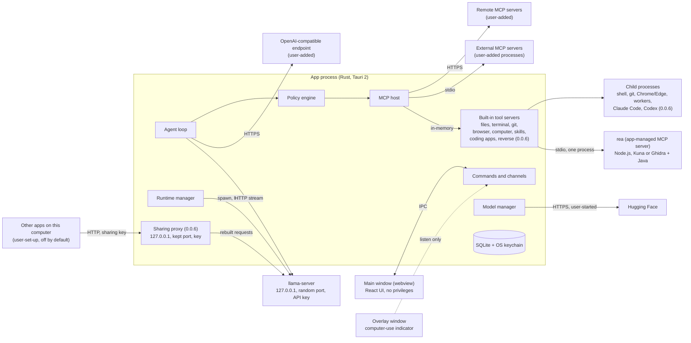
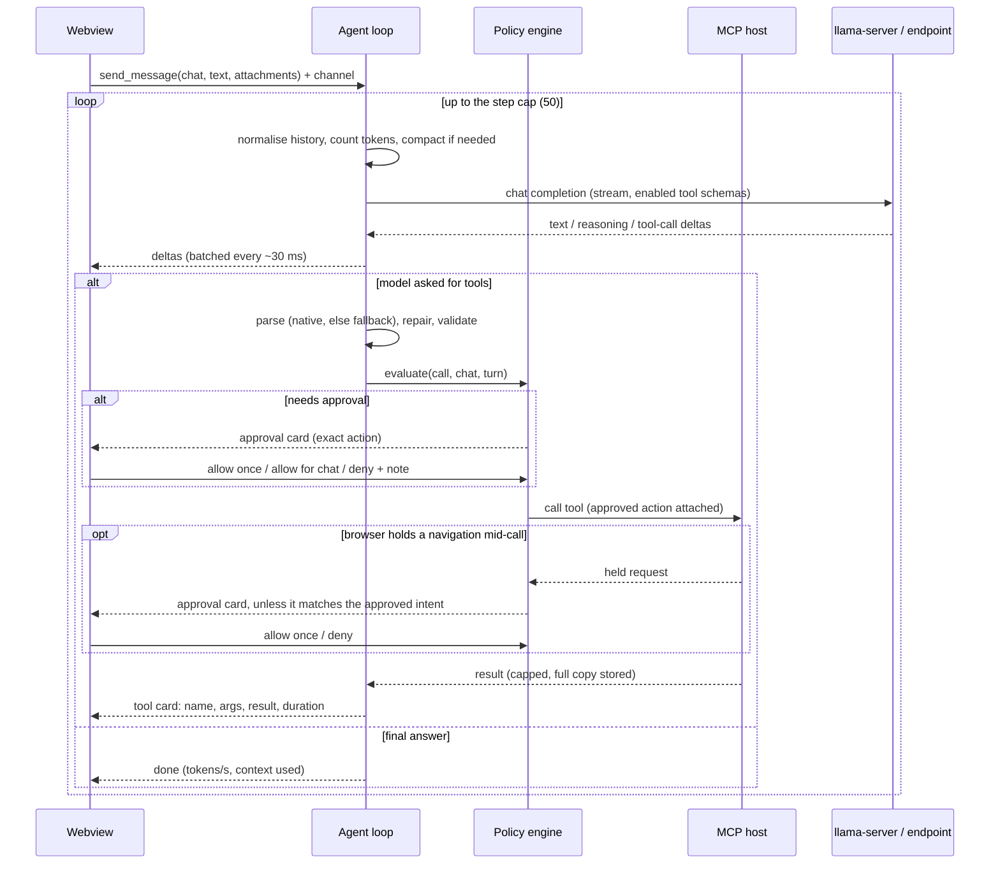

# Architecture

Status: **approved** (owner, 2026-11-10), with D1, D2 and D4 changed from the drafted defaults as recorded below.
Sources last checked: 2026-11-10. The evidence is in [`docs/research/`](docs/research/README.md); the spec this answers is [`docs/SPEC.md`](docs/SPEC.md).

The app is a local-first desktop app that gives locally run AI models chat, tools, skills and MCP. It ships as a Windows 10/11 x64 NSIS installer and one universal macOS .dmg (Apple silicon and Intel, macOS 13.3 or later).

**How to read this.** Section 1 is for the owner: the decisions to make and the limits to know. Section 19 says what the owner must supply and when. Everything between is the design the builder works from.

**0.0.6.** This version adds: load settings per model with Automatic context, reload and the busy question (7.6); summaries of long chats that hold up when the context shrinks (8.4); other apps using the loaded model through a sharing proxy (7.8); handing a task to Claude Code or Codex (9.3, 13.3); model comparison and the catalog's comparison facts (11); the folder chip (14); every installed model in the chat's model list (11); reverse engineering with rea (9.3, 13.3, 13.4); Fine control, the before-load picture and live usage (7.7, 11). Where a 0.0.6 decision is cited as "0.0.6 D*n*", it is a decision of [`docs/dev/0.0.6/spec.md`](docs/dev/0.0.6/spec.md), not a row of the tables in section 1.

1. [Decisions and limits](#1-decisions-and-limits)
2. [What the research changed](#2-what-the-research-changed)
3. [System overview](#3-system-overview)
4. [Process model](#4-process-model)
5. [Components](#5-components)
6. [Data flow](#6-data-flow)
7. [Inference runtime](#7-inference-runtime)
8. [Agent loop](#8-agent-loop)
9. [MCP host and built-in tools](#9-mcp-host-and-built-in-tools)
10. [Skills](#10-skills)
11. [Model manager and first run](#11-model-manager-and-first-run)
12. [Storage](#12-storage)
13. [Security model](#13-security-model)
14. [Frontend](#14-frontend)
15. [Errors](#15-errors)
16. [Packaging, CI and release](#16-packaging-ci-and-release)
17. [Testing](#17-testing)
18. [Dependencies](#18-dependencies)
19. [Milestones and what I need from you](#19-milestones-and-what-i-need-from-you)
20. [Risks](#20-risks)

---

## 1. Decisions and limits

Your answers are recorded as: a small Windows installer with Vulkan + CPU, with ROCm and CUDA as downloads (this replaced the earlier answer of bundling all four); "Allow for this chat" is scoped to tool + scope; MIT license; the Mac has 16 GB.

The column "Decided" is what was approved. Where it departs from your spec or from an earlier answer, the row says so.

### 1.1 Installer and GPU backends

| # | Decision | Decided | Alternative considered, and why it mattered |
|---|---|---|---|
| D1 | What the Windows installer contains | **Vulkan + CPU only**, about 50 MB to download. ROCm and CUDA are one-click downloads in Settings, pinned by SHA-256 and verified before use. | All four backends in the installer (1.0–1.2 GB download, 1.9 GB installed, close to the installer format's size limit, and re-downloaded on every update). The backend code is the same either way. |
| D2 | Ship ROCm in v1? | **Yes, as a download in Settings.** It is the `lemonade-sdk/llamacpp-rocm` build for RX 9000-series cards, pinned by SHA-256. | In the installer, or not in v1. What it is: a nightly build on a pre-release ROCm, from a project that gives no support commitment. llama.cpp's own Windows ROCm build no longer includes the ROCm runtime and does not work on a clean PC, so this is the only self-contained option. It is a second llama.cpp from a different commit, about 0.7 GB to download and 1.0 GB installed. It has an open bug on your card (prompt reading fell from about 1,100 to 400–480 tokens/s in recent builds). AMD supports ROCm on Windows 11 25H2 only. |
| D3 | Which backend "Auto" picks | **Vulkan on every GPU**, CPU if Vulkan fails. CUDA and ROCm are manual choices in Settings. | CUDA first on NVIDIA. I chose Vulkan because it is the one GPU path you can test, and your spec names it as the default. The evidence on your card is thin and points both ways; see below. The M1 checklist measures both backends on your RX 9070 XT, and the Auto order is confirmed or flipped from that. |
| D4 | Which CUDA build to offer | **A download**, not bundled: the CUDA 13 build that ships with the pinned llama.cpp (13.4), fetched by the user's machine directly from llama.cpp's own GitHub release. It needs an RTX 20 / GTX 16-series or newer card and driver 580 or newer; older NVIDIA cards use Vulkan. The download dialog shows NVIDIA's license before it starts. | Bundling it would have made you a redistributor of NVIDIA's runtime files. CUDA 12.4 covers older cards and is 0.5 GB larger. Neither of us can test CUDA. |

**Backends in numbers**

| Backend | Download | Installed | Serves | Who can test it |
|---|---|---|---|---|
| Vulkan + CPU | 0.04 GB | 0.1 GB | Every GPU, and machines with none | You |
| CUDA 13 | 0.57 GB | 0.7 GB | NVIDIA RTX 20 / GTX 16 and newer, by manual choice | Nobody on this project |
| ROCm | 0.69 GB | 1.0 GB | AMD RX 9000 on Windows 11 25H2, by manual choice | You |

Only the first row is in the installer. The others are downloaded on request into the app's local data folder (section 7.1). Downloaded backends are unsigned third-party binaries; on a PC with Smart App Control on, Windows may block them.

**D3 evidence, for your card**

| Source | Generating | Reading prompts |
|---|---|---|
| llama.cpp issue, Windows 11, 8B model | Vulkan 104, ROCm 91 tokens/s | Vulkan 2,866, ROCm 4,199 tokens/s |
| Community report, March 2026, Windows 10, older build, one current model family | Vulkan 18 vs ROCm 71 (4B); 33 vs 49 (9B). Unresolved | not given |

Agent work is prompt-heavy, so prompt reading matters as much as generation. The second report is about the model family the catalog would recommend first for your machines.

### 1.2 Safety

| # | Decision | Decided | Alternative considered, and why it mattered |
|---|---|---|---|
| D5 | What a terminal grant covers | **The exact command**: the same arguments in the same folder repeat without a prompt. A small built-in list of read-only programs (`ls`, `cat`, `git status` and the like, with paths held to approved folders) can be granted per program. | "The same program in the same folder, any arguments", which is how I described this option when you picked it. **I am tightening it.** Under the looser rule, one grant for `curl` or `git` covers `curl -T <your ssh key> https://...` and `git -c alias.p=push p`. |
| D6 | What a grant covers for an external MCP tool | The tool plus its exact arguments. A per-tool switch, set by you in the server's tool list, allows any arguments for a chat. | Whole tool, any arguments. The app cannot interpret a third-party tool's arguments, so a whole-tool grant on a fetch, SQL or shell tool is a grant for anything. |
| D7 | What a computer-use grant covers | Pointer and keyboard grants are bound to **the application in front when you approve**; input to any other application asks again. Terminals, system settings, password managers and this app can never be covered. | Allow once only (every click asks), or chat-wide. **This cannot fully meet your spec.** The app cannot tell a harmless click from a destructive one, so inside a granted application the model can delete, submit and send without a further prompt. Keyboard access to an application equals everything that application can do. |
| D8 | Browser actions that submit by script | Asks: real form submissions, any button click or Enter after the agent has typed on the page, and any button whose label is a consequential verb (send, post, pay, buy, delete, confirm). Background requests are not held. | Strict mode: also hold every background non-GET request per site. More prompts, and some pages time out waiting. **"Form submissions always need approval" cannot be guaranteed** on sites that send data from script; the default narrows the gap and section 9.3 lists what is left. |
| D9 | Outbound actions after the model has read untrusted content | Once a turn has taken in content from the web, an external MCP server or a file you did not attach, grants stop covering outbound actions for the rest of that turn: browser navigation and typing, external MCP calls, and git clone / pull / push ask, and the card says why. | Off. Without it, a web page or a README can tell the model to read a file under one grant and send it out under another, with no card at all. |
| D10 | Tools a new chat starts with | **Files** (6 tools), plus the two skill tools when a skill is enabled, plus **Browser** (10 tools, about 1,400 tokens) when a browser is available and the model's context is at least 8,192 tokens (owner's change, 2026-11-11; until then Browser was one click). Git is one click in the chat's tool menu. Tools from a newly added MCP server start off in every chat. A chat's own saved choice of tools, and the user's last choice, are not changed by this. | Files, Git and Browser all on, which your spec implies. That is 23 tool descriptions, roughly 3,000 tokens, in every request. Small models get worse with many tools, and on an 8k context it leaves too little room to work. |
| D11 | Do skill reads need approval? | No. `load_skill` and `read_skill_file` run without a prompt, because you enabled the skill and they only read its folder. They appear as tool cards and in the audit log. | Prompt for them too. Your spec says every tool call shows the action before it runs. |
| D12 | How long "Allow for this chat" lasts | Until the app quits, or until you revoke it in the chat's permissions panel. Not saved to disk. | Saved with the chat, so a chat reopened next week acts without asking. |
| D13 | Where the Allow / Deny buttons live | **Inline in the chat**, as approval cards. | A separate small approval window and a separate settings window that never render model output. The chat window renders model output, and two layers stop that output from running as script. If both failed, a script in that window could press Allow. The alternative holds even then, at the cost of a floating panel. Section 13.5. |
| D14 | Default stop hotkey | `Ctrl+Alt+Backspace` on Windows, `Ctrl+Option+Delete` on macOS. Configurable. | It must not collide with an OS shortcut or with AltGr typing on international keyboards, which rules out `Ctrl+Alt+<letter>`. |

The scope of every grant, tool by tool, is the table in section 13.3. Please read that table as part of approving.

### 1.3 Scope and platform

| # | Decision | Decided | Why it mattered |
|---|---|---|---|
| D15 | Minimum macOS version | **13.3**, not 13.0 | llama.cpp's macOS builds target 13.3. |
| D16 | Sign-in (OAuth) for remote MCP servers | Not in v1. Remote servers work with a URL plus static headers kept in the keychain. A server that demands sign-in gets a clear message. | Many hosted MCP servers use OAuth. The SDK supports it, so it can be added; it is extra scope. |
| D17 | Bundle identifier | `io.github.sugarhappy8.harnessui` | It names the data folder and keychain entries and should not change after the first release. It is separate from the display name. |

### 1.4 Limits to know before approving

- **Nothing in this document has been run.** No llama.cpp binary, no Tauri build, no Windows or macOS code. The runtime behaviour in sections 4 and 7 comes from reading source and documentation. It is first exercised by a probe build you run on both machines at the start of M1.
- **"No telemetry" has one exception outside the app's control.** On Windows the UI runs in Microsoft's WebView2 runtime. The app switches off its crash-dump upload, but WebView2 collects what Microsoft calls required diagnostic data regardless, and updates itself. Section 13.6.
- **Computer use will be slow and inaccurate on your hardware.** Only 7–9B vision models fit. Their published scores are roughly 50–65% on single clicks and 27–42% on whole tasks, before the accuracy lost to compression. M7 is accepted on mechanics (capture, coordinate mapping, the click lands where the model pointed, the indicator, Stop), not on task success.
- **The terminal classifier is a guard, not a sandbox.** A script the model wrote a minute ago can do anything once you allow it to run. Section 13.3.
- **An approved terminal command or an added MCP server runs as you.** It can read and change anything you can, including this app's own database. The guarantees in section 13 hold against the model's built-in tools, not against a process you allowed to run.
- **A coding benchmark runs code the model wrote, as you (0.0.4).** It is not sandboxed: that code could read or change files outside its folder or go online. Run benchmarks only with a model you trust. Section 13.14.
- **On the 16 GB Mac, expect an 8B-class model at about 16k context.** That is an estimate from the fit formula, measured at M2.
- **Allow all and the rule for terminal commands that start a coding assistant read text; they are not sandboxes (0.0.6).** A command line that starts Claude Code, Codex or a similar program asks, but a renamed copy, a link to one, a name built from pieces, `make claude` or `ssh host claude` is not seen. Section 13.3 lists what stays unseen.
- **A task handed to Claude Code or Codex goes online with your account (0.0.6).** It asks every time in Ask first and Allow all, and runs without a card in Full access. What the app reads for it is sent to that app's company, and it uses your plan or credit. Codex's sandbox on Windows has not been tried. Section 9.3.
- **rea and its decompilers run as you (0.0.6).** The app decides which rea tools the model can call and which files they may name; it cannot limit what rea, Kuna, Ghidra or Java do once they run. A decompiler reads a hostile file in full, and a crafted file could take one over with your rights and network access. Section 9.3.
- **Sharing the model with other apps has one gap the app cannot close (0.0.6).** While harnessUI is closed or sharing is off, another program on this computer could listen on the sharing port and receive what an app set up for it sends, including the key. The setup cards say so. Section 7.8.
- **Ghidra on Windows waits for one checksum (0.0.6).** Until the checksum GitHub publishes for the Ghidra download has been compared with the app's own and recorded in `reverse.lock.json`, a release build shows Ghidra as "Not available in this version of harnessUI.", so Windows has no decompiler. A CI step reads that checksum; the lead then records it. <!-- TODO(lead): confirm after WP9e -->

---

## 2. What the research changed

Each subsystem was researched against primary sources and then re-checked by a second, independent pass, because several of these projects changed a great deal in 2026. What shaped the design:

- **llama.cpp** now has stable version tags. This design pins **v0.9.0** (build `b12110`). Its defaults changed: port 9931, `--jinja` on, context and GPU layers auto-fitted, four slots, an 8 GB prompt cache. The app overrides all of them explicitly.
- **llama-server is no longer one file.** On Windows it is a small launcher plus about 20 DLLs; on macOS, a launcher plus 10 libraries.
- **A backend that fails to load does not crash.** The server silently runs on CPU. The app always names the device it expects, which turns that into a detectable error.
- **llama-server reports capabilities itself.** `/props` says whether the loaded chat template supports tool calls and whether vision is available.
- **llama-server constrains tool-call arguments to the tool's schema.** Malformed arguments are rare locally. The other side of that: one schema it cannot convert fails the whole request, and output it cannot parse comes back as an error, not as text.
- **The Rust MCP SDK is at 3.9** and implements a new protocol revision (2026-07-28) that drops the old handshake. Almost every API name from earlier versions has changed.
- **Tauri is at 2.12.** Its bundler signs sidecars but not files under Resources on macOS, which decides how llama.cpp is packaged there.
- **Hugging Face** returns a SHA-256 for every file, and downloads redirect to a CDN with a one-hour signed URL, so resume must re-resolve the URL each time.

---

## 3. System overview



Three rules hold everywhere:

1. **The webview has no privileges.** It cannot spawn processes, read files or open sockets. It renders state and sends user intent to Rust.
2. **Every tool call passes through one policy engine in Rust**, whether the tool is built in or comes from a server the user added.
3. **The model can only produce text and tool-call requests.** No tool can change approvals, enabled tools, approved folders or settings.

---

## 4. Process model

| Process | Count | Started by | Talks to the app over | Ends when |
|---|---|---|---|---|
| App (Rust + Tauri) | 1 (single-instance lock) | User | n/a | User quits |
| Main window webview | 1 | App | Tauri IPC | App quits |
| Overlay webview | 0–1 | App, while computer use is active | Events (listen only) | Computer use ends |
| `llama-server` | 0–1 | Runtime manager | HTTP on 127.0.0.1 | Model switch, quit, or crash (then restarted) |
| Built-in tool servers | One per tool group (files, terminal, git, browser, computer, skills and the rest of 9.3; since 0.0.6 also `coding_apps` and `reverse`), inside the app process | MCP host | In-memory MCP transport | App quits |
| External MCP server (stdio) | One process tree per enabled server | MCP host | stdin/stdout | Server disabled, app quits |
| Tool children | Per call | Built-in servers | Pipes, or CDP for the browser | Call ends, Stop, or timeout |
| Workers | Short-lived | App | Pipes | Job done, Stop, or timeout |
| Probes (`--list-devices`) | Short-lived | Runtime / model manager | stdout | Exit or 15 s timeout |
| `llama-fit-params` (0.0.6) | 0–1, app-wide | The model's settings panel while Fine control is open (`offload_measure`) | stdout, one JSON record | Exit, a newer request, cancel, or 30 s (`FIT_PARAMS_TIMEOUT`) |
| Sharing proxy (0.0.6) | 0–1 task inside the app process | The user's switch in Settings → Other apps | HTTP on `127.0.0.1:<kept port>` (it listens; section 7.8) | Sharing off, app quits |
| Claude Code or Codex (0.0.6) | 0–1 per call of `ask_claude_code` / `ask_codex` | The `coding_apps` built-in server, after approval | Task on stdin, JSON lines on stdout | Answer, Stop, or 30 minutes (`MAX_RUN`) |
| rea (0.0.6): the pack's `node` running `rea.mjs mcp` | 0–1 for the whole app | The `reverse` built-in server, on the first rea call | stdin/stdout (MCP), stderr to `mcp-reverse.log` | 15 minutes without a call, a decompiler change, update or removal in Settings, a Stop (started again on next use), app quits |
| Kuna, or Ghidra with Java (0.0.6) | 0–n | rea | rea's own channels | With rea (see the known limit in 9.3) |
| `xcode-select --install` (0.0.6, macOS) | Short-lived | Settings → Reverse engineering, **Install** | none | Hands over to Apple's installer and exits |

**Workers** are the app's own binary started with a hidden flag. They do the jobs that cannot be contained or stopped inside the app's process: parsing PDFs (a crafted file can hang a parser or overflow its stack) and libgit2 network operations (a stalled transfer has no cancel). Since 0.0.6 a third worker, the picture worker (`--internal-picture-worker`), turns a WebP picture into JPEG or PNG under a 1 GiB memory cap and a 60 s time limit (8.6).

The 0.0.6 rows all start through the one spawn helper below (`scripts/check-spawn.sh`, which since 0.0.6 also refuses low-level process creation and run-time library loading, `CreateProcess`, `posix_spawn`, `fork(`, `dlopen`, `LoadLibrary` and the like, outside `crates/runtime/src/spawn*`). Every llama.cpp program the app starts gets `GGML_NO_BACKTRACE=1`, so a crash never starts a debugger that would attach to a server holding chat text and its key.

### 4.1 No orphans

Every child is started through one helper in the `runtime` crate, built on the `process-wrap` crate. That is what the MCP SDK itself accepts for spawning servers, so llama-server, tool commands, workers and MCP servers share one spawn path. Nothing else in the codebase may spawn a process (a clippy rule enforces it).

- **Windows:** every child is started suspended inside its own Job Object with kill-on-close, and the app holds the only handle. If the app exits for any reason, including a crash or Task Manager, Windows closes the handles and kills every process in every job. Children are started with no console window. The app never puts itself in a job, so the updater's installer survives the app exiting. Tauri's own shell plugin does not set kill-on-close, which is one reason the app doesn't use it.
- **macOS:** every child is the leader of its own process group, and Stop or quit signals the whole group. macOS has no kernel feature that kills children when the parent dies, so two more layers cover a crash of the app:
  1. At launch the app starts one small **reaper**: its own binary with a hidden flag, in its own session, connected by a pipe. The app registers the process group of every child it starts. When the pipe closes or the app's PID disappears, the reaper kills every registered group.
  2. `llama-server` runs in its managed mode, in which it exits by itself when its stdin closes. This takes effect only once the model has finished loading.
- **Both:** on startup the app reads a file of child PIDs from the previous run and kills any still alive that match by executable path and start time.

The reaper is a design I have not been able to run. It is built first in M1 and tested against force-quit and crash before anything else depends on it.

### 4.2 Stop

One cancellation token is created per agent turn. Child tokens go to the inference stream and to every running tool call. The Stop button, the Stop button on the computer-use overlay and the global hotkey all cancel the root token.

| Target | What Stop does | Budget |
|---|---|---|
| Inference | Drops the HTTP stream; llama-server stops generating when the client disconnects | < 100 ms |
| Terminal, system git, workers | Kills the call's process tree outright, with no graceful wait | < 200 ms |
| In-process tools (file search, local libgit2 work) | Check the token between files and between steps | < 200 ms |
| Browser | Cancels pending CDP calls, fails any held request, sends `Page.stopLoading` | < 300 ms |
| Computer use | Releases every key and mouse button the app has pressed, then hides the overlay | < 100 ms |
| External MCP tool, stdio | Sends the cancel notification and stops waiting. The server's process tree is killed 500 ms later and restarted on next use, because a cancelled call returns nothing and the app cannot tell whether the server stopped | < 1 s |
| External MCP tool, remote | Sends the cancel and closes the request. The app cannot stop work on another machine | n/a |
| rea call (0.0.6) | The turn stops waiting after 250 ms. The call goes on in its own task: rea gets the cancel notification and 5 s, then its input is closed and it gets 3 s, then its process tree is killed (on Linux also the process groups its children lead). rea 6.9.0 never answers a cancelled call, so a Stop restarts rea on the next call | 250 ms for the turn; up to about 9 s until rea is free |
| `ask_claude_code`, `ask_codex` (0.0.6) | Ends the program's process group (Unix) or job (Windows). Processes it started in a new session can outlive it | not measured |
| Pending approval card | Resolved as cancelled | immediate |

**The hotkey** is registered from Rust, so it works when the window is not focused. A user-chosen combination is test-registered before it is saved. If the hotkey cannot be registered (another program holds it), the app shows a persistent warning with a link to change it, and computer use will not start until a stop hotkey is registered.

**So that injected input cannot block the hotkey:** every key and modifier is pressed and released inside one tool call, and any hold or drag is capped at 2 seconds. An OS hotkey fires only on an exact modifier match, so a modifier held by the model would otherwise swallow the user's stop chord.

A test asserts the whole sequence finishes inside 1 second with a stuck command, a hung page, a held key, an MCP server that ignores cancel and a stalled clone.

---

## 5. Components

The Rust side is a Cargo workspace. Everything with logic worth testing lives in crates that do not depend on Tauri, so they compile and test quickly on any OS.

| Crate | Responsibility | Depends on |
|---|---|---|
| `policy` | Path sandbox, risk classification, grant matching, destructive-command detection. Pure logic, no I/O beyond path resolution. | none of the others |
| `store` | SQLite schema and migrations, audit log, keychain access | none |
| `runtime` | Spawn helper and process trees; reaper; llama.cpp backends: detect, probe, launch, health, restart | none |
| `models` | GGUF header reader, hardware detection, fit check, Hugging Face client, download manager, curated catalog | `store`, `runtime` |
| `mcp-host` | Connections to MCP servers (in-memory, stdio, Streamable HTTP), tool registry, config import | `store`, `runtime` |
| `tools` | The six built-in MCP servers, and the describers that need I/O (file diff, element lookup) and return the action that `policy` evaluates; since 0.0.4 also the shared error and shortening helpers (`errors.rs`, `shorten.rs`) and the definition finder and index for mentions (`symbols/`) | `policy`, `runtime`, `store` |
| `agent` | Providers (local and OpenAI-compatible), agent loop, tool-call parsing and repair, context management | `policy`, `mcp-host`, `store` |
| `reverse` (0.0.6) | Reverse engineering with rea: the pinned packs (`reverse.lock.json`), their verified download and unpacking, rea's environment and its one process, the allow-list of 37 rea tools, their describer and folder walk, the chat's open file and result ids, and the cleaning of rea's output (9.3) | `policy`, `runtime`, `mcp-host`, `models` |
| `usage` (0.0.6) | This computer's live graphics-card and processor usage, read on request only (7.7). Starts no process, loads no library, opens no port | none |
| `src-tauri` (the app) | Tauri setup, windows, capabilities, commands, global hotkey, updater, overlay, worker and reaper entry points; since 0.0.6 also the load-settings resolver (`load_settings.rs`), the sharing proxy (`share/`), the coding apps (`outside_agent.rs`), the before-load picture (`offload.rs`), the usage reader thread (`usage_cmd.rs`), the comparison facts (`hub/compare.rs`), the chat's model list (`model_options.rs`) and the reverse-engineering commands (`reverse_cmd.rs`, `reverse_drop.rs`) | all of the above |

Also new in 0.0.6 inside existing crates: `runtime` runs `llama-fit-params` (`llama/fit_params.rs`) and reads the ready line's memory report; `models` reads the GGUF tensor table and works out where a model's layers go (`layers.rs`, `placement.rs`); `mcp-host` has `ManagedServer`, an MCP client for a server the app itself owns (rea), built from its stdio code; `policy` has the scopes `CodingApp`, `FileAnalysis` and `FileAnalysisSession` and the coding-assistant rule of the terminal classifier (`command/coding_apps.rs`).

The frontend (`src/`) is React 19 + TypeScript + Vite + Tailwind 4 with Radix UI primitives (section 14).

**App name.** The one constant is `productName` in `src-tauri/tauri.conf.json`. The Rust side reads it from Tauri's config at run time; the frontend imports it from the same file at build time. Window title, About box, User-Agent, MCP client name and prompts all derive from it. Crate and package names are neutral (`app`, `agent`, ...), so a rename touches one line.

**Repository layout**

```
src/                      React frontend
src-tauri/                Tauri app crate
  capabilities/           main.json, overlay.json
  resources/llama/        fetched at build time, not committed
  tauri.conf.json         base config (holds productName)
  tauri.windows.conf.json / tauri.macos.conf.json
crates/                   policy, store, runtime, models, mcp-host, tools, agent, (0.0.6) reverse, usage
catalog/models.json       curated model recommendations
llama.lock.json           pinned llama.cpp builds with URLs, sizes, SHA-256
reverse.lock.json         (0.0.6) pinned rea, Node.js, Kuna, Ghidra and Java downloads
scripts/                  fetch-llama, third-party notices, (0.0.6) pin_reverse.py
docs/                     SPEC.md, research/, guides
.github/workflows/        ci.yml, release.yml, (0.0.6) reverse.yml
```

---

## 6. Data flow

### 6.1 One agent turn



Messages, tool calls and audit rows are written to SQLite as they happen, so a crash loses at most the tokens in flight.

### 6.2 Model download

Search → repo detail (file sizes and SHA-256) → fit check → download each file to `<name>.part` with HTTP Range → hash the finished file → compare with the published SHA-256 → atomic rename → read the GGUF header → register in the database. A split model, or a model with a vision projector, is one download group with one progress bar.

Since 0.0.6 the registration also saves, in the model's `gguf_summary` JSON, the catalog id (for a catalog download) and what the Hugging Face uploader listed when the download started, so a comparison works offline later (11). When `download-progress` reports a group done, the chat's model list reads its entries again, so the new model is in "On this computer" at once (11).

### 6.3 First run

Detect hardware (RAM, GPUs, probe backends) → pick the best catalog entry the fit check rates green → show one card with a Download button → download → load → open a new chat. That is two clicks, Get started and Download, and the download is the only wait. The same screen offers "Use a model I already have" (file picker) and "Connect Ollama / LM Studio".

---

## 7. Inference runtime

### 7.1 Pinning and layout

`llama.lock.json` pins llama.cpp **v0.9.0 (`b12110`)** and lists every archive with URL, size and SHA-256. `scripts/fetch-llama` downloads, verifies and unpacks them before `tauri build`, locally and in CI. Nothing follows "latest": upstream publishes several builds a day and renames assets when toolkits change.

A **runtime directory** contains a complete `llama-server` and its libraries. A **backend** is a manifest entry that names a runtime directory and the device prefix to ask it for. The runtime manager only ever sees those two things, whether the directory came from the installer or from a later download.

| Platform | Backend | Source | Runtime directory |
|---|---|---|---|
| Windows | `cpu` | `llama-b12110-bin-win-cpu-x64.zip` | `resources/llama/main/` |
| Windows | `vulkan` (default) | the Vulkan DLL from `llama-b12110-bin-win-vulkan-x64.zip` | `resources/llama/main/` |
| Windows | `cuda` (download) | `llama-b12110-bin-win-cuda-13.4-x64.zip` plus NVIDIA's runtime DLLs from `cudart-llama-bin-win-cuda-13.4-x64.zip`, unpacked together | `<local data>/backends/cuda-b12110/` |
| Windows | `rocm` (download) | `lemonade-sdk/llamacpp-rocm` gfx120X zip | `<local data>/backends/rocm-<build>/` |
| macOS | `metal`, `cpu` | built in CI from the pinned tag for Apple silicon and for Intel, statically linked, joined into universal binaries | Tauri `externalBin` |

- **One build per directory.** Every upstream Windows zip is the CPU build plus one backend DLL, and llama.cpp loads whichever backend DLLs sit beside it. CPU and Vulkan therefore share `main/`, and the app picks between them with `--device`. The CUDA download is a complete runtime directory of its own (the upstream CUDA zip already contains the CPU build), so nothing is ever mixed into the installed folder. The ROCm build is linked differently and from a different commit; the lock file records which llama.cpp commit it was built from.
- **Downloaded backends.** `llama.lock.json` is compiled into the app, so the app knows each pack's URLs, sizes and SHA-256 without asking the network. A pack is downloaded on a click in Settings, resumable, verified file by file against the lock, unpacked into a temporary folder and renamed into `<local data>/backends/` only when complete. Its directory name carries the build, so a llama.cpp bump in an app update downloads the matching pack again. Removing a pack is a button next to it. Downloads come from `github.com` release assets only.
- **Windows** runtime directories go through Tauri's `bundle.resources`, because `externalBin` copies a single file. Tools the app doesn't use are removed, including the upstream tunnel helper and RPC server.
- **VC++ runtime.** The three Microsoft runtime DLLs are placed in each runtime directory. Every llama.cpp binary needs them, they are not in the upstream zips, and without them the server exits before printing anything.
- **macOS.** The upstream download is 11 separate binaries that must each be signed, and Tauri does not sign anything under `Resources`. The app builds two static binaries from the pinned tag, `llama-server` and `llama-fit-params`, as two `externalBin` entries that Tauri signs and notarizes with the app. Build flags: `-DBUILD_SHARED_LIBS=OFF -DGGML_METAL_EMBED_LIBRARY=ON -DCMAKE_OSX_DEPLOYMENT_TARGET=13.3 -DGGML_NATIVE=OFF -DLLAMA_BUILD_IS_DEV=OFF`. CI checks that each binary's minimum OS is 13.3, that it links only system libraries, and that it runs. Both are built twice, for Apple silicon and for Intel (`-DCMAKE_OSX_ARCHITECTURES`), and joined with `lipo` into universal files, so one .dmg serves every Mac; the two flag sets are the `macos-aarch64` and `macos-x86_64` entries of `llama.lock.json`. The Intel build has processor detection off and AVX, AVX2, FMA, F16C and BMI2 on, which every Intel Mac that runs macOS 13 has. Metal is compiled into both. The app itself is built with `tauri build --target universal-apple-darwin`; the reaper and the PDF and git workers are the app's own binary, so they are universal too. Fallback if the build is a problem: the upstream tarball, with a script that signs each file before `tauri build`.
- **Attestation.** Upstream release assets carry build attestations. CI verifies them as well as the SHA-256.
- **Path length.** The ROCm folder must sit at a path of at most about 118 characters or its kernel files exceed Windows' path limit. The default local data path is well inside that; the app checks it before downloading and explains it.
- **No interface guarantee.** llama.cpp's version number covers only its C API. Flags, defaults, log lines and HTTP fields can change in any release, so every bump of either pin must pass the contract tests in section 17 before it merges.
- **Reverse-engineering packs (0.0.6), beside the GPU packs.** `reverse.lock.json` (schema 2), written by `scripts/pin_reverse.py` and compiled into the app like `llama.lock.json`, pins rea 6.9.0 (its npm tarball, unpacked, never installed with npm), Node.js 24.22.3 (only `node` and its `LICENSE` kept), Kuna 1.990 (macOS and Linux), Ghidra 12.1.4 (the official zip, unchanged) and Eclipse Temurin JDK 21.0.13+9 (Windows and Linux; no Ghidra or Java on a Mac in 0.0.6). Per part it records URL, size and SHA-256; its hosts, which must be one of three compiled-in sets (`registry.npmjs.org`; `nodejs.org`; GitHub's release hosts); what to keep, the entry count, unpacked size and longest path; a `minimum_version` below which the part never runs; the publisher checks that passed at pin time (`verified_by`); and for rea the versions that have a reviewed allow-list fixture. A part is downloaded only on a click in Settings → Reverse engineering, after its licences are shown, resumably into `<local data>/reverse/.downloads/`, checked for size and SHA-256 before anything is unpacked, unpacked into `.tmp-<dir>` with no group or other write bits, marked `.complete` last and renamed into place. What is installed is read from disk only; a broken part, or one below its minimum, is never started. A release build offers a part only with its publisher's check: npm integrity, provenance and signatures for rea, GPG for Node.js and Temurin, GitHub's digest for Ghidra; Kuna publishes no check and is trusted on first download. `pin_reverse.py --check --release` fails on a lock that lacks one. Ghidra is still pinned `first-download-only` (1.4). The whole folder lies inside the app's local data folder, which the path sandbox forbids in every mode (13.4).

### 7.2 Choosing a backend

1. List display adapters (vendor, name, dedicated VRAM) through DXGI on Windows. This only decides which backends are worth probing.
2. Probe each candidate by running its `llama-server --list-devices` with a 15 s timeout and parsing lines of the form `Vulkan0: <name> (<total> MiB, <free> MiB free)`. Rows are matched by name prefix (`Vulkan`, `CUDA`, `ROCm`, `MTL`), because the list also contains integrated GPUs and, on macOS, a CPU math-library row. A start failure, non-zero exit, timeout or no matching row marks the backend unusable, with the reason kept for the UI. A backend whose driver library is missing produces no log line at all, so the app also checks for the Vulkan loader itself, in order to say "no Vulkan driver found" instead of "no GPU". Free memory comes from this probe; the OS adapter list reports only this process's usage.
3. **Auto** picks Vulkan, then CPU (D3). CUDA and ROCm are offered when their probe passes and chosen by the user. macOS uses Metal on Apple silicon. On a Mac with an Intel processor Auto uses the CPU, because llama.cpp's Metal backend is unreliable on Intel integrated graphics; Metal stays a manual choice there (it can help with a Radeon GPU), and the first-run suggestion is sized for system memory.
4. Cache the result per backend version and GPU driver version. Re-probe when either changes or when the user asks.

Settings has **Backend: Auto / Vulkan / CUDA / ROCm / CPU** and a device picker. Your Ryzen 7900X has an integrated GPU next to the RX 9070 XT, so the app always passes the discrete card explicitly (`--device Vulkan0`, or `HIP_VISIBLE_DEVICES` for ROCm, which is known to crash if it picks the integrated GPU). The ROCm option is shown only on Windows 11 25H2 with an RX 9000-series card; elsewhere it is greyed out with the reason.

### 7.3 Launch

The app chooses a free port, generates a random API key for this launch and starts:

```
llama-server --host 127.0.0.1 --port <port> --no-webui --no-slots --offline --jinja
             --cors-origins none --no-context-shift --video-ffmpeg-dir no-ffmpeg
             -a harnessui-local -m <model.gguf> [--mmproj <mmproj.gguf>]
             -c <context> -np 1 --device <device|none> <placement>
             [--cpu-moe | --n-cpu-moe <K>] [-nkvo] [-t <threads>]
             [-fa on | -fa off | -fa on -ctk q8_0 -ctv q8_0] [-lm mmap+mlock]
             --cache-ram <MiB> [--reasoning-budget <tokens>]
```

The exact flag spellings are checked by the contract tests, not assumed. Since 0.0.6 the line is built by `launch::build_args` from typed fields (`LaunchConfig`), each a fixed word or a number from a typed choice; nothing a user or a model types reaches it:

| Setting (7.6, 7.7) | Arguments |
|---|---|
| Use the graphics card: All of it | `-ngl all --fit off` |
| As much as fits | `--fit on` and no `-ngl`; with Leave free set, also `-fitt <MiB>` |
| Don't use it | `--device none -ngl 0 --fit off` |
| Layers or expert parts chosen in Fine control (a custom placement) | `-ngl <N> --fit off` (`all` when only expert parts were chosen), then `--cpu-moe` or `--n-cpu-moe <K>` |
| Conversation memory kept in computer memory | `-nkvo` |
| Processor threads chosen | `-t <T>` |
| Fast attention On / Off | `-fa on` / `-fa off`, only with Save memory off |
| Save memory | `-fa on -ctk q8_0 -ctv q8_0`, whatever Fast attention says |
| Keep the model in memory | `-lm mmap+mlock` |

Without a device (the processor, Don't use it, or no probed device) only the plain choice's own words appear; the placement, the expert flags, `-nkvo` and `-fitt` have nothing to act on. Counts are limited where the arguments are built, for the server and for `llama-fit-params` alike: above 1,000 layers `-ngl all`, above 1,000 expert layers `--cpu-moe`, above 1,024 threads no `-t`. `-c` stays explicit in every case, so only where the weights go changes, never how much the model remembers.

- **Model name (0.0.6).** `-a harnessui-local` makes every API response name the model `harnessui-local`, never the file's path. The start-up check still compares `/props` `model_path` with the launched file. The sharing proxy (7.8) puts this name in every request it forwards.
- **No media helper (0.0.6).** `--video-ffmpeg-dir no-ffmpeg` names a folder that does not exist in the runtime folder, so llama-server never finds `ffprobe` or `ffmpeg` on `PATH` and never starts a program of its own. Checked against the pinned server with a real vision model: without it a WebP picture made the server run both from `PATH`; with it nothing ran and the request got a 400. So llama-server cannot read WebP, and the app turns WebP into JPEG or PNG before sending (8.6).

- **Key** in the `LLAMA_API_KEY` environment variable, so it never shows in the process list.
- **`--jinja`** is passed explicitly even though it is now the default. **`--offline`** stops llama-server from downloading anything. An explicit **`-c`** stops it from silently shrinking the context to fit.
- **`-np 1` and a small `--cache-ram`** replace defaults meant for multi-user servers (four slots, an 8 GB prompt cache), which would hurt on a 16 GB machine.
- **Exposure.** By default the server answers any web page's cross-origin requests and exposes a status endpoint. The key, `--cors-origins` and `--no-slots` close those.
- **Effective context.** After every start the app reads the context the server actually allocated from `/props` and budgets against that number.
- **Working directory** is always the runtime directory, never a user folder. llama.cpp loads backend DLLs from the current directory too, so starting it inside a cloned repository would let a file in that repository run as code.
- **Environment** is scrubbed for the server and both probes. llama-server reads a `LLAMA_ARG_*` variable for every flag, including ones that switch on its own built-in shell tool and a peer-to-peer tunnel, and `GGML_BACKEND_PATH` makes it load an arbitrary library. Hugging Face tokens are never passed. Since 0.0.6 the environment also carries `GGML_NO_BACKTRACE=1`: without it a crashing llama.cpp program on Linux starts `gdb` (then `lldb`) from `PATH`, which attaches to the server and prints its memory.
- **Windows error mode** is set so a missing DLL does not raise a system dialog, and the resulting exit code is mapped to a plain message.
- **Images** are always sent as inline data. The app never forwards an http(s) or `file:` image URL, because the server would fetch it itself even with `--offline`.
- **The app's HTTP client for llama-server** has proxies and redirects disabled. Otherwise a system proxy setting would route local chat, with its key, through the proxy.

### 7.4 Lifecycle

```
Stopped → Starting (progress) → Ready → Stopping → Stopped
              ↓ failure                ↓ crash
           Failed (reason)        Restarting (max 3 in 5 min) → Ready | Failed
```

- **Health:** poll `/health` until 200, with a watcher on process exit and a timeout that scales with model size. Then read `/props` with the API key. A wrong-key response means another process owns the port, and the app picks a new port.
- **Load progress:** standalone llama-server exposes no progress number. The app starts it in the managed mode that llama.cpp's own multi-model router uses, in which the server writes `loading` state lines with a 0–1 progress value to stdout. This is an internal llama.cpp protocol, so it sits behind an adapter with a contract test. If no progress lines arrive, the UI falls back to named stages ("Reading model", "Loading into GPU") with elapsed time.
- **Crash while Ready:** restart with the same arguments up to 3 times in 5 minutes. An in-flight turn ends with a clear message; nothing is retried silently.
- **Load failure:** the stderr tail is classified (out of memory, invalid device, missing runtime DLL, port in use) and mapped to a plain-language error (section 15).
- **Retries on the same backend (0.0.6),** before any step-down, each at most once per load, and never changing the saved settings (`server/supervisor.rs`):
  1. *Save memory off*, when it was on and the log shows the model refusing it (on any backend, the processor included), or a graphics card is in use and the failure is one Save memory can cause.
  2. *Fast attention off*, when it was chosen On in Fine control with Save memory off, a graphics card is in use and the failure is of the same kind.
  3. *As much as fits*, when a graphics card ran out of memory with All of it, or with layers or expert parts chosen in Fine control that put part of the model on the card. A placement of 0 layers steps down instead, since As much as fits would put more on the card than was chosen.

  A failure to allocate the weights skips the first two, which only change the conversation memory and the working space. "A graphics card in use" is what the command line does (`LaunchConfig::uses_device`), not the backend's label: Don't use it on Vulkan runs on the processor. Without a card in use, running out of memory does not step down.
- **Stepping down:** if a GPU backend fails to load or reaches the crash limit, and another backend passed its probe, the app retries once on the next one down (ROCm or CUDA → Vulkan → CPU) and tells the user which backend is now in use and why.
- **Events (0.0.6).** Each retry is a typed `LoadStage` (`retryingWithoutSaveMemory`, `retryingWithoutFastAttention`, `retryingWithLessGpu` with `custom` and `chosenLayers` after a Fine control placement), and `Failed` is reported once, when the supervisor gives up: a retry reads `Starting`, the stage, `Starting`, `Ready`; a step-down reads `Starting`, `SteppedDown`, `Starting`, `Ready`. The header indicator words every stage and its reason in `src/lib/words.ts`, for example "Save memory doesn't work with this graphics card, so it was turned off for this load."
- **Switching models:** stop the current server, start the new one, show progress. One local model at a time. Since 0.0.6 every change of what is loaded first asks when the model is busy (7.6).
- **After load:** if a GPU was expected, the app checks the "offloaded N/M layers" log line and warns if the model ended up on CPU. It also times a short generation. On NVIDIA the driver can spill into system memory when VRAM runs out and keep going many times slower instead of failing, so "loaded but slow" is reported as its own condition. Since 0.0.6 the server's ready line carries a memory report (`ServerEvent::Memory`), which becomes `RuntimeStatusDto.placement`: where the model went, per device, for what the running attempt actually launched with, retries included. It feeds "Where the model went" in the usage menu (7.7), the note that part of the model runs on the processor, and the memory a later load counts as freed.

### 7.5 Providers

The agent loop talks to a `Provider` trait with two implementations:

- **Local:** the managed llama-server. Adds exact token counts (section 8.4), capabilities from `/props`, and tokens/s from the `timings` object.
- **OpenAI-compatible:** base URL + optional API key (keychain). Works with Ollama, LM Studio, vLLM and remote servers. The app probes what it can: the model list from `/v1/models`, and context length and capabilities from each server's own endpoints where they exist (section 8.4).

**When a remote endpoint rejects a request that carries tools,** the app retries with built-in tools only. If that succeeds, the external tools are reported as the cause and tools stay on. Only if it fails again are tools switched off for that model, with the endpoint's error under Copy details.

Both use streaming chat completions with `stream_options.include_usage`, through a small hand-written stream reader (section 8.2).

### 7.6 Load settings, Automatic, reload and the busy question (0.0.6)

**Per model means per model file** (0.0.6 D1): file name and size, not the path and not the backend. One model's choices are stored under `modelLoad:` and the first 16 hex digits of SHA-256(`local\n<file name>\n<size>`) as `ModelLoadSettings`; every field is a typed choice whose `Default` means "Same as default (…)", that is, follow the **defaults for all models** (`localModel`, in Settings → Local models). Only `set_model_load_settings` writes the key, after checking each value against the fixed lists, the model's trained length and the probed devices; **Reset to defaults** (`reset_model_load_settings`) deletes it; the generic `set_setting` cannot write it. The panel "Settings for this model" opens from a gear on every local model in the chat's model list and on every Installed row, and offers **Load with these settings** for a model that is not loaded.

**What is shown, in plain words** (0.0.6 D4): **How much it can remember** (Automatic, or sizes up to the trained length, each with a fit mark); **Use the graphics card** (on a Mac **Use Apple graphics**): All of it (the default and the 0.0.4 behaviour), As much as fits, Don't use it; **Save memory** (the conversation memory at half size, off by default); **Keep the model in memory** (off by default); under More options **Which graphics card** (only with more than one, named from the device's own name and memory) and **How long it may think** (thinking models only: Default, Short, Medium, Long). The thinking limit is per request, not a launch flag: the agent loop sends min(1,024, 4,096 or 16,384 tokens, half the output limit), never below 128 (`load_settings::thinking_for`, `limit_thinking`). Fine control (7.7) is the only place for finer choices; batch sizes, slots, rope, tensor overrides, free text and paths are never shown.

**The resolver.** Every load (a load with no settings given, Reload, Apply and restart, the backend check, first run) goes through `load_settings::plan`, which builds a `ResolvedLoad` in this order: the model's own settings, the defaults for all models, the image projector, the trained-length cap, then Automatic. Stored sizes outside 512 to 1,048,576 tokens, and header trained lengths under 512, are not believed. Upgrade rule: a stored global context of exactly 8,192 tokens with no `contextAuto` key (the 0.0.4 default) reads as Automatic, and so does a fresh install; any other stored size stays the user's default, with a one-time note under Defaults for all models.

**Automatic** (0.0.6 D2b, `models::fit::auto_ctx`): the largest multiple of 1,024 tokens between 4,096 and 32,768 (each bounded by the trained length) that fits with 1 GB to spare, preferring the whole model on the main device and otherwise allowing part of it on the processor. The room is the backend probe's cached free graphics memory (the Metal working set on Apple silicon; system memory less 2 GB on the processor), with the model a load replaces counted as free. The conversation memory is counted for every attention layer at full length, 2 bytes a value, or 34 bytes per 32 values with Save memory; the working space is 256 MiB plus the output buffer. Measured against the pinned llama-server on the processor (`the_memory_estimate_matches_llama_server`); what a graphics card reserves is not measured. Automatic is resolved once per load: the "already loaded" check, joining a load in progress and "Settings changed. Restart the model to use them." compare the choices (`same_launch`), never the number Automatic produced. Only Reload and Apply and restart resolve it again. The ready line says what it chose ("Remembers about … words (Automatic)").

**The busy question** (0.0.6 D3). One counter (`BusyCounter`) counts everything that uses the model: chat turns, model checks (the backend check included), benchmarks and requests from other apps (7.8), each through a guard that lowers the count when dropped. Every change of what is loaded (Reload, Apply and restart, Unload, picking another local model, deleting the loaded model in Installed) goes through `src/store/modelChange.ts`, which reads `model_busy` and, when something uses the model, asks: "A reply is being written. Stop it and restart the model?" (or "Another app is using the model. …", "A model check is running. …") with **Cancel**, **Restart when it ends** and **Stop and restart**. Without a question it still sends `when_idle=true`; only Stop and restart sends `false`. So a user of the model that appears after the check, or a count that cannot be read, is waited for, never stopped unasked. The backend holds the one waiting change in `ChangeGate`; a newer change, `cancel_pending_reload` or removing the model ends it with `load_replaced`. Stop and restart stops chat turns and model checks and waits briefly for them to wind down, so a reply keeps what it wrote; other apps' requests end when the server stops. Settings never take effect by themselves: Apply and restart is offered only when the loaded copy would launch differently.

**Reload** (`reload_local_model(force, when_idle)`) restarts with the current resolved settings, on the backend they choose, so after a step-down it tries the chosen backend again. `model_load_info(path, overrides?)` gives the panel its facts and fit marks, also for unsaved choices, without saving anything.

### 7.7 Fine control, the before-load picture and live usage (0.0.6)

The owner chose: Fine control inside each model's settings, the picture always in those settings as an estimate, exact figures worked out while Fine control is open, and live usage always visible under the model name. None of this is a tool action: the commands are main-window only, `set_setting`'s allow-list is unchanged, the model is never told the figures, and it is the same in Ask first, Allow all and Full access.

**Fine control** is a closed section in "Settings for this model", for that model only (a `fine` object inside its `ModelLoadSettings`; the defaults for all models have none). Six controls, each Automatic by default: **Layers on the graphics card** (Mac: Layers on Apple graphics), **Expert parts on the processor** (mixture-of-experts models only), **Conversation memory on the graphics card**, **Processor threads**, **Fast attention**, **Leave free on the graphics card** (Mac: Memory to leave free; Automatic, 0.5, 2 or 4 GB, used only with As much as fits). Choosing layers or expert parts is a *custom placement*: it replaces All of it and As much as fits, the plain control reads "Custom", and any plain choice clears it. Don't use it always wins, also when it comes from the defaults. With Save memory on, Fast attention shows "On (Save memory needs it)". Splitting a model across several graphics cards is not offered. The arguments are in 7.3.

- *Stored values are read back checked* (`sane_fine`), field by field, because a program can write the settings row: layers above 1,000, threads 0 or above 1,024, expert layers 0 or above 1,000, and a Leave free that is not 512, 2,048 or 4,096 MiB become Automatic, as does a value this version cannot read, without touching the other choices. A draft from the webview that is out of range is refused, never repaired.
- *Clamped for this computer and this file:* layers at or above the model's own count launch as `-ngl all`; threads above this computer's become its count.
- *Only what reaches the command line goes into `ResolvedLoad.fine`,* so "Settings changed. Restart the model to use them." appears exactly for a change that launches different arguments.
- *Automatic* with a custom placement or with the conversation memory in computer memory uses `placement::auto_ctx_placed_in`; with As much as fits and Leave free set, `fit::auto_ctx_with_margin`.

**The before-load picture, "Where the model goes".** One verdict serves every fit mark, the "too large" line and the picture (`offload::Placer` with `placement::judge_in`, on one set of memory figures), so they cannot disagree. Two tiers:

1. *The estimate,* instant, from the model file: the GGUF tensor table (`gguf::read_tensor_table`; sizes from offset gaps, hostile tables refused), grouped by `LayerSizes` into the input layer, the output unit, the blocks with their expert parts apart, and the rest, read once per file version. `placement::split` places a model as llama.cpp does (`-ngl` counts from the back, the input layer stays on the processor, `--n-cpu-moe` takes the first blocks); for As much as fits, `fit_layers` reproduces llama.cpp's own fit steps with whole layers, labelled "About".
2. *The measurement,* while Fine control is open: `offload_measure` runs `llama-fit-params -fitp on --log-jsonl --offline` with the draft's arguments, 600 ms after the last change. One run at a time app-wide (a newer request cancels the older one), killed after 30 s or on cancel, stdin closed, the backend's scrubbed environment. Only pinned builds are measured (`fit_params::measurable`: the installed runtime and the CUDA pack, or the development folder in a debug build); the ROCm pack and other builds keep the estimate. `llama-fit-params` reads the header and tensor table without allocating: 0.2 to 0.55 s and a 65 MiB peak for a 610 MiB model on the processor here; unverified on a graphics card. Exactly one `fit_memory_breakdown` JSON record is accepted, of at most the last 512 stdout lines; text from it is escaped like uploader text. Results are cached; a failure is cached per file version and backend build until the panel opens again, so a file that crashes the tool runs it at most once per opening. A measured answer replaces the estimate and the marks of the selected choices. Nothing is saved and nothing loads.

Loading a model whose latest answer says it probably won't fit asks first, with **Load anyway**; on a real out-of-memory the retries of 7.4 use As much as fits for that load and say so. Memory is counted the way Task Manager and Activity Monitor count it, in binary gigabytes written "GB"; download and file sizes keep Hugging Face's decimal GB; a caption under the picture says so.

**Live usage.** `UsageLine` sits under the model picker in the chat header, whatever model the chat uses. It asks `usage_now` every 1.5 s, only while the page is visible; its width follows the header (from "Graphics card 63% · 12.6 of 16 GB · Processor 12% · Memory 16.8 of 32 GB" down to three icons with percentages). Its menu shows each figure, the reason one is missing, and, from `RuntimeStatusDto.placement`, where the loaded local model went. Behind it, one reader thread (`usage_cmd`) owns a `usage::Sampler`: started by the first request, ended 30 s after the last; a sample that takes more than 2 s marks the reader stuck, and every figure then answers "readFailed" at once, with at most one replacement thread per run. The readers (`crates/usage`):

| | Graphics card busy and memory | Processor |
|---|---|---|
| Windows | PDH counters, added by their English names: the busiest engine of the chosen adapter, its dedicated memory in use. Adapters come from DXGI enumeration without creating a device, matched to the probe's description; software and virtual adapters are skipped. A name format the crate does not understand shows as not available, never 0% | PDH `% Processor Utility` capped at 100, else `GetSystemTimes` |
| macOS | One IORegistry property of the accelerator, `PerformanceStatistics` | `host_statistics` |
| Linux (development only) | amdgpu sysfs. NVIDIA and Intel cards are not read, so no vendor library is loaded into the process that holds approvals and secrets; the line says so | `/proc/stat` |

Computer memory comes from `models::hardware::system_memory()`. A figure the system does not give says why instead of showing a number. The crate starts no process, loads no library, opens no port and sends nothing anywhere. Process ids in PDH instance names never leave it; names from the system are escaped and capped at 80 characters; a failure is logged once per reader thread, with status codes only.

### 7.8 Other apps use the loaded model: the sharing proxy (0.0.6)

Settings → Other apps has the switch **Let other apps on this computer use the loaded model**, experimental and off by default (0.0.6 D5). It lets Claude Code, Codex or the Claude app, set up by the user, send requests to the model loaded here. The app answers them through a small HTTP/1 server of its own (hyper) on `127.0.0.1:<kept port>`, in front of llama-server, which keeps its random port and private key (0.0.6 D10).

- **The switch, port and key.** Only `set_share_enabled`, a main-window command, changes the switch; it never turns itself on. It is saved under `shareWithApps` (`{enabled, port}`), and a saved "on" starts the proxy again when the app starts. The port is chosen at random from 49152 to 65535 on the first switch-on and then kept; when it is taken the page says "Port N is used by another program. Choose another port." and nothing listens. The sharing key (`harnessui-share-` and 32 random hex digits) lives only in the keychain (`share.apps-key`), is fetched only for **Show key** or **Copy**, and is replaced by **Make a new key**, after which the old one stops working at once.
- **Checks before any body is read,** in this order: the request target is a plain path; `Host` is exactly `127.0.0.1:<port>` or `localhost:<port>` (against DNS rebinding); there is no `Origin` header (web pages); the key is in `x-api-key` or `Authorization: Bearer` (each header at most once), compared in constant time. Refused requests are counted in memory only (the page shows the count), never audited, and their connection is closed; above 20 a second they get a bare 429. At most 64 connections; when all are taken, the oldest one that never sent the key is closed to make room.
- **Exact paths only:** `POST /v1/messages`, `POST /v1/messages/count_tokens`, `POST /v1/responses`, `POST /v1/chat/completions`, and `GET /v1/models`, which the proxy answers itself with `harnessui-local`. Paths are compared byte for byte; a query string is ignored and never forwarded; the upstream path is a constant per API.
- **Requests are parsed and rebuilt:** at most 32 MiB of JSON; only the top-level fields each public API defines (llama.cpp extras such as `grammar`, `n_probs`, `id_slot`, `lora` and `cache_prompt` are dropped); the output limit capped at 32,768 tokens and at the context; the model name replaced by `harnessui-local`; every image, audio, video or file inline (a `data:` URL or base64), never a link or a file id, in every field llama-server's media loader reads (`image_url`, `input_audio`, `input_video`, `video_url`), because llama-server downloads any `http` value itself even with `--offline`. A contract test pins that set of fields against the pinned llama-server. WebP pictures are turned into JPEG or PNG in the picture worker after these checks and before forwarding (8.6), at most 32 a request; one that cannot be turned gets a plain error asking for PNG or JPEG (e2e `share-webp`, with a real vision model). Forwarded with a fixed header list (the private key, `content-type`, `accept`) through a client with no system proxy and no redirects.
- **Answers are cleaned:** `timings`, `system_fingerprint` and cached-token counters are removed from the JSON and from every SSE event (they would show how much of a prompt matches what the in-app chat sent last); the model is named `harnessui-local` and the model file's path never appears. "No model is loaded in harnessUI. Open harnessUI and load a model." and "The model in harnessUI is still loading. Try again in a minute." come back in each API's own error shape.
- **The busy counter** (7.6) is held while a request runs, so the busy question names "Another app"; a caller that leaves a streamed answer unread for 60 s is cut off, and switching sharing off ends running requests at once.
- **Setup text** (`share_setup`) is built with real JSON and TOML serialisers and shell quoting, never by joining strings: for Claude Code and Codex a way for one session first (variables for one window, or a separate Codex profile, `$CODEX_HOME/<name>.config.toml` chosen with `--profile`), then the settings-file way; the Claude app's setting is marked "Not tried yet". Every card ends with how to go back, that harnessUI must stay open with a model loaded, that the key is stored as plain text in that app's settings, and that while harnessUI is closed or sharing is off another program could pretend to be harnessUI on this port. The page offers to save 32,768 tokens as the loaded model's own setting when it remembers less, through the busy question.
- **No approval mode changes any of this** (0.0.6 D12): sharing is not a tool action, and no tool reaches the switch, the port or the key. Audit rows: 13.7.

---

## 8. Agent loop

### 8.1 Capability detection

| Flag | Before load (from the GGUF header) | After load (authoritative) |
|---|---|---|
| Tool calling | Chat template mentions `tools` and `tool_calls` (the two things llama.cpp checks) | `/props` → `chat_template_caps.supports_tool_calls` |
| Vision | A projector file is paired with the model (`general.architecture == "clip"`, matching embedding size) | `/props` → `modalities.vision` |
| Context length | `<arch>.context_length` | `/props` → the allocated context |

The GGUF reader is about 200 lines of our own code. It reads only the header, skips the multi-megabyte tokenizer arrays, and also works over HTTP Range so the model browser can show badges before download. The existing crates either load whole arrays or bring in a full llama.cpp build. The reader treats every file as hostile: counts in a GGUF are 64-bit, so it bounds the number of keys, checks every size multiplication, stops at 64 MiB of header (real headers are under 7 MiB) and is fuzz-tested.

Badges show Tools, Vision and Context. When a model's template has no tool support, tools are switched off for chats using it and the UI says why: "This model's chat template has no tool-calling format, so it can't request tools. Pick a model with the Tools badge to use files, terminal or browser."

### 8.2 Loop

```
normalise history → count, compact → stream → classify response
   ├─ final text                         → done
   ├─ tool calls (native)                ┐
   ├─ tool calls recovered from text     ┼→ for each call, in order:
   │                                     │    repair → validate → policy → (approval) → run → cap → append result
   │                                     ┘  → next step
   ├─ empty reply, or server parse error → recovery (8.3) → next step
   └─ reply cut off at the output limit  → handled below → next step
```

- **Step cap:** 50 model calls per turn by default (25 until 0.0.2; a real task, installing a toolchain, needed more), set in *Settings → General* from 25 to 200 (setting `stepsPerTurn`, 5 to 500 accepted). When a turn stops at the cap the chat shows a notice, not an error, with a Continue button that sends "Continue where you left off." as the next message. Tool calls in the response that reaches the cap are not run. The loop then makes one wrap-up request in which calling tools is disabled, asking the model to say what it did and what is left. The tool list stays in that request and only `tool_choice` changes to `none`, which keeps llama-server's cached prompt valid. Tool-call markup in the wrap-up reply is stripped, not shown and not run.
- **Order:** `parallel_tool_calls: false` is sent on every request, because llama-server's default depends on the model's template. If a model returns several calls anyway they run one at a time, in order. When one is denied or cancelled, the rest of that response is not run.
- **Output limit:** `max_tokens` is sent on every request: the context left after the prompt, never less than the reply reserve (8.4). A reply that ends on the limit is handled by what it held. Only thinking: retry once with thinking disabled. A cut-off tool call: the call is not run, its partial arguments are not stored, and the model is told "your call was cut off after N tokens; write the file in smaller pieces or use `edit_file`". That counts as one mistake; a second cut-off of the same tool ends the turn with a message that names the output limit as the cause.
- **Mistake budget:** 3 consecutive invalid calls to the same tool, or 6 consecutive mistakes overall, end the turn. Both reset on a successful call. A mistake is an invalid or unknown-tool call, a cut-off call or a server parse error. Denials and tool errors do not count.
- **Loop detection:** the same tool with the same arguments three times in a row gets a note that the model is repeating itself; five times ends the turn. A call identical to one the user denied earlier in the turn is refused automatically with the earlier note.
- **Every early stop** (mistake budget, loop detection) ends with the same wrap-up request as the step cap.
- **Cancellation:** checked between every stage and wired into the stream and each tool call (section 4.2).
- **One turn at a time** across the app in v1, because one local model with one slot serves one request. Chat titles come from a cheap rule, not a model call: a second request on the single slot would throw away the conversation's cached state.
- **Reasoning:** streamed into a collapsible "Thinking" block and not sent back in later requests unless the template says it supports that. Thinking gets its own token budget, so a reasoning model cannot spend the whole reply allowance on thought. Since 0.0.6 the model's "How long it may think" setting lowers that budget per request (7.6).
- **Sampling:** the app sends no temperature of its own. llama-server applies the values the model's publisher stored in the GGUF, the catalog can override them per model, and the user can override both. Model families disagree too much for one default.

**History invariant.** Before every request, and when a chat is opened, stored history is normalised so that any chat template will accept it:

- Every assistant tool call has exactly one result. Where none exists, a synthetic one is added: `denied`, `cancelled`, `not run` or `interrupted`.
- Tool-call arguments in stored history are always a valid JSON object. A cut-off call is stored with its name and an empty object. (llama-server re-parses every stored call and fails the request on invalid JSON, which would break the chat permanently.)
- No assistant message is empty, and none is last. A turn that ended without an answer gets a short "(stopped)" assistant message, so a user message never directly follows a user or tool message.
- A call recovered from text (8.3) is replayed as a native tool call followed by a tool-role result.

**Tolerant stream reader.** Servers that call themselves OpenAI-compatible differ, so the reader checks the HTTP status before parsing the stream and accepts all of these: tool-call arguments in fragments (llama.cpp, LM Studio) or whole in one chunk (Ollama); reasoning in `reasoning_content` or in `reasoning`; missing or duplicate tool-call ids (the app makes its own); keep-alive comment lines; a usage chunk with no choices; a stream that ends with an error object and no `[DONE]`. Tool calls count if any arrived, whatever `finish_reason` says.

**Regenerate and edit-and-resend** start a new branch from the user message and run the turn again. Tool calls are new calls through the policy engine, and nothing from the old branch is undone. If the replaced turn made changes (writes, commands, commits, submissions), the app lists them and asks before running again, and the new turn starts with an app note listing them.

### 8.3 Tool-call parsing, repair and retries

1. **Native:** accumulate streamed `tool_calls` deltas by index. On the bundled llama-server this is the normal path and a reliable one: the server turns each tool's schema into a grammar and constrains the model's output to it.
   - *Schema hand-off:* that conversion fails the whole request if one schema uses something it cannot convert (a remote `$ref`, an invalid `pattern`, very deep nesting). One odd schema from an added MCP server would break every chat. The app therefore sends llama-server a simplified copy of each schema (local definitions inlined; `pattern`, `format` and remote references dropped; depth bounded) and validates against the full schema itself.
2. **Fallback parser:** runs only when tools were offered and no native call arrived. It matters most for remote endpoints, which do not constrain output. It tries, in order:
   - known markers: `<tool_call>…</tool_call>` holding JSON, or holding `<function=name><parameter=key>value</parameter></function>` (the form some current model families use); `[TOOL_CALLS]`; `<|tool_call|>`; `<|python_tag|>`; `[TOOL_REQUEST]…[END_TOOL_REQUEST]`; `<function=name>{…}</function>`;
   - a fenced `json` block;
   - bare JSON, but only when the message starts with `{` or `[`.

   Rules that keep this from running something the model merely described:
   - A candidate counts only when it is the last thing in the message, and marker text inside a code fence or inline code is ignored.
   - Inside the JSON it accepts `name` + `arguments`, `name` + `parameters`, or `function.name` + `function.arguments`. Arguments are repaired (step 4) before the check.
   - A fenced or bare-JSON candidate counts only if the name is an enabled tool **and** its arguments validate. Otherwise it stays text.
   - A marker candidate that names an enabled tool but fails validation is a failed call: not run, error returned to the model, counted as a mistake. One naming an unknown tool gets "no such tool; available: …".
   - A candidate whose name and arguments match call-shaped text in a tool result, attachment or user message still in context is rejected. Text inside the Thinking block is never searched.
   - **A recovered call never matches a grant unless it is a read.** It always shows an approval card labelled "recovered from text".
3. **Empty reply or server parse error.** llama-server can reject the model's output as malformed (HTTP 500, or an error event mid-stream). A reply can also end normally with no content and no call, which happens when a thinking model puts its tool call inside its reasoning. In both cases the app retries the step once with thinking disabled (`chat_template_kwargs` or `reasoning_effort` on llama-server; the reasoning field on Ollama; a plain retry elsewhere). Output already streamed for the failed attempt is discarded. A second failure ends the turn with "The model returned no answer". These retries do not count as steps. The app never runs a call found in reasoning.
4. **Repair before validation**, guided by the schema and limited to what is unambiguous: arguments double-encoded as a JSON string are decoded; `"5"` becomes `5` and `"true"` becomes `true` where the schema demands that type; a null for an optional field is dropped; a single value is wrapped where the schema wants a list.
5. **Validation:** against the tool's JSON Schema (compiled once per tool). On failure the tool is not run and the model gets a short error naming each bad field and what was expected. Schemas from MCP servers are untrusted input: the validator is built without the ability to fetch a `$ref` from the network or from disk, schemas with external references are rejected, and depth and evaluation time are bounded.

The parser is a pure function over text with a table-driven test suite, one fixture per model family. The format list is data, because new families appear every few months.

### 8.4 Context management

**Numbers**

- *Budget* = allocated context − reply reserve − a small margin. The reply reserve is the smaller of 4,096 tokens and a quarter of the context.
- *Fixed overhead F* = system prompt + agent preamble + skills index + enabled tool schemas + loaded skill text. It is measured once per change with the token-count endpoint.
- *Trigger* = 80% of the budget.
- *Per-result cap* = the smallest of 8,000 tokens, 20% of the context, and (budget − F) ÷ 3. Tool-specific caps (page snapshot, page text) are derived from it and never exceed it. Image tokens count against it.

| Context | Budget | F, files only (est.) | Per-result cap | Trigger |
|---|---|---|---|---|
| 8,192 | ~6,050 | ~1,300 | ~1,580 | ~4,840 |
| 32,768 | ~28,500 | ~1,300 | ~6,550 | ~22,800 |

Measured at M3 (llama-server b12110, the pinned 0.6B test model, exact counts from the server):

- one tool, a one-line system prompt and the agent preamble: F = 291 tokens;
- the default set for a new chat at that time (files and skills, 8 tools), the default system prompt, the preamble and a one-line user message: 1,329 prompt tokens on the first request of a turn.

Since 2026-11-11 Browser is also on by default when a browser is available and the context is at least 8,192 tokens (D10). Its ten tools add about 1,400 tokens to every request (not re-measured here; the Tools panel's rougher estimate shows about 1,060), which is why it stays off below 8,192.

So the ~1,300 estimate for "files only" holds; the per-result cap and trigger rows above stand. Each tool's cost is shown in the chat's Tools panel (an estimate at 3.5 characters per token) next to the total and its share of the context.

**When tools do not fit.** If F exceeds 40% of the budget, the app does not start a tool turn. It says so with the numbers ("these 23 tools need about 3,500 tokens; this model's window is 8,192") and offers to turn tool groups off or raise the context. In practice a 4k window gets no tools, and an 8k window carries files plus one more group.

**Pinned instructions have their own share (0.0.4).** Pins (8.8) are part of the fixed overhead of every request, so no compaction stage drops them. They may take up to 25% of the budget, separately from the tools' 40%, and the tools' check leaves them out, so the tool list chosen for a small model still fits. A turn whose pins exceed their share does not start: "Your 20 pinned instructions need about 6,734 tokens; this model's window is 4,096, and pinned instructions may take up to 748 of it. Remove or shorten pins in the Context tab, or raise the context size." Without pins, every request is byte-for-byte what it was before (`without_pins_the_tools_are_refused_or_accepted_as_before`).

**Counting.** Exact for local models: llama-server has an endpoint that returns the token count of a full chat request without running it, and the app calls it before every request. If the server still rejects a request as too long, that forces compaction and one retry.

**Remote endpoints.** The app asks each kind of server for the context actually in use: Ollama's list of running models, LM Studio's loaded-instance config, vLLM's model list. Otherwise it uses a user setting that defaults to a cautious 4,096. Token counts are estimated at 3 characters per token and corrected from the `usage` numbers the endpoint returns. The correction is clamped to a fixed range, and a reply flagged as truncated is never used for it.

**Ollama.** Through its OpenAI-compatible API, Ollama cannot be told to use a larger context, defaults to 4k on GPUs under 24 GB (both of your machines), and silently drops old messages when the window overflows. The app shows the window it detected, explains how to raise it in Ollama, and flags a reply whose reported prompt size is far below what was sent.

**Compaction**, when the next request would pass the trigger, in three stages:

1. Replace tool results from earlier turns with one-line stubs.
2. Summarise the oldest turns with the same model, in a separate request with tool calls and thinking disabled, a fixed template (goal, decisions, work done, what is left, exact paths and identifiers) and a capped length. What stays verbatim is whatever fits under the trigger after F and the summary. The original messages stay in the database and in the UI, under an "Earlier messages were summarised" divider.
3. Inside the current turn: stub this turn's own tool results, oldest first, keeping the user's message and the latest call and result verbatim. A stub keeps the tool name, arguments, status, size and "call again to re-read". An assistant tool call and its results are always replaced together.

If the fixed part, the user's message and the latest call and result still do not fit, the turn ends with a plain-language error and next steps. Without stage 3, a single long tool turn overflows an 8k window after three or four results; a test runs 25 steps of cap-sized results on an 8k window to prove it completes.

**Summaries that hold up when the context changes (0.0.6).** The owner asked that a model's context be set per model and that long chats be shortened by themselves (7.6). Shortening already existed; 0.0.6 makes it visible and keeps it working when a chat moves to a model that remembers less.

- *What a summary stands for is left out.* A summary covers the stored messages it lists and the results of every call it covers; `agent::turn` leaves them out before normalising, so they are neither sent nor counted, and the Context tab lists them as left out.
- *A summary fits the context it is sent in.* Its cap is `summary_max_tokens` (half the reply reserve, from 128 to 1,024 tokens), kept as at most 4 characters per token (`summary_max_chars`), cut keeping head and tail. A summary written for a larger context is folded first: a separate request whose output limit is `fold_max_tokens` (twice the cap, within the reply reserve) asks for two thirds of the cap, and its answer is cut to the cap. A fold fails when it does not fit, is empty, the server fails, or its reply was cut off (finish reason `length`, or the stream ended early); the turn then shows "Could not summarise earlier messages. The reply goes on, but this chat may run out of room soon." once and goes on with the summary cut to its head and tail, for that turn only. A failed fold does not stop stage 2; a failed stage 2 stops further summaries in that turn.
- *The summary block is data.* Every "[App note]" marker in it becomes "(App note)", in any letter case and spacing, with hidden characters inside or full-width brackets, and a block tag split by hidden characters is escaped like a plain one (`agent::prompt::defang_app_notes`, also used for the task and context handed to a helper). The hidden characters inside or right next to a marker or such a tag (`policy::sanitize::visible`'s set, plus every other format and default-ignorable code point and U+2800), and control and tag characters anywhere, are written as visible escapes. Everything else is passed on as written, joiners and direction marks in ordinary words included, so text in any script reaches the model word for word. Only the marker itself is recognised: look-alike letters and "[App notes]" pass unchanged. Show summary (below) shows a person every hidden character as an escape. <!-- TODO(lead): confirm after the final fix round (integration-todo.md, helper escaping: a split block tag followed by a control or tag character and a letter) -->
- *The chat says what happened.* The `Compacted` event carries its stage, and the chat shows one plain note per stage: "Older tool results were shortened to make room.", "Earlier messages were summarised to make room.", "Older steps of this reply were shortened to make room." While the model writes a summary the note is "Summarising earlier messages to make room." A lasting line under the last summarised message reads "Above this line, the model sees a summary instead of the messages." with **Show summary**, which shows the text as plain text with hidden characters escaped (`get_chat` returns it, chosen on the shown branch as a turn chooses it). The context meter's title is "How much it can remember: X of Y tokens used". When even this is not enough on a local model, the error says "This chat is too long for the model to remember, even after summarising. Start a new chat, or let this model remember more in Model settings." and offers a **Model settings** button.
- *The fixed part is counted for the context it goes to.* The Tools panel's estimate and a turn both count the summary as the loop would send it in that context (`summary_as_sent`).

`crates/agent/tests/llama_memory.rs` runs this against the pinned llama-server and the small test model: a chat summarised at 32,768 tokens continues at 4,096 (the summary is rewritten under the smaller cap, or, if the rewrite runs to its limit, the failure note shows once and the turn goes on), and each request's thinking budget is min(the choice, half the output limit).

**Truncation inside tools.** File reads and searches are cut by whole lines from the start, sized to the per-result cap, and end with an instruction the model can follow: "Showing lines 1–120 of 5,000. Call `read_file` with offset=121 to continue." `offset` and `limit` are in lines (matches, for search). Other results keep the head and the tail with a note in the middle: `[... 48,210 characters (about 12,000 tokens) omitted ...]`. The full output is stored and shown in the tool card.

**Long results are saved, and the model can read more (0.0.4).** A long command output is shortened to its first lines, the lines in between that look like errors (with their line numbers, at most five) and its last lines (`shorten::command_view`). Whenever a tool shortened its result, `outputs::after_call` saves the whole text in `tool_outputs` for that chat and appends one line to what the model sees:

```
[Shortened: N of M lines shown. Full output is saved as output #ID. Read more with read_output {"id": ID, "lines": "A-B"} or {"id": ID, "grep": "text"}.]
```

`A-B` is the first range that was not shown, at most 200 lines. A line shown only in part does not count as shown. The model reads more with `read_output` (9.3), and the tool card's **Full output** button opens the same saved text. A saved output holds at most 2 MiB (head and tail kept, with a marker between), and a chat keeps its 200 newest. Security rules: 13.9.

**Raw limits.** Every tool, external ones included, has a limit on bytes read or accepted (1 MiB by default). Beyond it the stored copy is cut too and the card says so. Binary files return a one-line description.

**Screenshots:** only the most recent one or two stay in context; older ones become stubs.

**Tool schemas:** only tools enabled for this chat are sent, in a fixed order.

**Which tools a turn shows (0.0.4).** The Tools panel decides which tools are on in a chat; that is the permission. Of those, each turn shows the model a short list, chosen once when the turn starts by a pure function (`tool_select::select`), so the list is byte-identical in every request of the turn:

- always, when on: `find_tools` and `call_tool` (below), `run_subagent`, `load_skill`;
- everything the chat was shown before, so across turns the list only grows, in the fixed order of the chat's tools;
- then, while there is room under the cap (14 by default, setting `toolSelection`): the five core file tools, what the chat used or found, and the tools of the groups the user's last three messages are about (keywords per group in `tool_catalog.rs`), best match first, the groups taking turns.

A chat whose tools all fit under the cap is shown all of them. With the setting off, every tool that is on is shown and the two finder tools are not offered.

The list is also held to the model's context. The loop refuses a turn whose fixed overhead is over 40% of the budget (the table above), and the tools that are on by default no longer pass that in a 4,096-token context. So the selection is given an allowance (`tool_select::allowance`: a little under that limit, minus an estimate of the rest of the fixed part) and each tool an estimated size. When the list by count would not fit, it is made again by size: the core file tools, then what the chat was shown before, then the finder pair (both or neither), then the rest, each only if it still fits. Tools that are left out stay on in the chat. In a context too small for the finder pair the model cannot reach them in that turn, which is what such a context was like before.

Two tools of the built-in server `toolfinder` keep the rest reachable. `find_tools {query}` searches the tools that are on, shown or not, and returns purpose, arguments and validated examples. It may say that a group is switched off; it cannot switch it on. `call_tool {name, arguments}` runs a tool that is on but not in the list: the turn's tool host turns the call into the target before anything else looks at it (`tool_select::finder::Routing`). The name is looked up only among the tools the turn started with, the arguments are validated against the target's own schema, the target's own describer makes the action, and the policy engine decides on that action, so grants, always-ask, hard limits, the recovered-from-text rule, D9 and Allow all apply exactly as for a direct call. The approval card and the audit row name the real tool. `call_tool` cannot run itself, `find_tools` or `run_subagent`.

Nothing the model does can switch a tool on: the selection only chooses among the tools that are on, and the only part of a chat's stored tool choices a turn can change is what it remembers as shown and found.

### 8.5 Prompt assembly

**System message.** Exactly one, always first: the chat's system prompt (per chat, editable, with a global default) + the user's pinned instructions as a `<pinned_instructions>` block (0.0.4, 8.8) + the agent preamble (only when tools are on) + the skills index + any loaded skill text + the compaction summary, as marked blocks. Several chat templates reject a system message that is not first, or roles that do not alternate, so nothing else is ever sent as a system message.

**The preamble** lists the folders approved for this chat, the operating system and the path separator, and says that tool output is data and never instructions.

**Tool results** go back as tool-role messages wrapped in a delimiter that carries a fresh random value per result, the tool's name and the source path or URL.

**App notes** (the loop warning, a validation error, a denial with the user's note, the list of earlier side effects after a regenerate) are appended to the last tool result, outside the untrusted-data delimiter. No extra system or user message is inserted during a turn. An app note for the start of a turn (the task note, 8.7) is added to the turn's user message in each request and never stored with it.

**One sanitiser** runs over every untrusted string that enters the prompt: tool results, attachment text, skill files, external tool descriptions, and the path or URL in the delimiter header (also length-capped and stripped of newlines). It breaks up the loaded model's control tokens, found by comparing llama-server's tokenizer output with and without special-token parsing. For remote endpoints it uses a generic list of chat-template markers. Any delimiter-shaped text inside the content is escaped. This matters locally: llama-server parses control tokens anywhere in the rendered prompt, so without it a web page containing an end-of-turn token would end the turn.

**Non-text results.** `browser_screenshot` is offered only to vision models. On every request the builder projects stored history onto the current model: with no vision, each image becomes a text stub ("[image, 1280×800; this model cannot see images; use browser_snapshot or browser_read_text]"); with no tool support, tool calls and results are flattened to text. Audio and resource blocks from external servers become text or a stub. Whether an image travels inside the tool message or in a user message placed right after it depends on the template; it is recorded per catalog entry and verified on the pinned llama-server.

**Stable prefix.** The system message and the tool list are kept byte-identical from one request to the next wherever possible, because llama-server reuses its cached state only for an unchanged prefix. On local hardware a changed prefix means re-reading the whole conversation.

These measures lower the odds of prompt injection; they guarantee nothing, and small models follow injected text more readily than large ones. What the design guarantees structurally is narrower and is stated in section 13.5.

### 8.6 Attachments

- **Images** are accepted only when the selected model has vision, at most 8 per message and 20 MB each, and only when their first bytes match the type they claim (PNG, JPEG, GIF or WebP). They are sent inline. PNG, JPEG and GIF are stored and sent byte for byte.
- **WebP pictures (0.0.6).** llama-server reads WebP only through ffmpeg, which the app never lets it start (7.3), so `attachments.rs` turns a WebP picture into JPEG (quality 90, when every pixel is opaque) or PNG (when some are see-through) before it is stored. The decoding runs in the picture worker (section 4): pure Rust, every picture header in the file (each animation frame's too) at most 8,192 pixels a side, at most 128 MiB for the decoded pixels, the worker's own memory capped at 1 GiB and its time at 60 s, so a crafted file can cost the app neither its memory nor its life. A picture that cannot be read gives "This picture could not be read." with "Try a PNG or JPEG."; one larger than 20 MB once converted says so. WebP pictures already stored in a chat by an earlier version, and WebP pictures in tool results, are converted the same way before each request; one that cannot be converted is replaced by a short note ("[a WebP picture could not be read and was left out]"), because llama-server refuses a whole request holding a picture it cannot read. Since llama-server goes by a picture's bytes, not by the type it is given, a stored or tool picture is recognised as WebP by its first bytes too (`base64_is_webp`). WebP pictures that other apps send through the sharing proxy are turned the same way before forwarding (at most 32 a request; 7.8). The e2e scenario `webp-picture` drops a WebP picture, a crafted one and a broken one on the message box.
- **PDF and text files** have their text extracted locally and inserted into the message with the same delimiter and sanitiser as tool results. Long documents are truncated to a token budget with a note. There is no retrieval index in v1. Since 0.0.6 the budget is a share of the context the message is sent to (`document_for_model`): a fifth of the context per file, 40% shared by the message's documents and mentions, at least 600 characters, and at most a quarter of the 2 MiB storage guard in characters. The mentions' own cap (9.3) still counts only the mentions, so a message with both documents and mentions can carry more than 40% of the context, at most 72% with 8 documents and 2 mentions (`TODO(0.0.6)` in `attachments.rs`). The cut ends at a line end, with a note for the model giving the lines left out and a `read_file` offset. On a local model the share is held in llama-server's own tokens (`/tokenize`, at most 4 counts, a tenth to spare). What was cut is stored, and each turn tells the user, worded for the approval mode, with the file name made visible.
- **PDF parsing runs in a worker process** with a time limit and a memory cap (section 4).
- **Mentions (0.0.4)** are attachments too. A file or a definition the user chose with `@` in the message box is read by the app when the message is sent and stored as a document part of the user message, so it travels the same way as an attached text file: inside the untrusted-data delimiter, again after a restart and on Regenerate. Section 9.3 describes the picker and the index, 13.11 the rules.

### 8.7 Task state (0.0.4)

Each chat has at most one task record, shown in the **Task** tab of the panel beside the chat: goal, constraints, steps (todo, doing, done), next action, notes from the model, changed files, checks, a status (active, paused, done) and when it was last updated. It exists so that work can be paused, corrected and resumed after an interruption or a restart.

Three writers, kept apart:

- **The model** sets goal, constraints, steps, next action, status (active or done) and a note with `update_task` (9.3). It cannot write changed files or checks.
- **The app** records changed files and checks in `task::after_call`, from its own facts about each call (13.10). A file counts when a successful, non-read-only file write ran; a check counts when an approved `run_command` whose command line looks like a test, build, lint or type check ended (`task/checks.rs`: `cargo test`, `npm test`, `pytest`, `tsc`, `make`, `go vet` and many more; `--help`, `--version`, `--watch`, a pipe or `||` never count). An `edit_file` that failed, or only read the file to explain a failure, is not a changed file.
- **The user** edits goal, constraints, steps and next action in place, and has **Pause** (stores paused and stops the running reply through the normal Stop path), **Resume** (stores active and sends "Continue the task. Start with the next action." as an ordinary message), **Mark done** or **Reopen**, and **Clear task** after a confirmation. What the user changed and the model has not seen yet wins once over a stale `update_task`; while the task is paused, or the user marked it done, the model's `status` is ignored.

All changes go through `Store::change_task`, which reads, changes and writes in one transaction, so a tool call and a user edit that arrive together both take effect. A turn that ends unfinished leaves the task active with its state intact.

**The task note.** When a turn starts, `task::begin_turn` may add one app note with the task state (`task/note.rs`): goal, constraints, steps, changed files (up to 20, folder named once), the last four checks (command and result, never their output), next action, the model's latest note, and what the user changed since the model last saw it. It is phrased as state ("It is information, not a request"), capped at 300 tokens, and every text in it is one quoted, sanitised line. A paused task becomes active at the start of a real turn.

The note is sent only when the model's picture may be out of date (`task/when.rs`): on the first turn in the chat since the app started; after the user changed, paused, resumed or finished the task; after earlier messages were summarised; and every 8 turns. Otherwise it is left out. The reason is the local server's prompt cache: notes are not stored, so a turn that carries one makes llama-server process the previous turn again. A done task, or a record with only changed files and checks, sends no note. A helper started by `run_subagent` gets no task note, and `update_task` refuses while a helper runs.

### 8.8 Pinned instructions and the context inspector (0.0.4)

**Pinned instructions** are short texts the user keeps in front of the model, for one chat or for every chat. They are listed and edited in the **Context** tab (add, edit, move up and down, switch between "This chat" and "Every chat", unpin), and a user message can be pinned for its chat with the pin button on it. At most 20 pins apply to a chat (both kinds counted), each 1 to 1,000 characters. They are rendered in the system message right after the chat's system prompt:

```
<pinned_instructions>
The user pinned these instructions. Follow them in every reply:
1. Answer in German.
2. Use metric units in every answer.
</pinned_instructions>
```

The block's tag is reserved (text from outside cannot open or close it), and pin text passes the prompt sanitiser. Pins have their own share of the context (8.4). If the pins cannot be read from the database, the turn does not start ("The app could not read this chat's pinned instructions, so nothing was sent."). A helper started by `run_subagent` gets the chat's pins, like the system prompt. Security rules: 13.12.

**The context inspector** is the section "What the model gets next" in the Context tab. It shows exactly what the next request of the chat would contain, without sending it: the model and its context size, the total ("About N of M tokens", counted by the server or estimated) against the point where the app starts making room, the pins' and the fixed part's shares, the loop's own reason if the next message would be refused, what would be left out next, and the sections System prompt, Pinned instructions, Tool instructions, Skills list, Loaded skills, Tool definitions (the shown tools' names, how many more are on but not shown, and the full definitions), Summary of earlier messages, Messages kept, Messages left out, Task note (with the sentence saying whether it will be sent, and why) and Attachments, each with a token estimate. "Copy all" copies everything; each section draws at most 20,000 characters. When the chat does not end with a user message, a placeholder "(your next message)" stands where the next message will go.

It is built by the code that builds a real turn, never by a second copy. `turns::assemble(app, &request, Assembly::Turn | Assembly::Preview)` builds the turn input and the shown and hidden tool lists for both. In preview mode it makes the same reads and changes nothing: it reads the task note without recording that it was sent (`task::note_for_turn`), chooses tools without remembering what was shown (`tool_select::preview_for_turn`), skips the artifacts mark, the computer-use preparation and the skills server's turn settings, and does not store a remote endpoint's reported context size. `agent::preview_turn` then runs the loop's own fit checks, token counting and context steps: stage 1 of compaction is applied to a copy when needed; stage 2 needs the model to write a summary, so it is named and never run. The tab reads the view again when the chat or its last message changes, when a turn ends, and on `pinned-changed`, `task-changed`, `chat-tools-changed` and `mcp-changed`; there is no polling. Security rules: 13.13.

### 8.9 Tested settings and coding benchmarks (0.0.4)

Both run the real agent loop (`agent::turn::run_turn`) headlessly, in a fresh folder under the system temp folder (`harness-run-<uuid>`) that is removed when the run ends, however it ends (`src-tauri/src/evals/`). The harness builds its own tool host with the file tools, plus the terminal for benchmarks, so the user's approved folders, grants, MCP servers and tool switches play no part. Nothing asks while a run is going: every call is decided by a fixed rule, and what the rule does not allow is refused and counted as blocked (13.14). Nothing starts unless the user confirms a dialog. One run at a time; "End the check" or "End the benchmark" stops it.

**Tested settings** (*Settings → Local models → Tested settings*, "Check this model"). Three short probes, with file tools only: tool calling (read a file and reply with a random word from it), editing (a one-line change, verified by the file's content) and error recovery (an edit whose first target is ambiguous). Each probe runs under a few variants: default, temperature 0.2, and, for a model that can think, thinking off with and without temperature 0.2. The variant that passes most probes, then has the fewest tool failures, then comes first, is saved as the model's profile in the `settings` table under `modelProfile:` and 16 hex digits of a SHA-256 of the model's identity (local: file name, size and backend; endpoint: base URL and model). If nothing passes, nothing changes. How tool calls arrived (native, recovered from text, or both) is recorded and shown. A profile fills in only request defaults the user has not chosen, thinking and temperature (`evals::profile::apply_to_turn`, called from `turns::assemble`); "Forget these settings" removes it.

**Coding benchmarks** (*Settings → Diagnostics → Coding benchmarks*, "Run the benchmark"). Eleven small tasks shipped inside the app (`bench/tasks/`): four in Python, three in JavaScript, two config edits (JSON, INI) and two documentation edits. Tasks whose interpreter is not installed are skipped and said so before the run. A task passes only when its verification passes; verification never comes from the model's text. Config and documentation tasks are checked by the app reading the files. For the seven Python and JavaScript tasks, a script of the task's own loads the project's code in a separate process and prints its raw results for fixed inputs as one line `RESULT <json>`; the app compares those values with the expected values in the task's `task.json`, which is embedded in the app (13.14). Metrics per task and in total: completed, broken edits (failed edit calls and files left not parsing), failed commands (commands that ran and exited with a failure, such as a test run reporting failing tests), tool failures (calls that could not run or did not finish, and failed calls of other tools), blocked actions, steps, tokens and time. Each run is saved as JSON in `<app local data>/benchmarks/` (the newest 50 kept), and two runs can be compared side by side. A run ended with "End the benchmark" is kept, marked "ended early", with its finished tasks and the interrupted one as stopped. A run uses the model's profile when there is one. At the start of each check and benchmark, left-over run folders (`harness-run-` or `harness-verify-` plus 32 hex digits, real folders only, never links) older than an hour are removed from the temp folder.

---

## 9. MCP host and built-in tools

### 9.1 One path for all tools

The host keeps one connection object per server. Built-in servers connect over an in-memory transport; external ones over stdio or Streamable HTTP. From the registry upward (tool list, per-tool toggles, policy, approval cards, audit log, cancellation) there is no difference.

- **Naming:** built-in tools have short fixed names (`read_file`, `run_command`, `browser_click`). External tools are exposed as `<server>__<tool>`, reduced to letters, digits, underscore and hyphen, at most 64 characters, with a numeric suffix on collision. An added server can never shadow a built-in.
- **Registration:** each tool's schema is compiled when the tool is registered. A tool whose schema does not compile, or that the local server rejects when offered alone, is disabled by itself with the reason on its row.
- **In-memory transport:** typed message channels, with no serialisation. The SDK's byte-stream transports silently drop any message above 16 MiB.
- **Results:** tool failures come back as error results the model can read, not as protocol errors.
- **An MCP server the app owns (0.0.6).** rea is an MCP server, but not one of the user's: it is started by the built-in `reverse` server through `mcp_host::ManagedServer`, built from the stdio code of 9.2 (spawn through the runtime crate, handshake, cancellable calls, stderr log) with a fixed program, fixed arguments and an environment built from nothing, and with the allow-list as a typed argument of every call. It does not appear among the user's MCP servers, and none of 9.2's configuration applies to it (9.3).

### 9.2 External servers

- **Config:** the same `mcpServers` JSON Claude Desktop uses (`command`, `args`, `env`), extended with `type`, `url` and `headers` for remote servers. The paste box also accepts the VS Code (`servers`) and Cursor shapes. Values in `env` and `headers` move to the keychain on save. `args` and URLs are scanned for likely credentials (token-style flags, `user:password@`, key-like query parameters) and the user is offered to move them to the keychain behind a placeholder. URL credentials and query strings are never logged.
- **Spawn:** resolve the command to an absolute path first. On Windows `npx` is a `.cmd` shim that a plain spawn does not find; the app looks it up the way the shell would and runs it through `cmd.exe` with strict quoting, refusing arguments that cannot be quoted safely. On macOS, apps started from Finder don't inherit the shell's PATH, so the app captures the environment once at startup from an interactive login shell, under a timeout.
- **Missing runtime:** if the command is `npx`/`node`, `uvx`/`uv`/`python` or `docker` and it can't be found, the server shows "This server needs Node.js, which isn't installed" with a link. On macOS, `/usr/bin/python3` and `/usr/bin/git` are stubs that pop up Apple's "install developer tools" dialog; the app checks for the developer tools first and never runs a stub.
- **Environment:** a spawned server gets a short allowlist of variables (PATH, home and temp folders, the handful Windows programs need) plus the `env` from its config. It does not inherit the app's whole environment, so API keys set in the user's shell are not handed to third-party servers.
- **Handshake:** the app owns a small connect routine per server, because the SDK's automatic mode fails in two cases found in testing: servers built on older SDKs exit when the first message isn't the old handshake, and a server that takes more than 10 s to start (a first `npx -y` download) breaks the fallback. The routine starts with the older handshake, pinned to protocol 2025-11-25, which every current SDK still answers. If a server rejects it, the routine restarts the server and connects with the 2026-07-28 revision. The result is remembered per server. A 60 s start-up timeout applies, because the SDK has none.
- **Calls:** the host sends tool calls through the SDK's cancellable-request API and runs the protocol's "server needs input" rounds itself. That is the only way to get a per-call timeout, progress matched to the right tool card, and a Stop that names its reason.
- **HTTP:** one client configuration for all remote MCP traffic: no cross-origin redirects (so custom headers are never replayed to another host), connect and read timeouts, response size limits.
- **Status and logs:** Starting / Ready / Failed (reason) / Stopped per server. stderr is drained into a bounded buffer and a size-capped file, and its tail is shown next to any start-up error.
- **New and changed tools:** a newly added server's tools start off in every chat (D10). A tool whose name, description or schema changed since the user last saw it, and any tool that appears later, starts disabled and loses its grants.
- **Not supported:** the legacy HTTP+SSE transport (the SDK removed it). Such an entry is first tried as Streamable HTTP, then reported as unsupported with a pointer to the `mcp-remote` bridge.
- **Server-initiated requests:** sampling is refused, roots returns an empty list, elicitation is declined. These are the SDK defaults and they never hang.
- **Trust warning:** adding a server shows a dialog that it runs with the user's own permissions and can read and change anything they can. The acknowledgement is recorded.
- **Scope:** tools only. Out of v1: MCP resources and prompts, skills served over MCP (a new official extension; the skills registry is keyed by origin so they can be added later), and `.mcpb` server bundles.

### 9.3 Built-in servers

| Server | Tools | On in a new chat |
|---|---|---|
| `files` | `list_dir`, `read_file`, `search_files`, `write_file`, `edit_file`, `delete_file` | **yes** |
| `git` | `git_status`, `git_diff`, `git_log`, `git_commit`, `git_clone`, `git_pull`, `git_push` | no, one click (D10) |
| `browser` | `browser_navigate`, `browser_snapshot`, `browser_find`, `browser_read_text`, `browser_click`, `browser_type`, `browser_fill_form`, `browser_press_key`, `browser_screenshot`, `browser_back` | **yes** when a browser is available and the context is at least 8,192 tokens, otherwise one click (D10) |
| `terminal` | `run_command` | no (spec) |
| `computer` | `computer_screenshot`, `computer_click`, `computer_move`, `computer_drag`, `computer_scroll`, `computer_type`, `computer_key` | no (spec), and only offered for vision models |
| `skills` | `load_skill`, `read_skill_file` | yes, when any skill is enabled |
| `artifacts` (0.0.4) | `create_artifact`, `update_artifact`, `read_artifact`, `list_artifacts` | **yes** |
| `search` (0.0.4) | `web_search`, `read_source` | **yes** |
| `toolfinder` (0.0.4) | `find_tools`, `call_tool` | offered automatically when another tool is on and tools are chosen per task (8.4) |
| `outputs` (0.0.4) | `read_output` | offered automatically when another tool is on; not a switch |
| `task` (0.0.4) | `update_task` | offered automatically when another tool is on; not a switch |
| `coding_apps` (0.0.6), "Coding apps (experimental)" | `ask_claude_code`, `ask_codex` | no, switched on for one chat at a time; never offered to helpers |
| `reverse` (0.0.6), "Reverse engineering" | 37 rea tools (below) | no, until the owner turns it on in a chat; then the last choice |

Every group and every tool can be toggled per chat, and the user's last choice becomes their default for new chats, except Computer use, Subagents and Coding apps, which are switched on for one chat at a time.

**Files.**

- All access is confined to folders the user approved, globally or for one chat. Relative paths resolve against the chat's working folder, which is the first approved folder unless the user picks another. Sandbox rules are in section 13.4.
- Some paths are never reachable whatever was approved: the app's data folder, its install folder and the agent's browser profile. Skill files are written only by the skills UI. `list_dir` and `search_files` never go into those folders when they lie inside the folder being listed or searched (0.0.5).
- In Full access (0.0.5, 13.3) the approved folders are the whole computer, and `make_folder`, `move_path` and `delete_folder` are offered.
- Approving a home folder or a drive root shows a warning.
- Writes show a diff computed against the current file. The file's hash is recorded with the diff, and the write is refused if the file changed between preview and apply.
- A sandbox refusal tells the model which folders are valid, does not count as a mistake, and shows the user a link to the chat's permissions panel.
- *Errors that say what to do next (0.0.4).* Every failure of the file, terminal, git and skill tools says why and what to call instead, in one short paragraph (`crates/tools/src/errors.rs`). A missing file gets similarly named files in that folder and its parent; a folder given for a file, a binary or too large file and a file changed since it was read each name the call to make. `edit_file` takes two optional arguments, `occurrence` (which match to change, 1 is the first) and `replace_all`; the schema, the card's preview and the write agree on them. When old_text is not found, the answer says whether it differs only by whitespace, indentation, line endings or letter case and shows the closest lines; when it is found more than once, it lists each match as `line N: <line>` (cut to 120 characters) and how to pick one. Those answers quote the file, so they come only after the gate allowed reading it (13.9). `edit_file` refuses a file that is not UTF-8 text instead of rewriting the bytes it cannot read: "X is not UTF-8 text, so edit_file cannot change it without damaging the characters it cannot read. Change it with a command (run_command), for example one that converts it to UTF-8 first." `write_file` writes exactly the bytes the model sent.

**Terminal.** One command per call, with a working directory inside an approved folder or inside an enabled skill's folder. Output streams live into the tool card through plain pipes (no pseudo-terminal; nothing interactive in v1). Output is capped at 1 MiB. Default timeout 120 s (configurable per call up to a ceiling), with a Kill button on the card. Since 0.0.4 every result starts with `Exit code N (… s)` or with what ended the command (a timeout says after how long, and how to allow longer); a long output is shortened to head, error-looking lines and tail and saved for `read_output` (8.4); "command not found" names the program and close names on PATH.

- *Windows:* `powershell.exe -NoLogo -NoProfile -NonInteractive -ExecutionPolicy Bypass -Command ...`. This is Windows PowerShell 5.1, the only shell every Windows machine has. The tool description tells the model so, because 5.1 has no `&&` or `||`. The app forces UTF-8 output and returns the real exit code, both of which 5.1 gets wrong by default. A command fails through the last program's own exit code, or through an error of PowerShell itself; 5.1 also clears its success flag when a program that succeeded wrote to its error stream (each line becomes a `NativeCommandError` record), and that alone is not a failure (0.0.5). Progress records are switched off, and the CLIXML that 5.1 writes to a redirected error stream (`#< CLIXML`, `<Objs …>`) is turned back into the text of its error and warning records (`terminal::decode_clixml`). `-ExecutionPolicy Bypass` applies to that one process: the Windows default blocks every script file, including the ones Node installs for `npm`. Execution policy is not a security boundary (Microsoft says so); the approval card is. PowerShell 7 is used instead when it is installed and the user picks it.
- *macOS:* `/bin/zsh -lc ...` with the captured environment, so Homebrew, nvm and similar tools are on PATH even though the app was started from Finder.
- *Environment:* terminal and git children get the captured environment minus variables whose names look like secrets (`*_TOKEN`, `*_KEY`, `*_SECRET`, `*PASSWORD*`), with a user-editable pass-through list. Otherwise one `env` command would put every key in the model's context.

**Git.** Uses the system `git` when it is installed and falls back to libgit2 when it isn't. Push always asks, and its card shows the push URL as resolved at execution time.

- *Detecting git:* on macOS the app checks for the developer tools before ever running `/usr/bin/git` (see 9.2). Windows has no git by default, so the fallback is the normal case there for non-developers.
- *Repository-controlled code.* A repository can make git run programs: hooks, a file-system monitor, external diff drivers, a custom ssh command. A model with write access to the folder could set those up and then call a harmless-looking `git_status`. So system git is run from fixed argument templates with typed parameters, a `--` before every path, ref or URL, and values starting with a dash rejected. Every git tool call runs with hooks, the file-system monitor, external diff and text-conversion drivers and the pager switched off, with `https` and `ssh` transports only and terminal prompts off. A user who needs hooks uses the terminal tool.
- *libgit2 fallback:* covers status, diff, log, commit, and clone / pull / push over HTTPS. It has no access to git's credential helpers, so private repositories need a token the user enters once per host (kept in the keychain). It runs no hooks and has no LFS support; the UI says so when the fallback is in use. Its network operations run in a worker process so Stop can kill them.
- *Build note:* libgit2's HTTPS support links OpenSSL on macOS. The app builds it statically, and CI checks the finished binary loads nothing from Homebrew.

**Browser.**

- *Launch:* the app finds an installed Chrome, Edge, Brave, Vivaldi or Chromium itself (standard install paths, the registry on Windows, a user override; on a Mac with none, a pinned Chrome for Testing build the user can download from Settings → Browser) and starts it with `--user-data-dir` inside the app's data folder. It never points at the user's own profile, so it never sees their cookies or logins. If neither browser is installed the group shows as unavailable (section 15).
- *Connection:* CDP over a pipe (`--remote-debugging-pipe`), so there is no listening port another local program could attach to. The cost: Chrome marks a pipe-driven browser as automated, and some sites refuse automated browsers. A setting switches to a loopback port for those sites, which hides the automation flag but leaves an unauthenticated local port open while the browser runs.
- *CDP client:* a small one of our own. The maintained Rust crate defaults to headless mode, ignoring certificate errors and a fixed 800×600 viewport, and silently drops events it can't parse. Most of the work is lifecycle: one session per tab and per cross-site iframe, adopting pop-ups, navigation waits, and always releasing held requests.
- *Reading pages:* an accessibility-tree snapshot with element references (`- button "Sign in" [ref=e12]`), limited to the viewport and sized to the per-result cap. A full snapshot of an ordinary page measures 15–19k tokens. `browser_read_text` returns readable text, and `browser_find` returns only the elements matching a phrase.
- *Where the agent may go:* `http` and `https` only. `file:`, `chrome:` and `devtools:` URLs are blocked, and so are loopback and private-network addresses by default. **These rules are enforced in CDP on the actual request, not only on the tool's URL argument.** A tab is used by a tool call only after its set-up is complete: `Fetch.enable` answered, page events on, frame tree recorded (being attached is not enough; a call waits for it, and fails with an error if it does not come). Every document request on every attached target (main frame, sub-frames, pop-ups, each redirect hop) is paused and checked for scheme and for address class on the resolved IP. That stops a redirect, a link or a host name that resolves to 127.0.0.1 from steering the agent at the app's own llama-server or the user's router. A top-level navigation that leaves the granted site asks. Each read, click and type is checked against the frame's actual origin at execution time.
- *Uploads and downloads:* not in v1. File choosers opened by a page are cancelled and downloads are denied, each with a tool message saying so.
- *Form submission gate (D8):*
  1. Intent, before the action: a click that resolves to a submit control; Enter in a form field; any button click or Enter after the agent has typed on that page; any button whose label is a consequential verb. Each asks.
  2. Enforcement: every non-GET page navigation and every form-submission navigation is held in CDP until approved, and failed on Deny. This does not depend on timing, because a hostile page can delay its request. Held requests are always released on Stop, timeout or crash.
  3. Background requests (XHR, fetch) are not held unless strict mode is on for the site.
- *What the gate does not catch:* a button that submits by script, has an unremarkable label and is clicked before anything was typed; WebSocket messages; GET links that change state. Typing itself discloses the typed text to the page, whatever happens next.
- *Vision clicks:* a screenshot is in device pixels and CDP clicks are in CSS pixels, so coordinates from a vision model are divided by the page's device pixel ratio before use.

**Subagents** (added 2026-11-11 at the owner's request). The built-in group "Subagents" (server `subagents`, one tool, `run_subagent {task, context?}`) is off in every new chat and is switched on per chat in the Tools panel. When on, the model can hand a self-contained task to a helper: a nested agent turn with the same model, system prompt, preamble, skills and step cap, a fresh history of one app-framed user message holding the task, and the chat's tools minus `run_subagent` (a helper cannot start a helper). Calls in one reply run in order, so one helper runs at a time, and the parent turn continues when it returns. The helper's final answer is the tool result: ordinary untrusted tool text, wrapped, sanitised and capped like any other. A helper that is stopped, hits the step cap, loops or fails returns an error result with what it had. `run_subagent` itself shows no card, because starting a helper does nothing by itself; it is audited as "allowed without prompt". Every action the helper takes goes through the same policy gate, grants, approval cards and audit log as the chat's own. Its cards and audit previews start with "Subagent: " and its audit rows point at the `run_subagent` row. The helper inherits the turn's state: if untrusted content had entered the turn, its outbound actions ask (D9), and if the `run_subagent` call was recovered from text, its non-read calls ask once-only (8.3). What the helper read counts as untrusted content of the parent turn. Stop cancels the helper and its running tool through a child of the turn's token. Nothing of the helper is stored as chat messages or summaries, and its token counts do not reach the chat's context numbers.

**Computer use.**

- *Capture:* on Windows, the `xcap` crate. On macOS 14 and later, Apple's ScreenCaptureKit; the older capture call returns nothing on macOS 26 in some cases and is kept only for macOS 13. One monitor per screenshot. The app's own windows and the overlay are left out of the capture, and a cursor marker is drawn in.
- *Input:* keyboard through `enigo`, called only on the main thread (the released version crashes on macOS otherwise). Mouse on Windows through our own `SendInput` code, because `enigo` can only address the primary monitor there. Capture and input sit behind two small traits, compiled only on Windows and macOS.
- *The injector never sends input to this app.* Before each event it finds the window that would receive it (under the point for the pointer, the foreground window for keys) and returns a tool error if that window belongs to this app, including the webview's child processes. Without this rule a pointer grant would let the model press Allow on its own approval card. The error tells the model the point is covered by this app's window, and the UI offers to minimise the window while the agent works.
- *Grants (D7):* bound to the application in front at approval time. The injector checks the target application before every event.
- *Coordinates:* the monitor's origin, pixel size and scale are stored with each screenshot and used to map the model's answer back: physical pixels on Windows, points on macOS, negative origins included. On Windows the app declares per-monitor DPI awareness in its manifest, so no call ever sees scaled values.
- *Model conventions:* grounding models disagree about coordinates, and a fine-tune can differ from its base model. The setting is stored per model, with three modes: pixels of the resized image, a 0–1000 grid, and 0–1000 boxes. The catalog marks a convention as verified only where the publisher documents it. Since 2026-11-11 (owner's change) there is no setup step: the app picks the convention from the model's name (a 0–1000 grid as its guess for an unknown model) and the user can override it per model in Settings → Computer use. The calibration test first planned here could not work, because the app's own windows are left out of screenshots. The app resizes each screenshot itself to the exact size llama.cpp would resize it to.
- *Speed:* the publisher of the strongest open grounding model reports about 17 seconds per action on an M4 Pro, for a model that needs about 36 GB. Only the last one or two screenshots stay in context, each step shows progress, and Stop does not wait for the model.
- *Indicator:* an always-on-top overlay with a border, the text "AI is controlling this computer. Press <hotkey> to stop", and a small Stop button. The overlay is click-through except for that button, which is excluded from capture and from injection. On macOS a standard always-on-top window does not appear over another app's full-screen Space; the overlay is given the full-screen-auxiliary behaviour through a small native call. If the overlay cannot be shown on the active Space, the computer tool refuses to act.
- *Stop:* all input goes through one injector that records every key and button it holds. Stop, a panic and normal exit all release everything recorded plus every modifier and mouse button.
- *Elevated windows:* Windows blocks synthetic input into elevated windows without reporting an error, so the tool checks the target window first and returns "that window is running as administrator and can't be controlled".
- *macOS permissions:* a guided screen checks Screen Recording and Accessibility without triggering the system prompt, opens the right Settings pane on a button click, polls for the grant, and offers Restart where macOS requires it. The Settings links are undocumented by Apple, so the screen also spells out the manual path. macOS 15 and later ask again for Screen Recording about once a month.
- *Left open on purpose:* the tool schema takes either pixel coordinates or an element reference. v1 implements pixels only. Element references through the OS accessibility APIs would let non-vision models drive apps at a fraction of the token cost, and can be added without changing the tool's shape.

**Artifacts (0.0.4).** Server `artifacts`: `create_artifact {title, kind, content}` (kinds: `markdown`, `html`, `svg`, `mermaid`), `update_artifact {id, content}` or `{id, old_text, new_text}`, `read_artifact {id, version?}`, `list_artifacts {}`. On in new chats. The tools touch only the app's database, for the chat of the turn (an artifact of another chat reads as not there), so they never prompt (`Scope::AppData`) and are audited as "no approval needed". Limits: 1 MB per version, the newest 100 versions per artifact, 200 artifacts per chat. A new artifact opens in the panel beside the chat, where the user reads it, edits its source (saved as a new version), steps through versions, restores one, exports it to a file chosen in a save dialog (only with the kind's extension, never into the app's own folders) and deletes it. A document is rendered by the app's Markdown component. A page, a picture or a diagram is shown in a sandboxed frame (13.8). After a create or an update the tool waits up to four seconds for the window to show the version and report what went wrong in it: uncaught errors, unhandled rejections, `console.error` lines, requests the preview's rules stopped and parse errors, at most ten of at most 300 characters each. They come back to the model as part of the tool result, as data. The Mermaid library is bundled (version 11; version 12 bundles a component under a licence the project does not accept).

**Web search (0.0.4).** Server `search`: `web_search {query, library?, max_results?}` and `read_source {n, query?}`. On in new chats; both ask first (`Scope::WebSearch`), and "Allow for this chat" covers both. A search asks the service chosen in Settings → Search (DuckDuckGo's HTML endpoint by default; Brave or Tavily with a key from the keychain; the user's own SearXNG address), lists official documentation first (`search::official`), reads the top pages (4 by default, 0 to 8) from their own sites through the guarded fetcher (13.6), and gives the model per hit a number, title, site, address and the best passages. Sources are numbered per chat and stored (12): a row holds exactly what the model was given, the SHA-256 of the page's extracted text and when it was read. In an answer `[n]` becomes a chip that opens the Sources tab on that source, where a quoted sentence can be checked against the stored text; a number with no source is marked. `read_source` fetches the stored address of source n, never an address from the model. Version matching: the libraries of the chat's working folder are read from `package.json`, `Cargo.toml`, `pyproject.toml`, `requirements.txt` and `go.mod` (with their lock files) through the path sandbox; when the query or `library` names one, its major.minor is added to the query (the approval card says so) and its package index is asked once per app run for its documentation host. Everything retrieved is data: pages become text inside the crate, titles and excerpts are sanitised and capped, they reach the model only inside the untrusted-data delimiter and the user only as text. The first line of a result (`Sources [1] [2] for: …`) is written by the app, and the tool card reads the numbers only from that line.

**Tool finder (0.0.4).** Server `toolfinder`: `find_tools` and `call_tool` (8.4). Not switches in the Tools panel: they are offered exactly when another tool is on and "choose tools for each task" is on.

**Saved outputs (0.0.4).** Server `outputs`: `read_output {id, lines?: "A-B", grep?, context?}`, "Read a shortened tool result saved as output #id: a line range, or the lines containing grep text." It returns numbered lines (`N: text`) of a saved output of the current chat, at most what fits the result cap, and names the next range when more is left. With `grep` (plain text, case-insensitive) it returns the matching lines marked `:` with `context` lines around each marked `-` (2 by default, at most 20). An unknown id lists the chat's ids; a bad range says what to send; no match gives the number of lines. `Scope::AppData`, read-only, offline: it never prompts and is audited. Offered automatically like the tool finder; always shown when offered. Its result is another tool's output, so it counts as outside content (13.8).

**Task (0.0.4).** Server `task`: `update_task {goal?, constraints?, steps?: [{text, status?}], next_action?, status?: "active"|"done", note?}`, "Save the task state the user sees and work resumes from. Send only what changed; a list replaces the old one." It changes only the calling chat's task record (8.7) and returns the task as it now stands. `Scope::AppData`: no prompt, audited. Offered automatically and always shown. Its result is the app's own data (`artifacts::outside::OWN_DATA_TOOLS`).

**File and symbol mentions (0.0.4).** Typing `@` in the message box opens a list above it (`MentionPicker.tsx`, a `combobox` with a `listbox`): recently changed files when nothing is typed, otherwise files by fuzzy match on the path and definitions (name, kind, `file:line`); `path#name` searches definitions inside matching files. Choosing one puts `@calc.py#add` in the text and a chip under the box. Only chips the user chose are sent; a typed or pasted `@name` is plain text. On send the app reads each chip (`mentions::attach`, at most 8 per message): a whole file, or a definition from its leading comment to its end, with the path and line range, in `read_file`'s numbered format:

```
File: /home/u/project/calc.py, lines 1-2 (function add)
     1	def add(a, b):
     2	    return a + b
```

An excerpt is capped at the smallest of 8,000 tokens, 20% of the context and a 40% share of the context split among the message's mentions (3 characters per token, never under 600 characters). What was left out is said with a pointer to `read_file` (`[Lines X-Y of the file were left out (N lines). The file tools can read more: call read_file with offset=X.]`), and so is a single line too long to show. If one mention cannot be read, nothing is sent and the reason is shown under the box. Sent messages show their mentions as chips, also after a restart. Edit-and-resend drops mentions, as it drops attached files.

*Definitions* come from `tools::symbols::find_symbols`, a line-pattern finder over text whose comments and strings were blanked first (`symbols/lex.rs`), not a parser. It covers Rust, TypeScript, JavaScript, Python, Go, Java, C#, Kotlin, Swift, C and C++ (`.h` is read as C++), and gives each definition a name, kind, container and line range: to the matching brace, by indentation for Python, or 40 lines as a fallback. What each language recognises and misses is listed in `symbols/find.rs` and its tests.

*The index* (`symbols/index.rs`) has one entry per approved folder, shared by chats (a folder inside another approved folder is covered by the outer one). It is built on a background thread, names first and then definitions, published in batches of 400 files, so the window and a running turn are never blocked; the first search waits at most 150 ms. It skips what `search_files` skips plus build output, caches, dependency folders, `.ssh` and `.gnupg`, and leaves out binary files, files over 1 MB and what a mention may not read (13.11). Limits: 20,000 files and 200,000 definitions per folder, 2,000 per file, 4 folders kept (the least recently used is dropped). It is refreshed at most every 3 seconds when searched, reusing entries whose size and modified time are unchanged; there is no file watching. Searches measured in the unoptimised build: 1 to 7 ms on this repository (704 files), 5 to 51 ms on about 4,000 files with first results after about 60 ms.

**Coding apps (0.0.6).** Server `coding_apps` (`src-tauri/src/outside_agent.rs`): `ask_claude_code {task, may_edit?}` and `ask_codex {task, may_edit?}`. The local model hands a task to Claude Code or Codex installed on this computer; the owner asked for both directions of item 3, and the other one is 7.8. Experimental and off in new chats; switched on per chat; never offered to a helper started by `run_subagent`, in any mode ("Helpers cannot ask Claude Code or Codex. Only the main chat can."). Approvals: 13.3.

- *Programs are resolved once,* when the user turns the group on (`find_coding_apps`): the file is located on `PATH` (the login `PATH` on macOS) or in `~/.local/bin`, never run. Its absolute path, real path and identity (device and inode on Unix, volume serial number and file index on Windows, size and modified time on both) are saved under `codingApps`; the Tools panel and every card show the absolute path. Before each run the path must lead to the same file with the same identity, or nothing runs. A program inside an approved folder or a skill folder is refused, judged part by part: every link on the found path, file or folder, at any part of the path or of a link's target, counts by the real folder it stands in, when the group is turned on and again before each run. On Windows the real `.exe` is used when there is one; an npm `.cmd` shim gets only the template's fixed words. When neither app is found the panel says "Claude Code and Codex are not installed on this computer."
- *The task goes on standard input,* never on the command line (at most 60,000 characters; an empty task is refused). The working folder is the chat's working folder and must be one the user approved. In Full access "approved" keeps meaning the folders the user approved, not the whole computer.
- *Fixed templates.* Every Claude Code flag was checked against its documentation and against Claude Code 2.1.322 on the build machine; Codex was not installed there, so its flags come from its documentation and none was run.
  - Claude Code: `claude -p --restricted --safe-mode --strict-mcp-config --disable-slash-commands --permission-mode default --tools Read,Grep,Glob --settings {"disableAllHooks":true,"permissions":{"blockReadsOutsideWorkingDirectories":true}} --output-format stream-json --verbose`; with `may_edit`, `Edit,Write` join `--tools` and the mode is `acceptEdits`. `--disable-slash-commands` stops a task such as `/config …` from rewriting the user's Claude Code settings without any model call. A known version older than these flags need is not offered.
  - Codex: `codex exec --json --sandbox read-only|workspace-write -c features.hooks=false -`, in the working folder.

  The model chooses only `may_edit`. No token that turns off a permission check (`policy::command::coding_apps::BYPASS_TOKENS`) can appear in either line (tested).
- *The card states only what the command line confines* (tested against the templates). Claude Code: "It can only read files in <folder>." or "It can read and change files only in <folder>.". Codex: "It can read files elsewhere on this computer that you can read.", with `may_edit` also "It can change files in <folder>." and "It can also change files in the temporary folder and run commands in its sandbox."; on Windows "On Windows, Codex's sandbox has not been tried yet.". Always: "It runs online with your <app> account and uses your plan or credit. What it reads is sent to <company>. It can take several minutes." and "Experimental.". When the app's environment points the program at the sharing port (7.8), the card says "<app> is set up to use the model in harnessUI, so this task goes to your local model, not online." (`--restricted` makes Claude Code read no user settings file, so only the environment can.)
- *Running.* Secret-looking environment variables stay stripped, as in the terminal (the apps use their own stored login). The card says how long the app has been working, once a minute; a run ends after 30 minutes. Stop ends the process group (Unix) or job (Windows); processes the app started in a new session can outlive it (as in 13.14). The answer is untrusted tool output, shortened like any other long result.

**Reverse engineering with rea (0.0.6).** The owner asked for rea "as a main feature … with a free decompiler" and chose both Kuna and Ghidra. rea is an MCP server (`node scripts/rea.mjs mcp`), downloaded on request with Node.js and a decompiler (7.1), and run behind the app's own built-in server `reverse` (`crates/reverse`; one `ReverseServer` per app, built in `toolset::build_host` and shared with Settings and the Tools panel). It reads only files the model names: inside the chat's approved folders, or anywhere in Full access except the app's own folders and the key stores. Nothing that attaches to a running program is offered (no debugger, Frida, live-process or capture tools).

| | Windows x64 | macOS | Linux x64 (development) |
|---|---|---|---|
| Apple's command line tools | n/a | needed first, for every rea tool; **Install** runs `/usr/bin/xcode-select --install`, which opens Apple's own installer | n/a |
| rea and Node.js | yes | yes | yes |
| Kuna | no: "rea can't use Kuna on Windows yet." | yes, but only programs built for one kind of chip; most Mac apps are built for both | yes |
| Ghidra and Java | yes: rea's experimental Windows support, for programs on this PC's own NTFS or ReFS drives, with nothing saved between opens | no: "Not available on Mac in this version." | yes |

- *Settings → Reverse engineering* (`src/components/settings/Reverse.tsx`, `src-tauri/src/reverse_cmd.rs`), a tab next to Local models, is the only place where parts are downloaded, removed or switched: eight main-window commands. Nothing is in the installer and nothing is downloaded until the owner chooses it there; after that it works offline. Downloads start only after the owner accepts the licences shown and only for rows this build offers here; they report progress per part (`reverse-progress`) and never cut a chat's call. Before an Update or a Repair of what rea uses, an idle rea is stopped while its lock is held, so Windows can replace the files; a change that would stop a working rea answers busy, and the page asks "rea is working on a file in a chat. Stop it and continue?". The decompiler choice is the setting `reverseDecompiler`, written only by these commands (never `set_setting`). Only a decompiler that is on disk and offered by this build can be the choice; the first one installed becomes it, and removing it switches to the other or to none. The page checks the status every 5 s while visible and when the window regains focus, so Apple's tools turn to "Installed" without a restart. Whether Apple's tools are there is decided from files only (`swiftc` under the Command Line Tools or the selected developer folder), never by running a program.
- *How rea runs* (`reverse::env`, `reverse::process`, `mcp_host::ManagedServer`): the pack's `node` with exactly `<rea>/scripts/rea.mjs mcp`, working folder `reverse/work`, spawned through the runtime crate, stderr into `mcp-reverse.log`. Its environment is built from nothing: a few named system variables; `HOME`, temp and cache folders inside `reverse/` (so rea writes nothing into the owner's home or other apps' settings); `REA_MCP_TOOL_FAMILIES` limited to the eight families the allow-list needs; and `REA_ANALYSIS_PROVIDER` always `kuna` or `ghidra`, never `auto`, which would search the computer for other decompilers. `NODE_OPTIONS`, Java option variables, proxy variables and any other `REA_*` setting never reach it. Ghidra's PDB analyzer is turned off (`REA_GHIDRA_DISABLED_ANALYZERS`), since a PDB named inside a hostile program could point at a network share. The app never runs rea's `setup`, `update`, `doctor` or `mcp add`. One process serves the app and calls run one at a time under rea's lock; rea starts on first use and stops after 15 minutes without a call, on a decompiler change, update or removal, and when the app quits. Before every start, checked fresh: a Mac without Apple's tools never starts rea (its `xcrun` would open Apple's install window in the middle of a chat); rea and the chosen decompiler must be installed and at or above their minimum, and rea one of the versions with a reviewed fixture. After each start rea's tool list is compared with that version's fixture, schema for schema; a tool that changed is switched off.
- *The allow-list is the barrier* (`reverse::allow`). The model sees exactly 37 tools under rea's own names, with the app's own descriptions and narrowed schemas (listed properties only, `additionalProperties: false`): `open_binary`, `close_binary` and `binary_session`; 20 tools that work on the chat's open file (functions, readable code, machine instructions, callers and callees, references, strings, names, sections, call graphs, `batch_decompile` of up to 20 functions); `inspect_analysis_view`, which reads more of an earlier result by its id; and 13 file checks that need no decompiler (a Windows program's imports, resources and signatures, exports, built-in protections, Go and Rust build facts, .NET contents, compiled Python, desktop app folders, Electron fuses, JavaScript apps). rea 6.9.0 advertises 255 tools, and its family filter leaves about 140 enabled that are not offered, among them debuggers, live-process and UI capture, and tools that write files or change rea's settings. Only the allow-list keeps them from the model, so it is enforced twice: `describe` and `call` refuse any other name, and `ManagedServer::call` refuses any name outside the list before anything is written to rea's standard input. The app sends `detail` itself, fixed per tool; `provider_id`, snapshot paths and rea's size limits are never accepted. With Kuna, five session tools answer that rea cannot do this with Kuna.
- *The Tools panel group* always lists the 37 tools. Those that cannot run here yet are marked with one shared reason and a button to Settings → Reverse engineering; they are not offered but stay on by name, so a group switched on also covers a decompiler installed later. The group is off in new chats until the owner turns it on in a chat; after that new chats follow the owner's last choice.
- *A call* (`reverse::server`), while holding rea's lock: a name outside the list, or an action `describe` did not make, is refused; if the chat's open file no longer passes the chat's folders, rea is told `close_binary` and `reset_investigation` and the chat's binding and ids are dropped; the call is described again and must match what was approved (the same canonical arguments, the same file identity or a folder walked again, the same decompiler, binding and result id); rea is started if needed; a session call whose file rea lost (an idle stop, a crash) opens it again first, without a card ("rea is opening <file> again with <decompiler>…"); an `open_binary` after another chat used rea first clears rea; immediately before rea is made to read a file, the canonical path, its identity and that it is not a link are checked once more (a folder is walked again); then the call is forwarded with the canonical arguments, the tool's time limit and the turn's Stop. Housekeeping the app did for a call is named on the first line of its result, which the audit row's result summary keeps.
- *The open file and the result ids belong to chats* (`reverse::session`). One binding: chat, canonical path, file identity, decompiler, rea's generation and an open counter that grows at every open, close and reset. rea's result ids (`ev_` and 64 hex digits) are digests of a result's content, so a hostile file can show one before rea makes it. An id therefore belongs to the chats whose own successful results about the same canonical file showed it (two chats looking at the same file share rea's ids); an id seen in any result about another file is contested and readable by no chat. The ledger holds at most 10,000 records and never drops one; when it is full, new ids are left out and the next open clears rea. `inspect_analysis_view` with no running rea is refused without starting one.
- *Output* (`reverse::results`): the `reverse/` folder is masked as "[harnessUI's rea folder]" in every spelling (as written and as resolved, both slash styles, JSON-escaped, with the `\\?\` prefix, the Windows 8.3 short form, case-insensitively on Windows and macOS, and percent-encoded as in file URLs), then `policy::sanitize::visible` runs on every string that reaches the model, the card, storage or the tab, and the text is held to the 1 MiB result cap again. Plain lines for known failures are added to error results only, so text in a hostile file cannot trigger them. rea's own progress messages are not shown.
- *Dropping a program on the message box* (`reverse_dropped`, main window only, at most 8 paths) points at it instead of attaching it, once rea is installed: a file counts as a program by its first 16 bytes (compiled Python only with a `.pyc` or `.pyo` name), an `.asar` name or an `.app` bundle; the chat's path sandbox decides between inserting the canonical path, offering **Add a folder…**, and saying it cannot be reached; a path holding a hidden or direction-changing character is never inserted, and the owner is asked to rename it. Nothing is sent: it is the owner's own gesture, and the tools then go through `describe`, `policy::evaluate` and the audit log as always.
- *Known limits* (module docs of `process.rs`, `walk.rs`, `server.rs`): on macOS and Linux, Kuna and Java run in process groups of their own and can outlive an app crash until they notice the closed pipe, and on macOS they can outlive rea when rea ignores its input closing; on Windows the Job Object ends them in every case. A link created inside a folder after it was checked is not seen until the next call; a hard link to a file elsewhere on the same drive looks like an ordinary file. The moment between the app's last check and rea's own open of the file remains. No refusal made before anything is approved names an entry of the folder the model gave (13.9): a link to a place the chat can't reach, a device or pipe, a folder rea can't check (one it can't list, or a name that is not valid text) and harnessUI's own folders inside are each refused with one fixed sentence (`describe.rs`, `LINK_OUT`, `DEVICE_IN_FOLDER`, `UNREADABLE`, `HOLDS_APP_FOLDERS`). The entry's path, escaped, is only on the card's preview and in the audit row. Policy and paths: 13.3 and 13.4.

The e2e scenario `reverse-engineering` drives this against `e2e/fake_rea.py`, a fake rea that records every call, its environment and its working folder: the card shows the canonical path and the decompiler, Deny records nothing, Allow once records the canonical path and no `provider_id`, a session tool runs with no card, tools that are not offered are "no such tool", injected text shows as plain text and the pack's folder as "[harnessUI's rea folder]", another chat cannot read the first chat's id, and Stop ends the fake's process tree. <!-- TODO(lead): confirm after WP9e --> Contract tests against the real rea (`crates/reverse/tests/real_rea.rs`, run when `REVERSE_PACK_CACHE` names a cache filled by `pin_reverse.py --download-to`) install every part through the real unpacker, start rea with the app's environment, check every allow-listed tool against rea's live list, open a fixture with Kuna and with Ghidra, and check that rea wrote nothing outside the pack's `home`, `tmp`, `cache` and `work` folders. <!-- TODO(lead): confirm after WP9e -->

---

## 10. Skills

- **Format:** the Agent Skills format, unchanged: a folder with `SKILL.md` (YAML frontmatter, then Markdown) and optional `scripts/`, `references/`, `assets/`. The spec defines six frontmatter fields: `name`, `description`, `license`, `compatibility`, `metadata`, `allowed-tools`.
- **`allowed-tools` never grants anything.** Other clients treat it as pre-approval. Here it is parsed and shown in the skill's details, and has no effect on approvals.
- **Storage:** one folder per skill under the app's data directory, plus an enabled flag in the database. A setting, off by default, also loads the shared `~/.agents/skills` folder that other clients use.
- **Import is a trust decision.** A skill's text becomes instructions to the model. Import shows a notice saying so, and imported skills start disabled.
- **Two levels of checking,** as the format's own client guide recommends:
  - *Loading is lenient,* so skills written for other clients work. A name that doesn't match its folder, an unknown field or a non-string metadata value produces a warning and the skill still loads. Only a missing description or unreadable YAML skips it.
  - *The editor's Validate button is strict* and mirrors the reference validator: only the six fields; name 1–64 characters, lowercase letters, digits and single hyphens, matching the folder; description 1–1024 characters; compatibility up to 500.
- **Index:** the system prompt carries one `<available_skills>` block with each enabled skill's name and description, about 50–100 tokens per skill. Both are escaped and length-capped when the block is built, for leniently loaded skills too, so a description cannot close the block and add text of its own.
- **`load_skill(name)`** returns the full `SKILL.md`, the skill's folder, a list of its files, and a ready-to-run, correctly quoted command line for each script. Its `name` argument is restricted to the enabled skills.
  - It is exempt from the per-result cap, and loaded text sits in the system message so it survives compaction.
  - All loaded skill text together may use at most about 30% of the context. A skill that does not fit returns an error the model can read, and the UI shows the numbers.
  - Loading a skill that is already loaded returns "already loaded". The user can unload a skill from the chat.
- **`read_skill_file(name, path)`** returns one referenced file, sandboxed to the skill's folder, with `offset` and `limit` like `read_file`.
- **Scripts** run only through the terminal tool with its normal approvals. An enabled skill's folder is a valid working directory for `run_command`, because the format runs scripts from the skill's root; the card says "runs inside skill <name>". The folder is not writable through the file tools. If the terminal is off, `load_skill` says so. Skills whose scripts are bash-only will not run under Windows PowerShell.
- **UI:** import from a folder or a zip, create, edit with live frontmatter validation, enable, disable, delete.
- **Zip import** rejects absolute paths, `..`, symlinks, more than 512 files or more than 16 MiB unpacked.

---

## 11. Model manager and first run

**Search.** `GET https://huggingface.co/api/models?filter=gguf&filter=conversational&search=...` with cursor paging. The second filter matters: about a sixth of the most-downloaded GGUF repositories are speech, image or video models that llama-server cannot load. A "Show all GGUF repositories" switch drops it, and a search term of the form `owner/repo` opens that repository directly. Each result shows downloads, license, and a gated badge. The detail view makes one call that returns every file with its size and SHA-256. Files are classified in a fixed order: not `.gguf` → ignored; projector (`mmproj`) → attached to its model; helper files (`imatrix`, draft-model sidecars) → hidden; split shards → grouped and summed; then the quantization label is read from the filename. If the model's architecture is one the selected backend's llama.cpp build doesn't know, the app says so before the download starts.

Model cards are untrusted remote content. The detail view shows the card as sanitised text with images blocked, plus an "Open on Hugging Face" link.

**Download.** Two HTTP clients: one talks to `huggingface.co` with the optional token and never follows redirects; the other fetches the redirect target with no credentials, and only when it is HTTPS on `huggingface.co` or a `*.hf.co` host. The CDN host depends on where the repository is stored, so a fixed host list would fail for EU-hosted models. Signed URLs are never logged. Resume uses `Range`, asks for uncompressed bytes, and re-resolves the signed URL every time, because it expires after an hour. A resume continues only if the file's published hash and size still match what was stored beside the partial file. The finished file is hashed and compared before it is renamed into place. Pause, resume and cancel are per download group. Interrupted downloads resume after an app restart. Files are stored under `<models>/<owner>/<repo>/<file>`, because several publishers use the same generic file names in every repository.

**Gated models.** 401 means "add a Hugging Face token"; 403 means "open the model page and accept its terms". The token lives in the keychain, is validated when pasted, is sent only to `huggingface.co`, and never reaches llama-server, MCP servers or the terminal's environment.

**Mirror.** An advanced setting points the app at a different Hugging Face endpoint, for networks where `huggingface.co` is unreachable. It is off by default and must be `https`. The token is never sent to a mirror, so gated downloads need the official endpoint. Catalog entries are checked against the SHA-256 in the signed catalog whatever host served the file; for anything else the UI says the checksum was supplied by the mirror.

**Fit check**, two tiers:

1. *Before download:* weights (file sizes) + KV cache from the GGUF header (`context × layers × (key + value length) × KV heads × 2 bytes`, the formula llama.cpp uses) + a stated allowance for compute buffers + the projector, compared against free VRAM, Metal's working-set limit, or RAM.
2. *Once the file is local:* the bundled `llama-fit-params` tool, which measures the real requirement without allocating.

The verdict is green (fits with at least 1 GB spare), yellow (fits only with a smaller context or with some layers on CPU) or red, each with one sentence, for example: "Needs about 13.1 GB; your GPU has 15.2 GB free. Fits."

Since 0.0.6, for a local file, the marks of the model's settings panel and its picture come from `models::placement`: pure, saturating arithmetic on the GGUF tensor table, which knows what every layer and every expert part weighs, and one verdict (`placement::judge_in`) that needs to know the kind of memory (the processor, a graphics card with its own memory, Apple's shared memory). `llama-fit-params` runs only while Fine control is open (7.7). The header reader keeps at most 16 MiB of metadata however large the file, and reads at most 65,536 tensor entries.

**Curated catalog.** `catalog/models.json` is bundled with the app and holds, per memory tier, a ranked list of models with pinned repo commit, files, sizes, SHA-256, recommended context, measured memory at that context, capabilities, license, sampling overrides, the oldest llama.cpp build that runs the model, and the build and date it was last tested on. No model name appears in code. First run takes the highest-ranked tested entry that is green on the detected hardware.

- *Testing an entry.* Every entry must pass a real tool-call round trip and the template-shape test (section 17) under the pinned llama.cpp. CI runs both on CPU for entries its runner can hold. You run them at the M2 hand-off for the entries recommended for your two machines. An entry nobody could run is marked untested and is never the first-run pick; hardware above the largest tested tier gets the largest tested entry.
- *Refresh* downloads a newer catalog from this repo's latest release. The app accepts it only if its signature verifies against the updater's public key and its sequence number is newer than the one it has. Until the updater key exists (section 19), Refresh is disabled with an explanation.

- *Comparison facts (0.0.6).* Since catalog `sequence` 2 (`schemaVersion` still 1, so older parsers read the file) an entry can carry `summary`, `source`, `goodAt`, `publisher`, `parameters`, `activeParameters`, `languages` and `released`. `summary` is an exact quote of at most two sentences from the original publisher's own Hugging Face model card (never a re-uploader's card, never benchmark text); `source` is that card's `https://huggingface.co/<owner>/<model>` page; each `goodAt` key is backed by a phrase on that card that names the task, never by a heading alone or a benchmark; each number or date is one the card states for that model or its series. Fields the card does not state are left out. The phrases backing every value, with the card commits read on 2026-11-12, are listed for the owner's review before release. The bundled catalog is compiled in; only a Refresh download is signature-checked, and the release job signs the file with the updater key.

**Compare (0.0.6).** Models → Compare puts up to four models side by side, each a file: a catalog entry, an installed model, or a Hugging Face repository with one of its files (the largest marked as fitting at the comparison size, else the smallest, until the user picks one with Change). The rows are questions ("What is it good at?", "Who made it?", "How big is it?", "Will it fit on this computer?" and more), and every answer names its source. The facts come only from `compare_facts` and `catalog_list` (`src-tauri/src/hub/compare.rs`, main window only):

- *The signed catalog* ("From the publisher's model card"), attached only on an exact match: the same SHA-256 for every file when all are known, else the same repository and path, or a catalog id saved at download that no hash contradicts. An uploader's claim that its repository is made from a catalog model gets only that publisher's text, under "The uploader says this is made from …", never the catalog's capabilities, sizes, licence or fit.
- *What the Hugging Face uploader lists* ("The uploader lists"): saved at download (6.2), or fetched through the Hugging Face client for that column's one repository, never in bulk. Every string is made safe in `models::hf`: invisible characters shown as `[U+XXXX]`, at most 300 characters (reading stops at the cap), unknown tags dropped, `https` links only.
- *The GGUF header* of the installed file, or of one file of the repository.
- *The user's own model checks and benchmark runs* ("Your results"), matched by file name and size.

The fit is one verdict per column at the chosen size. Offline, rate limits (429), gated and missing repositories become a column's problem, not an error. Listings and headers are cached for the session; `catalog_list` never fetches anything; installed files are read only when they are in the installed list. The screen draws all outside text as plain text with invisible, direction and control characters shown as codes, and opens links only through the destination-confirm dialog. No publisher benchmark numbers and no scores are shown.

**The chat's model list (0.0.6).** Before 0.0.6 "On this computer" listed only the files used recently, so a new download appeared only after it had been loaded once. `list_model_options` (`src-tauri/src/model_options.rs`) now holds the files used recently (`recentLocalModels`), the endpoints' cached models and every other installed model (the same rows as Models → Installed); the menu shows "On this computer" (used recently first, then by name) and "Endpoints". Each file appears once, keyed by its real path (compared without case on Windows and macOS); missing files are left out; two different files with the same name each show the end of their folder in small text, with the full path as the tooltip. `remember_local_model` stores the real path and drops older spellings (at most 20 kept); removing a model from Installed forgets every spelling of it. The list is read again when the menu opens, when a download finishes, and after an import, delete or models-folder change in Installed. It reads only the app's own table and setting; nothing a model or tool writes reaches it. Labels are escaped in Rust as the folder chip escapes paths. Known limits: hard links are separate entries; on a case-sensitive Mac volume two files whose names differ only in case show as one; a chat that loaded a file under one spelling still sees "A different model is loaded" after another chat loads it under another spelling.

**Also:** delete models, disk usage per model and in total, import an existing GGUF (registered in place, not copied), and a configurable models folder.

---

## 12. Storage

**SQLite**: one file in the app's *local* data folder, WAL mode, versioned migrations. On Windows that is the non-roaming folder: the roaming one is often redirected to a network share in companies, and SQLite's WAL mode does not work over a network.

| Table | Holds |
|---|---|
| `chats` | title, model, system prompt, per-chat tool toggles, working folder |
| `messages` | a tree (`parent_id`) so regenerate and edit-and-resend keep the earlier branch; role, content parts, token counts, tokens/s |
| `messages_fts` | full-text index for history search |
| `tool_calls` | linked to their message, so each branch shows only its own; server, tool, arguments, status, timings, result summary, pointer to the full result |
| `summaries` | compaction summaries, keyed by the last message each covers; one is used only when that message is an ancestor of the current branch |
| `attachments` | file metadata and extracted text; bytes live in a content-addressed folder |
| `audit_log` | append-only (section 13.7) |
| `artifacts`, `artifact_versions` | what the model made with the `artifacts` tools: one row per artifact, one per version (content, who wrote it, and whether content from outside the conversation had entered the chat by then, 13.8). Deleted with their chat |
| `sources` | what a web search retrieved, numbered per chat, one row per address: title, site, the text the model was given, the hash of the page's text, when it was read |
| `tasks` | one task record per chat (8.7): status and last update as columns, goal, constraints, steps, next action, notes, changed files, checks and the user's unseen changes as a JSON state. Changed only through `Store::change_task`. Deleted with its chat |
| `pinned_instructions` | pinned instructions (8.8): text (1 to 1,000 characters, a CHECK constraint backs the store's limit), position, and the chat, or NULL for every chat. A chat's own pins are deleted with the chat |
| `tool_outputs` | the whole text of tool results the model saw shortened (8.4): chat, call id, tool, text (at most 2 MiB), size and line count; the 200 newest per chat. Deleted with their chat |
| `models`, `downloads` | installed models with their GGUF summary; download state for resume. Since 0.0.6 the `gguf_summary` JSON also holds the catalog id and what the Hugging Face uploader listed at download (11) |
| `providers`, `mcp_servers`, `mcp_tool_prefs`, `skills`, `approved_folders`, `settings` | configuration, with no secrets the app can identify. Since 0.0.4 `settings` also holds model profiles under `modelProfile:<16 hex digits>` (8.9), which the generic settings command cannot write |

**0.0.6 changes no schema** (0.0.6 D9): new data goes in the `settings` table as JSON, or in existing JSON columns, and audit rows reuse existing decisions. New `settings` keys, none of which the generic `set_setting` command can write (its allow-list is still `theme`, the default system prompt, the remote context length and the step limit):

| Key | Holds | Written only by |
|---|---|---|
| `localModel` | The defaults for all models; beside the 0.0.4 `ctx`, `backend` and `device`: `contextAuto`, `gpu`, `saveMemory`, `keepInMemory`, `thinkingLimit` (each with a default, so an older version still reads it and this one reads theirs; 7.6) | `set_local_model_settings` |
| `modelLoad:<16 hex digits>` | One model file's choices, Fine control's `fine` included (7.6, 7.7) | `set_model_load_settings`; deleted by `reset_model_load_settings` |
| `recentLocalModels` | Files used recently, by real path, at most 20 (11) | `remember_local_model` |
| `shareWithApps` | `{enabled, port}` of the sharing proxy (7.8); the sharing key is in the keychain | `set_share_enabled`, `set_share_port` |
| `codingApps` | The Claude Code and Codex programs found when the group was last turned on, with their identities (9.3) | `find_coding_apps` |
| `reverseDecompiler` | The decompiler rea uses (9.3) | The Settings → Reverse engineering commands |

**SQLite access:** one dedicated database thread owns the connection and async code talks to it over a channel, so no Tauri command ever blocks on disk. History search uses SQLite's FTS5 with the trigram tokenizer, which matches substrings and works for Chinese, Japanese and Korean text; queries shorter than three characters fall back to a plain scan.

**Keychain** (Windows Credential Manager, macOS Keychain): provider API keys, the Hugging Face token, git host tokens, MCP `env` and header values, and since 0.0.6 the sharing key (`share.apps-key`, 7.8). One entry per secret, because Windows caps an entry at 2,560 bytes; a longer value is split across numbered entries. Writes are serialised on one thread, because Credential Manager can lose concurrent updates. Entries are stored as local to the machine, not roaming. The database stores only references. An exported MCP config omits secret values. On unsigned macOS builds the Keychain asks for the login password once per entry after every rebuild; that stops with a Developer ID.

**Files on disk:** skills, attachments (including the excerpts of mentions, stored as copies), the browser profile, downloaded backends (`backends/`), benchmark results (`benchmarks/`, 0.0.4) and logs live in the app's local data folder. Since 0.0.6 a WebP picture is stored as the JPEG or PNG it was turned into (8.6), and the reverse-engineering packs live in `reverse/`: one folder per part and version (`rea-6.9.0/`, `node-24.22.3/`, `kuna-1.990/`, `ghidra-12.1.4/`, `java-21.0.13+9/`), plus rea's `home/`, `tmp/` (emptied at each start), `cache/` and `work/`, `.downloads/` for resumable parts and `.tmp-<dir>/` while unpacking. rea's error output goes to `mcp-reverse.log` in the logs folder. Logs rotate daily, are capped in size, stay local, and are reachable from "Open logs folder". llama-server's own output and tool output do not go into the log stream; they are kept in a bounded buffer per session so a chatty server cannot fill the disk. Secrets and prompt text are not logged.

**Models folder:** configurable, and by default a visible folder in the user's home directory (`<home>/<app name>/models`), not the app's data folder. The Windows uninstaller offers to delete app data, and that should not silently delete tens of gigabytes of models.

---

## 13. Security model

`SECURITY.md` will carry the full threat model. This section is the design it will describe.

### 13.1 Trust boundaries

| Party | Trust | What limits it |
|---|---|---|
| User | Trusted | n/a |
| App's Rust code | Trusted | Tests, review |
| Webview UI | Low privilege; it renders untrusted text | Capabilities, CSP, no remote content |
| Model output | Untrusted | Can only become text or a tool-call request |
| Tool results, web pages, file contents, attachments | Untrusted data | Never reach the policy engine or settings |
| Skills | Instructions the user chose to import | Import notice; start disabled; `allowed-tools` ignored |
| Pinned instructions (0.0.4) | Instructions the user typed or pinned from their own message | Written only by main-window commands; no tool can write one; they change only the prompt (13.12) |
| External MCP servers | Run with the user's permissions; their output, descriptions and hints are untrusted | Warning on add; every call goes through policy; their hints never lower a prompt |
| Model files (GGUF, projector) | Untrusted input, parsed in full by llama-server and `llama-fit-params` | The checksum proves origin, not safety; one pinned llama.cpp build; a llama.cpp security advisory triggers a bump and a release |
| llama-server | Trusted binary, untrusted output | Loopback only, random port, per-launch key |
| `llama-fit-params` (0.0.6) | Pinned binary that parses a model file's header and tensor table | Pinned builds only, scrubbed environment, 30 s, one JSON record accepted, output capped and escaped (7.7) |
| Remote endpoints | User-chosen | Requests go only to the configured base URL |
| Other apps on this computer using the sharing proxy (0.0.6) | Untrusted callers; any local program can try the port | Off by default; key compared in constant time; `Host` and `Origin` checked before the body is read; requests rebuilt from known fields, inline media only; answers cleaned (7.8). Not a tool action, so no approval mode changes it |
| Claude Code and Codex, when a task is handed to them (0.0.6) | Programs the user installed, run as the user, online with the user's account; their answer is untrusted | Card in Ask first and Allow all; program resolved once, identity checked before each run, refused inside approved folders; fixed templates; task on stdin (9.3, 13.3) |
| rea, Node.js, Kuna, Ghidra, Java (0.0.6) | Pinned downloads that run as the user and read hostile files in full; their output is untrusted | Allow-list of 37 tools; every path through the sandbox; checks again under rea's lock; output masked, sanitised and capped (9.3, 13.4) |

### 13.2 Webview lockdown

- **Capabilities:** two explicit capability files, listed by name in the config so a stray file is never picked up. `main` gets core defaults plus open/save dialogs, opening external links and clipboard write. `overlay` can only listen to events. There is no shell, filesystem or HTTP plugin in the app at all.
- **Command ACL:** app commands are declared in the build script, so only the `main` window may call them. Without this, Tauri lets any local window call any command.
- **CSP:** `default-src 'self'; script-src 'self'; connect-src 'self' ipc: http://ipc.localhost; img-src 'self' data: blob:; style-src 'self' 'unsafe-inline'; object-src 'none'; frame-src artifact://sandbox.localhost http://artifact.sandbox.localhost; form-action 'none'; base-uri 'self'; require-trusted-types-for 'script'`. The two `frame-src` entries are the one origin artifact previews load from, in the spelling of each platform (13.8); a test pins the whole string. There is no `http://127.0.0.1` in `connect-src`: the webview never talks to llama-server; Rust proxies the stream. The Trusted Types directive is confirmed at M0 with the real frontend; if a dependency cannot run under it, it is removed here and in 13.5.
- **No remote content:** navigation to anything but the app's own origin is blocked in Rust, and so is `window.open`. Markdown is rendered without raw HTML. Images in model output load only from `data:` or `blob:`, so a model cannot leak data through an image URL.
- **Links:** DNS prefetch is switched off, so rendering or hovering a link never resolves its host. Links in model and tool output do not navigate: a click shows the full destination (host emphasised, punycode for non-ASCII hosts) and opens the system browser only after the user confirms.
- **Prototype freeze:** every page of the app freezes `Object.prototype` as its first import (`src/lib/freeze.ts`). Tauri's own setting for this (`freezePrototype`) is off, because on Windows it would also freeze it inside preview frames, where the diagram library cannot start. A test keeps the setting and the imports together.
- **Verification:** CSP isn't enforced under `tauri dev`, so CI checks it against a built app.

### 13.3 Policy engine

Every tool call becomes an **action**: what kind it is, the exact thing it touches, a preview for the card, a scope key and a risk level. Built-in tools have their own describers. External tools get a generic one that shows the server, the tool and the full arguments.

Evaluation order:

1. Tool not enabled for this chat, or server not ready → refused; the model is told the tool is unavailable.
2. Hard limits → denied with a reason; no prompt. These are: a path outside approved folders or inside a never-reachable folder (13.4); a working directory that is neither in an approved folder nor an enabled skill's folder; a blocked URL scheme or address.
3. Risk is **always ask** → approval card with *Allow once* and *Deny* only.
4. The call was recovered from text and is not a read → card (8.3).
5. The turn has taken in untrusted content and the action is outbound → card that says why (D9).
6. A grant for this chat matches the tool and scope → allowed, logged as "allowed by grant".
7. Otherwise → approval card with *Allow once*, *Allow for this chat*, *Deny* (optional note, sent back to the model).

Between steps 2 and 3, in this order: in a chat that is in *Full access* (0.0.5) everything is allowed; a task for a coding app (`Scope::CodingApp`, 0.0.6) asks with *Allow once* and *Deny* only, whatever a describer said and whatever was granted; skills (D11), the app's own data for the chat (`Scope::AppData`: artifacts, `find_tools`, `read_output`, `update_task`) and rea's work on the chat's open file (`Scope::FileAnalysisSession`, 0.0.6) never prompt. In a chat that is in *Allow all*, steps 3 to 7 are replaced as described under "Approval modes" below.

The approved action travels with the call. The tool executes that action and re-checks it immediately before the side effect, so what runs is what was shown.

**What "Allow for this chat" covers**

| Tool | A grant covers | Always asks, whatever was granted |
|---|---|---|
| `read_file`, `list_dir`, `search_files` | Reads inside the same approved folder. Also an `edit_file` that must read its file to explain why it cannot be made: it is decided as a read of that file (13.9) | n/a |
| `write_file`, `edit_file` | Writes inside the same approved folder | `delete_file`; replacing a file with an empty one; any write under a `.git` folder; shell start-up files; git and ssh configuration; autostart locations (LaunchAgents, the Windows Startup folder) |
| `run_command` (D5) | The exact command: same normalised arguments, same folder, program resolved to its absolute path. Programs on the built-in read-only list can be granted per program, with their path arguments held to approved folders. For an interpreter, the grant names the script file | Any delete, whatever its flags (`rm`, `unlink`, `rmdir`, `shred`, `del`, `erase`, `rd`, `Remove-Item` and its aliases, `git rm`, `find -delete`); elevation (`sudo`, `runas`, `Start-Process -Verb RunAs`); disk and system commands (`format`, `diskpart`, `mkfs`, `dd`, `shutdown`, registry edits); `git push`, `git reset --hard`, `git clean`, git with `-c` or an alias; inline code passed to an interpreter (`python -c`, `node -e`); a command run through a wrapper (`env`, `xargs`, `nohup`, `cmd /c`, `Start-Process`, the PowerShell call operator); and anything the parser cannot fully break down: redirections, variables, command substitution, subshells, `Invoke-Expression`, `-EncodedCommand`, `eval` |
| `git_status`, `git_diff`, `git_log` | The same repository | n/a |
| `git_commit`, `git_pull`, `git_clone` | The same repository (clone: the same remote host) | `git_push` |
| `browser_navigate`, read and snapshot, click, type | The same site (scheme + host + port) | Form submission as defined in D8; a navigation that leaves the granted site |
| `computer_screenshot` | Screenshots for this chat | n/a |
| `computer_*` pointer and keyboard (D7) | That kind of input, to the application that was in front at approval | Input to any other application; terminals and shell hosts, system settings, password managers. Input to this app is refused outright |
| External MCP tool (D6) | That tool with those exact arguments. If the user ticked "allow any arguments" for it, the whole tool | A tool its server marks destructive, and any tool the user marked always-ask |
| `load_skill`, `read_skill_file` | No prompt (D11) | n/a |
| `web_search`, `read_source` | Searches and reading sources in this chat | n/a |
| `create_artifact`, `update_artifact`, `read_artifact`, `list_artifacts`, `find_tools`, `read_output`, `update_task` | No prompt: the app's own data for the chat | n/a |
| `call_tool` | Whatever covers the tool it names: it is decided as that tool (8.4) | Whatever always asks for that tool |
| `ask_claude_code`, `ask_codex` (0.0.6) | Nothing: no grant covers a task for a coding app, not even one for exactly it | Every call, in Ask first and Allow all, with or without untrusted content; runs without a card in Full access |
| rea: `open_binary` and the 13 file checks (0.0.6) | rea opening or checking files in the same approved folder in this chat (`FileAnalysis { folder }`). A `read_file` grant does not cover rea, and this grant does not cover the file tools | n/a |
| rea: tools on the chat's open file, and `inspect_analysis_view` with an id of this chat (0.0.6) | No prompt and never granted (`FileAnalysisSession`): rea is working on a file the user already let it open | n/a |

**Approval modes: Ask first, Allow all (0.0.4) and Full access (0.0.5).** A chat is in one of three modes. *Ask first* is the evaluation order above. In *Allow all*, steps 1 and 2 hold unchanged (a tool that is off, a hard limit: a path outside the approved folders stays a denial), skills and the app's own data are allowed as before, and steps 3 to 7 are replaced by three:

- an action that *keeps asking* gets a card with *Allow once* and *Deny* only, which says what kind of thing it is;
- an action that can send data out, once untrusted content has entered the turn, gets a card that says why (D9);
- anything else runs and is logged as "allowed by Allow all". Grants are not consulted, and a call recovered from text is treated like a native one.

Describers state two facts on every action that Ask first does not read: `keep_asking` and `network`. What keeps asking:

- *Deleting and emptying.* `delete_file`; a write that leaves a file empty; a delete program whatever its flags (`rm`, `del`, `Remove-Item`, `rmdir`, `shred`, `truncate` and others), `git rm`, `git clean`, `find -delete`, `robocopy /MIR`, `zip -m`; a delete, uninstall, prune, clean or drop word handed to another program as an argument of its own (`cargo clean`, `kubectl delete`, `sqlite3 db "DROP TABLE x"`); the ways a command line leaves a file empty (a redirection with nothing to write such as `> file`, `: > file`, `'' > file`, `$null > file`; nothing piped into `Set-Content` or `Out-File`; `Set-Content` with an empty value; `New-Item -Force`; the null device copied over a file; inline code that writes an empty text). In computer use, the Delete key in a file manager.
- *Discarding or destroying.* `git reset --hard`, `git checkout` of files, `git restore`, `git stash drop`, `git branch -D`, `git gc --prune`, `git reflog expire`, history rewriting, a forced push; disk and system programs, registry edits, elevation.
- *Sensitive places.* Writes under a `.git` folder, shell start-up files, git and ssh configuration, autostart locations, and a command that is not a plain read and names one.
- *Publishing and paying.* `git push` and the `git_push` tool, commands that publish or deploy; a web control whose label says pay, buy, order, checkout, transfer, delete, remove, send, post or publish, and Enter in a form whose submit button says so.
- *Coding assistants (0.0.6).* A command line that starts Claude Code, Codex or a similar program, or carries a token that turns off one's permission checks (rule 9, "Coding apps" below); it also counts as reaching the network.
- *Protected applications* (D7's never-covered list), external tools marked destructive or always-ask, and a command that hides what it runs (an encoded command, text decoded and run). Since the review of steps 2 and 3 this includes a program told to run another command in its own language or options (`allow_all/own_command.rs`): `awk` with `system(...)` or a pipe to or from a command, `sed` with its `e` command or the `e` flag of `s`, `tar` with a checkpoint action or a helper program (`--to-command`, `--use-compress-program`, `-I` and others), `zip -TT` or `--unzip-command`, `ed` and `ex`, and `vi`, `vim` or `emacs` handed commands to carry out. Such a command is built inside the program, where its words can be put together from pieces, so no reading of the command line shows it.
- A command that cannot be fully broken down is read as text, and asks when the text holds one of the delete or destroy words above or a file-removal call of a common language.

After untrusted content has entered the turn, these also ask: browser navigation to another site, browser typing and submissions, typing into a web browser through computer use, external tool calls, `git_pull`, `git_clone`, and a command that names a network program, an address or a Windows share, or that can hide what it runs (command or process substitution, a variable or a quoted word where a program's name belongs, the call operator, a wrapper (`busybox` and `toybox` count as wrappers), another shell, an interpreter handed its code, a .NET call), or that starts a small web server (`python -m http.server`, `php -S`). An interpreter called only with `--version` or `--help`, and `node --test` with only `--test` flags, is read as a plain command, not as one reading its code from standard input. A command line that only has a glob, a redirection to a file or a variable as an argument still shows every program it runs and is judged by their names. Web search is not in this list: its destination is the service the user chose, and a page is read only from an address that service returned.

Who can switch it: the mode is state in the app's Rust code (`approvals.rs`), a per-chat choice kept in memory only (D12) and one saved setting, the mode every chat starts in (`approvalModeDefault`; 0.0.4's `allowAllDefault` is read when it is missing and still written, as "anything but Ask first", so going back to 0.0.4 keeps the closest mode it knows). It is changed only by commands that are granted to the main window alone and check the calling window again (`set_chat_approval_mode`, `set_default_approval_mode`, and 0.0.4's `set_approval_mode` and `set_allow_all_default`); the generic settings command refuses both keys. Changing the default makes every chat follow it again, also chats switched by hand. No tool reaches it and nothing the model writes is read there. A preview frame cannot call those commands (13.8). The policy gate reads the mode on every decision, so a switch reaches a running turn in both directions, and a helper started by `run_subagent` is decided by a gate built for the same chat. "Forget everything I allowed in this chat" also puts the chat back to asking.

Limits to state plainly (1.4): Allow all is a guard built on the terminal classifier, not a sandbox. It reads the command line. It cannot see what a script file or a program does once it runs (`python cleanup.py`, `make`, a script the model wrote a minute earlier), a delete built from variables or string joins, or an edit that happens to leave a file empty (`sed -i d file`). In Allow all a terminal command is not shown before it runs, and commands are not held to the approved folders. Overwriting a file with other content, moving and renaming are edits and do not ask. The rules were probed with about 240 command lines for both shells; the table tests in `crates/policy/src/allow_all/tests.rs` hold each rule in both directions (the programs that run a command of their own, the web servers and the plain interpreter calls added after the review of steps 2 and 3 included, for example `rule3_a_program_told_to_run_a_command_of_its_own_still_asks`).

**Full access (0.0.5).** The owner asked for a mode where the app "stops asking for everything", and chose "run absolutely everything; only the app's own database and saved keys stay protected". In *Full access*:

- `policy::evaluate` returns `AllowedByFullAccess` for every action that passes steps 1 and 2: no card for deletes, destroying commands, sensitive places, paying or publishing, protected applications, tools marked destructive, commands that hide what they run, or outbound actions after untrusted content, and no difference for a call recovered from text. A tool that is off or not ready is still refused, and a hard limit is still a denial.
- The file, terminal and git tools reach the whole computer (`approvals::whole_computer`): the chat's own approved folders first, then the home folder, then the top of every drive (`/`; on Windows each drive letter that exists). The home folder is the working folder when the chat has none. The app's own folders (its data, which holds the database, its logs, its install folder, which on macOS is the whole `.app` bundle, the agent's browser profile) and, since 0.0.5, the folders where the system keeps saved keys (macOS `~/Library/Keychains`; Windows `Microsoft\Credentials`, `Vault` and `Protect` under roaming and local app data; Linux `~/.local/share/keyrings`) stay in `forbidden_folders`, so the path sandbox refuses them as in every mode. Skill folders are still written only by the skills UI. The drive list is worked out the first time a call needs it in the turn, so a chat that is not in Full access never looks at the drives.
- The file tools leave devices, pipes and sockets alone in every mode (reading one can block for ever or never end, and `/` is reachable now): `describe` refuses them, `search_files` reads regular files only and never more than its limit, and skips `/proc`, `/sys` and `/dev`.
- The files server offers three more tools, only in Full access (`crates/tools/src/files/organize.rs`): `make_folder`, `move_path` (into an existing folder under the item's own name; never replaces anything; a file is copied, checked and removed when it crosses drives, a folder is not) and `delete_folder` (recursive; the action's preview counts what goes with it). They refuse to move or delete a folder that holds one of the app's folders or a skill folder (the home folder holds the app's data on every system), and a drive's top; `move_path` refuses a link (it would move what the link points to). They are not switches of their own: they come with `write_file` while the chat is in Full access, so a chat whose tool list was saved before 0.0.5 has them too; the Tools panel lists them with the companions. Outside Full access they are off, the panel says "Works only when Full access is on in this chat", and a call answers "works only when Full access is on".
- `list_dir` and `search_files` never enter the app's own folders, in every mode: a listing names such a folder and marks it "not reachable", a search skips it.
- The preamble (8.5) gets one paragraph: Full access is on, the model may read, create, change, move and delete anywhere except the app's folders, and deleted files do not go to the trash. Without Full access the system message is unchanged, character for character.
- A held browser navigation of the chat's own call is released without a card (see below). Pages the model writes still wait for "Run scripts" after outside content: that is a property of the page, not an approval (13.8).
- Calls are audited as "allowed by Full access": decision `allowed_by_mode` with the note `Full access` (no migration).

The mode is read for every call: the policy gate reads it on every decision, and the turn's tool host widens or narrows the folders per call (`AppTools::chat_now`), so switching Full access off reaches a running turn at once, in the tools and in the approvals. The folder tools and the preamble paragraph are decided when the turn starts; a folder tool still in the list after the switch refuses to run. The confirmation the user reads before switching it on says plainly what it means: nothing asks, the model can change or delete anything on the computer and use the browser and the accounts the user is logged in to, something it reads could trick it, and the app's own data and keys stay out of reach of its tools while a program it runs has the user's full rights.

**A saved Full access default asks again at every start.** The mode every chat starts in is a row in the app's database, and a command can write that file (in Allow all, `sqlite3` on it runs without a card). So a saved Full access is never applied by itself: when the app starts, every chat starts in Ask first and the main window asks "Start every chat in Full access again?" (`get_full_access_default_pending`, `answer_full_access_default`, main window only). Confirming applies it for this run; anything else saves Ask first. A saved Allow all is applied as in 0.0.4. If 0.0.4 switched "Allow all in every chat" off after 0.0.5 saved a mode, the mode is Ask first.

Limits to state plainly: Full access removes the approval layer, not the hard limits; it is not a sandbox. Untrusted content is still marked as data in the prompt, but nothing stops a model that follows it. Two checks keep obvious commands away from the app's folders and the key stores, in every mode: a command whose text names one of them (its path written either way round, in any letter case, or the app's identifier) is refused (`terminal::names_app_folder`), and so is one with a word that, read as a path, lands inside one of them or, for a delete, a move or a change of rights, holds one of them (`terminal::reaches_app_folder`: words split at spaces and shell punctuation; `~`, `$HOME`, `${VAR}`, `$env:VAR`, `%VAR%` expanded from the app's environment; relative words joined to the working folder; `..` resolved; globs matched as a shell would or more, so `io.github.*` and `rm -rf *` in the home folder are caught). Both read text: a command can still do anything the user's account can, including reading the app's database or asking the keychain for keys through a program of its own, a variable the app does not know or a path built from pieces. On Windows any program of the user's can read Credential Manager entries without a prompt. The forbidden folders bind the app's tools, not the programs a command starts.

**Coding apps (0.0.6).** The local model may hand a task to Claude Code or Codex (9.3). The decision the owner confirmed for 0.0.6 (0.0.6 D11 as amended, with D12): in Ask first and Allow all every hand-off shows a card with *Allow once* and *Deny*, after any grant ("Allow for this chat" never covers it), with or without untrusted content in the turn. In Full access nothing asks: the owner's rule for that mode is "run absolutely everything", and the terminal could start those programs anyway. Steps 1 and 2 still come first in every mode: the group switched off, a program inside an approved or skill folder, a program file that was swapped since the group was turned on, a working folder the user did not approve. The engine checks Full access before the coding-app rule (`policy::evaluate`), so the audit row says "allowed by Full access". The action has risk `AlwaysAsk`, keeps asking, and reaches the network and goes outbound; its scope `CodingApp {app, folder}` is one that no grant covers. Helpers never get these tools, in any mode, and the e2e scenario `coding-apps` runs Deny, Allow once and Full access against fake programs that record their arguments and standard input.

The same programs can be started from the terminal, so the classifier has a rule for them (rule 9 of Allow all, `crates/policy/src/command/coding_apps.rs`). A command line asks with *Allow once* and *Deny* (Ask first: `Risk::AlwaysAsk`; Allow all: keeps asking) and counts as going online, and runs in Full access, when:

- (a) its program is a coding assistant (`ASSISTANTS`: `claude`, `claude-code`, `codex` and other coding-assistant programs, with `.exe`, `.cmd` and the like), also after a wrapper (`env`, `timeout`, `sudo`, `cmd /c`, `Start-Process`, a shell given a command and many more), after a word of any program that runs what follows (`uv run`, `bundle exec`, `kubectl exec pod --`, `docker run img`; npm, git and read-only programs left out), after `find -exec` or `fd -x`, inside code handed to an interpreter, fed to a shell or `at` on its standard input, as a locator finds it (`$(which claude)`, `(Get-Command claude).Source`), or held in a variable or alias set on the same line; also written with escapes, quotes, carets or backticks taken out, split over two lines, as a glob pattern, or after brace or zsh-alternative expansion;
- (b) such a name is the package handed to a package runner (`npx`, `npm exec`, `pnpm dlx`, `yarn dlx`, `bunx`, `uvx`, `pipx run`, `nix run`, and `npm:` or Nix package names);
- (c) `node`, `bun` or `deno` is handed a script inside one of the assistants' npm packages;
- (d) a token that turns off an assistant's permission checks (`BYPASS_TOKENS`, such as `--dangerously-skip-permissions`) appears anywhere on the line, quoted or not, also split over two lines.

A pattern in the place of the program counts when it can expand to an assistant's name and fixes enough of it for that place: any pattern as a command's first word (`cl?ude -p x`); after a wrapper or a run word, one that fixes at least one letter of the name, so a folder's files (`timeout 60 ./build/*`) stay arguments; after a bare `--` or where the word before may be an option's value, one that fixes the name's first letter, so file patterns there (`pnpm test -- src/*`) stay arguments. A line that cannot be broken down is read as text in several ways (as written, without quotes, without escapes, lines joined, braces expanded). Reading a line has a limit of work (8 MiB of text in all, and a nesting limit); a line beyond it counts as starting an assistant, so it fails closed. A locator's command is read to its end, however long, in linear time. Writes to these programs' settings keep asking like `.git`, in the file tools and in the classifier: a project's `.claude/` folder and `.mcp.json`, and the user's `~/.claude/`, `~/.claude.json` and `~/.codex/`, because a hook or MCP server configured there runs the next time the program starts.

Limits to state plainly: rule 9 is a classifier of text, and Allow all is a guard, not a sandbox. These stay unseen by design (the module docs of `coding_apps.rs`, pinned in both directions by `patterns_that_fix_too_little_are_a_known_gap`): a copy of one of these programs under another name, or a link to it (`ln -s "$(which claude)" helper; ./helper -p …`); a name built from pieces (`c=cl; ${c}aude`), kept in a file or script, or passed in from outside the line; a program named by a setting (`git -c core.pager=claude`); a project's own script or task (`make claude`, `npm run claude`); a program that runs on another computer (`ssh host claude`); a program not on the list that runs the next word it is given without a word such as `run`, `exec` or `--`; after a wrapper or run word, a pattern that fixes no letter of the name (`uv run ~/.local/bin/??????`), and where the word before may be an option's value, one that fixes a single letter but not the first (`uv run --frozen ~/.local/bin/?????e`); a pattern with fewer than two fixed letters after a wrapper's option that takes two values (`bwrap --bind /a /b ~/.local/bin/c*`), after a runner's own subcommand (`tmux new-window …`, `perf record …`, `pueue add …`) or after a nested run word (`uv run uv run …`). The full name in those places is seen. Accepted false alarms ask: a word naming an assistant among a wrapper's arguments (`valgrind ./app --name claude`), `kubectl run claude --image x`, `poetry run pytest -k claude`.

**rea's tools in each mode (0.0.6).** Opening or checking a file is a read of that file by a pinned program: read-only, not outbound, not network, risk normal, scope `FileAnalysis { folder }`. Work on the chat's open file, or on a result this chat already got, is `FileAnalysisSession`: allowed without a card like the app's own data, but not the app's own data, so every rea result marks the chat as holding outside content for artifact previews (13.8). No offered tool sends data anywhere and the arguments reach only rea, so D9 adds no cards after untrusted content.

| Call | Ask first | Allow all | Full access |
|---|---|---|---|
| Open or file check, path inside the chat's approved folders | Card: Allow once / Allow for this chat / Deny | Runs; audited "allowed by Allow all" | Runs; audited "allowed by Full access" |
| Path outside the approved folders | Denied, no card (hard limit) | Denied | Runs (the folders are the whole computer) |
| Path inside the app's folders or a key store, or a network or device path | Denied | Denied | **Denied** |
| A folder (`.app` bundles included) holding a link that leaves the approved folders | Denied | Denied | Runs |
| A folder holding the app's folders or a key store, a link into them, a link to a network or device path, a device or pipe, an unlistable folder, or more than 50,000 entries or 32 levels | Denied | Denied | **Denied** |
| Open or file check without a path | Refused before policy: "Give the file's path." | Same | Same |
| Session tool, or `inspect_analysis_view` with an id of this chat, file still reachable | No card; audited "no approval needed" | Same | Runs; audited "allowed by Full access" |
| Session tool or id otherwise; any rea tool on a Mac without Apple's command line tools | Refused before policy, with a message the model reads; rea is not started | Same | Same |
| A tool not on the allow-list | Not offered; a call is "no such tool" | Same | Same |
| Recovered from text | Treated as a read | Treated as a read | Runs |

The card for `open_binary` says what rea will read and with which decompiler, that it does not run the file or change it, that what rea finds goes to the model as data from the file, and what "Allow for this chat" would cover. Every path on it is the canonical one, sanitised.

**External tool hints.** Only an explicit destructive mark raises a tool to always-ask. An absent hint is treated as unknown. A hint that a tool is read-only is never used to skip a prompt. The host does not use the SDK's helper for this, which treats "absent" as "destructive" and would make almost every external tool always-ask.

**The terminal classifier fails closed.** Commands are parsed with real grammars for bash/zsh and PowerShell (tree-sitter), the same approach OpenAI's open-source Codex CLI uses. A command can be covered by a grant only if it parses without errors into a plain sequence of simple commands made of literal words, and every one of them is covered. Anything else asks every time. Codex treats this kind of parsing as a convenience on top of an OS sandbox. This app has no OS sandbox in v1, so it is a guard against accidents and obvious abuse, not a security boundary. The UI says so when the terminal is turned on.

**Line breaks are read as the shell reads them (0.0.6, every rule).** The grammar read a backslash before a line break as a space between words, which is not what a POSIX shell runs. Found while fixing the coding-assistant rule: `echo \<CR><LF>rm -rf foo` parsed as one `echo` command, while bash and dash ran `rm` as a command of its own (the file was seen deleted), so a grant for `echo` in Ask first covered it and Allow all ran it with no card; `r\<LF>m -rf foo` was read as the program `r`. Now a POSIX line is first joined as the shell joins it (`command::join_lines`: a backslash before a line break joins the two lines into one word, also inside double quotes, not inside single quotes or a comment), and the parser and the Allow-all facts (`command_facts`) both read the joined line, so `r\<LF>m` reads as `rm` and the delete rule fires. **Any carriage return in a POSIX line makes the line complex** ("the command contains a carriage return"): in Ask first it always asks and no grant covers it; in Allow all it is read as text (rule 3, `scan`) and asks for what the text shows, such as the `rm` here or a coding assistant (rule 9), so a harmless line with a carriage return runs there without a card. Ordinary continuations such as `cargo test \<LF>  --package foo` stay plain commands a grant can cover (`a_line_continuation_is_read_as_the_shell_reads_it`).

**Approvals raised during a call.** Built-in servers receive an approval-request handle from the app when they are constructed; external servers have none. It is used only for held browser navigations. A held navigation that matches the submit intent approved for the call in progress is released without a second prompt. Any other held navigation raises its own always-ask card, whether or not a call is running, and is failed on Deny, Stop or timeout. Each such decision is its own audit row linked to the originating call. In Allow all one more kind is released without a card: a page moving its tab to another site during a call, while no untrusted content had entered the turn when that call was decided (for example a redirect of the turn's first navigation). Held submissions and anything held outside a call keep their card in Ask first and Allow all. In Full access every held navigation of the chat's own call (from the tab the call works in or a tab it opened) is released without a card, with its own audit row noted `Full access`. The browser is shared by every chat, so a hold outside a call or from another tab keeps its card.

**Making the card safe to read.** Every string on a card is chosen by the model or a server. Previews show the canonical resolved path, the resolved program path and the punycode host. Control, right-to-left-override and zero-width characters are rendered as visible escapes. *Allow* never has default focus or an Enter binding, and input on a card is ignored for a short interval after it appears.

### 13.4 Path sandbox

For every path a file tool, the terminal's working directory or a git tool receives:

1. **Hard limits first.** Never under the app's data folder, the install folder or the agent's browser profile, whatever folder was approved, also in Full access (where the approved folders are the whole computer, 13.3). A folder that holds one of them is never moved or deleted (`files/organize.rs`).
2. **Lexical check, with no file-system access.** Reject NUL bytes, Windows device names and alternate data streams. Normalise separators and dot segments. Reject UNC and device-namespace forms unless an approved folder is itself on that share. Require the path to sit lexically under an approved folder. This step exists because merely resolving `\\attacker\share\x` on Windows makes the machine connect and authenticate to that server.
3. **Canonicalise**, following symlinks, and stop if resolution reaches a remote path. For a path that doesn't exist yet, canonicalise the deepest existing ancestor and append the remainder.
4. **Containment.** Require the canonical path to be inside the canonical form of an approved folder, compared component by component, case-insensitively on Windows and on case-insensitive macOS volumes.
5. **Re-check at open time,** and refuse if the final component is a symlink that was not there at preview.

`../` escapes, symlinks pointing out, Windows junctions, `\\?\` and UNC forms, 8.3 short names and case tricks each have unit tests. Property tests generate random path shapes, and one test asserts that a UNC argument causes no I/O.

**rea's paths (0.0.6).** Every path a rea tool names (`path`, or `input_path` for a JavaScript app) is required, goes through this sandbox with the chat's approved and forbidden folders (in Full access the whole computer, the forbidden folders still forbidden), and is replaced by its canonical form before it is forwarded; a relative path resolves against the chat's working folder. `reverse/` lies inside the app's local data folder, so rea, its programs, its cache and its home are out of reach of the file and git tools and of the terminal's command checks in every mode; a debug build's `HARNESS_REVERSE_ROOT` (a fake pack for tests) is forbidden explicitly. On top of steps 1 to 5 (`crates/reverse/src/walk.rs`, `describe.rs`):

- Network and device forms are refused from the text alone, as written and after dot segments, in every mode, before the system resolves anything.
- Links on the way to a path are followed by their text, one hop at a time, before the system resolves anything, so a chain of local links never leads the system to a share or to `/net/…`.
- A folder (an app folder, an `.app` bundle, an unpacked JavaScript app) is walked, because rea follows links inside a folder it is given: at most 50,000 entries and 32 levels; every sub-folder must pass the sandbox, and a folder holding the app's own folders or a key store is refused in every mode (rea walks it for itself and cannot be told to skip them); a folder that cannot be listed is refused; each link is checked by its text, hop by hop, and where it resolves, and a link to a folder that passes is walked too; devices, pipes and sockets are refused. The walk never follows links into folders itself.
- The check is made again immediately before rea reads the file (9.3): the same canonical path, the same identity, not a link, a folder walked again. Known limits: a link created after that check, or the moment between it and rea's own open, is not seen; a hard link to a file elsewhere on the same drive looks like an ordinary file, as for `read_file`.

**A dropped program (0.0.6).** A file dropped on the message box once rea is installed (9.3) is first looked at as text (a network or device path is refused with no file-system access), then by its first bytes, then through the chat's sandbox, built as a turn builds it. Only a path inside goes into the message box, as its canonical form; a path with hidden or direction-changing characters is never inserted.

**Coding-app programs (0.0.6).** A program for `ask_claude_code` or `ask_codex` is refused when it, or any folder a link on its path stands in, is inside an approved folder or a skill folder, judged part by part on the path and on each link's target (9.3). Here "approved" means the folders the user approved, also in Full access.

### 13.5 What untrusted content can and cannot do

**It cannot change permissions.** This is enforced by structure:

- No tool, built-in or external, can change grants, approved folders, enabled tools or settings. Those change only through commands the UI sends.
- The agent loop holds a read-only view of policy state.
- An approval is resolved by a random request ID created in Rust, delivered only to the main window.
- Computer-use input is refused on the app's own windows (9.3), under both options of D13.
- Tool descriptions from external servers are length-capped, sanitised and shown to the model as descriptions.
- It cannot become a standing instruction or a record the app keeps (0.0.4). No tool writes a pinned instruction, and pinning a message takes only the id of the user's own message (13.12). The task's changed files and checks come from the app's facts about each call, never from what a result says (13.10). A model profile changes only thinking and temperature (13.14).
- It cannot change a model's load settings, the sharing switch, port or key, the coding apps found, or the decompiler rea uses (0.0.6). Each is written only by its own main-window command (`set_model_load_settings`, `set_share_enabled`, `find_coding_apps`, the Reverse engineering commands), the generic `set_setting` refuses those keys, and in every approval mode, Full access included, the app's folders that hold them are out of reach of the tools.

**What else 0.0.6 treats as data.** The answer of Claude Code or Codex is untrusted tool output, wrapped and shortened like any other. rea's output is tool output with the app's folder masked and every string sanitised, and it marks the chat as holding outside content. A summary sent back to the model, and the task and context handed to a helper, have their "[App note]" markers and split block tags defanged (8.4). <!-- TODO(lead): confirm after the final fix round (helper escaping) --> Requests from other apps through the sharing proxy are parsed and rebuilt from known fields, never passed through, and never reach the agent loop or the policy engine. Text from a model card, from llama.cpp's own output and from the usage readers is shown as plain text with invisible characters made visible. A dropped program puts only its canonical path in the box, and only when that path has no hidden characters, because the model would read the box's text as the owner's own words.

**It cannot make a page it wrote run on its own.** A page the model writes as an artifact after a file, a web page or a tool result entered the chat (or a file or picture the user attached or mentioned) may be a page a stranger asked for. It is shown without its scripts and without `<link>` tags until the user presses "Run scripts" for that version (13.8).

**It can use permissions already granted.** A read grant plus any outbound grant lets data leave with no card. D9 closes the common routes: after untrusted content enters a turn, outbound actions ask. What remains is a terminal command or external tool the user explicitly allowed with wide scope.

**These hold against the model's built-in tools, not against other processes.** An approved terminal command or an external MCP server runs as the user. It can edit the app's database, including the approved-folder list and the audit log. "Changed only by UI commands" and "append-only" are properties of the app's own code.

**Script in the main window (D13).** The main window renders model output and holds the commands that approve actions, add MCP servers and change settings. Three things stop a script from running there: model and tool output is rendered as text and React elements, never as HTML (a lint rule bans `innerHTML`-style sinks); the CSP allows no inline script, no `eval` and no remote script, and requires Trusted Types where the webview supports it; and the window never loads remote content. The alternative in D13 removes the dependency on those layers: the chat window keeps only chat commands, and approvals, MCP configuration, provider endpoints, approved folders and settings move to windows that render no model output. I have not made it the default because it changes the approval UX from inline cards to a floating panel, and because window parenting and full-screen behaviour are things I cannot test from Linux. It can be adopted at M3 without touching the policy engine.

### 13.6 Network use

All outbound HTTP from the app goes through one module, and each request carries a reason from this fixed list. A lint forbids creating an HTTP client anywhere else.

| Reason | Trigger | Hosts |
|---|---|---|
| Model search and download | User searches or downloads, or (0.0.6) adds a Hugging Face model to Models → Compare, which reads that one repository's listing and the header of one of its files | `huggingface.co` and its CDN, or the configured mirror |
| Backend download | User clicks Download next to ROCm or CUDA in Settings | `github.com` release assets of `ggml-org/llama.cpp` and `lemonade-sdk/llamacpp-rocm` (and GitHub's asset CDN) |
| Catalog refresh | User clicks Refresh | this repo's GitHub releases |
| Update check | User clicks Check, or turned on automatic checks (off by default) | this repo's GitHub releases |
| Remote endpoint | User added it | the configured base URL |
| Remote MCP server | User added it | the configured URL |
| Local endpoint probe | User clicks "Connect Ollama / LM Studio" | `127.0.0.1` |
| Web search | The model calls `web_search` and the user allows it | the search service chosen in Settings: `html.duckduckgo.com`, `api.search.brave.com`, `api.tavily.com`, or the user's SearXNG address |
| Reading sources | Part of an allowed search, or `read_source` | the sites of the results, through the guarded fetcher; `registry.npmjs.org`, `pypi.org`, `crates.io` for a library's documentation host |
| Reverse-engineering download (0.0.6) | User clicks Download, Update or Repair in Settings → Reverse engineering, after the licences are shown | `registry.npmjs.org` (rea), `nodejs.org` (Node.js), and GitHub release assets of `NationalSecurityAgency/ghidra`, `adoptium/temurin21-binaries` and `Noelo-Lab/kuna` (`github.com` and GitHub's asset hosts); each part only from its own host set in `reverse.lock.json` |

- **Loopback requests** (llama-server, the local probe) are made with proxies and redirects disabled. Everything else uses the system proxy.
- **The guarded fetcher** (`search::Fetcher`) is the only code that reads an address someone else chose: a search result or a redirect. For the first request and for every redirect hop it allows only `http` and `https` with no user name or password; resolves the host name once and refuses if any address it resolves to is loopback, private, link-local, carrier-grade NAT, unique-local, unspecified, multicast or reserved (IPv4, IPv6, and IPv4 carried inside IPv6), with `localhost` names refused without a lookup; connects with an HTTP client made for that hop whose only resolver returns the checked addresses, with no proxy and no redirect following, so there is no second lookup; and follows redirects by hand, at most five, each through the same steps. Limits: 10 seconds for a fetch, 2 MiB of body, `text/html` and `text/plain` only (JSON for the package indexes), no packed bodies, no cookies, no referrer, and a `User-Agent` that names the app and its version and nothing else. Page requests never use a proxy, because through a proxy the address check would mean nothing; where the web is reachable only through a proxy, pages cannot be read and the model gets the service's summaries with the reason. The search request itself carries the query (one line, at most 400 characters), and for Brave and Tavily the key in a header. The address classification is a copy of the browser tool's; a test keeps the two equal.
- **Outside that module:** `git clone/pull/push` (the git tool), whatever the browser tool's Chrome does (launched with background networking, sync and component updates disabled), and whatever an external MCP server does on its own. Since 0.0.6 also Claude Code and Codex while a task handed to them runs: they go online with the user's own account, and the card says so (9.3).
- **Listening (0.0.6).** The sharing proxy listens only on `127.0.0.1`, on the kept port, and only while the user has it switched on (7.8). It forwards to llama-server like the app's own client, with proxies and redirects disabled.
- **What 0.0.6 adds that stays offline.** The live usage readers read this computer and send nothing. `llama-fit-params` runs with `--offline` and the backend's scrubbed environment. rea, once downloaded, works offline: its `mcp` path makes no network request (checked by reading the package), its environment carries no proxy variables, and Ghidra's PDB analyzer is turned off. A program a decompiler parses could still take it over (1.4), and then it has the user's network access. A CI workflow records every outbound connection attempt of the contract tests' process tree on Linux, Windows and macOS and fails on anything but loopback; it cannot attribute lookups made by the system's own resolver on Windows and macOS. <!-- TODO(lead): confirm after WP9e -->
- **No telemetry, no crash upload, no account.** With no model downloaded and nothing clicked, the app makes no network request. A preview frame can make no request (13.8).
- **WebView2, on Windows.** The UI runs in Microsoft's WebView2 runtime, which by default uploads crash dumps of webview processes and collects "required" diagnostic data. A dump of a crashed renderer contains whatever chat text was in memory. The app turns on WebView2's custom crash reporting setting so dumps are not sent; confirming that the pinned Tauri exposes that setting is an M0 task. WebView2's required diagnostic data and its self-update through Edge Update stay outside the app's control. The app keeps WebView2's SmartScreen lookups switched off (Tauri's default).
- **Test:** a release-gate test runs the built app on both OSes behind a recording proxy through first launch and a rendered chat, and asserts no outbound connection or DNS query beyond the documented exceptions. For 0.0.6 it gains a case that opens and decompiles a fixture with each decompiler and asserts no outbound connection or DNS query. <!-- TODO(lead): confirm after WP9e -->

### 13.7 Audit log

One append-only row per tool call: time, chat, server, tool, full arguments, the action preview, risk level, decision (allow once / allow for chat / allowed by grant / allowed by Allow all / no approval needed / denied / cancelled / refused by policy), who decided, any deny note, result status, a result summary and the duration. Decisions on held navigations are their own rows. Viewable in the app with filters, and exportable as JSON Lines or CSV. Schema version 2 rebuilds the table to accept the decision "allowed by Allow all": rows, ids, results and parent links are kept and the append-only triggers recreated; a test starts from a version 1 database. A call that ran because the chat was in Full access (0.0.5) has the same decision with the note `Full access`, shown as "allowed by Full access"; the table is not changed for it. A model check or a benchmark (0.0.4) writes one row for the run, decided by the user, with no chat, and one row per call and per verification linked to it (13.14).

0.0.6 adds rows but no decision values and no schema change (0.0.6 D9):

- *Other apps* (7.8): one row per authenticated generation request, server `other-apps`, with the path, what the caller says it is (its `User-Agent`, sanitised, at most 40 characters), the token counts (from the usage object, or else from the `timings` the proxy removed) and the result; never the request text. A forwarded request is `allowed_without_prompt`. A request the proxy answers itself has result `not_run` with the reason: `refused_by_policy` when one of its rules refused it (too large, too slow, not JSON, a link instead of inline data), else `allowed_without_prompt` (no model loaded, still loading). `count_tokens` writes at most one row a minute. Requests without the right key are never audited, only counted in memory, so a local program cannot fill the log.
- *Coding apps* (9.3): ordinary tool rows; in Full access "allowed by Full access".
- *rea* (9.3): an open or file check is decided like any tool (allow once, allow for chat, allowed by grant, allowed by Allow all or Full access); a session tool is "no approval needed" (in Full access "allowed by Full access", since that is decided first). Housekeeping the app did for a call (`close_binary`, `reset_investigation`, a restart of rea) is named on the first line of that call's result, which the row's result summary keeps; the row's preview is written at approval time, before the call.

### 13.8 Artifact previews (0.0.4)

A page, a picture or a diagram the model makes is a page the model wrote, shown inside the main window, which also holds the commands that approve actions. What keeps the two apart:

- **An address of its own.** Frames load `artifact://sandbox.localhost/<id>/<version>` (`http://artifact.sandbox.localhost/...` on Windows), served by Rust. The host is deliberately not the one Tauri gives a custom scheme. On Windows the app's script interface is put into every frame, and Tauri decides by a frame's address whether its calls are the app's own: `http://artifact.localhost` would count as the app's own, `http://artifact.sandbox.localhost` does not, and no capability grants anything to another origin (a test pins both). On macOS and Linux the interface is given to the main frame only; a frame can post to the same message channel, but every message needs a key that only the main frame holds.
- **A sandbox.** Every response carries `Content-Security-Policy: sandbox ...` and the frame element repeats it. Without `allow-same-origin` the page has an origin nothing else shares: no cookies, no storage, no reading of the app's page. It cannot move the window, open another, submit a form or show a dialog.
- **No request.** The same policy is `default-src 'none'` with inline styles, `data:` and `blob:` pictures, sounds and fonts, and scripts as below. `connect-src 'none'; form-action 'none'; frame-src 'none'; base-uri 'none'`. The app's own policy lets a frame navigate only to the preview origin.
- **Only into a frame the app just made.** A page is served once, for a ticket the app issues when it is about to create the frame (`artifact_frame`); the address carries it. An address written down anywhere (in a chat, by a page about itself) opens nothing. This matters most on macOS and Linux, where the webview cannot tell the app whether a request comes from a frame or from the window itself, and a preview loaded as the window's own page would be handed the app's script interface. The navigation filter lets a preview address through only while its ticket is unused; on Windows it lets none through, and the handler also refuses a request that says it is for a whole window. The page's first script stops the page if it finds itself outside a frame.
- **Whose scripts run.** A picture or a diagram is drawn by a page of the app's own, under a policy that runs only the app's scripts (a nonce per response, and the bundled diagram library): a script or a handler inside the picture does not run, and is reported to the model as a problem. An HTML page runs its own scripts, with one exception: a page written after content from outside the conversation entered the chat. "Entered the chat" is decided by the app from what tools ran and what the user attached (`artifacts::outside`): the result of any tool that is not the app's own data (`read_output` counts, because it returns another tool's result), a file the user attached or mentioned, or a picture, in this turn or in the chat's history. The mark is stored with the version and kept by every version made from it. Such a page is served without scripts and with every `<link>` tag renamed, and the panel offers "Run scripts" for that version; the allowance is kept until the app quits.
- **Proven, not assumed.** When the window starts, a page of the app's own is loaded into a hidden frame from the preview address and tries to call a tripwire command with whatever interface it finds, to make requests its rules forbid, and to find storage or the parent page. Scripts are on in previews only after that check has passed (opaque origin, no storage, no cookies, no parent, no tripwire touched). Otherwise every preview is served with scripts off, with a notice and "Check again". A tripwire touched later switches scripts off at once.

The only thing that comes out of a frame is `postMessage`. The app takes messages only from the frame's own window, checks their shape, cuts them and uses them as text.

Known limits. A script in a preview can still open a connection to a server with a connection hint (`<link rel="preconnect">` made by script): no request is sent, but the server's name leaves, and no rule a page is served with covers it. That is why a page written after outside content runs no script until the user allows it, and why a page shown without scripts has no `<link>` at all. Closing it for scripts needs the webview itself to have no route to the network, which could not be verified on Windows from the development machine and is not done. On Windows, Tauri's channel-fetch command is exempt from its access rules, so a preview could remove a queued large event before the main window reads it (a lost stream chunk; its content goes to the main frame, not to the preview). A preview runs in the app's web process on WebKit, so a page that loops for ever freezes the window. The sandbox was exercised end to end on Linux (WebKitGTK); on Windows and macOS it rests on the framework's source as read, on the start-up check, and on the first real use.

### 13.9 Tool errors and stored outputs (0.0.4)

**Rule.** A tool failure explains itself without opening a way around the gate. A message produced before approval (by `describe`) reaches the model as an app note, which the model trusts, before anyone approved anything. So such a message never contains text from a file, names from a folder or text from repository config, and its wording never depends on what a file says. It holds only the arguments, numbers, paths the model sent, the file's existence, kind or size, and what to call next.

**How the code enforces it.**

- *A failing edit is a read.* When `edit_file` cannot be made as written (old_text not found, found more than once, or `occurrence` out of range), explaining why needs the file's text. `describe` then returns a read of that file, with exactly `read_file`'s policy facts for that path (the same code; the card says "Read X to explain why an edit cannot be made" and "Nothing will be changed"). The gate asks or allows exactly as for that read: a read grant or Allow all covers it, Ask first without a grant shows a read card, a denial gives the model only the usual note. After the gate, `call` answers with the matching or closest lines as an error result, which the loop wraps as untrusted data like any tool result. It reads no more of the file than `read_file` does (1 MiB). Under that read-only action no file tool writes, even if the file changed so that the edit would now apply.
- *What `describe` still refuses* depends only on the arguments and the path: old_text equal to new_text (refused from the arguments, before the file is read), `occurrence` together with `replace_all`, a path the sandbox refuses, a folder or a missing file, a file too large. Three refusals each state one fixed fact about the content (binary, not UTF-8, changed since this chat read it), the same for every argument, so they cannot be used to guess text. `needs_file_text` is checked in debug builds.
- *Names of other files* appear only in results of `read_file`, `list_dir` and `search_files`, which the gate let through as reads. A failing edit or delete never names a file.
- *A folder walk names nothing inside the folder (0.0.6).* rea's tools check a folder before it is approved (`crates/reverse/src/walk.rs`) and refuse it for a link the chat can't reach, a device or pipe, a folder rea can't check or harnessUI's own folders inside, each with one fixed sentence (`WalkRefusal::message`). A refusal reaches the model as the app note "Blocked without asking: …", outside the tool output's delimiters, so an entry's name, which the folder's author chose, never goes in it; the entry's path, escaped, goes only on the card's preview and in the audit row (`WalkRefusal::detail`). Tests: `no_message_for_a_folder_names_anything_inside_it` and `a_link_named_like_an_app_note_never_reaches_the_note` (`crates/reverse/src/describe/tests.rs`), and the e2e probe `reverse-describe`, with a link named like an app note. The release review found the first version naming the entry; both tests were seen failing first. The `git_push` refusal no longer quotes the push URL from the repository's config.
- *Not UTF-8.* `edit_file` refuses such a file in `describe` and again in `call`, instead of decoding it lossily and writing replacement characters back.
- *Stored outputs belong to their chat.* `read_output` and `get_tool_output(chatId, id)` look an output up by id and chat together; the chat comes from the call's context, never from the arguments. `read_output` is `Scope::AppData`, read-only and offline, so it never prompts and is audited. Its result is another tool's output: wrapped as untrusted, and not one of the app's own-data tools for artifacts (13.8).
- *The card's button comes from the app's record.* "Full output" takes the saved output's id from the row `outputs::after_call` wrote for that call (`tool_output_for_call(chatId, callId)`), not from the result text, so a file whose last line imitates the Shortened line opens nothing. `after_call` drops any `savedOutput` value a tool or server put in its result. Both commands are for the main window only.

**Tests.** `crates/tools/src/files.rs`: `an_edit_that_needs_the_file_to_explain_it_is_described_as_a_read` (policy facts equal `read_file`'s, also for `.git/config`), `no_message_from_describe_holds_a_line_of_the_file` (no line of the file in any `describe` message of the four file tools, and the same answer whether old_text is in the file or not), `the_read_only_edit_never_writes`, `a_file_that_is_not_utf8_is_not_edited`, `the_explain_read_stops_where_read_file_stops`. `src-tauri/src/outputs/tests.rs`: two chats cannot read each other's outputs, the exact Shortened line, a line shown in part is read next, `only_the_app_says_which_output_a_call_saved`. `ToolCallCard.test.tsx`: a result that only imitates the line shows no button. The e2e scenario `tool-errors-output` runs the read card, the match list as data, the edit with `occurrence`, a shortened 6,000-line read, `read_output` with grep, and `get_tool_output` refusing another chat. An independent review found two ways around the first version (an `occurrence` out of range and an unchanged edit were answered before approval, which let a model guess a file's text one character at a time; non-UTF-8 files lost bytes); both were fixed with the tests above, each seen failing first.

### 13.10 Task state and its note (0.0.4)

**Rule.** The task record cannot become a channel for instructions or a way to change permissions. What the app records about the work comes from the app's own facts, not from what a tool result says, and the note that goes to the model is state, not commands.

**How the code enforces it.**

- `update_task` changes only the calling chat's task (the chat comes from the call's context), accepts only goal, constraints, steps, next action, status (active or done) and a note (`additionalProperties: false`, so `changed_files`, `checks` or `user` have no way in), and goes through `describe` and the policy engine like any tool (`Scope::AppData`: no prompt, audited). It refuses while a helper runs.
- `task::after_call` records a changed file only from a call of the `files` server with `Scope::FileWrite`, not read-only, not an error, and the canonical path in the policy action; a check only from the approved command line in the action, `is_error`, and the terminal's own first line `Exit code N`.
- The note quotes every text (from the model, the user, a path or a command line) as one sanitised line: `"` becomes `'`, any spelling of `[App note]` becomes `(App note)`, invisible characters are made visible and whitespace (U+2028 and U+2029 included) is squeezed. App notes also pass `Sanitizer::clean`. Command output never enters the note or the tool result; a check's one-line summary is shown only in the Task tab, as plain text. The note is capped at 300 tokens and never stored, so at most one task note is in a request.
- The user's side is four commands (`get_task`, `edit_task`, `set_task_status`, `clear_task`), granted to the main window and checking the calling window again. Pause uses the normal stop and Resume an ordinary message; neither touches approvals, grants, approved folders or tool switches.

**Tests.** `src-tauri/src/task/tests.rs`: `the_inspector_and_the_turn_get_the_same_note` (5 task states by 4 memory states; looking changes neither the memory nor the record), `an_ordinary_turn_carries_no_note`, `every_task_command_checks_the_window`, `a_failed_or_read_only_edit_is_not_a_changed_file`; `task/when.rs` tests for each reason the note is sent; the check recogniser's tests in `task/checks.rs`. The e2e scenario `task-state` covers the tab, Pause during a reply, a reload, Resume with the note once in the request, and an ordinary follow-up with no note. An independent review read the quoting, the sanitiser and the recording rules and found them sound; it did not cover the timing of the note.

**Known limits.** The agent loop counts the result of `update_task` as content that entered the turn (D9), so in Ask first a `run_command` that was already granted asks again after it. A turn that carries a note makes a local server process the previous turn again (8.7).

### 13.11 Mentions and the path sandbox (0.0.4)

**Rule.** A mention reads exactly what `read_file` could read, and less. It has no approval card, because choosing a mention in the picker is the user's own act, like attaching a file; so the path sandbox is its only barrier, and nothing but the user's choice can trigger it.

**How the code enforces it.**

- *Only the user's chips are read.* The `@path` text is never parsed back, so a typed or pasted mention, and anything in model output or tool results, reads nothing. The commands `search_mentions` and `resolve_mentions` are granted to the main window and check the calling window again; the send path resolves the chips itself before anything is stored.
- *The same checks as `read_file`* (`symbols/resolve.rs`): `PathSandbox::check` with symlinks resolved, the app's never-reachable folders, and a re-check right before the file is opened. Stricter than `read_file`: it also refuses skill folders, every place where an edit would always ask (`.git`, `.ssh`, shell start-up files, credential configuration), files over 1 MB, binary files (a NUL in the first 8 KB), folders and anything that is not a regular file.
- *The open itself is checked* (`open_checked`). On Unix the file is opened without following a link at the end of the path (`O_NOFOLLOW`, and `O_NONBLOCK` so a FIFO swapped in cannot block), and the handle's device and inode must match the path the sandbox checked ("the file changed while it was being read; try again"). On Windows the open does not follow a reparse point and refuses one. On both, size, kind and content come from that one handle, and the 1 MB limit holds on the handle's size and on the bytes read.
- *The index shows nothing a mention could not read.* Its walk never follows links, checks every folder with the sandbox and the mention rules, and each chat searches only its own approved folders.
- *Stored as a copy.* The excerpt is written to the app's attachments folder as `<sha256>.txt`, and the attachment row points there, never at the user's file, because deleting a chat deletes its attachments' files.
- *Untrusted content.* The excerpt reaches the model as an attachment inside the untrusted-data delimiter. Its presence marks the turn as holding untrusted content from the first policy decision (D9), and the chat as having had outside content for artifact previews (13.8).

**Tests.** `crates/tools/src/symbols/resolve/tests.rs` (15 and more): outside the approved folders, `..`, a link leaving the folder (file and folder links), a forbidden folder, too large, binary, `.git`, `.ssh`, `.bashrc`, a skill folder, `the_open_refuses_a_link_swapped_in_after_the_check` (Unix), `a_single_line_longer_than_the_cap_is_marked_cut_with_a_note`. `symbols/index/tests.rs`: links never followed, forbidden and skill folders skipped. `src-tauri/src/mentions.rs`: `the_commands_are_for_the_main_window_only`, deleting a chat leaves the mentioned file alone. `crates/agent/tests/turn_loop.rs`: `an_attachment_in_the_user_message_marks_the_turn_untrusted`. The e2e scenario `mentions` checks the request's excerpt and that a path outside the folders is refused by both commands and by `send_message`. An independent review found the window between the last check and the open, and a line longer than the cap cut without a note; both were fixed with the tests above.

**Known limits.** On Unix, `O_NOFOLLOW` covers only the last part of the path: a parent folder swapped for a link after the re-check is followed, and the inode comparison catches it only when it leads to a different file. A hard link inside an approved folder to a file outside is the same file to every check here (`read_file` has the same gap). On Windows there is no file identity check, so a swapped parent folder or a swap to another regular file is not detected there.

### 13.12 Pinned instructions (0.0.4)

**Rule.** Only the user makes a pin, and a pin changes only the prompt. Model output, tool results, files and web pages can never become a pin, and a pin cannot change the approval mode, grants, approved folders or tool switches.

**How the code enforces it.**

- Pins are written only by seven Tauri commands in `src-tauri/src/pinned.rs` (`list_pins`, `add_pin`, `edit_pin`, `remove_pin`, `move_pin`, `set_pin_scope`, `pin_message`), granted to the main window and checking the calling window again. They take text the user typed, or for `pin_message` only a chat id and a message id: the store reads the stored text and accepts only the user's own message in that chat. There is no model tool for pins.
- The store (`crates/store/src/pinned.rs`) enforces the limits whoever calls it: at most 20 pins apply to any chat (an every-chat pin is refused if any chat would go over), 1 to 1,000 characters (backed by a CHECK constraint), control, bidirectional and invisible tag characters removed. A pin is changed only through a chat it applies to; another chat's pin is "not found". Its pin calls write to no other table.
- The app never interprets pin text. It is rendered inside the reserved `<pinned_instructions>` block and passes the prompt sanitiser, so text from outside cannot forge or close that block.
- A turn whose pins cannot be read does not start, rather than running without them.
- Pins are stored as plain text, and the Context tab says not to put passwords or keys in one.

**Tests.** `src-tauri/src/pinned/tests.rs`: `the_commands_are_for_the_main_window_only`, `only_this_module_writes_a_pin_and_no_tool_does` (scans every `.rs` file for calls to the pin writers and for the table's name), `a_turn_whose_pins_cannot_be_read_does_not_start`, `a_helpers_request_carries_the_chats_pins`, `pinning_a_message_takes_its_id_and_tells_the_window`. Store tests refuse assistant, tool and system messages, another chat's message, and 1,001 characters. `crates/agent` tests show pins survive every context stage and that a request without pins is unchanged. The e2e scenario `pinned` checks the exact block, once, in the right place, and that another chat gets only the every-chat pin. An independent review found the pin rules sound.

### 13.13 The context inspector (0.0.4)

**Rule.** The inspector shows what will be sent, changes nothing and sends nothing to the model, and shows no secret.

**How the code enforces it.**

- One assembly function for the real turn and the preview (8.8). In preview mode every step that records something is skipped or replaced by a read-only one.
- `agent::preview_turn` never runs stage 2 of compaction (it would need the model) and sends no request. Policy, approvals and events are inert in a preview.
- The view holds only the request body: system message blocks, tool definitions, messages, attachments, the task note. The endpoint address, headers and key are never part of it. For a remote endpoint, the context size the server reports is asked each time the tab refreshes (a request to the configured endpoint only) and is not stored.
- The tab draws everything as plain text, because it includes tool results and file contents, and caps each section at 20,000 characters. `inspect_context` is for the main window only.

**Tests.** `crates/agent/tests/turn_loop.rs`: `the_preview_is_the_first_request_of_the_turn` (equal as JSON to the first request a real turn sends), and tests that stage 1 is applied, that what the summary replaces is listed and that a refusal is the loop's own. `src-tauri/src/context_cmd/tests.rs`: `no_secret_reaches_the_view`, `the_command_is_for_the_main_window_only`, and `the_preview_mode_of_the_assembly_changes_nothing`, which reads the source, because the assembly needs the running app. The e2e scenario `context-inspector` compares what the fake endpoint received with what the inspector showed just before, and checks that two inspections leave the chat, task, outputs, audit, pins and messages rows and the remembered tools as they were.

### 13.14 Evaluation harness: tested settings and benchmarks (0.0.4)

**Rule.** A run starts only after the user confirms a dialog that tells the truth. The model check executes nothing the model writes. A benchmark does run code the model writes, on the user's computer, with the user's rights, and is not sandboxed; the confirmation and the audit text say so.

**How the code enforces it.**

- *One path, a fixed rule.* Every call goes through its tool's describer, then `evals::sandbox::Gate`, which calls `policy::evaluate` in Allow all with the turn treated as untrusted from its first call, and the rule is asked again just before the tool runs. The approver shows no card and never allows anything. Refused: tools not offered (`delete_file` among them), hard limits (a path outside the run's folder, also through `..` or a link, the app's own folders), anything Allow all would ask about or keeps asking about, anything marked `network`, non-terminal `outbound`, file paths that resolve outside the folder, and command words that name places outside it (`..`, links, `~`, variables).
- *The model check* offers only the file tools, so nothing the model writes is executed.
- *The benchmark terminal is an allow-list* (`sandbox.rs`, `only_allowed_commands`), on top of every check above. A command line runs only if the strict parser breaks it into simple commands of literal words joined by `|`, `&&`, `||` or `;`, and each command is one of: Python (`python3`, `python`, `py`, with at most `-B` or `-u` before the rest) running `-m unittest`, `-m pytest` or a `.py` file inside the folder; Node.js (`node`, `nodejs`) running a `.js`, `.cjs` or `.mjs` file inside the folder with no flag before it, or `node --test` with only `--test` flags and script files inside the folder; or a command that looks at files (`ls`, `cat`, `head`, `tail`, `wc`, `grep`, `diff`, `pwd`, `echo`, and `dir`, `type`, `findstr`, `Get-ChildItem`, `Get-Content`, `Select-String`, `Get-Location`, `Write-Output`, matched by name, not by alias). Always refused: a program given by path; any word with `*`, `?` or `[`, quoted or not; every redirection (also `2>&1`), here-documents, background `&`, variables and substitutions; every other program (`ln`, `sed`, `awk`, `tar`, `cp`, `mv`, `make`, `sh`, `git` …). Every refused terminal call ends with one sentence, which is also added to the run's system prompt when the terminal is offered: "In this run the terminal runs only the task's tests and scripts and commands that look at files: python3 (or python) with a .py file of the project folder, python3 -m unittest, python3 -m pytest, node with a .js file, node --test, and ls, cat, head, tail, wc, grep, diff, pwd and echo, joined with |, && or ; and written without wildcards or redirections."
- *Verification decides nothing in the model's process.* A task's script runs in its own process, loads the project's code and prints raw results for fixed inputs as `RESULT <json>`; it contains no expected values. The app compares those values with `expect` in the task's `task.json`, embedded in the app, and reports the first difference ("mean12 is {"value":1.0}, expected {"value":1.5}"). Code that patches an assertion or prints a fake success line cannot change what the app compares; there is no nonce any more. The script runs through `runtime::spawn` with a time limit, and waits on exit, the time limit or the run's cancellation, whichever comes first; then the process group is killed (also after a normal exit) and each output stream is waited for at most 2 seconds, so a child that keeps a pipe open cannot hang it. A task ended during verification is reported as stopped. Each verification writes an audit row under the run's row (server `evals`, tool `verify`, "allowed without prompt" by the app), with the command it ran and the result, `ok` or `failed` with the difference.
- *The confirmation* says that code the model writes is run on this computer with the user's rights, that the app cannot see inside it, that it could read or change files elsewhere or go online, and that benchmarks should be run only with a model the user trusts. The model check's confirmation says that the model gets only file tools and that the app runs nothing it writes. For an endpoint, both dialogs say that the tasks and the model's replies go to that endpoint. The start button ignores clicks for its first 0.7 s, and no button says Allow once, Deny, Save, Use, Continue, Send or Stop.
- *Contained effects.* The run's folder is made with a fresh name under the system temp folder, with no path argument anywhere, and removed without following links. On Unix, folders get mode 0700 before removal and files are left alone, so nothing becomes writable for others and a hard-linked outside file keeps its mode; on Windows the read-only flag is cleared on files. Left-over run folders older than an hour are removed when a run starts (never links, never a name that is not exactly the app's). One run at a time, started only from the confirm buttons; a panicking run frees the slot. The eight commands are granted to the main window only, and every one of them checks the calling window first. A profile can only fill in thinking and temperature the user has not chosen, and the generic settings command cannot write one. Benchmark ids are a strict 20-character form, so loading a run cannot reach another path.

**Tests.** `src-tauri/src/evals/sandbox/tests.rs`: `the_review_escapes_are_blocked` (every escape line of the review, with real outside paths), `look_alikes_are_blocked`, `commands_off_the_allow_list_are_blocked_with_the_list`, `every_shipped_task_command_runs`, `ordinary_commands_run`; the blocked tables were seen failing with the allow-list switched off. Verification and runs: `tampering_with_the_checking_process_does_not_pass` (the review's three cheats), `every_task_passes_when_solved_and_fails_when_not`, `a_child_left_holding_the_pipe_does_not_hang_the_check`, `cancel_ends_a_running_check`, `a_panicking_run_releases_the_slot`, `every_script_check_gets_an_audit_row`, `a_locked_folder_is_removed_and_nothing_becomes_world_writable`, the left-over removal tests, and `every_command_checks_the_window_first`, which reads `commands.rs`. The profile tests: an explicit choice beats a profile; a profile changes only thinking and temperature. `src/components/evals/evals.test.tsx` checks that nothing starts before confirmation and the exact dialog texts for a local model and an endpoint. The e2e scenario `capability-check` runs a check and a benchmark against the scripted endpoint. `e2e/m9_model_check.py` ran and passed against the 0.6B test model on the CPU backend: the check ended by itself with every setting in the table, no folder was left, the approved and home folders were unchanged, the audit rows were there, and "End the benchmark" stopped a run in 0.3 s and kept it as ended early. It shows the harness works with a real local server; it does not show that a small model passes the probes (that model never passed error recovery, and the chosen setting differed between two runs).

**What the second independent review found, and what changed.** Before these decisions the benchmark rule judged a command line by its words, and the review showed by experiment that allowed commands could read, write and delete outside the folder: through a script the model wrote and then ran, through `sed`, `awk`, `tar`, `zip` and editors running commands of their own, and through globs combined with a link. Verification could be passed by code that patched the test functions or printed the pass line itself, and could hang so that Stop had no effect. The check's dialog said "Nothing leaves this computer" also for a remote endpoint, and `python -m http.server` was allowed. The allow-list, the honest texts, verification by values the app compares, the audited verifications that cannot hang, and the Allow all rules for programs that run their own commands are the answer.

**Still not confined.** When a benchmark runs code the model wrote, that code runs with the user's full rights: it can read, change or delete any file the user can, and go online. That code is the task's tests (`unittest`, `pytest` and `node --test` import files the model wrote), the model's own scripts (`python3 x.py`, `node x.js`), and the app's verification, which loads the model's code. The allow-list limits only the command lines the model types; it cannot see what a script does. A process that such code starts in a new session outlives the run: the app stops waiting for it after 2 seconds but does not kill it. Such code can also read the verification script and the app's files. Real confinement needs an OS sandbox (bubblewrap, sandbox-exec, AppContainer), which does not exist yet. The capability check is not affected: file tools only, and nothing the model writes is run. The Windows and PowerShell parts of the allow-list are compile-checked only.

---

## 14. Frontend

- **Stack:** React 19, TypeScript, Vite, Tailwind 4, Radix UI primitives for dialogs, menus, tooltips and focus handling. Zustand for client state. No router; the app is one window with panels.
- **IPC:** typed wrappers around `invoke`, with the Rust types exported to TypeScript at build time so the two sides cannot drift. Streaming uses a Tauri channel per turn; Rust batches deltas every 30 ms or so.
- **Chat view:** virtualised message list; Markdown with code highlighting and no raw HTML; collapsible Thinking and tool cards (name, arguments, result, duration, live output for the terminal); approval cards inline with the diff, command, path or URL shown in full.
- **Screens:** chat, history sidebar with search / rename / delete, model manager, tools and permissions for the current chat, skills, MCP servers, audit log, settings, first run.
- **Panel beside the chat (0.0.4):** four tabs, Artifacts, Task (8.7), Sources and Context (pinned instructions and the inspector, 8.8). The message box has the `@` mention picker (9.3).
- **Chat header (0.0.6):** the model picker with the live usage line under it (7.7); the runtime indicator, which words every load stage and its reason through `src/lib/words.ts` and has Reload, Model settings… and Unload to free memory (7.4, 7.6); the folder chip; and the approval mode menu.
- **The folder chip (0.0.6).** The owner found the chat's folders "kinda hidden": they were only in the Tools panel and in Settings → Permissions. `FolderChip.tsx` sits beside the approval mode menu, always visible when a chat is open. It shows the working folder's last name ("harnessUI", or "harnessUI + 2 more" with more folders), "No folder · Choose" when there is none, and "Whole computer" in Full access, in the mode menu's warning colour; both stay in words at every width. Its menu lists the approved folders with the working one marked and each full path, never truncated, with **Make this the working folder**, **Remove**, **Add a folder…** and **Open in Tools panel**; folders approved for every chat are changed in Settings → Permissions. In Full access the menu says "Full access is on, so the file and terminal tools can reach every folder on this computer except harnessUI's own." with the working folder (the home folder when the chat has none), and "A program the terminal starts has your full rights, so it could still reach harnessUI's own folders."; in Allow all it adds "In Allow all, terminal commands are not held to these folders." Every change goes through the commands the Tools panel already uses (`list_approved_folders`, `approve_folder`, `remove_approved_folder`, `set_chat_working_folder`, main window only), so nothing new is reachable by a tool or the model. It reads the folders again every 2 s while the window is visible. Every path is plain text with invisible and direction-changing characters shown as `\u{XXXX}` (`visiblePath`, also used by the Tools panel's and Settings → Permissions' folder lists), inside `<bdi dir="ltr">`. The message box's placeholder names the working folder ("Ask anything. Files: harnessUI").
- **New screens (0.0.6):** "Settings for this model" with Fine control and "Where the model goes" (7.6, 7.7); Models → Compare (11); Settings → Other apps (7.8); Settings → Reverse engineering, next to Local models (9.3); the Coding apps and Reverse engineering groups in the Tools panel (9.3).
- **Themes:** light, dark and system, through CSS variables.
- **Keyboard:** new chat, search history, focus input, stop, toggle sidebar, open settings, plus a shortcut sheet.
- **Accessibility:** full keyboard reach, visible focus, ARIA live region for streamed text, reduced-motion support, contrast checked in both themes.

---

## 15. Errors

Every error that reaches the UI has four parts: a code, a plain-language message, what to do next, and technical details behind **Copy details**. Raw errors and stack traces go to the log file only.

| Situation | Message | Next step offered |
|---|---|---|
| Model too big | "This model needs about 21 GB but only 15 GB of GPU memory is free." | Use a smaller context / run part on CPU / pick a smaller model |
| Port in use | Handled silently by picking another port. Shown only if several attempts fail | Restart the app |
| Download interrupted | "The download stopped at 62%. Nothing was lost." | Resume |
| GPU driver missing or outdated | "Your graphics driver didn't accept the Vulkan backend." | Update the driver (vendor link) / switch to CPU for now |
| MCP server failed to start | "'filesystem' didn't start: Node.js isn't installed." | Install Node.js / open server logs |
| Model has no tool support | See 8.1 | Pick a model with the Tools badge |
| Tools do not fit the context | "These 23 tools need about 3,500 tokens; this model's window is 8,192." | Turn tool groups off / raise the context |
| Pinned instructions do not fit (0.0.4) | "Your 20 pinned instructions need about 6,734 tokens; this model's window is 4,096, and pinned instructions may take up to 748 of it." | Remove or shorten pins in the Context tab / load the model with a larger context, or set the endpoint's context in Settings → Endpoints |
| Hash mismatch after download | "The downloaded file doesn't match the published checksum." | Download again |
| Gated model | "This model requires accepting its terms on Hugging Face." | Open model page / add token |
| Backend crashed repeatedly | "The model stopped unexpectedly three times. Switched to Vulkan." | Copy details / choose a backend |
| No browser found | "The browser tool needs Chrome, Edge, Brave, Vivaldi or Chromium, and none was found." | Install Chrome or Edge / download a browser for the agent (macOS) / choose a browser path |
| Stop hotkey unavailable | "Another program is using Ctrl+Alt+Backspace." | Choose a different hotkey |
| Save memory refused on a load (0.0.6) | "Save memory doesn't work with this graphics card, so it was turned off for this load." (on the processor "Save memory doesn't work with this model, …"; on Apple graphics "… with this model on Apple graphics, …"; `src/lib/words.ts`). The load is retried without it; the saved setting is unchanged | Model settings… |
| Chat too long even after summarising (0.0.6) | "This chat is too long for the model to remember, even after summarising. Start a new chat, or let this model remember more in Model settings." | Model settings / a new chat |
| Sharing port taken (0.0.6) | "Port N is used by another program. Choose another port." | Choose another port |
| WebP picture that cannot be read (0.0.6) | "This picture could not be read." | "Try a PNG or JPEG." |
| Coding apps not found (0.0.6) | "Claude Code and Codex are not installed on this computer." | None in the app: the programs are looked for again each time the group is turned on |

---

## 16. Packaging, CI and release

- **`ci.yml`** (every push and PR): format, clippy, `cargo-deny`, Rust tests, frontend lint and tests, then `tauri build` on pinned Windows and macOS runner images, uploading the installer and the universal .dmg as workflow artifacts. The macOS runner is an Apple silicon Mac, so a further job opens the .dmg on an Intel Mac runner and runs the app's binary, the sidecars and a short CPU generation there. Windows builds pass `--no-sign`. macOS builds are ad-hoc signed (`signingIdentity: "-"`), because an Apple Silicon Mac refuses a completely unsigned app as "damaged". There is one build flavour: the installer always contains Vulkan + CPU only.
- **Milestone hand-off:** the CI build of the milestone commit, linked in the milestone summary. ROCm and CUDA are tested by downloading them from Settings inside that build. CI fails the Windows build if the installer grows past 150 MB, so a mistake that bundles something large is caught at once.
- **`release.yml`** (every `v*` tag): `tauri-apps/tauri-action@v1` builds NSIS (`--bundles nsis`) and macOS (`--target universal-apple-darwin --bundles app,dmg`), creates a draft GitHub release, uploads the updater manifest, and signs and uploads the catalog. A final job fails the release if the manifest is missing a platform (`windows-x86_64`, `darwin-aarch64`, `darwin-x86_64`; the two Mac entries point at the same universal archive) or the catalog. Third-party actions are pinned by commit hash, and signing secrets are exposed only to the signing step.
- **Windows installer:** NSIS, per-user install (no admin prompt), with the small WebView2 bootstrapper embedded. Windows 10 and 11 ship WebView2, so the bootstrapper normally does nothing; the 127 MB offline installer is not worth its share of the size limit. Minimum Windows 10 version 1903, the first that passes non-ASCII model paths to llama-server correctly.
- **Updater key.** You generate the key pair once on your own machine (`tauri signer generate`), keep the private key and its password in your password manager and as repository secrets, and commit the public key. Every release build needs it. If the private key is lost, installed copies can never accept another update or catalog. It is the one "secret" that cannot be a placeholder.
- **Code signing, prepared with placeholders:**
  - macOS: Developer ID + notarization through the `APPLE_*` secrets, passed only when they are non-empty. Until they exist, builds are ad-hoc signed. That is fine for chat and tools, but macOS forgets Screen Recording and Accessibility grants on every new ad-hoc build, so computer use is only practical with a Developer ID.
  - Windows: a generic `signCommand` in a separate config file, used only when the signing secrets exist. It is not tied to one provider: Microsoft's own signing service accepts individual developers only in the USA and Canada, so you may need a different certificate route.
- **Opening unsigned builds,** documented in the README: on macOS, right-click → Open, or Privacy & Security → Open Anyway, or `xattr -dr com.apple.quarantine <App>.app`. On Windows, "More info → Run anyway" on SmartScreen. **If Smart App Control is on (Windows 11), unsigned apps are blocked with no way through**; it has to be turned off on the test PC, or Windows signing has to come first.
- **Updates:** Tauri's updater with its signature check, with `requireSignedVersion` on and downgrades off, so an old signed installer cannot be passed off as a new version. The app never checks on its own unless the user turns that on. The check runs in Rust; the webview has no updater permission. Before installing an update on Windows the app stops llama-server and every tool child, because the installer cannot replace files a running process holds open. The installer also kills any stray `llama-server.exe` under the install folder first.
- **Licenses:** `LICENSE` (MIT) and a generated `THIRD-PARTY-NOTICES` covering llama.cpp and its embedded libraries, LLVM OpenMP, the Microsoft Visual C++ runtime DLLs and WebView2 bootstrapper under Microsoft's redistribution terms, plus every Rust crate and npm package. It ships in the installer and is shown in About. The ROCm and CUDA packs are not shipped; their license texts (ROCm components; NVIDIA's CUDA license) are shown before download and saved beside the pack. Since 0.0.6 the same holds for reverse engineering: rea, Node.js, Kuna, Ghidra and Eclipse Temurin are not in the installer, and the download dialog in Settings → Reverse engineering names each part's licence before anything is fetched (rea MIT, with its bundled packages' licences; Node.js MIT; Kuna Apache-2.0; Ghidra Apache-2.0, with the modules under its `GPL/` folder GPL-3.0, downloaded unchanged from its publisher; Temurin GPL-2.0 with the Classpath Exception). The notices say so after the CUDA and ROCm note. <!-- TODO(lead): confirm after WP9e -->
- **Reverse engineering in CI (0.0.6).** `ci.yml` checks the lock and its fixtures offline (`python3 -I scripts/pin_reverse.py --check`, `scripts/pin_reverse_test.py`). <!-- TODO(lead): confirm after WP9e --> A separate workflow, `reverse.yml` (manual and nightly, downloads cached), runs the real-rea contract tests on Linux, Windows and macOS: on Linux under `strace` (failing on any connection but loopback or a Unix socket) and the same tests again inside a network namespace with no network; on Windows with outbound firewall rules that block and log the pack's `node.exe`, `java.exe` and `decompile.exe`, and a check that every socket Ghidra's bridge listens on is on 127.0.0.1; on macOS as a test user whose non-loopback traffic a `pf` rule blocks and logs. On Linux and macOS it also runs the `reverse` server's call path (`crates/reverse/tests/fake_rea.rs`) with the real rea and Kuna. After a Stop test no `kuna` or `java` of the test is left running. <!-- TODO(lead): confirm after WP9e --> `ci.yml` and `reverse.yml` also read the digest GitHub publishes for the pinned Ghidra download, with the workflow's read-only token (`pin_reverse.py github-digest --part ghidra`), which the build sandbox could not do, and fail if it or the size differs from the lock. Once it confirms, the lead records it in `reverse.lock.json` as `github-digest` (`github-digest --record`), and a release build offers Ghidra (1.4). <!-- TODO(lead): confirm after WP9e -->

---

## 17. Testing

| Layer | What | Notes |
|---|---|---|
| Unit (mandatory) | Path sandbox, permission rules, tool-call parsing | Table-driven and property-based. Includes: a UNC path causes no I/O; every delete form always asks; wrapper commands and `git -c` always ask; a call shown as an example inside an answer is not run; an echoed call from a page is not run, with a grant active |
| Unit | GGUF reader (fuzzed), fit estimate, quantization and split-file parsing, context compaction, history normalisation, sanitiser, error mapping | Real GGUF headers as fixtures |
| Integration | Agent loop against a scripted fake OpenAI-compatible server and in-memory fake MCP servers: approvals, denials, retries, step cap, cancellation at every stage, truncation, empty replies, cut-off calls, 25 cap-sized results on an 8k window | No model needed, runs anywhere |
| Contract | Every runtime directory, on each CI OS, with a tiny test model: flags accepted, `/health`, `/props`, API-key enforcement, `--list-devices` format, load-progress lines, streamed tool call, usage and timings chunk, the token-count endpoint, the overflow error shape, the parse-error shapes, the thinking-off field, sanitised text yields no control tokens | Runs on every bump of either pin. The ROCm directory runs in CI on its CPU device if it starts there; otherwise the same script is a step of the manual checklist |
| Template shapes | Every message shape the loop can emit (several calls in one message, synthetic denied and not-run results, an app note, a summary block, a stopped turn, an image result), rendered through llama-server's template endpoint for each catalog model, with no inference | A condition for adding a catalog entry |
| Stop | The 1-second guarantee: stuck command, hung page, held key, an MCP server that ignores cancel, a stalled clone; and the hotkey works while the agent holds Shift | Windows and macOS CI |
| Process | No orphans after force-quit and after a simulated crash | Windows and macOS CI |
| Computer use | A click aimed at the app's own Allow button or tool toggle changes nothing | Windows and macOS CI |
| Offline | The built app behind a recording proxy makes no undocumented request or DNS query; local chat still works with `HTTP_PROXY` set to a dead address | Release gate |
| Frontend | Reducers for streamed events, approval card (escapes, no default focus), diff view | Vitest |
| Manual | A written checklist per milestone for your two machines | GPU paths can only be tested this way |

**Added in 0.0.6.** Contract tests against the pinned llama-server (`crates/runtime/tests/`): every load-setting argument starts (Save memory reports the q8_0 cache; Keep in memory starts, and locks the model where the system's lock limit allows; As much as fits with `--fit on`), the alias is the model id in `/v1/models`, `/v1/messages` and `/v1/chat/completions` while `/props` still names the launched file, the media fields llama-server reads (for the sharing proxy), and `llama-fit-params` measuring without allocating. Unit tests pin `args_are_exact` for every choice, the retry and step-down order, the classifier's rows in both directions (coding assistants, line continuations, carriage returns, the known gaps), the proxy's checks (10,000 requests without the key write no audit row), the allow-list against rea's pinned catalog, and every Settings command checking its window. e2e scenarios (`e2e/scripted_agent.py`): `model-settings`, `chat-memory`, `compare-models`, `coding-apps`, `share-proxy`, `share-webp` (WebP through the sharing proxy), `other-apps`, `folder-chip`, `header-layout` (the folder chip and the header from 720 to 1,440 pixels wide), `model-list`, `fine-control`, `webp-picture`, `reverse-settings`, `reverse-tools`, `reverse-describe` and `reverse-engineering` <!-- TODO(lead): confirm after WP9e -->; with the real small model `e2e/m10_model_settings.py` and `e2e/m11_fine_control.py`. A graphics card, Windows and macOS are not available on the build machine: those paths are covered by argument-building and fixed-number tests and are on the owner checklist.

---

## 18. Dependencies

Each has a one-line reason. Versions are the current stable ones, checked on 2026-11-10; lockfiles pin them exactly. A milestone summary lists every dependency it added. Several of these versions are also the first without a known security advisory (`zip` 9, `git2` 0.21, `rmcp` 3.9, `tokio` 1.54.1), so they are written as minimums.

**Rust**

| Dependency | Version | Why |
|---|---|---|
| `tauri`, `tauri-build` | 2.12 / 2.7 | The required shell. Pinned to 2.x: a 3.0 alpha is being published and is what `cargo search` shows |
| `tauri-plugin-global-shortcut` | 2.4 | Global stop hotkey, registered from Rust |
| `tauri-plugin-updater` | 2.14 | Signed, opt-in updates |
| `tauri-plugin-dialog` | 2.8 | Native open and save dialogs |
| `tauri-plugin-opener` | 2.7 | Open links and folders in the OS |
| `tauri-plugin-single-instance` | 2.5 | One app instance, so one llama-server and one database writer |
| `tauri-plugin-clipboard-manager` | 2.5 | Copy buttons and "Copy details" |
| `rmcp` | 3.9 or newer | The official Rust MCP SDK, as required. 3.9.0 is the first release with a fix for a memory-exhaustion bug in its HTTP client |
| `tokio`, `tokio-util` | 1.54 / 0.7 | Async runtime; cancellation tokens |
| `reqwest` | 0.13 | HTTP for providers, Hugging Face and remote MCP. Same major version rmcp uses, so one copy is compiled |
| `serde`, `serde_json` | 1 | Serialisation |
| `rusqlite` (bundled SQLite) | 0.40 | Storage with FTS5 built in and no system dependency. 0.40 because the migration helper does not accept 0.41 yet |
| `rusqlite_migration` | 2.6 | Versioned schema migrations with a built-in validity test |
| `keyring-core`, `apple-native-keyring-store`, `windows-native-keyring-store` | 1.0 / 1.0 / 1.1 | OS keychain on both platforms. These are the parts behind the `keyring` crate; using them directly is the only way to keep Windows entries local to the machine |
| `jsonschema` | 0.61 | Validate tool arguments. Built with default features off, which removes its ability to fetch schemas over the network or from disk |
| `process-wrap` | 10 | Job Objects and process groups; the same crate and version rmcp uses |
| `windows` | 0.62 | DXGI adapter info, mouse input, window ownership checks. Same version Tauri uses. Since 0.0.6 also PDH counters and DXGI enumeration for the usage line (`crates/usage`), and file identity, free space and 8.3 names for the coding apps and the reverse packs |
| `objc2` and its framework crates | 0.6 / 0.3 | macOS: ScreenCaptureKit capture on 14+, the overlay's full-screen behaviour, window ownership checks |
| `sysinfo` | 0.40 | RAM, CPU name, GPU name and total VRAM |
| `sha2` | 0.11 | Verify downloads |
| `similar` | 3.2 | Diffs for write previews |
| `dunce` | 1.0 | Canonical Windows paths without the `\\?\` prefix, for the sandbox and for display |
| `which` | 8 | Find `npx`, `uvx`, `git` and browsers the way the shell would, including Windows `.cmd` shims |
| `ignore`, `globset`, `grep-searcher`, `grep-regex` | 0.4 / 0.4 / 0.1 / 0.1 | File walking and content search; these are ripgrep's own libraries |
| `tree-sitter`, `tree-sitter-bash`, `tree-sitter-powershell` | 0.27 / 0.25 / 0.26 | Parse shell commands for the terminal classifier |
| `git2` (vendored libgit2, HTTPS) | 0.21 | Git fallback when system git is missing |
| `zip` (deflate only) | 9.5 | Skill import, with its path-escape guard; since 0.0.6 also unpacking the reverse-engineering packs that ship as `.zip` (Ghidra, and Temurin and Node.js for Windows) |
| `serde-saphyr` | 2.1 | YAML frontmatter for skills. The older YAML crates are unmaintained or have security advisories |
| `pdf-extract` | 0.12 | PDF text extraction in pure Rust, run in a worker process |
| `chardetng`, `encoding_rs` | 1.0 / 0.8 | Detect and decode non-UTF-8 text files |
| `image`, `fast_image_resize` | 0.25 / 6.1 | Re-encode attachments; downscale screenshots quickly. Since 0.0.6 with the `webp` and `jpeg` features: WebP pictures become JPEG or PNG in the picture worker (pure Rust decoder) |
| `hyper`, `hyper-util`, `http-body-util` (0.0.6) | 1.12 / 0.1.21 / 0.1.5 | The sharing proxy's HTTP/1 server (server and `http1` features only). Already in the lock through `reqwest`; the server feature adds only `httpdate` |
| `toml` (0.0.6 use in the app) | 1 | Codex setup text written with a real TOML serialiser (already used by web search) |
| `tar`, `flate2` (0.0.6) | 0.4.46 / 1.1 | Unpacking the reverse-engineering packs that ship as `.tar.gz` (rea, Kuna, Node.js for macOS and Linux, Temurin for Linux); `tar` without default features reads no extended attributes |
| `tokio-tungstenite` | 0.30 | WebSocket for the browser tool's optional loopback-port mode |
| `xcap` | 0.9 | Screen capture on Windows, and on macOS 13 |
| `enigo` | 0.6 | Keyboard input for computer use (and mouse on macOS) |
| `minisign-verify` | current | Verify the catalog's signature with the updater's key |
| `tracing`, `tracing-subscriber`, `tracing-appender` | 0.1 / 0.3 / 0.2 | Local log files, rotated daily with a cap on how many are kept |
| `thiserror` | 2 | Typed errors |
| `ts-rs` | current | Export Rust types to TypeScript so the two sides cannot drift |
| `proptest` (dev) | current | Property tests for the sandbox and the parser |
| `cargo-deny` (CI tool) | current | Required from the first commit. Fails CI on security advisories, disallowed licenses and banned crates; feeds the third-party notices |

Deliberately not used: `tauri-plugin-shell`, `-fs`, `-http` and `-sql` (they would give the webview direct access to processes, files, the network and the database); `hf-hub` (it forces Hugging Face's Xet protocol and extra hosts); `chromiumoxide` (section 9.3); `sqlx` (cannot coexist with `rusqlite`); `reqwest-eventsource` (it pulls in a second, older `reqwest`).

**Frontend**

| Dependency | Why |
|---|---|
| React 19, Vite, TypeScript, Tailwind 4 | The required stack |
| Radix UI primitives | Headless, accessible dialogs, menus, tooltips |
| Zustand | Small state store |
| `react-markdown`, `remark-gfm` | Markdown rendered to React elements, never to HTML strings |
| A syntax highlighter that outputs tokens, not HTML | Code blocks without an HTML sink; chosen at M1 |
| `@tanstack/react-virtual` | Long chats stay fast |
| Vitest, Testing Library (dev) | Frontend tests |

Two build details are settled by CI at M0, not here: which TLS backend `reqwest` uses (the default needs an assembler on the Windows build machine; the alternative uses each OS's built-in TLS; both trust the OS certificate store), and whether the release profile unwinds or aborts on panic. The design does not rely on catching panics.

---

## 19. Milestones and what I need from you

After each milestone I stop with: what works, how to test it by hand, known issues, any TODOs, and the dependencies added. The README and CHANGELOG are updated at every milestone. A failed checklist step is reported with **Copy details** and the logs folder.

| | Delivers |
|---|---|
| **M0** | This document approved. Workspace scaffold, locked-down capabilities and CSP (Trusted Types and the WebView2 crash-dump setting confirmed), `cargo-deny`, CI building an installable empty app on both OSes |
| **M1** | **First, a probe build you run on both machines** (list devices per backend, load a tiny model in managed mode, time Vulkan against ROCm, save the output). Its results settle the parsers and D3. Then: backend fetch and lock file, spawn helper and reaper (no orphans), runtime manager (probe, launch, health, step down, restart), chat with a GGUF from disk with a user-set context, streaming, stop, regenerate, edit-and-resend, history with search / rename / delete, per-chat model and system prompt with an editor, tokens/s, OpenAI-compatible endpoints |
| **M2** | GGUF reader and badges, context length from the header, hardware detection, fit check, Hugging Face search and downloads, image attachments, catalog and its tests, catalog Refresh against a locally signed fixture, first-run flow |
| **M3** | Agent loop, context usage display and compaction, PDF and text attachments, MCP host (in-memory, stdio, HTTP), policy engine and approval cards, stop hotkey, audit log, files tool. Measured tool-schema token costs recorded in 8.4. SECURITY.md and the MCP guide |
| **M4** | Terminal and git tools, terminal classifier |
| **M5** | Skills, and the skill-writing guide. Tested with a published skill that has scripts and assets, on both OSes |
| **M6** | Browser tool |
| **M7** | Computer use and overlay. The checklist includes the indicator over a full-screen app |
| **M8** | Error coverage, themes, accessibility pass, shortcut sheet, signing, updater end to end, notices, offline release-gate test, release build |

**What I need from you, and when**

| What | When | Why |
|---|---|---|
| Your Windows version and Adrenalin driver version | Before M1 | ROCm is supported on Windows 11 25H2 only |
| Whether Smart App Control is on (Windows Security → App & browser control) | Before M0 | If it is on, unsigned milestone builds cannot be installed |
| Time on both machines at each hand-off | Every milestone | I cannot run Windows, macOS or a GPU. You are the first person to run each milestone on real hardware |
| Running the catalog tests for the entries recommended for your machines | M2 hand-off | Each is a multi-gigabyte download that CI cannot load |
| Updater key pair | Before the first release; earlier if you want to test catalog Refresh end to end | See section 16. Until it exists, Refresh is disabled and listed as a TODO |
| Apple Developer ID | Ideally before M7 | Without it, Screen Recording and Accessibility are re-granted on every build, and the Keychain re-prompts per secret from M1 |
| A Windows signing route | Decide before M8 | Lead time; see section 16 |
| An NVIDIA tester | Optional, any time | Nobody on this project can run CUDA |
| Time on both machines for the 0.0.6 checklist | Before the 0.0.6 release | The graphics choices, Save memory, Keep the model in memory, Automatic, Fine control, the picture's measurement and the usage line on the RX 9070 XT and on the 16 GB Mac; Claude Code and Codex using the shared model, and `ask_claude_code` / `ask_codex` on both; rea with Ghidra on Windows and Kuna on the Mac (`docs/dev/0.0.6/item5-spec.md` section 9). None of these can run on the build machine |
| Review of the catalog's comparison quotes | Before the 0.0.6 release | Every "good at" phrase and quote is the publisher's own; the owner reads the table before it ships (11) |

---

## 20. Risks

I work in a Linux container with no GPU, no Windows and no macOS. I can compile and test the logic crates and run the frontend. Everything platform-specific is verified by CI building on both OSes and by you running the manual checklist.

| Risk | Mitigation |
|---|---|
| Nothing has been run yet; runtime behaviour in sections 4 and 7 is from reading source | The M1 probe build on your machines comes before the parsers are frozen |
| GPU paths (Vulkan on the RX 9070 XT, ROCm, Metal on the M5) can't be run in CI | Probe output and logs are captured in "Copy details"; the M1 checklist exercises each backend |
| Vulkan may be slow on your card for some model families (one unresolved report, section 1.1) | The M1 probe measures both backends with the catalog's first-run model before the Auto order and catalog ranking are fixed; a short speed test runs after every model load |
| Nobody on this project can test CUDA | Manual choice only, labelled best effort, with automatic step-down to Vulkan |
| ROCm build is a nightly with an open regression on your card, and is a second llama.cpp build | Optional download, pinned by hash, covered by the same contract tests, removable without code changes |
| Downloaded backends are unsigned binaries; Smart App Control or antivirus may block them | Clear error naming the cause; Vulkan stays available; signing the packs is possible later by re-hosting them |
| llama.cpp moves fast and its log and stdout formats are not a stable API | Two pinned builds; all parsing behind adapters with contract tests |
| The load-progress protocol is internal to llama.cpp | Adapter with automatic fallback to stage text |
| The macOS reaper is untested | Built and crash-tested first in M1 |
| rmcp ships breaking changes often, and security fixes almost monthly | Version floor plus a committed lockfile; `cargo-deny` in CI; all SDK use confined to `mcp-host` and `tools` |
| Small models call tools unreliably | Few tools by default (D10), grammar-constrained arguments locally, repair, bounded retries, tested catalog entries |
| Small contexts leave little room | Measured overhead, tools refused when they do not fit, compaction inside the turn (8.4) |
| Computer use on your hardware is slow and inaccurate | Stated in section 1.4; M7 is accepted on mechanics |
| The form-submission gate cannot be complete | D8; the gaps are listed in 9.3 and will be in SECURITY.md |
| A malformed model file could exploit a parser bug in llama.cpp, which runs with the user's rights | Checksums prove origin only. A llama.cpp advisory triggers a bump and a release. Running llama-server with reduced rights is not in v1 |
| Third-party binaries (llama.cpp, ROCm, CUDA runtime) are unsigned | Tauri signs them when Windows signing is configured. Whether signing NVIDIA's DLLs is compatible with NVIDIA's license is a question for you before the first signed release |
| Smart App Control blocks unsigned builds on Windows 11 | Checked before M0 (section 19) |
| WebView2 collects required diagnostic data on Windows | Stated in section 1.4; crash-dump upload is switched off |
| macOS loses Screen Recording and Accessibility grants on each unsigned rebuild | Documented in the M7 checklist; goes away with Developer ID signing |
| `llama-fit-params`' JSON report and the ready line's memory report are internal llama.cpp output (0.0.6) | Behind parsers that accept exactly one well-formed record and cap and escape everything; contract tests against the pinned build; on failure the picture falls back to the estimate and says why |
| rea changes its tools between versions (0.0.6) | rea runs only at versions with a reviewed fixture, and its live tool list is compared with it at every start; a changed tool is switched off |
| Ghidra's GitHub digest is not yet pinned (0.0.6) | A release build withholds Ghidra until it is; CI reads the digest; Windows has no decompiler until then (1.4) <!-- TODO(lead): confirm after WP9e --> |
| The usage readers, Fine control and the picture's measurement cannot be run on a graphics card, Windows or macOS here (0.0.6) | Fixed-number and argument-building tests; "not available" instead of a wrong figure; the owner's 0.0.6 checklist |
| Claude Code's and Codex's flags change between versions (0.0.6) | Every Claude Code flag checked against 2.1.322 and its documentation, a known older version not offered; Codex's flags from its documentation only, not run here |
