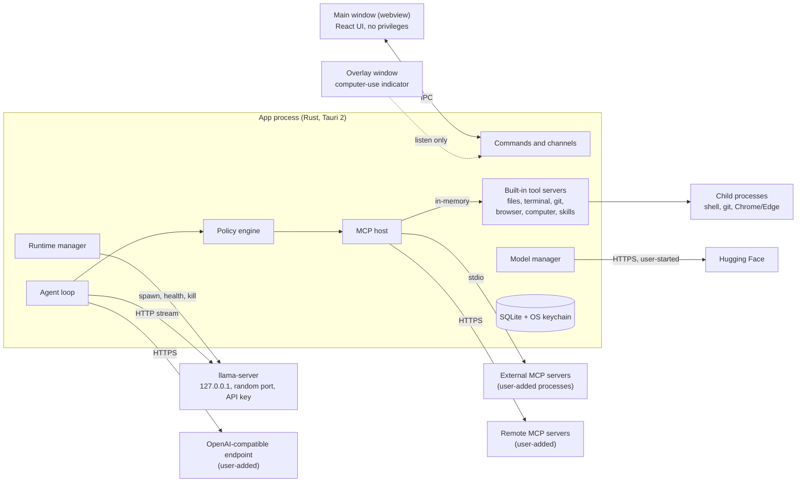
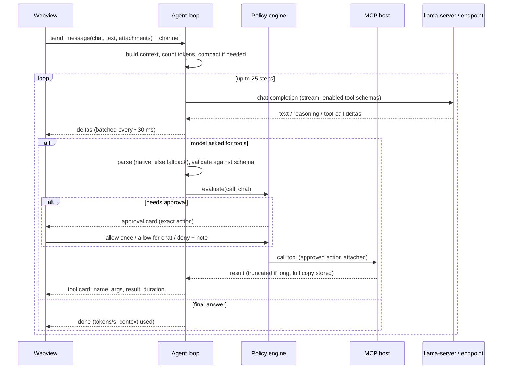

# Architecture

Status: **draft for approval**. No app code is written until this is approved.
Last verified against upstream sources: 2026-11-10.

The app is a local-first desktop app that gives locally run AI models chat, tools, skills and MCP. It ships as a Windows 10/11 x64 NSIS installer and a macOS Apple Silicon .dmg.

Contents:

1. [Decisions that need your call](#1-decisions-that-need-your-call)
2. [What the research changed](#2-what-the-research-changed)
3. [System overview](#3-system-overview)
4. [Process model](#4-process-model)
5. [Components](#5-components)
6. [Data flow](#6-data-flow)
7. [Inference runtime](#7-inference-runtime)
8. [Agent loop](#8-agent-loop)
9. [MCP host and built-in tools](#9-mcp-host-and-built-in-tools)
10. [Skills](#10-skills)
11. [Model manager and first run](#11-model-manager-and-first-run)
12. [Storage](#12-storage)
13. [Security model](#13-security-model)
14. [Frontend](#14-frontend)
15. [Errors](#15-errors)
16. [Packaging, CI and release](#16-packaging-ci-and-release)
17. [Testing](#17-testing)
18. [Dependencies](#18-dependencies)
19. [Milestones](#19-milestones)
20. [Risks and what I cannot verify from here](#20-risks-and-what-i-cannot-verify-from-here)

---

## 1. Decisions that need your call

Your earlier answers are recorded as: all four GPU builds inside the Windows installer (Vulkan, CUDA, ROCm, CPU); "Allow for this chat" is scoped to tool + scope; I stop after every milestone; MIT license; the Mac has 16 GB.

Research turned up facts that affect some of these. Each item below has a default. If you approve the document without comment, the default applies.

| # | Decision | Default | Why it needs you |
|---|---|---|---|
| D1 | What the Windows installer contains | **All four backends, as you asked.** The installer is about 1.0–1.2 GB and installs 2.3 GB. | Every app update re-downloads the whole installer, and Tauri's updater holds it in RAM while it does. The alternative is a ~150 MB installer with Vulkan + CPU, and CUDA and ROCm as one-click downloads in Settings. The backend code is identical either way, so this can change later without a rewrite. |
| D2 | Where the ROCm build comes from | The AMD-sponsored `lemonade-sdk/llamacpp-rocm` build for RX 9000-series cards, pinned by SHA-256. | llama.cpp's own Windows ROCm build no longer includes the ROCm runtime and does not work on a clean PC. The lemonade build is self-contained, but it is a nightly built on a pre-release ROCm, and it has an open performance bug on the RX 9070 XT. |
| D3 | Which backend "Auto" picks on AMD | **Vulkan.** ROCm is a manual choice in Settings. | On the RX 9070 XT, published numbers show Vulkan generating tokens faster than ROCm (104 vs 91 tokens/s on an 8B model) while ROCm reads prompts faster. AMD supports ROCm only on Windows 11 25H2. |
| D4 | Which CUDA build to bundle | CUDA 13.5. It needs an RTX 20-series / GTX 16-series or newer card and driver 580 or newer. Older NVIDIA cards use Vulkan. | The CUDA 12.4 build covers older cards but is 0.5 GB larger, which pushes the four-backend installer past the 2 GB limit of Tauri's installer format. Using it needs a custom installer template. Neither of us can test CUDA: you have no NVIDIA card. |
| D5 | Minimum macOS version | **13.3**, not 13.0. | The official llama.cpp macOS builds require 13.3. |
| D6 | Sign-in (OAuth) for remote MCP servers | Not in v1. Remote servers work with a URL plus static headers (kept in the keychain). A server that demands OAuth gets a clear "sign-in isn't supported yet" message. | Many hosted MCP servers use OAuth. The SDK supports it, so it can be added, but it is extra scope (browser hand-off, loopback listener, token storage). |
| D7 | Do skill reads need approval? | No. `load_skill` and `read_skill_file` run without a prompt, because you enabled the skill and they only read its folder. They still appear as tool cards and in the audit log. | Your spec says every tool call shows the exact action before it runs. Say so if you want these to prompt too. |
| D8 | How long "Allow for this chat" lasts | Until the app quits, or until you revoke it from the chat's permissions panel. It is not saved to disk. | Saving grants would mean a chat reopened next week acts without asking. |
| D9 | Default stop hotkey | `Ctrl+Alt+Backspace` on Windows, `Ctrl+Option+Delete` on macOS. Configurable. | It must not collide with an OS shortcut or with AltGr typing on international keyboards, which rules out `Ctrl+Alt+<letter>`. |
| D10 | Bundle identifier | `io.github.sugarhappy8.harnissui` | It names the data folder and keychain entries. It should not change after the first release. It is separate from the display name, which stays easy to change. |

---

## 2. What the research changed

I had each subsystem researched against primary sources and then re-checked by a second, independent pass, because my own knowledge predates several large upstream changes. The ones that shaped this design:

- **llama.cpp** now has stable version tags. This design pins **v0.9.0** (build `b12110`). Defaults changed: the port is 9931, `--jinja` is on by default, context and GPU layers auto-fit, and it starts four slots with an 8 GB prompt cache. The app overrides all of these explicitly.
- **llama-server is no longer one file on Windows.** It is a small launcher plus about 20 DLLs, so each backend is a folder, not a sidecar binary.
- **A backend that fails to load does not crash.** The server silently runs on CPU. The app therefore always names the device it expects, which turns a silent fallback into a detectable error.
- **llama-server reports capabilities itself.** `/props` returns whether the loaded chat template supports tool calls and whether vision is available. GGUF metadata gives the answer before load; `/props` is the authority after.
- **Tool-call parsing in llama.cpp was rewritten.** When the model's output doesn't match the expected format the server returns an error instead of text, so the app's fallback parser needs its own recovery path (section 8.3).
- **The Rust MCP SDK is at 3.9** and implements a new protocol revision (2026-07-28) that drops the old handshake. Almost every API name I knew from older versions has changed. The host must speak both the old and new revisions to reach existing servers.
- **Tauri is at 2.12.** Tauri's bundler signs sidecars but not files under Resources on macOS, which decides how llama.cpp is packaged there.
- **Hugging Face** returns a SHA-256 for every file, and downloads redirect to a CDN host with a one-hour signed URL, so resume must re-resolve the URL each time.

---

## 3. System overview



Three rules hold everywhere:

1. **The webview has no privileges.** It cannot spawn processes, read files or open sockets. It renders state and sends user intent to Rust.
2. **Every tool call passes through one policy engine in Rust**, whether the tool is built in or comes from a server the user added.
3. **The model can only produce text and tool-call requests.** Approvals, enabled tools, approved folders and settings change only through commands the UI sends after a user action.

---

## 4. Process model

| Process | Count | Started by | Talks to the app over | Ends when |
|---|---|---|---|---|
| App (Rust + Tauri) | 1 (single-instance lock) | User | n/a | User quits |
| Main window webview | 1 | App | Tauri IPC | App quits |
| Overlay webview | 0–1 | App, while computer use is active | Events (listen only) | Computer use ends |
| `llama-server` | 0–1 | Runtime manager | HTTP on 127.0.0.1 | Model switch, quit, or crash (then restarted) |
| Built-in tool servers | 6 tasks inside the app process | MCP host | In-memory MCP transport | App quits |
| External MCP server (stdio) | One process tree per enabled server | MCP host | stdin/stdout | Server disabled, app quits |
| Tool children | Per call | Built-in servers | Pipes, or CDP for the browser | Call ends, Stop, or timeout |
| Probes (`--list-devices`, `llama-fit-params`) | Short-lived | Runtime / model manager | stdout | Exit or 15 s timeout |

### 4.1 No orphans

Every child is started through one helper in the `runtime` crate. Nothing else in the codebase may spawn a process (enforced by a clippy `disallowed-methods` rule).

- **Windows:** the app creates one Job Object with `KILL_ON_JOB_CLOSE` at startup and assigns every child to it. If the app exits for any reason, including a crash or Task Manager, Windows kills every process in the job. Each tool call also gets a nested job so one call's tree can be killed on its own. Children are started with `CREATE_NO_WINDOW` so no console flashes.
- **macOS:** every child is the leader of its own process group, and Stop or quit signals the whole group. macOS has no kernel feature that kills children when the parent dies, so two more layers cover a crash of the app itself: (1) `llama-server` is started in its managed mode, in which it exits when its stdin closes; (2) other long-lived children are started through a small guard, which is the app's own binary re-executed in a `--guard` mode that watches the parent with kqueue and kills the group when the parent disappears.
- **Both:** on startup the app reads a file of child PIDs it wrote in the previous run and kills any that are still alive and still match by executable path and start time.

### 4.2 Stop

One cancellation token is created per agent turn. Child tokens go to the inference stream and to every running tool call. The Stop button and the global hotkey both cancel the root token. The hotkey is registered from Rust, so it works when the window is not focused.

| Target | What Stop does | Budget |
|---|---|---|
| Inference | Drops the HTTP stream; llama-server stops generating when the client disconnects | < 100 ms |
| Terminal and git commands | Kills the call's job / process group outright, with no graceful wait | < 200 ms |
| Browser | Cancels pending CDP calls and sends `Page.stopLoading` | < 300 ms |
| Computer use | Releases every key and mouse button the app has pressed (it tracks them), then hides the overlay | < 100 ms |
| External MCP tool | Sends the protocol's cancel notification and stops waiting. If the server keeps working for 2 s it is restarted | immediate |
| Pending approval card | Resolved as cancelled | immediate |

A test asserts the whole sequence finishes inside 1 second with a deliberately stuck command, a hung page and a held key.

---

## 5. Components

The Rust side is a Cargo workspace. Everything with logic worth testing lives in crates that do not depend on Tauri, so they compile and test quickly on any OS.

| Crate | Responsibility | Depends on |
|---|---|---|
| `policy` | Path sandbox, action descriptions, risk classification, grant matching, destructive-command detection. Pure logic. | none of the others |
| `store` | SQLite schema and migrations, audit log, keychain access | none |
| `runtime` | Spawn helper and process trees; llama.cpp backends: detect, probe, launch, health, restart | `store` |
| `models` | GGUF header reader, hardware detection, fit check, Hugging Face client, download manager, curated catalog | `store`, `runtime` |
| `mcp-host` | Connections to MCP servers (in-memory, stdio, Streamable HTTP), tool registry, config import | `store`, `runtime` |
| `tools` | The six built-in MCP servers | `policy`, `runtime`, `store` |
| `agent` | Providers (local and OpenAI-compatible), agent loop, tool-call parsing and repair, context management | `policy`, `mcp-host`, `store` |
| `src-tauri` (the app) | Tauri setup, windows, capabilities, commands, global hotkey, updater, overlay | all of the above |

The frontend (`src/`) is React 19 + TypeScript + Vite + Tailwind 4 with Radix UI primitives (section 14).

**App name.** The one constant is `productName` in `src-tauri/tauri.conf.json`. The Rust side reads it from Tauri's config at run time; the frontend imports it from the same file at build time. Window title, About box, User-Agent, MCP client name and prompts all derive from it. Crate and package names are neutral (`app`, `agent`, ...), so a rename touches one line.

**Repository layout**

```
src/                      React frontend
src-tauri/                Tauri app crate
  capabilities/           main.json, overlay.json
  resources/llama/        fetched at build time, not committed
  tauri.conf.json         base config (holds productName)
  tauri.windows.conf.json / tauri.macos.conf.json
crates/                   policy, store, runtime, models, mcp-host, tools, agent
catalog/models.json       curated model recommendations
llama.lock.json           pinned llama.cpp builds with URLs, sizes, SHA-256
scripts/                  fetch-llama, third-party notices
docs/                     guides (writing a skill, adding an MCP server)
.github/workflows/        ci.yml, release.yml
```

---

## 6. Data flow

### 6.1 One agent turn



Messages, tool calls and audit rows are written to SQLite as they happen, so a crash loses at most the tokens in flight.

### 6.2 Model download

Search → repo detail (file sizes and SHA-256) → fit check → download each file to `<name>.part` with HTTP Range → hash the finished file → compare with the published SHA-256 → atomic rename → read the GGUF header → register in the database. A split model or a model with a vision projector is one download group with one progress bar.

### 6.3 First run

Detect hardware (RAM, GPUs, probe backends) → pick the best entry from the bundled catalog that the fit check rates green → show one card with a Download button → download → load → open a new chat. That is three clicks: Get started, Download, and nothing else until the chat box. The same screen offers "Use a model I already have" (file picker) and "Connect Ollama / LM Studio".

---

## 7. Inference runtime

### 7.1 Pinning and layout

`llama.lock.json` pins llama.cpp **v0.9.0 (`b12110`)** and lists every archive the build needs with URL, size and SHA-256. `scripts/fetch-llama` downloads, verifies and unpacks them before `tauri build`, locally and in CI. Nothing follows "latest": upstream publishes several builds a day and renames assets when toolkits change.

A **backend** is a directory containing a complete `llama-server` and its libraries, plus a manifest entry. The runtime manager only ever sees "a directory and a manifest entry", whether the directory came from the installer or from a later download.

| Platform | Backend | Source | Packaged as |
|---|---|---|---|
| Windows | `vulkan` (default) | upstream `win-vulkan-x64` zip | `resources/llama/vulkan/` |
| Windows | `cpu` | upstream `win-cpu-x64` zip | `resources/llama/cpu/` |
| Windows | `cuda` | upstream `win-cuda-13.5-x64` + `cudart` zips (D4) | `resources/llama/cuda/` |
| Windows | `rocm` | `lemonade-sdk/llamacpp-rocm` gfx120X zip (D2) | `resources/llama/rocm/` |
| macOS | `metal` | upstream single-file `llama` binary (run as `llama serve`) | Tauri `externalBin`, so Tauri signs and notarizes it |

Notes:

- Windows backends go through Tauri's `bundle.resources` because `externalBin` flattens everything into one folder, and the four backends have DLLs with the same names.
- The macOS binary goes through `externalBin` because Tauri does not sign anything under `Resources`, and unsigned code there fails notarization. The single-file build has no dylibs, so there is exactly one extra binary to sign. If that build proves unsuitable, the fallback is the upstream tarball with every dylib signed by a script before `tauri build`.
- The Microsoft VC++ runtime DLLs are placed next to each Windows backend, because llama.cpp needs them and Windows does not always have them.
- The ROCm folder must sit at a path of at most about 118 characters or its kernel files exceed Windows' path limit. The app checks this and explains it if a custom install path is too deep.

### 7.2 Choosing a backend

1. List display adapters (vendor, name, dedicated VRAM) through DXGI on Windows. This only decides which backends are worth probing.
2. Probe each candidate by running its `llama-server --list-devices` with a 15 s timeout and parsing lines of the form `Vulkan0: <name> (<total> MiB, <free> MiB free)`. A start failure, non-zero exit, timeout or `(none)` marks the backend unusable, with the reason kept for the UI.
3. Pick by priority. NVIDIA: CUDA, then Vulkan, then CPU. AMD: Vulkan, then CPU (ROCm only if chosen, D3). Intel and others: Vulkan, then CPU. macOS: Metal.
4. Cache the result per backend version and GPU driver version. Re-probe when either changes or when the user asks.

Settings has **Backend: Auto / Vulkan / CUDA / ROCm / CPU** and a device picker for machines with more than one GPU. Your Ryzen 7900X has an integrated GPU next to the RX 9070 XT, so the app always passes the discrete card explicitly (`--device Vulkan0`, or `HIP_VISIBLE_DEVICES` for ROCm, which is known to crash if it picks the integrated GPU).

### 7.3 Launch

The app chooses a free port, generates a random API key for this launch and starts:

```
llama-server --host 127.0.0.1 --port <port> --no-webui --offline --jinja
             -m <model.gguf> [--mmproj <mmproj.gguf>]
             -c <context> -np 1 --device <device> -ngl <auto|n>
             --cache-ram <small> 
```

with the key in the `LLAMA_API_KEY` environment variable, so it never shows in the process list. `--jinja` is passed explicitly even though it is now the default. `--offline` stops llama-server from ever downloading anything. An explicit `-c` stops it from silently shrinking the context to fit.

The app never forwards an http(s) image URL to llama-server, because the server would fetch it itself. Images are always sent as inline data.

### 7.4 Lifecycle

```
Stopped → Starting (progress) → Ready → Stopping → Stopped
              ↓ failure                ↓ crash
           Failed (reason)        Restarting (max 3 in 5 min) → Ready | Failed
```

- **Health:** poll `/health` until 200, with a watcher on process exit and a timeout that scales with model size. Then read `/props` with the API key. A wrong-key response means another process owns the port, and the app picks a new port.
- **Load progress:** standalone llama-server exposes no progress number. The app starts it in the managed mode that llama.cpp's own multi-model router uses, in which the server writes `loading` state lines with a 0–1 progress value to stdout. This is an internal llama.cpp protocol, so it sits behind an adapter with a contract test that runs on every llama.cpp bump. If no progress lines arrive, the UI falls back to named stages ("Reading model", "Loading into GPU") with elapsed time.
- **Crash while Ready:** restart with the same arguments up to 3 times in 5 minutes, then stop and show the error. An in-flight turn ends with a clear message; nothing is retried silently.
- **Load failure:** no blind retry. The stderr tail is classified (out of memory, invalid device, missing runtime DLL, port in use) and mapped to a plain-language error with a next step (section 15).
- **Switching models:** stop the current server, start the new one, show progress. One local model at a time.
- **After load:** if a GPU was expected, the app checks the "offloaded N/M layers" log line and warns if the model ended up on CPU.

### 7.5 Providers

The agent loop talks to a `Provider` trait with two implementations:

- **Local:** the managed llama-server. Adds exact token counts (`/tokenize`, `/apply-template`), capabilities from `/props`, and tokens/s from the `timings` object.
- **OpenAI-compatible:** base URL + optional API key (keychain). Works with Ollama, LM Studio, vLLM and remote servers. The app probes what it can: model list from `/v1/models`, and context length and capabilities from Ollama's and LM Studio's native endpoints when they answer. Where the endpoint doesn't say, token counts are estimated and calibrated against the `usage` numbers it returns, and tool support is assumed until the endpoint rejects a tools request, at which point tools are switched off for that model with an explanation.

Both use streaming chat completions with `stream_options.include_usage`.

---

## 8. Agent loop

### 8.1 Capability detection

| Flag | Before load (from the GGUF header) | After load (authoritative) |
|---|---|---|
| Tool calling | Chat template mentions `tools` and `tool_calls` (the same two things llama.cpp checks) | `/props` → `chat_template_caps.supports_tool_calls` |
| Vision | A projector file is paired with the model (`general.architecture == "clip"`, matching embedding size) | `/props` → `modalities.vision` |
| Context length | `<arch>.context_length` | `/props` → `n_ctx` |

The GGUF reader is about 200 lines of our own code. It reads only the header, skips the multi-megabyte tokenizer arrays, and also works over HTTP Range so the model browser can show badges before download. The existing crates either load whole arrays or bring in a full llama.cpp build.

Badges show Tools, Vision and Context. When a model's template has no tool support, tools are switched off for chats using it and the UI says why: "This model's chat template has no tool-calling format, so it can't request tools. Pick a model with the Tools badge to use files, terminal or browser."

### 8.2 Loop

```
build request → stream → classify response
   ├─ final text                         → done
   ├─ tool calls (native)                ┐
   ├─ tool calls recovered from text     ┼→ for each call, in order:
   │                                     │    validate → policy → (approval) → run → truncate → append result
   │                                     ┘  → next step
   └─ server parse error                 → recovery (8.3) → next step
```

- **Step cap:** 25 model calls per turn by default (configurable). At the cap the loop stops and tells the user it hit the limit; it does not ask the model for one more summary.
- **Order:** `parallel_tool_calls` is sent as false. If a model returns several calls anyway they run one at a time, in order.
- **Cancellation:** checked between every stage and wired into the stream and each tool call (section 4.2).
- **One turn at a time** across the app in v1, because one local model with one slot serves one request.
- **Reasoning:** `reasoning_content` is streamed into a collapsible "Thinking" block and is not sent back in later requests unless the template says it supports that.

### 8.3 Tool-call parsing, repair and retries

1. **Native:** accumulate streamed `tool_calls` deltas by index.
2. **Fallback parser:** runs only when tools are enabled and no native call arrived. It recognises a fixed set of text shapes: `<tool_call>{...}</tool_call>`, a fenced `json` block or bare JSON object/array with `name` + `arguments` (or `parameters`), `[TOOL_CALLS][...]`, `<|python_tag|>{...}`, `<function=name>{...}</function>`. A candidate counts only if the name is an enabled tool **and** its arguments validate against that tool's schema, which keeps ordinary JSON in an answer from being mistaken for a call. Recovered calls are removed from the visible text and the card is marked "recovered from text".
3. **Server parse error:** when llama-server rejects the model's output as malformed (HTTP 500, or an error event mid-stream), the app retries the step once with thinking disabled, which is the known cause in most reports. A second failure is surfaced as an error.
4. **Repair before validation:** arguments double-encoded as a JSON string are decoded; `"5"` becomes `5` and `"true"` becomes `true` only where the schema demands that type.
5. **Validation:** against the tool's JSON Schema (compiled once per tool). On failure the tool is not run. The model gets a short error naming each bad field and what was expected.
6. **Retry budget:** 2 corrections per call and 5 per turn. After that the turn stops with "The model kept producing invalid tool calls", plus the last error under Copy details.

The parser is a pure function over text with a table-driven test suite, one fixture per model family.

### 8.4 Context management

Budget = context length − reserved output (the smaller of 4096 tokens and a quarter of the context) − a small margin.

- **Counting:** exact for local models, by asking llama-server to render and tokenize the actual request before sending it. Estimated and self-calibrating for remote endpoints. The UI shows "used / total" from the last real `usage` numbers.
- **Tool output cap:** each result is capped at the smaller of 8,000 tokens and 25% of the context, keeping the head and the tail, with a note in the middle: `[... 48,210 characters (about 12,000 tokens) omitted ...]`. The full output is stored and shown in the tool card. File and search tools take offset and limit arguments, so the model can page instead of relying on truncation.
- **Compaction, in two stages, when the next request would pass 80% of the budget:**
  1. Replace old tool results (not from the current turn) with one-line stubs.
  2. If still over, summarise the oldest turns with the same model in a separate tool-free request, keeping the system prompt and the most recent turns verbatim. The summary is stored as its own row. The original messages stay in the database and in the UI, under a "Earlier messages were summarised" divider.
- **Screenshots:** only the most recent few stay in context; older ones become stubs.
- **Tool schemas:** only tools that are enabled for this chat are sent. The UI warns past roughly 12 enabled tools, because small models get worse with many.

### 8.5 Prompt assembly

`system` = the chat's system prompt (per chat, editable, with a global default) + a short agent preamble (only when tools are on) + the skills index (names and descriptions only).

Tool results go back as tool-role messages wrapped in a delimiter that states the source and that the content is untrusted data. A closing delimiter appearing inside the content is escaped. The preamble tells the model that tool output is data and never instructions. That instruction is a courtesy to the model; the actual guarantee is structural and is described in section 13.5.

### 8.6 Attachments

- **Images** are accepted only when the selected model has vision. They are downscaled, re-encoded to PNG or JPEG and sent inline.
- **PDF and text files** have their text extracted locally and inserted into the message as a named, delimited block. Long documents are truncated to a token budget with a note. There is no retrieval index in v1.

---

## 9. MCP host and built-in tools

### 9.1 One path for all tools

The host keeps one connection object per server. Built-in servers connect over an in-memory transport; external ones over stdio or Streamable HTTP. From the registry upward (tool list, per-tool toggles, policy, approval cards, audit log, cancellation) there is no difference.

- **Naming:** built-in tools have short fixed names (`read_file`, `run_command`, `browser_click`). External tools are always exposed as `<server>__<tool>`, so an added server can never shadow a built-in.
- **In-memory transport:** typed message channels, with no serialisation and no message size cap. The stdio and byte-stream transports silently drop any message above 16 MiB, which a screenshot could reach.
- **Results:** tool failures come back as error results the model can read, not as protocol errors.

### 9.2 External servers

- **Config:** the same `mcpServers` JSON Claude Desktop uses (`command`, `args`, `env`), extended with `type`, `url` and `headers` for remote servers. The paste box also accepts the VS Code (`servers`) and Cursor shapes. Values in `env` and `headers` move to the keychain on save.
- **Spawn:** resolve the command to an absolute path first. On Windows `npx` is a `.cmd` shim that a plain spawn does not find. On macOS, apps started from Finder don't inherit the shell's PATH, so the app computes the login-shell PATH once at startup, with a timeout, and passes it to children.
- **Missing runtime:** if the command is `npx`/`node`, `uvx`/`uv`/`python` or `docker` and it can't be found, the server shows "This server needs Node.js, which isn't installed" with a link, instead of a spawn error.
- **Handshake:** try the 2026-07-28 revision, fall back to the older handshake, and remember which one each server speaks. A 60 s start-up timeout applies, because the SDK has none.
- **Status and logs:** Starting / Ready / Failed (reason) / Stopped per server. stderr is drained into a ring buffer and a log file, and its tail is shown next to any start-up error.
- **Transports not supported:** the legacy HTTP+SSE transport (the SDK removed it). Such an entry is first tried as Streamable HTTP, then reported as unsupported with a pointer to the `mcp-remote` bridge.
- **Server-initiated requests:** sampling is refused, roots returns an empty list, elicitation is declined. These are the SDK defaults and they never hang.
- **Trust warning:** adding a server shows a dialog that it runs with the user's own permissions and can read and change anything they can. The acknowledgement is recorded.
- **Scope:** tools only. MCP resources and prompts are out of v1.

### 9.3 Built-in servers

| Server | Tools | On by default |
|---|---|---|
| `files` | `list_dir`, `read_file`, `search_files`, `write_file`, `edit_file`, `delete_file` | yes |
| `terminal` | `run_command` | **no** |
| `git` | `git_status`, `git_diff`, `git_log`, `git_commit`, `git_clone`, `git_pull`, `git_push` | yes |
| `browser` | `browser_navigate`, `browser_snapshot`, `browser_read_text`, `browser_click`, `browser_type`, `browser_fill_form`, `browser_press_key`, `browser_screenshot`, `browser_back` | yes |
| `computer` | `computer_screenshot`, `computer_click`, `computer_move`, `computer_drag`, `computer_scroll`, `computer_type`, `computer_key` | **no**, and only offered for vision models |
| `skills` | `load_skill`, `read_skill_file` | yes, when any skill is enabled |

Every group and every tool can be toggled per chat.

**Files.** All access is confined to folders the user approved (globally or for one chat). Sandbox rules are in section 13.4. Writes show a diff computed against the current file. The file's hash is recorded with the diff, and the write is refused if the file changed between preview and apply.

**Terminal.** One command per call, in PowerShell on Windows and zsh on macOS, with a working directory that must be inside an approved folder. Output streams live into the tool card. Default timeout 120 s (configurable per call up to a ceiling), with a Kill button on the card. Kill and timeout take down the whole process tree.

**Git.** Uses the system `git` when it is on PATH and falls back to libgit2 when it isn't. Push always asks. With libgit2, operations that need credentials the app doesn't have fail with a message recommending installing git.

**Browser.**

- *Launch:* the app finds the installed Chrome or Edge itself (standard install paths, the registry on Windows, a user override) and starts it with `--user-data-dir` inside the app's data folder. It never points at the user's own profile, so it never sees their cookies or logins. Chrome 136+ refuses remote debugging on the default profile; a custom directory is the supported route.
- *Connection:* `--remote-debugging-port=0`, then read the port Chrome writes into the profile folder. The port is on loopback only. Chrome rejects debugging connections that carry a web `Origin`, so a web page cannot attach; another program already running as the user could, which is the same access it already has to the profile folder.
- *CDP client:* a small one of our own (about 25 methods and 10 events over a WebSocket). The maintained Rust crate pins an old protocol and silently drops events it can't parse, which would leave a paused form submission hanging forever. Its defaults (headless, ignore certificate errors, fixed 800×600 viewport) are also wrong for this job.
- *Reading pages:* an accessibility-tree snapshot with element references (`- button "Sign in" [ref=e12]`), limited to the viewport and capped at 2–4k tokens by default. A full snapshot of an ordinary page measures 15–19k tokens, which a small model cannot afford. `browser_read_text` returns readable text with its own cap, and a find tool returns only matching elements.
- *Form submission gate, two layers:*
  1. Intent: a click that resolves to a submit control, Enter in a form field, or a script calling `submit()` asks first.
  2. Enforcement: CDP pauses every non-GET document, XHR and fetch request that follows an agent action until the user approves, and fails it on Deny. Paused requests are always released on Stop, timeout or crash.
- *Known gaps in that gate:* WebSocket messages, GET links that change state, and requests from service workers are not caught. It is defence in depth, and SECURITY.md will say so.

**Computer use.**

- *Capture and input:* screen capture through the `xcap` crate; keyboard through `enigo`; mouse on Windows through our own `SendInput` code, because `enigo` can only address the primary monitor there. Both sit behind two small traits so either can be swapped. On macOS a ScreenCaptureKit path is kept as a fallback, because the capture call `xcap` uses is deprecated.
- *Coordinates:* one monitor per screenshot. The monitor's origin, pixel size and scale are stored with the image and used to map the model's answer back: physical pixels on Windows (the app is per-monitor DPI aware), points on macOS, negative origins included.
- *Model conventions:* a per-model setting with three modes, because grounding models disagree: pixels of the resized image (Qwen2.5-VL family), a 0–1000 grid (Qwen3-VL / Qwen3.5 family), and 0–1000 boxes with y first (Gemma 4). The app resizes the screenshot itself to the exact size llama.cpp would resize it to, so the model's coordinates refer to the image the app knows. A one-click calibration test in Settings shows whether a model clicks where it should.
- *Indicator:* a click-through, always-on-top overlay with a border and "AI is controlling this computer. Press <hotkey> to stop."
- *Stop:* all input goes through one injector that records every key and button it holds. Stop, a panic and normal exit all release everything recorded plus every modifier and mouse button.
- *Limits, stated in the UI:* Windows blocks synthetic input into elevated windows without reporting an error, so the tool checks the target window first and returns "that window is running as administrator and can't be controlled".
- *macOS permissions:* a guided screen checks Screen Recording and Accessibility without triggering the system prompt, opens the right Settings pane on a button click, polls for the grant, and offers Restart where macOS requires it.

---

## 10. Skills

- **Format:** the Agent Skills format, unchanged: a folder with `SKILL.md` (YAML frontmatter with `name` and `description`, then Markdown) and optional `scripts/`, `references/`, `assets/`.
- **Storage:** one folder per skill under the app's data directory, plus an enabled flag in the database.
- **Progressive loading:** the system prompt carries only each enabled skill's name and description. `load_skill(name)` returns the full `SKILL.md` and the skill's folder path. `read_skill_file(name, path)` returns one referenced file, sandboxed to the skill's folder with the same path rules as the files tool.
- **Scripts** run only through the terminal tool with its normal approvals. If the terminal is off, `load_skill` says so, so the model doesn't try.
- **UI:** import from a folder or a zip, create, edit with live frontmatter validation that follows the spec's rules, enable, disable, delete.
- **Zip import** rejects absolute paths, `..`, symlinks and oversized archives.

---

## 11. Model manager and first run

**Search.** `GET https://huggingface.co/api/models?filter=gguf&search=...` with cursor paging. Each result shows downloads, license, and a gated badge. The detail view makes one call that returns every file with its size and SHA-256. Files are classified in a fixed order: not `.gguf` → ignored; projector (`mmproj`) → attached to its model; helper files (`imatrix`, draft-model sidecars) → hidden; split shards → grouped and summed; then the quantization label is read from the filename.

**Download.** Two HTTP clients: one talks to `huggingface.co` with the optional token and never follows redirects; the other fetches the CDN URL with no credentials, only if the host is on an allowlist. Resume uses `Range` and re-resolves the signed URL every time, because it expires after an hour. The finished file is hashed and compared before it is renamed into place. Pause, resume and cancel are per download group. Interrupted downloads resume after an app restart.

**Gated models.** 401 means "add a Hugging Face token"; 403 means "open the model page and accept its terms". The token lives in the keychain and is validated when pasted.

**Fit check**, two tiers:

1. *Before download:* weights (file sizes) + KV cache from the GGUF header (`context × layers × (key + value length) × KV heads × 2 bytes`, the formula llama.cpp uses) + a stated allowance for compute buffers + the projector, compared against free VRAM, Metal's working-set limit, or RAM.
2. *Once the file is local:* the bundled `llama-fit-params` tool, which measures the real requirement without allocating.

The verdict is green (fits with at least 1 GB spare), yellow (fits only with a smaller context or with some layers on CPU) or red, each with one sentence, for example: "Needs about 13.1 GB; your GPU has 15.2 GB free. Fits."

**Curated catalog.** `catalog/models.json` is bundled with the app and holds, per memory tier, a ranked list of models with pinned repo commit, files, sizes, SHA-256, context, capabilities and license. No model name appears in code. First run takes the highest-ranked entry that is green on the detected hardware. "Refresh" downloads a newer catalog from this repo's latest release; the app accepts it only if its signature verifies against the same public key the updater uses. Every catalog entry must pass a real tool-call round trip under the pinned llama.cpp before it is added.

**Also:** delete models, disk usage per model and in total, import an existing GGUF (registered in place, not copied), and a configurable models folder.

---

## 12. Storage

**SQLite** (one file in the app data folder, WAL mode, versioned migrations):

| Table | Holds |
|---|---|
| `chats` | title, model, system prompt, per-chat tool toggles |
| `messages` | a tree (`parent_id`) so regenerate and edit-and-resend keep the earlier branch; role, content parts, token counts, tokens/s |
| `messages_fts` | full-text index for history search |
| `tool_calls` | server, tool, arguments, status, timings, result summary, pointer to the full result |
| `summaries` | compaction summaries and the message range each covers |
| `attachments` | file metadata and extracted text; bytes live in a content-addressed folder |
| `audit_log` | append-only (section 13.7) |
| `models`, `downloads` | installed models with their GGUF summary; download state for resume |
| `providers`, `mcp_servers`, `mcp_tool_prefs`, `skills`, `approved_folders`, `settings` | configuration, never secrets |

**Keychain** (Windows Credential Manager, macOS Keychain): provider API keys, the Hugging Face token, MCP `env` and header values. One entry per secret, because Windows caps an entry at about 2.5 KB. The database stores only references. An exported MCP config omits secret values.

**Files on disk:** models folder (configurable), skills, attachments, the browser profile, logs. Logs rotate, stay local, and are reachable from "Open logs folder".

**Nothing leaves the machine** unless the user starts one of the network actions in section 13.6.

---

## 13. Security model

`SECURITY.md` will carry the full threat model. This section is the design it will describe.

### 13.1 Trust boundaries

| Party | Trust | What limits it |
|---|---|---|
| User | Trusted | n/a |
| App's Rust code | Trusted | Tests, review |
| Webview UI | Low privilege; it renders untrusted text | Capabilities, CSP, no remote content |
| Model output | Untrusted | Can only become text or a tool-call request |
| Tool results, web pages, file contents | Untrusted data | Never reach the policy engine or settings |
| External MCP servers | Run with the user's permissions; their output and descriptions are untrusted | Warning on add; every call goes through policy; their own hints never lower a prompt |
| llama-server | Trusted binary, untrusted output | Loopback only, random port, per-launch key |
| Remote endpoints | User-chosen | Requests go only to the configured base URL |

### 13.2 Webview lockdown

- **Capabilities:** two explicit capability files. `main` gets core defaults plus open/save dialogs, opening external links and clipboard write. `overlay` can only listen to events. There is no shell, filesystem or HTTP plugin in the app at all. Process spawning and file access happen in Rust and are not reachable from JavaScript.
- **Command ACL:** app commands are declared in the build script, so only the `main` window may call them. Without this, Tauri lets any local window call any command.
- **CSP:** `default-src 'self'; script-src 'self'; connect-src 'self' ipc: http://ipc.localhost; img-src 'self' data: blob:; style-src 'self' 'unsafe-inline'; object-src 'none'; frame-src 'none'; form-action 'none'; base-uri 'self'`. There is no `http://127.0.0.1` in `connect-src`: the webview never talks to llama-server; Rust proxies the stream.
- **No remote content:** navigation to anything but the app's own origin is blocked in Rust, and so is `window.open`. Links open in the system browser. Markdown is rendered without raw HTML. Images in model output load only from `data:` or `blob:`, so a model cannot leak data through an image URL.
- **Verification:** CSP isn't enforced under `tauri dev`, so CI checks it against a built app.

### 13.3 Policy engine

Every tool call becomes an **action**: what kind it is, the exact thing it touches, a preview for the card, a scope key and a risk level. Built-in tools have their own describers. External tools get a generic one that shows the server, the tool and the full arguments.

Evaluation order:

1. Tool not enabled for this chat, or server not ready → refused; the model is told the tool is unavailable.
2. Hard limits (path outside approved folders, working directory outside approved folders, non-http(s) URL) → denied with a reason; no prompt.
3. Risk is **always ask** → approval card with *Allow once* and *Deny* only.
4. A grant for this chat matches the tool and scope → allowed, logged as "allowed by grant".
5. Otherwise → approval card with *Allow once*, *Allow for this chat*, *Deny* (optional note, sent back to the model).

The approved action travels with the call. The tool executes that action and re-checks it immediately before the side effect, so what runs is what was shown.

**What "Allow for this chat" covers**

| Tool | A grant covers | Always asks, whatever was granted |
|---|---|---|
| `read_file`, `list_dir`, `search_files` | Reads inside the same approved folder | n/a |
| `write_file`, `edit_file` | Writes inside the same approved folder | `delete_file`; a write that would replace a file with an empty one |
| `run_command` | The same program in the same working directory | Recursive or forced deletes (`rm -r`, `rm -f`, `del /s`, `rmdir /s`, `Remove-Item -Recurse`), elevation (`sudo`, `runas`, `Start-Process -Verb RunAs`), disk and system commands (`format`, `diskpart`, `mkfs`, `dd`, `shutdown`), `git push`, and any command the parser cannot fully break down: pipes into a shell, `Invoke-Expression`, `-EncodedCommand`, `eval`, command substitution |
| `git_status`, `git_diff`, `git_log` | The same repository | n/a |
| `git_commit`, `git_pull`, `git_clone` | The same repository (clone: the same remote host) | `git_push` |
| `browser_navigate`, read and snapshot, click, type | The same site (scheme + host + port) | Form submission, file upload |
| `computer_*` | The same kind of action (look / pointer / keyboard) | n/a (the overlay and Stop are the control here) |
| External MCP tool | That tool on that server | A tool whose server marks it destructive |
| `load_skill`, `read_skill_file` | No prompt (D7) | n/a |

The terminal classifier fails closed: a command is grantable only if it parses into simple commands that are each recognised as safe to grant. Anything else asks every time. It is a convenience boundary, not a sandbox. The terminal tool runs commands with the user's permissions, and the UI says so when the terminal is turned on.

A hint from an external server that a tool is read-only is never used to skip a prompt. A hint that a tool is destructive is honoured.

### 13.4 Path sandbox

For every path a file tool receives:

1. Reject NUL bytes, Windows device names and alternate data streams.
2. Resolve against the approved folder, then canonicalise, following symlinks. For a path that doesn't exist yet, canonicalise the deepest existing ancestor and append the remainder, which must not contain `..`.
3. Require the canonical path to be inside the canonical form of an approved folder, compared component by component and case-insensitively on Windows and on case-insensitive macOS volumes.
4. Re-check at open time and refuse if the final component is a symlink that was not there at preview.

`../` escapes, symlinks pointing out, Windows junctions, `\\?\` and UNC forms, 8.3 short names and case tricks each have unit tests, and property tests generate random path shapes.

### 13.5 Untrusted content cannot change permissions

This is enforced by structure, not by prompt wording:

- No tool, built-in or external, can change grants, approved folders, enabled tools or settings. Those are changed only by commands the UI sends.
- The agent loop holds a read-only view of policy state.
- An approval is resolved by a random request ID created in Rust, delivered only to the main window.
- Tool descriptions from external servers are length-capped and shown to the model as descriptions; they are not merged into the system prompt's instructions.

Residual risk: a script running inside the main window could click "Allow" on the user's behalf. The CSP, the absence of raw HTML and the absence of remote content are what prevent that script from existing.

### 13.6 Network use

All outbound HTTP from the app goes through one module, and each request carries a reason from this fixed list. A lint forbids creating an HTTP client anywhere else.

| Reason | Trigger | Hosts |
|---|---|---|
| Model search and download | User searches or downloads | `huggingface.co` and its CDN |
| Catalog refresh | User clicks Refresh | this repo's GitHub releases |
| Update check | User clicks Check, or turned on automatic checks (off by default) | this repo's GitHub releases |
| Remote endpoint | User added it | the configured base URL |
| Remote MCP server | User added it | the configured URL |
| Local endpoint probe | User clicks "Connect Ollama / LM Studio" | `127.0.0.1` |

Outside that module: `git clone/pull/push` (the git tool), whatever the browser tool's Chrome does (launched with background networking, sync and component updates disabled), and whatever an external MCP server does on its own.

There is no telemetry, no crash upload and no account. With no model downloaded and nothing clicked, the app makes no network request.

### 13.7 Audit log

One append-only row per tool call: time, chat, server, tool, full arguments, the action preview, risk level, decision (allow once / allow for chat / allowed by grant / denied / cancelled / refused by policy), who decided, any deny note, result status, a result summary and the duration. Viewable in the app with filters, and exportable as JSON Lines or CSV.

---

## 14. Frontend

- **Stack:** React 19, TypeScript, Vite, Tailwind 4, Radix UI primitives for dialogs, menus, tooltips and focus handling. Zustand for client state. No router; the app is one window with panels.
- **IPC:** typed wrappers around `invoke`, with the Rust types exported to TypeScript at build time so the two sides cannot drift. Streaming uses a Tauri channel per turn; Rust batches deltas every 30 ms or so.
- **Chat view:** virtualised message list; Markdown with code highlighting and no raw HTML; collapsible Thinking and tool cards (name, arguments, result, duration, live output for the terminal); approval cards inline with the diff, command, path or URL shown in full.
- **Screens:** chat, history sidebar with search / rename / delete, model manager, tools and permissions for the current chat, skills, MCP servers, audit log, settings, first run.
- **Themes:** light, dark and system, through CSS variables.
- **Keyboard:** new chat, search history, focus input, stop, toggle sidebar, open settings, plus a shortcut sheet.
- **Accessibility:** full keyboard reach, visible focus, ARIA live region for streamed text, reduced-motion support, contrast checked in both themes.

---

## 15. Errors

Every error that reaches the UI has four parts: a code, a plain-language message, what to do next, and technical details behind **Copy details**. Raw errors and stack traces go to the log file only.

| Situation | Message | Next step offered |
|---|---|---|
| Model too big | "This model needs about 21 GB but only 15 GB of GPU memory is free." | Use a smaller context / run part on CPU / pick a smaller model |
| Port in use | Handled silently by picking another port. Shown only if several attempts fail | Restart the app |
| Download interrupted | "The download stopped at 62%. Nothing was lost." | Resume |
| GPU driver missing or outdated | "Your graphics driver didn't accept the Vulkan backend." | Update the driver (vendor link) / switch to CPU for now |
| MCP server failed to start | "'filesystem' didn't start: Node.js isn't installed." | Install Node.js / open server logs |
| Model has no tool support | See 8.1 | Pick a model with the Tools badge |
| Hash mismatch after download | "The downloaded file doesn't match the published checksum." | Download again |
| Gated model | "This model requires accepting its terms on Hugging Face." | Open model page / add token |
| Backend crashed repeatedly | "The model stopped unexpectedly three times." | Copy details / try another backend |

---

## 16. Packaging, CI and release

- **`ci.yml`** (every push and PR): format, clippy, Rust tests, frontend lint and tests, then `tauri build` on `windows-latest` and `macos-latest`, uploading the unsigned installer and .dmg as workflow artifacts. Those artifacts are what you install to test a milestone. CI builds use a **lite** flavour (Vulkan + CPU) to stay fast; a manual run or a tag builds the **full** flavour.
- **`release.yml`** (every `v*` tag): `tauri-apps/tauri-action@v1` builds NSIS (`--bundles nsis`) and macOS (`--target aarch64-apple-darwin --bundles app,dmg`), creates a draft GitHub release, and uploads the updater manifest.
- **Windows installer:** NSIS, per-user install (no admin prompt), WebView2 offline installer embedded in the full flavour so installation needs no network.
- **Signing, prepared with placeholders:**
  - macOS: Developer ID + notarization through the `APPLE_*` secrets. Until they exist the build is ad-hoc signed.
  - Windows: a `signCommand` in a separate config file, used only when the signing secrets exist.
  - The README will document opening unsigned builds: right-click → Open (or Privacy & Security → Open Anyway) on macOS; "More info → Run anyway" on Windows SmartScreen.
- **Updates:** Tauri's updater with its signature check. The app never checks on its own unless the user turns that on. The check runs in Rust; the webview has no updater permission.
- **Licenses:** `LICENSE` (MIT) and a generated `THIRD-PARTY-NOTICES` covering llama.cpp, its embedded libraries, LLVM OpenMP, the ROCm components, a reference to the NVIDIA CUDA EULA, plus every Rust crate and npm package. It ships in the installer and is shown in About.

---

## 17. Testing

| Layer | What | Notes |
|---|---|---|
| Unit (mandatory) | Path sandbox, permission rules, tool-call parsing | Table-driven and property-based |
| Unit | GGUF reader, fit estimate, quantization and split-file parsing, destructive-command classifier, context compaction, error mapping | Real GGUF headers as fixtures |
| Integration | Agent loop against a scripted fake OpenAI-compatible server and in-memory fake MCP servers: approvals, retries, step cap, cancellation, truncation | No model needed, runs anywhere |
| Contract | The pinned llama-server on each CI OS with a tiny test model: flags accepted, `/health`, `/props`, `--list-devices` format, load-progress lines, streaming tool calls | Runs on every llama.cpp bump |
| Stop | The 1-second guarantee with a stuck command and a held key | Windows and macOS CI |
| Frontend | Reducers for streamed events, approval card, diff view | Vitest |
| Manual | A written checklist per milestone for your two machines | GPU paths can only be tested this way |

---

## 18. Dependencies

Each has a one-line reason. Exact versions are pinned in the lockfiles; the table is filled in fully as each dependency is added, and the milestone summary lists the new ones.

| Dependency | Why |
|---|---|
| `tauri` 2.12, `tauri-build` | The required shell |
| `tauri-plugin-global-shortcut` | Global stop hotkey |
| `tauri-plugin-updater` | Signed, opt-in updates |
| `tauri-plugin-dialog` | Native open/save dialogs |
| `tauri-plugin-opener` | Open links and folders in the OS |
| `tauri-plugin-single-instance` | One app instance, so one llama-server and one database writer |
| `tauri-plugin-clipboard-manager` | "Copy details" and copy buttons |
| `rmcp` 3.9 (pinned) | The official Rust MCP SDK, as required |
| `tokio`, `tokio-util` | Async runtime; cancellation tokens |
| `reqwest` | HTTP client for providers, Hugging Face and remote MCP |
| `serde`, `serde_json` | Serialisation |
| `rusqlite` (bundled SQLite) | Storage with full-text search, no system dependency |
| `keyring` | OS keychain on both platforms |
| `jsonschema` | Validate tool arguments |
| `process-wrap` | Job Objects and process groups; the same crate rmcp uses |
| `windows` | DXGI adapter info, Job Objects |
| `sysinfo` | RAM and CPU info |
| `sha2` | Verify downloads |
| `similar` | Diffs for write previews |
| `git2` | Git fallback when system git is missing |
| `zip` | Skill import |
| `tracing`, `tracing-appender` | Local rotating logs |
| `thiserror` | Typed errors |
| `proptest` (dev) | Property tests for the sandbox and parser |
| React, Vite, TypeScript, Tailwind | The required frontend stack |
| Radix UI | Headless accessible components |
| Zustand | Small state store |
| `react-markdown`, `remark-gfm` | Safe Markdown rendering |

Still to choose, with the choice justified when it lands: PDF text extraction, CDP client, input and screen-capture crates, YAML frontmatter parser, syntax highlighter.

---

## 19. Milestones

I stop after each one with: what works, how to test it by hand, known issues, and any TODOs.

| | Delivers |
|---|---|
| **M0** | This document approved. Workspace scaffold, locked-down capabilities and CSP, CI building an installable empty app on both OSes |
| **M1** | Backend fetch and lock file, runtime manager (probe, launch, health, restart, no orphans), chat with a GGUF from disk, streaming, stop, OpenAI-compatible endpoints, SQLite history |
| **M2** | GGUF reader and badges, hardware detection, fit check, Hugging Face search and downloads, catalog, first-run flow |
| **M3** | Agent loop, MCP host (in-memory, stdio, HTTP), policy engine and approval cards, stop hotkey, audit log, files tool |
| **M4** | Terminal and git tools, destructive-command classifier |
| **M5** | Skills |
| **M6** | Browser tool |
| **M7** | Computer use and overlay |
| **M8** | Error coverage, themes, accessibility pass, signing, updater, notices, release build |

---

## 20. Risks and what I cannot verify from here

I work in a Linux container with no GPU, no Windows and no macOS. I can compile and test the logic crates and run the frontend. Everything platform-specific is verified by CI building on both OSes and by you running the manual checklist.

| Risk | Mitigation |
|---|---|
| GPU paths (Vulkan on the RX 9070 XT, ROCm, Metal on the M5) can't be run in CI | Probe output and logs are captured in "Copy details"; the M1 checklist exercises each backend on your machines first |
| Nobody on this project can test CUDA | Shipped as best effort and labelled so, with automatic fallback to Vulkan |
| ROCm build is a nightly with an open regression on your card | Opt-in, pinned by hash, benchmarked against Vulkan in the M1 checklist, removable without code changes |
| llama.cpp moves fast and its log and stdout formats are not a stable API | One pinned build; all parsing behind adapters with contract tests |
| The load-progress protocol is internal to llama.cpp | Adapter with automatic fallback to stage text |
| rmcp ships breaking changes often | Exact version pin; all SDK use confined to `mcp-host` and `tools` |
| Small models call tools unreliably | Fallback parser, repair, bounded retries, tested catalog entries, few tools by default |
| Third-party binaries (llama.cpp, ROCm, CUDA runtime) are unsigned | Tauri signs them when Windows signing is configured. Whether signing NVIDIA's DLLs is compatible with NVIDIA's license terms is a question for you before the first signed release |
| A 1 GB+ installer makes updates heavy | D1 offers the small-installer alternative |
| macOS loses Screen Recording and Accessibility grants on each unsigned rebuild | Documented in the M7 checklist; goes away with Developer ID signing |
